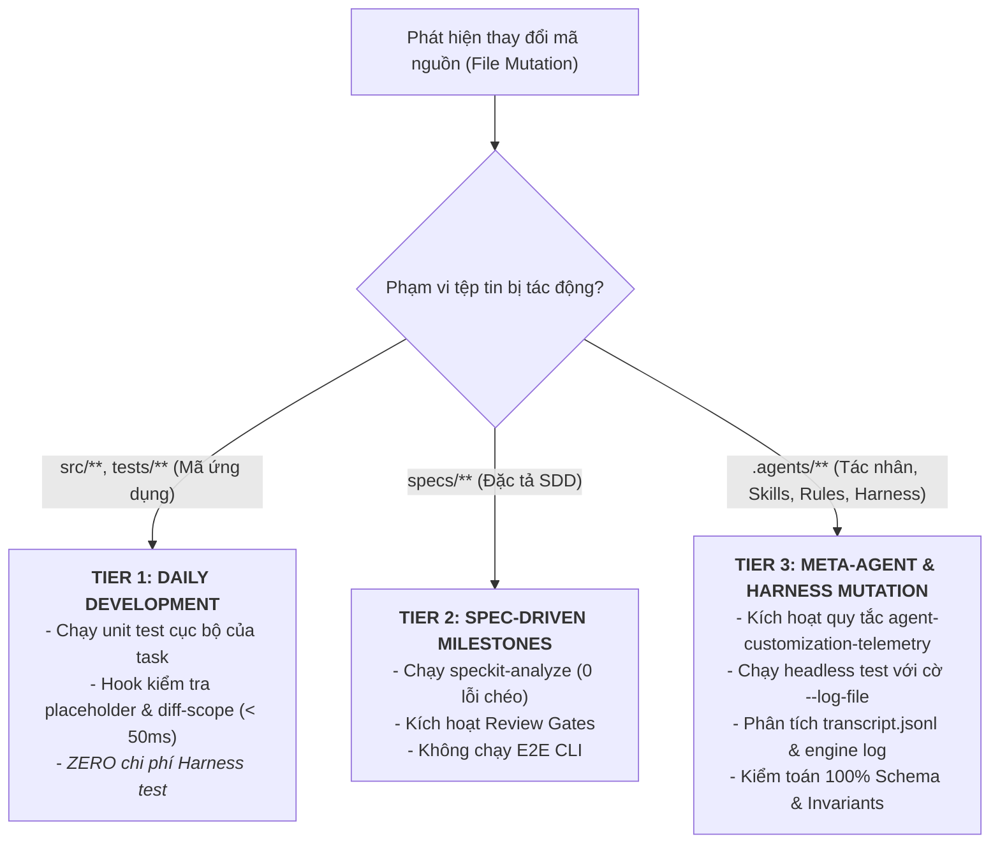

# Quy Chuẩn Quản Trị Hệ Thống Tác Nhân & Xác Thực Thực Nghiệm Qua Log (Agent Customization & Telemetry Verification)

Tài liệu này xác lập các nguyên tắc kỹ thuật phòng thủ bất biến khi can thiệp, cấu hình, mở rộng hoặc kiểm thử các thành phần trong thư mục `.agents/` (Custom Subagents, Skills, Rules, Hooks, Scripts và Evaluation Harness).

---

## 1. Tiên Đề "Log-First Verification" (Nhật Ký Là Nguồn Chân Lý Duy Nhất)

### 1.1. Hiện tượng "Ảo ảnh Phản hồi" (The Response Illusion)
- Mô hình ngôn ngữ lớn (LLM) là bộ sinh xác suất. Khi được hỏi về khả năng vận hành hoặc sự hiện diện của một Skill/Rule, Agent có xu hướng tự sinh ra câu trả lời logic, mạch lạc khẳng định "Đã sẵn sàng" hoặc "Đã nhận diện", ngay cả khi:
  - Tệp `SKILL.md` chưa từng được nạp vào bộ nhớ.
  - Đường dẫn cấu hình trong Frontmatter bị sai lệch khiến Engine bỏ qua.
  - Công cụ gọi bị lỗi deprecation hoặc phân quyền bị từ chối ngầm.
- Thuộc tính `status: "SUCCESS"` từ lệnh CLI chỉ phản ánh tiến trình hệ điều hành kết thúc với Exit Code 0, hoàn toàn KHÔNG chứng minh tính đúng đắn về ngữ nghĩa và cấu hình của hệ thống tác nhân.

### 1.2. Kỷ luật Bắt buộc Kiểm Tra Log Cơ Học
Mọi hoạt động thẩm định hoặc kiểm thử Agent/Skill bắt buộc phải thu thập và kiểm tra trực tiếp qua hai nguồn chứng cứ cơ học:
1. **Engine Log (`--log-file <path>`)**:
   - Quét tìm dòng log đăng ký: `manager.go:* Reloading system slash commands and skills` để xác nhận Engine đã phát hiện Skill.
   - Quét tìm các cảnh báo nghiêm trọng: `Tool "..." is deprecated`, `failed to get path`, `syntax error in frontmatter`.
2. **Trajectory Transcript (`transcript.jsonl` / `transcript_full.jsonl`)**:
   - **Xác thực Tool Call thực tế**: Agent phải có bước gọi công cụ (ví dụ: `tool_calls: [{"name": "read_file", "args": {"Path": ".../SKILL.md"}}]`) để nạp tri thức từ file nghiệp vụ. Nếu không có tool call đọc `SKILL.md`, mọi phát biểu của Agent đều bị coi là phỏng đoán giả định vô căn cứ.
   - **Đối soát Token thực tế**: Đối chiếu `input_tokens` và `output_tokens` với hạn ngạch token budget để đảm bảo không bị Context Bloat.

---

## 2. Quy Chuẩn Cấu Hình Chuẩn Hóa (Configuration Hygiene)

Khi chỉnh sửa bất kỳ tệp tác nhân nào trong `.agents/agents/*.md`, bắt buộc tuân thủ bit-for-bit:

### 2.1. Chuẩn Hóa Danh Sách `skills:`
- **Customization Discovery Root**: Thư mục `.agents/` là gốc khám phá của dự án.
- **Quy tắc đường dẫn tương đối**: Đường dẫn của skill trong YAML Frontmatter **BẮT BUỘC** khai báo theo dạng `skills/<skill_name>` (tính từ gốc `.agents/`), ví dụ:
  ```yaml
  skills:
    - skills/speckit-constitution
    - skills/speckit-checklist
    - skills/speckit-analyze
    - skills/speckit-converge
  ```
- **Ranh giới cấm**: **TUYỆT ĐỐI CẤM** gắn thêm tiền tố `.agents/` (ví dụ: `.agents/skills/...`). Việc này gây lỗi phân giải đường dẫn kép (`.agents/.agents/skills/...`), làm triệt tiêu cơ chế Progressive Discovery.

### 2.2. Khóa Cứng Tầng Mô Hình (Model Tier Lock)
- Các subagent đóng vai trò phân tích kiến trúc, lập quy hoạch, kiểm toán độc lập và bảo mật bắt buộc phải khai báo `model: pro` để bảo đảm năng lực suy luận sâu và độ nhạy logic:
  - `host-orchestrator.md` ➔ `model: pro`
  - `spec-analyst-planner.md` ➔ `model: pro`
  - `surgical-auditor.md` ➔ `model: pro`
  - `deep-security-analyst.md` ➔ `model: pro`
- Tác nhân thực thi phẫu thuật kế thừa phiên cha: `surgical-implementer.md` ➔ `model: inherit`.
- Tác nhân tra cứu dung lượng lớn: `deep-codebase-investigator.md` ➔ `model: flash`.

---

## 3. Chiến Lược Phân Tầng Kích Hoạt Theo Vòng Đời Dự Án (Lifecycle-Tiered Activation)

Nhằm tối ưu hóa hiệu năng, triệt tiêu lãng phí token và tránh lặp lại các bài kiểm thử nặng không cần thiết trong chu trình phát triển hàng ngày, hệ thống phân định rõ 3 tầng kích hoạt:



### 3.1. Tier 1: Daily Development (Phát Triển Mã Nguồn Ứng Dụng Hàng Ngày)
- **Phạm vi áp dụng**: Tệp thuộc `src/**`, `tests/**`, `lib/**`.
- **Cơ chế kiểm soát**:
  - Tự động kích hoạt rule `ast-invariance.md`.
  - Hooks tự động: `diff-scope-guard.ps1` (chặn sửa ngoài workspace) và `placeholder-guard.ps1` (chặn TODO/FIXME) chạy ngầm trong bộ nhớ cực nhanh (< 20ms).
  - Builder chỉ cần chạy unit test của riêng task mục tiêu đạt `Exit Code: 0`.
- **Ranh giới cấm**: **TUYỆT ĐỐI KHÔNG** kích hoạt bộ test harness headless của subagents (`run-subagent-redteam-harness.ps1` hoặc `run-harness-tests.ps1`) trong chu trình này để tránh token bleed và nghẽn tiến trình.

### 3.2. Tier 2: Spec-Driven Milestones (Giai Đoạn Lập & Duyệt Đặc Tả)
- **Phạm vi áp dụng**: Tệp thuộc `specs/<feature>/**`.
- **Cơ chế kiểm soát**:
  - Tự động kích hoạt rule `interface-stability.md` và `design-matrix.md`.
  - Kích hoạt kỹ năng `speckit-analyze` kiểm toán phi phá hủy tính nhất quán giữa `spec.md`, `plan.md`, `tasks.md`.
  - Mở Review Gate (Review-Spec, Review-Plan) lấy phê duyệt từ người dùng.

### 3.3. Tier 3: Meta-Agent & Harness Mutation (Setup, Cấu Hình & Nâng Cấp Hệ Thống `.agents/`)
- **Phạm vi áp dụng**: Mọi sửa đổi trên các tệp thuộc `.agents/**` (`.agents/agents/*.md`, `.agents/skills/**`, `.agents/rules/**`, `.agents/hooks.json`, `.agents/scripts/**`).
- **Cơ chế kiểm soát bắt buộc**:
  1. Tự động nạp quy tắc này (`agent-customization-telemetry.md`).
  2. Bắt buộc kiểm tra cú pháp Frontmatter YAML (khớp chính xác 8 trường dữ liệu và định dạng `skills/name`).
  3. Bắt buộc chạy kiểm thử Headless Mode qua script có xuất log: `agy -p "..." --agent <name> --log-file <temp_log> --output-format json`.
  4. Đọc và phân tích trực tiếp file log động và file transcript để xác nhận tool call và triệt tiêu toàn bộ lỗi ẩn.

---

## 4. Bảng Tiêu Chuẩn Nghiệm Thu Cấu Hình Tác Nhân (DoD Checklist Cho .agents/)

Trước khi bàn giao bất kỳ chỉnh sửa nào trong `.agents/`, bắt buộc tự đối soát 5 điểm:
- [ ] 1. **Khớp đường dẫn skill**: Thuộc tính `skills:` bắt đầu bằng `skills/`, không có tiền tố `.agents/`.
- [ ] 2. **Khóa cứng Model Tier**: Agent phân tích/kiểm toán/điều phối được gán `model: pro`.
- [ ] 3. **Tool Whitelisting Tối Giản**: Không cấp công cụ thừa; các công cụ deprecated (`list_dir`, `grep_search`, `find_by_name`, `ask_permission`) được thay thế bằng công cụ hệ thống chuẩn hóa.
- [ ] 4. **Trích xuất bằng chứng Log**: Có bằng chứng từ `transcript.jsonl` hoặc `--log-file` chứng minh tool call thành công, không có lỗi phân giải đường dẫn ngầm.
- [ ] 5. **Bảo toàn Invariants**: Giữ nguyên toàn bộ mã định danh bất biến (ví dụ: `ORCH-INV-*`, `SPEC-INV-*`, `BLD-INV-*`, `AUD-INV-*`).

