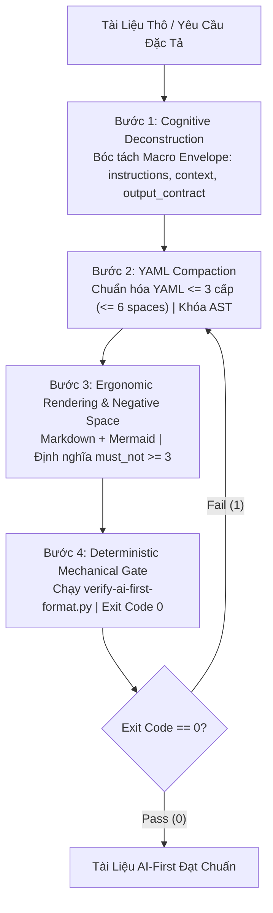

# AI-First Document Formatter (Triad Protocol)

Kỹ năng định hình tài liệu kỹ thuật và khế ước tác vụ dành riêng cho AI Agents, bảo toàn tối đa Attention Budget, chống lại hiện tượng trôi dạt ngữ cảnh (Attention Bleeding) và tuân thủ nguyên tắc kiểm chứng cơ học nhị phân theo tiêu chuẩn của hệ thống.



---

## 1. Ranh Giới Bất Biến (Negative Space & Invariants)

1. **DOC-INV-001 (Macro XML Envelope)**: Mọi tài liệu đặc tả AI-First bắt buộc phải chứa đúng 3 cặp thẻ macro cấp cao nhất: `<instructions>`, `<context>`, `<output_contract>`.
2. **DOC-INV-002 (Indentation Guard)**: Toàn bộ cấu trúc YAML không được vượt quá 3 cấp lồng (tương đương tối đa 6 khoảng trắng thụt lề).
3. **DOC-INV-003 (Anti Micro-tagging)**: Tuyệt đối cấm phân mảnh văn bản bằng vô số thẻ XML con; tổng số thẻ XML phân biệt trong một tài liệu không được vượt quá 12 thẻ.
4. **DOC-INV-004 (Path & Link Hygiene)**:
   - Cấm chèn đường dẫn tuyệt đối cục bộ của máy tính cá nhân. Chỉ sử dụng đường dẫn tương đối dự án.
   - Cấm bọc thẻ mã (backtick) bên trong văn bản hiển thị của link Markdown.
5. **DOC-INV-005 (Mandatory Negative Space)**: Mỗi tài liệu bắt buộc phải định nghĩa tối thiểu 3 điều cấm cụ thể (`must_not:` $\ge 3$) nhằm triệt tiêu Semantic Void.

---

## 2. Bản Đồ Điều Phối Tri Thức & Công Cụ (Knowledge & Tooling Map)

### 2.1. Tài Liệu Hướng Dẫn Chuyên Sâu (References)
- [ai-first-triad-principles.md](references/ai-first-triad-principles.md): Nguyên lý cốt lõi của Bộ Ba Tam Hợp (XML + YAML + Markdown) và quản lý ngân sách chú ý.
- [document-archetypes-guide.md](references/document-archetypes-guide.md): Cẩm nang hướng dẫn chi tiết 5 Document Archetypes từ Lớp 0 đến Lớp 3.
- [thought-latency-and-anchors.md](references/thought-latency-and-anchors.md): Lý thuyết độ trễ tư duy S1-S4 và các mỏ neo ngữ nghĩa (Semantic Anchors).
- [formatting-anti-patterns.md](references/formatting-anti-patterns.md): Nhận diện 6 mùi thiết kế tài liệu xấu và kỹ thuật khắc phục triệt để.

### 2.2. Biểu Mẫu Chuẩn Cho 5 Document Archetypes (Templates)
- [archetype-1-constitutional.template.md](templates/archetype-1-constitutional.template.md): Mẫu hiến pháp và điều hướng hành vi L0 (Constitutional Steering).
- [archetype-2-operational-policy.template.md](templates/archetype-2-operational-policy.template.md): Mẫu chính sách vận hành và chuẩn mực code L1 (Operational Policy).
- [archetype-3-task-specification.template.md](templates/archetype-3-task-specification.template.md): Mẫu đặc tả tác vụ kỹ thuật nguyên tử L3 (Task Specification).
- [archetype-4-architecture-adr.template.md](templates/archetype-4-architecture-adr.template.md): Mẫu ghi nhận quyết định kiến trúc L2 (Architecture Decision Record).
- [archetype-5-skill-playbook.template.md](templates/archetype-5-skill-playbook.template.md): Mẫu playbook quy trình thao tác kỹ năng L1/L2 (Skill Playbook).

### 2.3. Schema Kiểm Định Hình Thức (Schemas)
- [ai-first-document-schema.json](schemas/ai-first-document-schema.json): Schema JSON định nghĩa cấu trúc tài liệu AI-First.
- [yaml-constraints-schema.json](schemas/yaml-constraints-schema.json): Schema JSON kiểm tra các ràng buộc YAML.

### 2.4. Công Cụ Tự Động Hóa & Kiểm Định (Scripts)
- [verify-ai-first-format.py](scripts/verify-ai-first-format.py): Script Python kiểm định cơ học nhị phân (Exit Code 0/1).
- [auto-format-markdown.py](scripts/auto-format-markdown.py): Script Python tự động bọc thẻ XML, chuyển heading/must/must_not thành khung Triad.

### 2.5. Ví Dụ Đối Chứng Thực Chiến (Examples)
- [01-flat-to-hybrid-adr.example.md](examples/01-flat-to-hybrid-adr.example.md): Chuyển đổi quyết định kiến trúc từ văn xuôi phẳng sang chuẩn Triad.
- [02-task-spec-packaging.example.md](examples/02-task-spec-packaging.example.md): Đóng gói task spec nâng cấp module thuế VAT vượt qua Gate kiểm định.

---

## 3. Quy Trình 4 Bước Đóng Gói Chuẩn Hóa

### Bước 1: Cognitive Deconstruction (Phân Tách Khối Vùng Chú Ý)
- Phân bổ thông tin vào đúng 3 vùng chú ý vật lý:
  - `<instructions>`: Chứa mục tiêu, khế ước cốt lõi và các ràng buộc thực thi.
  - `<context>`: Chứa thông tin nền tảng, sơ đồ trực quan và liên kết tham chiếu.
  - `<output_contract>`: Chứa lệnh kiểm chứng cơ học và tiêu chí nhị phân kết thúc.

### Bước 2: YAML Compaction & AST Framing (Tối Giản Dữ Liệu Cấu Trúc)
- Chuyển các thông số kỹ thuật, metadata và assertions vào các khối mã ` ```yaml ` chuẩn.
- Rà soát thụt lề: cấp 0 (0 spaces), cấp 1 (2 spaces), cấp 2 (4 spaces), cấp 3 (6 spaces). Triệt tiêu toàn bộ cấp 4 trở lên.

### Bước 3: Visual Ergonomics & Negative Space Integration (Định Hình Trực Quan & Biên Cấm)
- Sử dụng bảng Markdown và sơ đồ Mermaid (`flowchart`, `sequenceDiagram`) để tăng tính công thái học cho kỹ sư người đọc.
- Bắt buộc khai báo danh sách `negative_space` với ít nhất 3 mục `must_not`.

### Bước 4: Deterministic Mechanical Verification (Kiểm Định Cơ Học)
- Chạy script kiểm định nhị phân:
  ```powershell
  python .agents/skills/ai-first-doc-formatter/scripts/verify-ai-first-format.py <duong_dan_tai_lieu>
  ```
- Chỉ đóng dấu hoàn thành khi kịch bản trả về `Exit Code: 0`.
