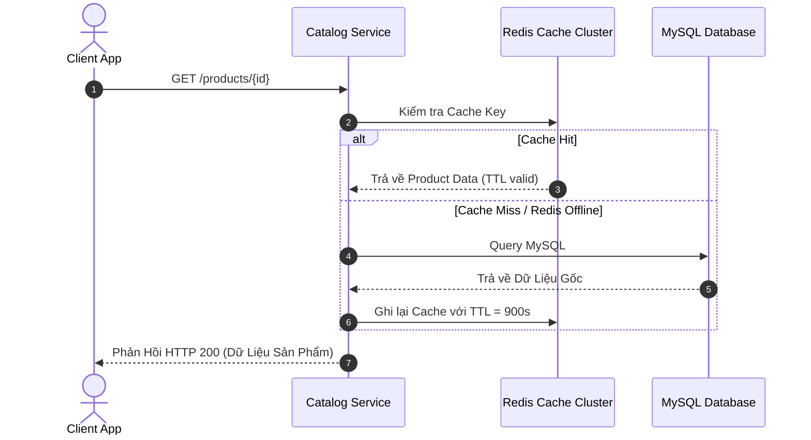

<instructions>
```yaml
adr_metadata:
  adr_id: "ADR-012"
  title: "Redis Distributed Caching Layer Implementation (Case Study 01)"
  status: "Accepted"
  architecture_level: "L2 Domain Architecture"

decision_boundaries:
  must:
    - "Set explicit TTL (Time-To-Live) between 300s and 3600s on every cached key."
    - "Gracefully fallback to primary MySQL database when Redis connection fails."
    - "Attach correlation_id to all cache miss and eviction logs."
  negative_space:
    - must_not: "CẤM lưu trữ dữ liệu nhạy cảm hoặc plain text credentials trong cache."
    - must_not: "CẤM ném lỗi HTTP 500 cho người dùng khi cụm Redis gặp sự cố (Cache Fallback Invariant)."
    - must_not: "CẤM khởi tạo cache keys không có tiền tố namespace phân vùng (e.g. 'prod:catalog:')."
    - must_not: "CẤM thiết lập TTL vô thời hạn (infinite TTL) trên các bảng dữ liệu biến động."
```
</instructions>

<context>
## Case Study 01: Chuyển Đổi Quyết Định Kiến Trúc Sang AI-First Triad

Tài liệu này minh họa cấu trúc ADR chuẩn mực sau khi được tái cấu trúc từ văn xuôi phẳng thành mô hình Tam Hợp AI-First Triad.

### 1. Luồng Dữ Liệu Bộ Nhớ Đệm (Cache-Aside Pattern)


### 2. Ma Trận Đánh Đổi Kỹ Thuật (Trade-Off Matrix)

| Tiêu Chí Đánh Đổi | Đọc Trực Tiếp MySQL | Tầng Bộ Đệm Redis | Rationale Đánh Đổi |
| :--- | :--- | :--- | :--- |
| **Độ trễ truy vấn (P95)** | ~120ms | < 4ms | Giảm tải 95% áp lực truy vấn cho MySQL |
| **Tính nhất quán dữ liệu** | Nhất quán tức thì | Nhất quán cuối cùng (TTL) | Chấp nhận độ trễ cập nhật tối đa 900s |
| **Chi phí hạ tầng** | Tăng CPU/RAM DB | Thêm node Redis Memory | Tối ưu chi phí hơn scale dọc MySQL |

### 3. Tệp Tin Liên Quan (Clickable Relative Links)
- [CacheService.ts](src/services/CacheService.ts)
- [Quy Chuẩn Chính Sách Vận Hành](templates/archetype-2-operational-policy.template.md)
</context>

<output_contract>
```yaml
adr_verification:
  runner: "python .agents/skills/ai-first-doc-formatter/scripts/verify-ai-first-format.py"
  target_file: "examples/01-flat-to-hybrid-adr.example.md"
  expected_exit_code: 0
  assertions:
    - "Macro XML envelope balanced 100%."
    - "YAML nesting depth <= 3 levels (<= 6 spaces)."
    - "Negative Space must_not assertions >= 3."
    - "Zero corrupted backtick markdown links and zero absolute local paths."
```
</output_contract>
