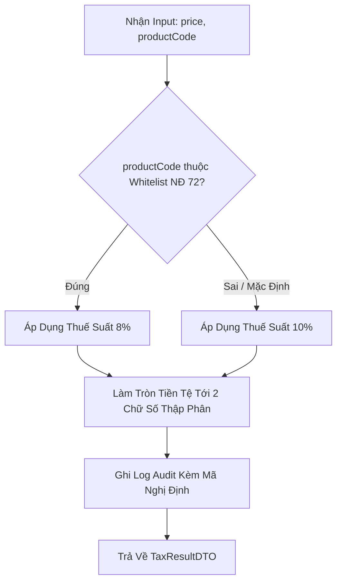

<instructions>
```yaml
task_metadata:
  task_id: "TSK-089"
  title: "VAT Calculation Module Upgrade Decree 72 (Case Study 02)"
  objective: "Nâng cấp logic tính thuế VAT hỗ trợ danh mục giảm thuế theo Nghị định 72"
  scope: "src/finance/TaxCalculator.ts"

execution_boundaries:
  must:
    - "Preserve original 10% rate for standard luxury product categories."
    - "Apply 8% reduced rate specifically for whitelisted product codes."
    - "Add unit tests covering edge cases: exempt products, null category, round-off."
  negative_space:
    - must_not: "CẤM sửa đổi chữ ký phương thức công khai calculateTax(price, category)."
    - must_not: "CẤM cài đặt thêm thư viện tính toán bên ngoài (zero external dependencies)."
    - must_not: "CẤM làm tròn sai lệch số thập phân vượt quá 0.001 (Preserve Currency Precision)."
    - must_not: "CẤM nuốt ngoại lệ khi mã sản phẩm không tồn tại trong danh mục tra cứu."
```
</instructions>

<context>
## Bối Cảnh Nghiệp Vụ & Dữ Liệu Tham Chiếu

### 1. Luồng Tính Thuế VAT (Tax Calculation Flow)


### 2. Tệp Nguồn & Chỉ Mục Dòng Cần Phẫu Thuật
- [TaxCalculator.ts](src/finance/TaxCalculator.ts)
- [TaxCalculator.test.ts](tests/finance/TaxCalculator.test.ts)
- [Quy Chuẩn Thư Mục](../../rules/directory-governance.md)
</context>

<output_contract>
```yaml
verification:
  runner: "python .agents/skills/ai-first-doc-formatter/scripts/verify-ai-first-format.py"
  target_file: "examples/02-task-spec-packaging.example.md"
  expected_exit_code: 0
  assertions:
    - "Macro XML envelope balanced 100%."
    - "YAML nesting <= 3 levels (<= 6 spaces)."
    - "Negative Space must_not assertions >= 3."
    - "Unit test coverage >= 90% for new tax logic."
```
</output_contract>
