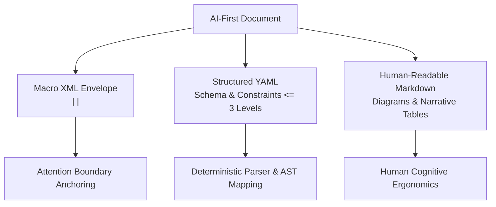

# AI-First Triad Principles & Attention Budgeting Architecture

## 1. Triad Architecture Overview
Cấu trúc tài liệu AI-First được định hình bởi Bộ Ba Cốt Lõi (Triad):

1. **Macro XML Envelope**:
   - Xác lập ranh giới chú ý vật lý cứng cho LLM Attention Heads.
   - Thẻ cấp cao bao bọc: `<instructions>`, `<context>`, `<output_contract>`.
   - Ngăn chặn triệt để hiện tượng Attention Bleeding (tràn ngữ cảnh giữa hướng dẫn thực thi và dữ liệu nền).

2. **Structured YAML (Data & Constraints Substrate)**:
   - Truyền tải thông điệp ngữ nghĩa có cấu trúc cao (schemas, typed configurations, boundaries).
   - Ràng buộc nghiêm ngặt: Độ sâu lồng không vượt quá 3 cấp (tương đương 6 spaces thụt lề) để ngăn chặn suy giảm năng lực phân giải của LLM.

3. **Markdown & Visual Diagrams (Ergonomic Interface)**:
   - Trình bày thông tin mô tả danh định, giải thích ngữ cảnh, bảng biểu và biểu đồ Mermaid.
   - Hỗ trợ đánh giá trực quan mà không phá vỡ tính parseable của hệ thống máy tính.

---

## 2. Attention Budgeting & Thought Latency (S1 - S4)

Khi LLM đọc tài liệu kỹ thuật, mỗi tầng token tiêu tốn một phần ngân sách chú ý (Attention Budget). Mô hình phân bổ độ trễ tư duy (Thought Latency):

| Tầng | Cấp độ | Phân loại dữ liệu | Mục tiêu chú ý (Attention Target) | Ràng buộc cấu trúc |
| :--- | :--- | :--- | :--- | :--- |
| **S1** | Khởi động tức thì | Chỉ thị lõi, ranh giới cấm | Kích hoạt bộ nhớ đệm chú ý ưu tiên cao | Đặt trong `<instructions>` và Negative Space |
| **S2** | Tải cấu trúc | Typed Schema, Inputs/Outputs | Định hình AST và khế ước dữ liệu | Biểu diễn bằng YAML $\le 3$ cấp thụt lề |
| **S3** | Tải ngữ cảnh | Kiến trúc, Lịch sử, Tham chiếu | Hỗ trợ suy diễn biên (Edge reasoning) | Đặt trong `<context>`, liên kết tương đối |
| **S4** | Đóng gói nghiệm thu | Output Contract, Verification | Đảm bảo tính đóng kín nhị phân | Đặt trong `<output_contract>`, assertions nhị phân |

---

## 3. Anti-Patterns & Negative Spaces

Tài liệu AI-First loại bỏ 4 phản mẫu thường gặp làm suy thoái hiệu năng mô hình ngôn ngữ lớn:

### 3.1. Micro-tagging Flooding
- **Hiện tượng**: Lạm dụng thẻ XML nhỏ lẻ (`<step1>`, `<rule_a>`, `<detail_x>`, ...) rải rác khắp văn bản.
- **Tác hại**: Khiến Tokenizer bị phân mảnh, tiêu tốn số lượng lớn distinct token IDs và làm giảm độ sắc bén của Attention Mechanism.
- **Tiêu chuẩn**: Số lượng thẻ XML phân biệt trong toàn bộ tài liệu $\le 12$.

### 3.2. Deep Indentation Explosion
- **Hiện tượng**: Cấu trúc YAML lồng nhau 4-8 cấp thụt lề.
- **Tác hại**: Gây lệch vị trí positional embeddings, dẫn đến parsing hallucinations và trượt key-value.
- **Tiêu chuẩn**: Tối đa 3 cấp lồng (indents: 0, 2, 4, 6 spaces).

### 3.3. Semantic Void (Thiếu Negative Space)
- **Hiện tượng**: Chỉ mô tả những việc "cần làm" (Positive Duties) mà không định hình không gian ranh giới cấm.
- **Tác hại**: LLM tự suy diễn các nhánh chưa được định nghĩa và tạo ra mã dư thừa hoặc vi phạm an toàn.
- **Tiêu chuẩn**: Tối thiểu 3 điều cấm tường minh (`must_not:` $\ge 3$).

### 3.4. Path Corruption & Broken Links
- **Hiện tượng**: Nhúng absolute path cục bộ của máy tính cá nhân (`C:\Users\...`, `/home/...`) hoặc lồng backtick sai quy cách trong link markdown (`[`file`](path)`).
- **Tác hại**: Gây tê liệt cơ chế Clickable Link và phá hủy tính di động của tài liệu qua các môi trường khác nhau.
- **Tiêu chuẩn**: Chỉ dùng đường dẫn tương đối hoặc URI định chuẩn; liên kết Markdown văn bản thuần không bọc backtick bên trong nhãn vuông.
