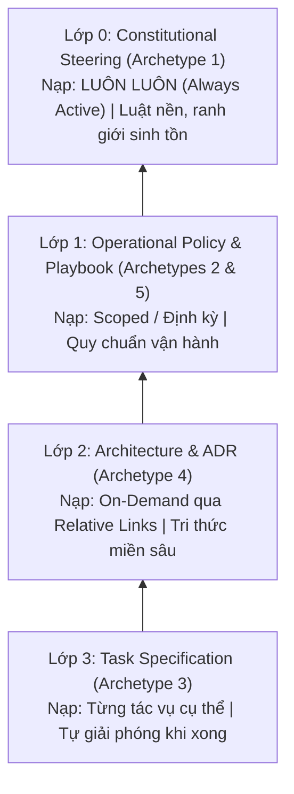

# Hướng Dẫn Chi Tiết 5 Document Archetypes Chuẩn AI-First

Tài liệu này chuẩn hóa cấu trúc giải phẫu và quy cách áp dụng của 5 Document Archetypes trong hệ thống dựa trên tiêu chuẩn kiến trúc 4 tầng tri thức (L0 - L3).

---

## 1. Archetype 1: Tài Liệu Hiến Pháp & Điều Hướng Hành Vi (Constitutional Steering)
- **Tầng tri thức**: **Lớp 0 (Constitutional Rules)** — Luôn luôn nạp vào bối cảnh hệ thống (`always_active`).
- **Tệp tin thực tế**: `AGENTS.md`, `CLAUDE.md`, `SYSTEM_PROMPT.md`.
- **Mục tiêu**: Định danh vai trò nhận thức tối cao (Persona), ranh giới đạo đức/kỹ thuật bất biến, thứ tự ưu tiên giải quyết xung đột (`priority_order`), và tiêu chuẩn dừng khẩn cấp.
- **Biểu mẫu**: [archetype-1-constitutional.template.md](../templates/archetype-1-constitutional.template.md).
- **Cấu trúc cốt lõi**:
  - `<instructions>`: Mệnh lệnh tối cao về danh tính và tư duy phòng vệ.
  - Khối YAML `constitutional_policy`:
    - `priority_order`: 1 đến 4 (Bảo toàn dữ liệu > Khế ước mã nguồn > Ý định người dùng > Tối thiểu blast radius).
    - `constraints`: `must` và `must_not` (Zero-Assumption, cấm sinh mã phỏng đoán).
  - `<context>`: Bản đồ điều phối tri thức động (`on_demand_knowledge_map`).
  - `<output_contract>`: Tiêu chí nghiệm thu nhị phân toàn hệ thống.

---

## 2. Archetype 2: Tài Liệu Quy Chuẩn & Chính Sách Vận Hành (Operational Policy & Rulebook)
- **Tầng tri thức**: **Lớp 1 (Working Policies & Standards)** — Nạp theo phạm vi làm việc (`scoped_or_frequent`).
- **Tệp tin thực tế**: `coding_standards.md`, `security_policy.md`, `review_checklist.md`, `directory-governance.md`.
- **Mục tiêu**: Chuẩn hóa phong cách lập trình, quy tắc xử lý lỗi, chuẩn mã hóa dữ liệu, kiến trúc thư mục.
- **Biểu mẫu**: [archetype-2-operational-policy.template.md](../templates/archetype-2-operational-policy.template.md).
- **Cấu trúc cốt lõi**:
  - `<instructions>`: Phạm vi áp dụng và chế tài kỹ thuật.
  - Khối YAML `policy_rules`:
    - `must`: Danh mục bắt buộc (Bọc lỗi với AppError, khai báo kiểu tường minh).
    - `must_not`: Vùng cấm (Cấm nuốt ngoại lệ, cấm expose stack trace ra API).
  - `<context>`: Mẫu đối sánh thực chiến Good vs Bad Patterns (`diff` hoặc `typescript`).
  - `<output_contract>`: Bảng kiểm tra tự động trước commit.

---

## 3. Archetype 3: Tài Liệu Đặc Tả Tác Vụ & Bối Cảnh Thực Thi (Technical Task Specification)
- **Tầng tri thức**: **Lớp 3 (Task Evidence & Execution)** — Nạp dùng một lần theo từng ticket cụ thể (`task_specific_only`).
- **Tệp tin thực tế**: `task_spec.md`, `tasks.md`, `ticket_context.xml`, `spec.md`.
- **Mục tiêu**: Định nghĩa phạm vi thay đổi nguyên tử (atomic change), đầu vào, đầu ra, ranh giới sửa đổi (blast radius containment) và kịch bản test.
- **Biểu mẫu**: [archetype-3-task-specification.template.md](../templates/archetype-3-task-specification.template.md).
- **Cấu trúc cốt lõi**:
  - `<instructions>`: Khối YAML `task_metadata` (task_id, objective, scope) và `execution_boundaries` (`must`, `must_not`).
  - `<context>`: Bối cảnh nghiệp vụ, sơ đồ luồng dữ liệu Mermaid, các tệp liên quan kèm chỉ mục dòng (`[File.ts:L10-L40](path)`).
  - `<output_contract>`: Runner kiểm thử tự động, mã thoát mong đợi `0`, và các bằng chứng cơ học nhị phân.

---

## 4. Archetype 4: Tài Liệu Kiến Trúc & Miền Tri Thức (Architecture & ADR)
- **Tầng tri thức**: **Lớp 2 (Domain & Architecture)** — Nạp On-Demand khi cần đào sâu nghiệp vụ (`on_demand_via_links`).
- **Tệp tin thực tế**: `ADR-001.md`, `architecture_overview.md`, `domain_models.md`.
- **Mục tiêu**: Ghi nhận quyết định kiến trúc, đánh giá phương án thay thế, sơ đồ tuần tự hệ thống và các bất biến miền (Domain Invariants).
- **Biểu mẫu**: [archetype-4-architecture-adr.template.md](../templates/archetype-4-architecture-adr.template.md).
- **Cấu trúc cốt lõi**:
  - `<instructions>`: Quyết định lựa chọn và tuyên bố trạng thái (Accepted/Superseded).
  - `<context>`:
    - Bối cảnh bài toán và các rào cản kỹ thuật.
    - Sơ đồ tương tác tuần tự Mermaid (`sequenceDiagram`).
    - Bảng ma trận so sánh đánh đổi (Trade-off Matrix).
    - Khối YAML `domain_invariants`: Các chuyển đổi trạng thái hợp lệ và bất hợp lệ.
  - `<output_contract>`: Kế hoạch triển khai và tiêu chí kiểm chứng sau thay đổi kiến trúc.

---

## 5. Archetype 5: Tài Liệu Kỹ Năng & Quy Trình Thao Tác (Agent Skill & Action Playbook)
- **Tầng tri thức**: **Lớp 1/2 (Skill & Action Playbook)** — Nạp khi kích hoạt trigger kỹ năng.
- **Tệp tin thực tế**: `SKILL.md`, `migration_playbook.md`, `incident_recovery.md`.
- **Mục tiêu**: Hướng dẫn quy trình từng bước (Step-by-step Execution Protocol) cho Agent thực thi các nghiệp vụ phức tạp, xử lý vùng nguy hiểm (Danger Zones).
- **Biểu mẫu**: [archetype-5-skill-playbook.template.md](../templates/archetype-5-skill-playbook.template.md).
- **Cấu trúc cốt lõi**:
  - `<instructions>`: Trigger nhận diện kỹ năng và tôn chỉ thực thi.
  - `<context>`:
    - Khối YAML `execution_protocol`: Step 1 (Pre-check), Step 2 (Dry run), Step 3 (Execute), Step 4 (Verify).
    - Khối YAML `danger_zones`: Liệt kê các hành vi nguy hiểm, hậu quả và giải pháp khắc phục.
  - `<output_contract>`: Tiêu chí nghiệm thu hoàn thành thao tác playbook.
