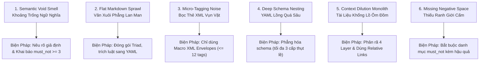

# 6 Mùi Thiết Kế Tài Liệu Xấu & Biện Pháp Khử Mùi (Anti-Patterns & Remediation)

Tài liệu này hệ thống hóa 6 "mùi hôi" cấu trúc tài liệu (Documentation Smells) thường gặp khiến Large Language Models (LLMs) suy luận sai lệch, vi phạm ranh giới hệ thống, hoặc bỏ sót yêu cầu kỹ thuật.



---

## 1. Mùi 1: Semantic Void Smell (Khoảng Trống Ngữ Nghĩa)
- **Triệu chứng**: Tài liệu chỉ mô tả mục tiêu chung chung, không có thông số kỹ thuật rõ ràng, không có danh sách giả định, không có định nghĩa trường hợp biên (edge cases).
- **Hậu quả**: LLM rơi vào khoảng trống ngữ nghĩa và tự động "lấp đầy" bằng suy đoán chủ quan (hallucinations), sinh ra mã giả lập (mocks/stubs) hoặc logic sai nghiệp vụ.
- **Biện pháp xử lý**:
  - Khai báo tường minh danh sách `assumptions` (các giả định kỹ thuật đã kiểm chứng).
  - Khóa chặt không gian giải pháp bằng tối thiểu 3 điều cấm cụ thể (`must_not:` $\ge 3$).
  - Nếu thiếu dữ kiện, bắt buộc kích hoạt cơ chế hỏi lại con người (Stop & Clarify) thay vì phỏng đoán.

---

## 2. Mùi 2: Flat Markdown Sprawl (Văn Xuôi Phẳng Lan Man)
- **Triệu chứng**: Toàn bộ tài liệu là văn bản Markdown thuần trải dài, các quy tắc cứng và luật sinh tử bị chôn vùi trong các câu văn dài dòng và đoạn văn mô tả bối cảnh.
- **Hậu quả**: Cơ chế tự chú ý (Self-Attention) của LLM đối xử với luật cứng ngang hàng với văn phong miêu tả phụ trợ, dẫn đến tình trạng AI "đọc lướt qua" và vi phạm các quy tắc then chốt.
- **Biện pháp xử lý**:
  - Áp dụng cấu trúc tam hợp AI-First Triad: Cô lập vùng bối cảnh vào `<context>`, đưa toàn bộ luật cứng sang khối ` ```yaml ` với khóa `must` và `must_not`.
  - Giữ văn phong cô đọng, giàu mật độ tín hiệu kỹ thuật (High Signal-to-Noise Ratio).

---

## 3. Mùi 3: Micro-Tagging Noise (Bọc Thẻ XML Vi Mô Vụn Vặt)
- **Triệu chứng**: Sử dụng thẻ XML dày đặc quanh từng câu văn hoặc từng gạch đầu dòng (ví dụ: `<step>`, `<rule_1>`, `<sub_item>`, `<text>`, `<name>`).
- **Hậu quả**: Làm bùng nổ số lượng thẻ phân biệt trong tài liệu, gây phân mảnh Tokenizer, làm loãng không gian chú ý của mô hình vào các cú pháp đóng mở vụn vặt.
- **Biện pháp xử lý**:
  - Chỉ sử dụng XML ở tầm vĩ mô (Macro-Delimiters): `<instructions>`, `<context>`, `<output_contract>`, `<examples>`, `<input>`.
  - Ràng buộc cơ học: Tổng số thẻ XML phân biệt trong một tài liệu không được vượt quá 12 thẻ.

---

## 4. Mùi 4: Deep Schema Nesting (YAML Lồng Nhau Quá Sâu)
- **Triệu chứng**: Cấu trúc YAML lồng nhau từ 4 đến 8 cấp thụt lề (8 đến 16 khoảng trắng).
- **Hậu quả**: Khiến mô hình dễ bị lệch ma trận vị trí (Positional Embedding Drift), dẫn đến parsing error, mất dấu quan hệ cha-con giữa các keys và hallucinate giá trị.
- **Biện pháp xử lý**:
  - Giới hạn cứng: Độ sâu lồng nhau của YAML không vượt quá 3 cấp (tối đa 6 spaces thụt lề).
  - Phẳng hóa cấu trúc dữ liệu: Phân tách các cấu trúc phức tạp thành các khối độc lập có mã định danh liên kết (reference IDs).

---

## 5. Mùi 5: Context Dilution Monolith (Tài Liệu Đơn Khối Khổng Lồ)
- **Triệu chứng**: Nhồi nhét toàn bộ hiến pháp, tiêu chuẩn code, chi tiết kiến trúc, bảng phân tích ticket, log kiểm thử vào một tệp duy nhất dài hàng chục nghìn dòng.
- **Hậu quả**: Gây loãng ngữ cảnh nghiêm trọng (Context Dilution), làm Agent bị hội chứng "Lost in the Middle" và làm cạn kiệt ngân sách chú ý (Attention Budget).
- **Biện pháp xử lý**:
  - Áp dụng Mô hình 4 Tầng Tri Thức (L0 Constitutional -> L1 Working Policy -> L2 Architecture -> L3 Task Evidence).
  - Tài liệu gốc đóng vai trò là "Bản đồ điều phối" (Routing Map), nạp tri thức chi tiết theo nhu cầu (On-Demand) thông qua Clickable Relative Links: `[Tên](duong/dan/tuong_doi.md)`.

---

## 6. Mùi 6: Missing Negative Space (Bỏ Quên Không Gian Ranh Giới Cấm)
- **Triệu chứng**: Tài liệu chỉ liệt kê toàn bộ các hành động cần làm (Positive Duties), hoàn toàn không có bất kỳ điều cấm nào.
- **Hậu quả**: Agent tự do lựa chọn bất kỳ giải pháp nào thỏa mãn danh sách cần làm mà không lường trước các tác dụng phụ tai hại (Side Effects), vô tình phá vỡ tính toàn vẹn của mã nguồn lân cận.
- **Biện pháp xử lý**:
  - Bắt buộc khai báo danh sách `negative_space` với ít nhất 3 mục `must_not` kèm cảnh báo hậu quả hệ thống nếu vi phạm.
  - Sử dụng GitHub Alert `> [!CAUTION]` cho các ranh giới sống còn.
