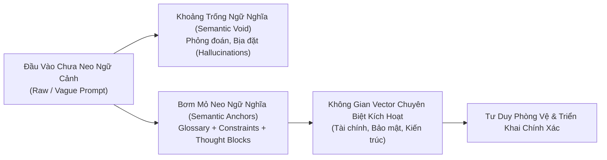
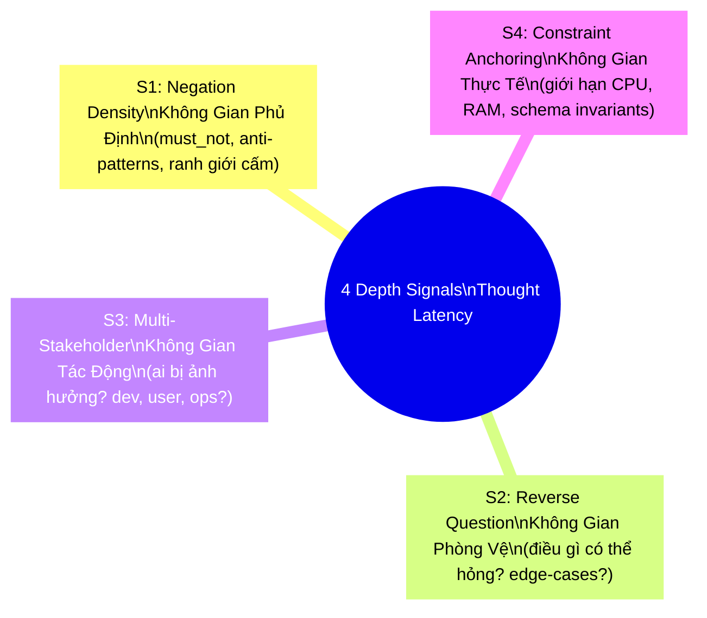

# Độ Trễ Tư Duy (Thought Latency) & Mỏ Neo Ngữ Nghĩa (Semantic Anchors)

Tài liệu này phân tích cơ chế nhận thức của Large Language Models (LLMs) trong việc kích hoạt không gian vector, quản lý độ trễ tư duy (Thought Latency) và neo ngữ cảnh nhận thức (Cognitive Anchoring).

---

## 1. Bản Chất Kích Hoạt Không Gian Vector (Vector Space Triggering)

LLM không tư duy như con người và cũng không biên dịch mã nguồn như trình biên dịch truyền thống. Mô hình biểu diễn tri thức dưới dạng các cụm tọa độ đa chiều trong không gian vector (High-dimensional Vector Space).



Khi văn bản thiếu các điểm tựa từ vựng chuyên sâu (Domain Anchors), mô hình rơi vào **Khoảng Trống Ngữ Nghĩa (Semantic Void)** — trạng thái mà các vector chú ý tản mác, dẫn đến sinh mã phỏng đoán, sót trường hợp biên, và tạo ra các đoạn code giả lập (mocks/stubs).

### 4 Loại Semantic Anchor Trọng Yếu:
1. **Domain Glossary**: Tối thiểu 10 thuật ngữ chuyên ngành định vị chính xác miền bài toán (ví dụ fintech: `Idempotency-Key`, `HMAC-SHA256`, `Replay Attack`, `Non-repudiation`, `Atomic Settlement`).
2. **Thought Blocks (Cognitive Scaffolding)**: Các khối phân tích logic chuyên sâu lý giải nguồn cơn kiến trúc thay vì chỉ đưa ra kết quả.
3. **Stakeholder Empathy**: Trả lời câu hỏi *"Code này viết cho ai, giải quyết nỗi đau gì của người dùng, hậu quả kinh tế/vận hành nếu sập là gì?"*.
4. **Defensive Reasoning**: Lý giải tường minh nguyên do vì sao các ranh giới an toàn (Guardrails) bắt buộc phải tồn tại.

---

## 2. Lý Thuyết Độ Trễ Tư Duy (Thought Latency Theory)

Không đo tư duy của AI bằng số lượng token dài dòng mà đo bằng **Kiểu Tư Duy Đa Chiều**. Thay vì phản xạ nhanh, nông (System-1 Thinking), hệ thống AI-First ép Agent dừng lại phân tích sâu (System-2 Thinking) thông qua **4 Tín Hiệu Chiều Sâu (4 Depth Signals)**:



### Chi Tiết 4 Tín Hiệu Nhận Thức:

| Tín Hiệu | Không Gian Khám Phá | Câu Hỏi Nhận Thức Cốt Lõi | Dấu Ấn Trong Tài Liệu |
| :---: | :--- | :--- | :--- |
| **S1** | **Negation Density** | *"Hệ thống tuyệt đối CẤM làm điều gì và điều gì sẽ gây sập?"* | Danh mục `must_not:`, cảnh báo `> [!CAUTION]` |
| **S2** | **Reverse Questioning** | *"Khi ngoại lệ xảy ra, luồng rollback và cô lập lỗi sẽ như thế nào?"* | Kịch bản biên, kịch bản lỗi mạng, mã trạng thái HTTP |
| **S3** | **Multi-Stakeholder** | *"Kiến trúc này ảnh hưởng ra sao tới hiệu năng người dùng và chi phí hạ tầng?"* | Bảng ma trận đánh đổi (Trade-off Matrix) |
| **S4** | **Constraint Anchoring** | *"Ràng buộc kỹ thuật cụ thể về bộ nhớ, độ phức tạp thuật toán và schema là gì?"* | Schema YAML $\le 3$ cấp, assertion kiểm thử nhị phân |

> [!IMPORTANT]
> **Cơ Chế Chống Đánh Lừa (Anti-Gaming)**:
> Agent có thể giả mạo 1 hoặc 2 tín hiệu bằng từ khóa sáo rỗng, nhưng để đồng thời thỏa mãn cả 4 tín hiệu (S1 + S2 + S3 + S4) trong văn bản, bộ não của LLM buộc phải thực sự du hành qua 4 góc phần tư của không gian nhận thức.

---

## 3. Kiến Trúc Luồng Đôi: Kỹ Thuật & Nhận Thức (Dual Context Stream)

Để tối ưu hóa chi phí token và hiệu năng suy luận, hệ thống phân tách tri thức thành hai luồng song sinh:

```text
┌──────────────────────────────────────┐     ┌──────────────────────────────────────┐
│     Technical Scaffolding            │     │          Cognitive Depth             │
│   (hydrated-context / Contracts)     │     │     (thought-cache / Reasoning)      │
├──────────────────────────────────────┤     ├──────────────────────────────────────┤
│ - Kích thước: ~30-50 dòng YAML       │     │ - Kích thước: ~100-200 dòng YAML     │
│ - Trả lời: WHAT (Cần làm cái gì?)    │     │ - Trả lời: WHY + WHO + WHAT IF       │
│ - Chứa: Schemas, Types, Boundaries   │     │ - Chứa: S1-S4 Reasoning, Trade-offs  │
│ - Agent Planner: Bắt buộc đọc        │     │ - Agent Planner: Tùy chọn (Optional) │
│ - Agent Builder: Bắt buộc đọc        │     │ - Agent Builder: Bắt buộc đọc        │
└──────────────────────────────────────┘     └──────────────────────────────────────┘
```

Việc phân tách này giúp Agent Planner lập kế hoạch nhanh mà không bị Attention Overload, trong khi Agent Builder nắm trọn lý do thiết kế để không vi phạm intent gốc của kiến trúc sư.

---

## 4. Bảng Tra Cứu Điểm Neo Ngữ Nghĩa (Semantic Anchors Quick Reference)

| Nhóm Từ Khóa Neo | Các Khóa Thường Dùng | Tác Động Nhận Thức Lên AI |
| :--- | :--- | :--- |
| **Governance & Rules** | `instructions`, `hard_invariants`, `must`, `must_not`, `priority_order` | Khóa chặt ranh giới hành vi, triệt tiêu ảo tưởng tự do |
| **Execution & Scope** | `task`, `scope`, `assumptions`, `step_by_step`, `stop_conditions` | Định hình luồng thực thi tuần tự, xác lập điểm dừng khẩn cấp |
| **Verification & Gate** | `output_contract`, `acceptance_criteria`, `mechanical_proof`, `definition_of_done` | Kích hoạt tư duy tự kiểm tra bằng chứng trước khi kết thúc |
| **Context & Evidence** | `context`, `evidence`, `examples`, `load_when_needed` | Phân lập dữ liệu tham chiếu, chống nhầm lẫn dữ liệu thành mệnh lệnh |
