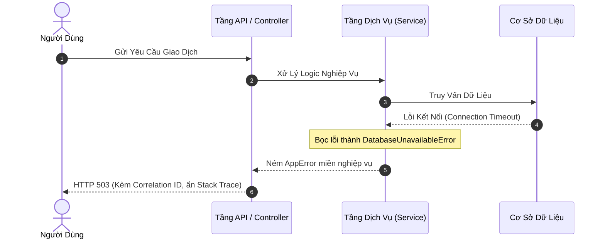

<instructions>
```yaml
policy_metadata:
  policy_id: "POL-001"
  title: "Secure Error Handling & Coding Standards"
  level: "L1 Working Policy"
  enforcement: "Strict Mechanical Gate"

policy_rules:
  must:
    - "Wrap external errors in domain-specific AppError instances."
    - "Include correlation_id and timestamp in every error log."
    - "Clean up acquired resources (file descriptors, sockets) in finally blocks."
  negative_space:
    - must_not: "CẤM để lộ raw database stack traces cho API consumers."
    - must_not: "CẤM dùng generic 'catch (Exception e) {}' không ghi log."
    - must_not: "CẤM trả về HTTP 200 OK cho các gói tin thất bại nghiệp vụ."
    - must_not: "CẤM commit credentials hoặc passwords dạng plain text vào git."
```
</instructions>

<context>
## Chuẩn Hóa Bọc Lỗi & Kiểm Soát Ngoại Lệ Tầng Dịch Vụ

Tài liệu này xác lập quy chuẩn kỹ thuật cho toàn bộ service layer trong hệ thống. Mọi ngoại lệ phát sinh từ database hoặc đối tác thứ ba bắt buộc phải được bọc trong các lớp lỗi miền nghiệp vụ.



### Triển Khai Thực Chiến Tham Chiếu
- [Quy Chuẩn Thư Mục](../../rules/directory-governance.md)
- [Cơ Chế Bọc Lỗi & Khử Mùi](../references/formatting-anti-patterns.md)
</context>

<output_contract>
```yaml
compliance_verification:
  audit_runner: "python .agents/skills/ai-first-doc-formatter/scripts/verify-ai-first-format.py"
  target_policy: "templates/archetype-2-operational-policy.template.md"
  expected_exit_code: 0
  criteria:
    - "Zero generic empty catch blocks in service files."
    - "Every catch block logs correlation_id."
    - "Negative space contains at least 3 must_not rules."
```
</output_contract>