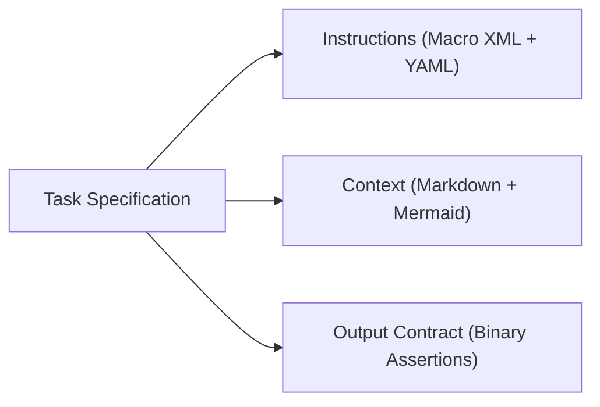

<instructions>
```yaml
task_metadata:
  task_id: "TSK-001"
  title: "Archetype 3 Task Specification Standard Template"
  objective: "Xác lập khuôn mẫu đặc tả công việc chuẩn AI-First"
  scope: "Layer-1 Module Boundaries"

execution_boundaries:
  must_do:
    - "Tuân thủ nghiêm ngặt mô hình AI-First Triad: XML Envelope + YAML + Markdown"
    - "Thiết lập kiểm chứng nhị phân máy đọc được với exit code 0"
    - "Duy trì độ sâu YAML không vượt quá 3 cấp thụt lề"
  negative_space:
    - must_not: "CẤM đưa cấu trúc lồng YAML sâu quá 3 cấp (vượt 6 spaces thụt lề)"
    - must_not: "CẤM phân mảnh tài liệu bằng Micro-tagging với trên 12 thẻ phân biệt"
    - must_not: "CẤM nhúng absolute paths cục bộ của máy cá nhân (chỉ dùng relative path)"
    - must_not: "CẤM lồng dấu backtick bên trong văn bản nhãn liên kết Markdown"
```
</instructions>

<context>
## Bối Cảnh & Cơ Sở Kiến Trúc

Tài liệu này đóng vai trò khuôn mẫu Archetype 3 dành cho các tệp đặc tả tác vụ (`tasks.md`, `spec.md`, `plan.md`). 
Mục tiêu là tối ưu hóa việc phân bổ chú ý (Attention Budget) cho LLM, triệt tiêu ảo ảnh cú pháp (hallucination) và đảm bảo các công cụ kiểm định tự động có thể phân tích cú pháp xác định.



### Tham Chiếu Quy Chuẩn
- [Nguyên Lý Triad](references/ai-first-triad-principles.md)
- [Quy Chuẩn Thư Mục](../../rules/directory-governance.md)
</context>

<output_contract>
```yaml
verification:
  runner: "python .agents/skills/ai-first-doc-formatter/scripts/verify-ai-first-format.py"
  target_artifact: "templates/archetype-3-task-spec.template.md"
  expected_exit_code: 0
  assertions:
    - "Macro XML envelope cân bằng tuyệt đối"
    - "YAML nesting <= 3 levels (<= 6 spaces)"
    - "Distinct XML tags <= 12"
    - "Negative Space must_not assertions >= 3"
```
</output_contract>
