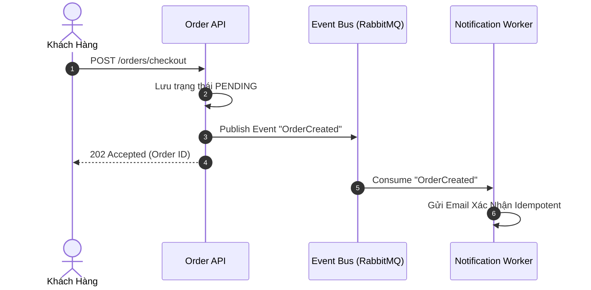

<instructions>
```yaml
adr_metadata:
  adr_id: "ADR-004"
  title: "Event-Driven Asynchronous Order Processing"
  status: "Accepted"
  architecture_level: "L2 Domain Architecture"

decision_boundaries:
  must:
    - "Publish OrderCreated event immediately after persisting transaction in PENDING."
    - "Ensure idempotency keys are validated by Notification Worker before sending email."
    - "Include correlation_id across all event payloads."
  negative_space:
    - must_not: "CẤM xử lý các tác vụ bên ngoài (gửi email, SMS) đồng bộ trong luồng HTTP."
    - must_not: "CẤM bỏ qua việc kiểm tra trùng lặp sự kiện (Duplicate Event Swallowing)."
    - must_not: "CẤM thay đổi trạng thái đơn hàng bất hợp lệ (từ PAID ngược về DRAFT)."
    - must_not: "CẤM lưu trữ plain text thẻ tín dụng hoặc token nhạy cảm trong payload sự kiện."
```
</instructions>

<context>
## Kiến Trúc Xử Lý Đơn Hàng Hướng Sự Kiện (Event-Driven Architecture)

### 1. Bối Cảnh (Context)
Hệ thống hiện tại xử lý thanh toán và gửi email đồng bộ trong một HTTP request duy nhất, dẫn đến timeout khi gateway bên thứ ba phản hồi chậm hoặc email server quá tải.

### 2. Sơ Đồ Kiến Trúc Đề Xuất (Target Architecture)


### 3. Ma Trận Đánh Đổi (Trade-Off Matrix)

| Tiêu Chí Đánh Đổi | Xử Lý Đồng Bộ Cũ | Xử Lý Sự Kiện Bất Đồng Bộ Mới | Rationale Kỹ Thuật |
| :--- | :--- | :--- | :--- |
| **Độ trễ API** | Rất cao (2000-5000ms) | Cực thấp (< 100ms) | Trải nghiệm người dùng phản hồi tức thì |
| **Độ phức tạp vận hành** | Rất thấp (Monolith) | Trung bình (Cần Queue Broker) | Đánh đổi chấp nhận được để scale tải |
| **Tính nhất quán dữ liệu** | Tức thì (Strong Consistency) | Cuối cùng (Eventual Consistency) | Phù hợp trọn vẹn nghiệp vụ e-commerce |

### 4. Bất Biến Miền Nghiệp Vụ (Domain Invariants)
```yaml
domain_invariants:
  order_state_transitions:
    allowed:
      - "DRAFT -> PENDING_PAYMENT"
      - "PENDING_PAYMENT -> PAID"
      - "PENDING_PAYMENT -> CANCELLED"
    forbidden:
      - "PAID -> DRAFT"
      - "CANCELLED -> PAID"
```

### Tài Liệu Tham Chiếu
- [Hướng Dẫn Archetype](../references/document-archetypes-guide.md)
- [Tiêu Chuẩn Chính Sách Vận Hành](archetype-2-operational-policy.template.md)
</context>

<output_contract>
```yaml
adr_verification:
  audit_runner: "python .agents/skills/ai-first-doc-formatter/scripts/verify-ai-first-format.py"
  target_adr: "templates/archetype-4-architecture-adr.template.md"
  expected_exit_code: 0
  assertions:
    - "Trade-off matrix present and formatted in standard Markdown."
    - "Domain state transitions declared in YAML depth <= 3."
    - "Negative Space must_not assertions >= 3."
```
</output_contract>