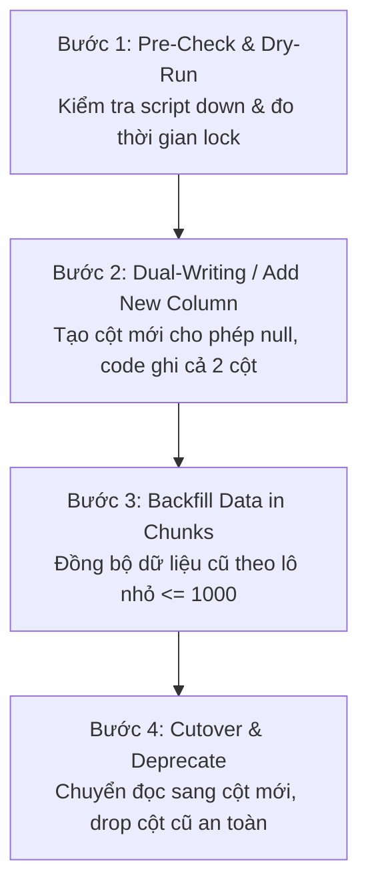

<instructions>
```yaml
playbook_metadata:
  playbook_id: "PLB-001"
  title: "Safe Zero-Downtime Database Migration Protocol"
  skill_target: "Agent Skill Playbook (Archetype 5)"
  authority_level: "L1/L2 Execution Protocol"

trigger_conditions:
  activates_when:
    - "Agent modifies database table schemas or index definitions."
    - "Batch data update scripts are deployed to production environments."

operational_constraints:
  must:
    - "Provide 1-to-1 matching reversible rollback migration scripts (down script)."
    - "Wrap table schema mutations in transactions with statement timeout limits."
    - "Execute dry-run benchmarks on staging replicas prior to production execution."
  negative_space:
    - must_not: "CẤM thực thi lệnh 'ALTER TABLE ... DROP COLUMN' trực tiếp trong một bản phát hành duy nhất."
    - must_not: "CẤM chạy migration dữ liệu hàng triệu dòng mà không chia lô nhỏ (batching chunk size <= 1000)."
    - must_not: "CẤM giữ table exclusive locks quá 5000ms gây nghẽn toàn bộ kết nối hệ thống."
    - must_not: "CẤM bỏ qua bước kiểm chứng schema sau khi migration kết thúc."
```
</instructions>

<context>
## Quy Trình 4 Bước Di Chuyển Schema Không Gây Gián Đoạn (Zero-Downtime Protocol)

### 1. Khung Thực Thi Tuần Tự (4-Step Execution Matrix)


### 2. Chi Tiết Các Bước Thao Tác (Protocol Details)
```yaml
execution_protocol:
  step_1_pre_check:
    action: "Kiểm tra tính khả nghịch và cú pháp reversible migration."
    validation: "Dry-run trên staging replica, kiểm tra table lock < 100ms."
  step_2_add_column:
    action: "Thêm cột mới với giá trị nullable hoặc default không rewrite bảng."
  step_3_backfill:
    action: "Chạy script backfill dữ liệu cũ có gắn rate-limit và correlation_id."
  step_4_verify:
    action: "Truy vấn kiểm tra tính toàn vẹn của index và tỷ lệ đồng nhất dữ liệu 100%."
```

### Tài Liệu Tham Chiếu
- [Quy Chuẩn Chính Sách Vận Hành](archetype-2-operational-policy.template.md)
- [Quyết Định Kiến Trúc Hướng Sự Kiện](archetype-4-architecture-adr.template.md)
</context>

<output_contract>
```yaml
playbook_verification:
  audit_runner: "python .agents/skills/ai-first-doc-formatter/scripts/verify-ai-first-format.py"
  target_artifact: "templates/archetype-5-skill-playbook.template.md"
  expected_exit_code: 0
  criteria:
    - "Protocol steps clearly defined in YAML depth <= 3."
    - "Negative Space must_not assertions >= 3."
    - "Dry-run and verification checks included."
```
</output_contract>