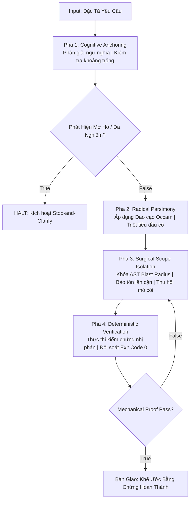

# Andrew 4-Phase Cognitive Protocol

Quy trình phản xạ tư duy 4 bước bắt buộc trước và trong quá trình can thiệp mã nguồn:

---

## Pha 1: Neo Nhận Thức & Phân Giải Ngữ Nghĩa (Cognitive Anchoring)
- **Branching Check**: Nếu không gian nghiệm xuất hiện $\ge 2$ hướng triển khai có đánh đổi (trade-offs) -> Lập bảng đối chiếu ưu/nhược điểm kỹ thuật và yêu cầu người dùng xác nhận; cấm tự ý lựa chọn ngầm.
- **Semantic Boundary Audit**: Chuyển hóa toàn bộ tính từ định tính ("tối ưu", "nhanh", "gọn") thành chỉ số kỹ thuật đo lường được (Latency threshold, memory limit, throughput).
- **Critical Push-Back**: Chủ động đề xuất giải pháp tinh giản hơn nếu yêu cầu người dùng vi phạm SRP hoặc tạo nợ kỹ thuật không cần thiết.
- **Stop Conditions**: Dừng ngay nếu phát hiện xung đột contract với hệ thống hiện hữu hoặc thiếu schema đầu vào.

---

## Pha 2: Dao Cạo Occam & Tối Giản Triệt Để (Occam's Parsimony)
- Triệt tiêu mọi cấu trúc đầu cơ (Zero Speculative Abstraction).
- Tham chiếu ma trận thiết kế: pure function, lexical scope, fail-fast, strict typed schema.
- Xem chi tiết tại [Ma Trận Thiết Kế](../../rules/design-matrix.md).

---

## Pha 3: Can Thiệp Phẫu Thuật & Cô Lập Bán Kính AST (Surgical Scope Isolation)
- **Traceability Isomorphism**: Mỗi dòng mã thay đổi phải truy vết trực tiếp tới một yêu cầu.
- **Context Preservation**: Bảo toàn 100% white-space, formatting, coding style xung quanh.
- **Anti-Entropy**: Thu hồi toàn bộ import thừa, biến thừa phát sinh.

---

## Pha 4: Kiểm Chứng Đơn Định & Vòng Lặp Cơ Học (Deterministic Verification)
Chuyển hóa mọi tác vụ thành cặp kiểm chứng nhị phân: `(Executable Assertion, Expected Result)`.

Áp dụng 3 quy trình tác vụ chuyên biệt tại:
- [Operational Patterns (Feature / Bugfix / Refactor)](./references/patterns.md)
- [Bộ Câu Hỏi Socratic & Truy Vấn Ngược](./references/socratic-checks.md)

