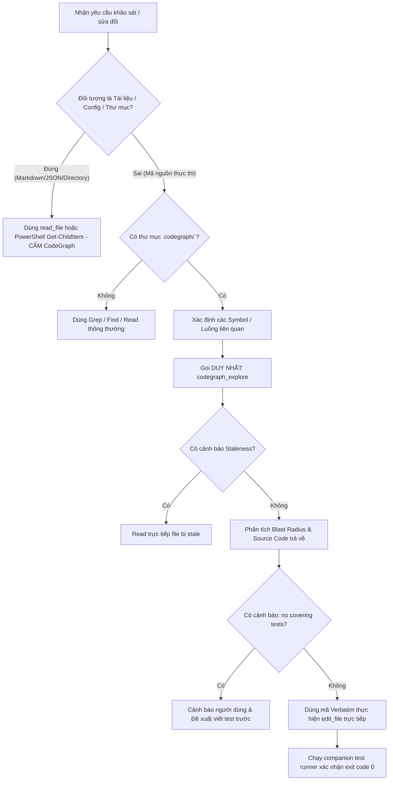

# CodeGraph Mastery: Hướng Dẫn Vận Hành MCP CodeGraph Cho AI Agent

CodeGraph là hệ thống lập chỉ mục mã nguồn cục bộ (100% Local-First) dựa trên **Tree-sitter AST, SQLite FTS5 và giải thuật Personalized PageRank (PPR)**. Công cụ cung cấp mã nguồn nguyên văn có số dòng chuẩn xác (`<line>\t<code>`), chuỗi liên kết hàm (call graph) và vùng ảnh hưởng (blast radius) chỉ trong **duy nhất 1 tool call**.

---

## 0. Ranh Giới Phạm Vi: Phạm Vi Hỗ Trợ & Vùng Cấm (Operational Boundary)

> [!IMPORTANT]
> **CodeGraph chỉ dành cho Mã Nguồn Thực Thi (Executable Code AST)**. CodeGraph KHÔNG lập chỉ mục tài liệu văn bản, tệp cấu hình hoặc cấu trúc thư mục tĩnh.

| Phân Loại | Định Dạng / Đối Tượng | Khả Năng Hỗ Trợ Của CodeGraph | Hành Động Chuẩn Của Agent |
| :--- | :--- | :--- | :--- |
| **Mã nguồn ứng dụng** | TypeScript (`.ts`, `.tsx`), JavaScript (`.js`, `.mjs`), Python (`.py`), v.v. | **HỖ TRỢ ĐẦY ĐỦ**: Phân tích AST, Call graph, Symbols, Blast radius, Verbatim Source. | **Duy nhất 1 lệnh**: Gọi `codegraph_explore` (cấm grep/read vòng lặp). |
| **Tài liệu văn bản** | Markdown (`.md`, `spec.md`, `plan.md`, `tasks.md`, tài liệu Docs) | **CẤM / KHÔNG HỖ TRỢ**: Query vào CodeGraph sẽ gây kết quả rác (false-positives) hoặc `No relevant code found`. | Dùng trực tiếp `read_file` (hoặc `edit_file`). |
| **Tệp cấu hình tĩnh** | `.json` (`hooks.json`, `package.json`), `.yml`, `.yaml`, `.env` | **CẤM / KHÔNG HỖ TRỢ**: Không có AST function/class symbols. | Dùng trực tiếp `read_file`. |
| **Khảo sát cấu trúc thư mục** | Liệt kê các file trong `specs/`, `.agents/`, `src/` | **CẤM / KHÔNG HỖ TRỢ**: Truyền tên thư mục vào CodeGraph sẽ làm tràn context hoặc trả về code không liên quan. | Dùng lệnh shell `Get-ChildItem <dir>` qua `run_command` (hoặc tool `list_dir` nếu có). |

---

## 1. Nguyên Tắc Cốt Lõi: Single-Tool & Zero Redundant Read

1. **Quy tắc 1-Call Determinism:**
   - Thay thế toàn bộ chuỗi tìm kiếm thủ công (`file_search` $\rightarrow$ `grep_search` $\rightarrow$ `read_file` $\times N$) bằng **1 lệnh gọi duy nhất**: `codegraph_explore(query)`.
   - CẤM chạy grep/read vòng lặp khi dự án đã có thư mục `.codegraph/`.

2. **Quy tắc Verbatim Source (Chống đọc lại lãng phí):**
   - Khối mã nguồn trả về từ `codegraph_explore` là **mã nguồn thực tế trên đĩa (byte-for-byte on-disk source)** kèm số dòng chuẩn.
   - Coi như tệp đó ĐÃ ĐƯỢC ĐỌC. Dùng trực tiếp đoạn mã này làm `Target` cho công cụ `edit_file`.
   - **CẤM TUYỆT ĐỐI** gọi thêm lệnh `read_file` trên các file đã xuất hiện trong kết quả explore.

3. **Quy tắc Bắt Buộc Kiểm Tra Blast Radius Trước Khi Mutation:**
   - Trước khi sửa bất kỳ hàm, class, hoặc interface nào, quan sát kỹ khối:
     `**Blast radius — what depends on these (update/verify before editing)**`
   - Xác định danh sách callers và file tests bao phủ (`tests: [...]`).
   - Nếu xuất hiện `⚠️ no covering tests found`, Agent **PHẢI KÍCH HOẠT TƯ DUY PHÒNG THỦ**: cảnh báo rủi ro hoặc yêu cầu/viết unit test trước khi sửa mã.

---

## 2. Nghệ Thuật Đặt Query `codegraph_explore` Tối Ưu

### Kỹ Thuật 1: "Bag-of-Symbols" & Flow Query (Ưu tiên số 1)
Đưa vào các symbol đại diện cho các trạm dừng của luồng dữ liệu (bắt đầu $\rightarrow$ trung gian $\rightarrow$ đích). Thuật toán Random-Walk-with-Restart (PPR) sẽ tính đường đi ngắn nhất nối giữa các symbol này.

- ❌ **Kém hiệu quả:** `query: "làm sao để lưu cấu hình extension"`
- ✅ **Chuẩn xác:** `query: "ZaloAutomationOrchestrator start queueManager initialize queueRepo"`
- ✅ **Chuẩn xác:** `query: "ForwardAutomator forwardPhase1 SELECTORS resolveElement"`

### Kỹ Thuật 2: Phân Giải Symbol Mơ Hồ (Disambiguation)
Khi tên hàm ngắn hoặc dễ trùng lặp (`clampPosition`, `validate`, `init`), luôn đính kèm tên file hoặc hằng số liên quan chặt chẽ:
- ❌ **Kém hiệu quả:** `query: "clampPosition"`
- ✅ **Chuẩn xác:** `query: "clampPosition VIEWPORT_PADDING panel-storage.ts"`

### Kỹ Thuật 3: Khảo Sát Bán Kính Ảnh Hưởng Interface
Khi muốn thay đổi public contract:
- ✅ **Cú pháp:** `query: "<Tên_Interface> <Tên_File_Chứa_Interface>"`
- Ví dụ: `query: "IFeatureStorageAdapter storage.config.ts"`

### Kỹ Thuật 4: Vượt Ranh Giới Kiến Trúc (Cross-Boundary WXT)
Khi cần tìm điểm nối giữa Entrypoint DOM và Core Service Worker:
- ✅ **Cú pháp:** `query: "entrypoints/zalo.content/index.tsx orchestrator start ZaloAutomationOrchestrator"`

---

## 3. Xử Lý Các Tình Huống Đặc Thù & Cảnh Báo Hệ Thống

### 3.1. Xử Lý `⚠️ Staleness Banner` (Xung Đột Debounce Watcher)
File Watcher của CodeGraph có cửa sổ debounce khoảng 2000ms.
- Nếu bạn vừa ghi đè/sửa một file và gọi explore ngay, kết quả có thể kèm theo banner:  
  `⚠️ Staleness Banner: file X was modified <2s ago`
- **Hành động bắt buộc:** Khi gặp banner này đối với file vừa sửa, hãy gọi trực tiếp `read_file(X)` để đọc nội dung mới nhất. Không được dựa dẫm vào cache AST đang chờ đồng bộ của CodeGraph cho đúng file đó.

### 3.2. Dự Án Monorepo & Tham Số `projectPath`
Nếu làm việc trong monorepo hoặc thư mục hiện tại không có `.codegraph/` ở root:
- Luôn truyền tham số `projectPath` trỏ đến thư mục con chứa chỉ mục:
  ```json
  {
    "query": "SymbolName",
    "projectPath": "C:/path/to/sub-package"
  }
  ```

---

## 4. Định Dạng Quy Trình Làm Việc Tiêu Chuẩn Cho Agent

Khi nhận được yêu cầu khảo sát hoặc chỉnh sửa từ người dùng:


