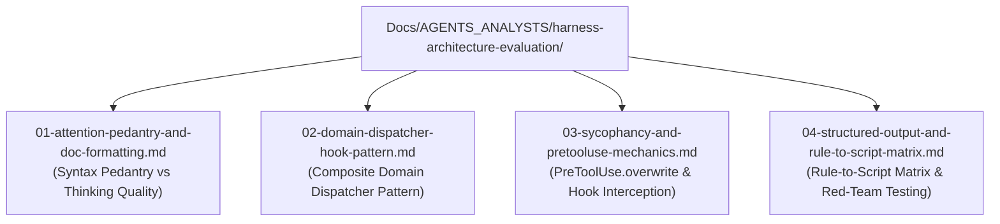

<instructions>
```yaml
document_metadata:
  title: "Tổng Quan Hệ Thống Vấn Đề & Khung Tiêu Chí Đánh Giá Kiến Trúc Harness"
  archetype: "archetype-2-operational-policy"
  version: "1.0.0"
  domain: "harness-engineering"
  status: "ACTIVE"
rules:
  - must_not: "CẤM đưa ra nhận định chủ quan không có bằng chứng mã nguồn hoặc kiểm chứng thực nghiệm."
  - must_not: "CẤM nhầm lẫn giữa kiểm định hình thức cú pháp (Syntax Check) và kiểm định tính đúng đắn logic (Semantic Correctness)."
  - must_not: "CẤM tạo ra các quy tắc mâu thuẫn làm triệt tiêu không gian suy luận (Thinking Budget) của mô hình."
```
</instructions>

<context>

# TỔNG QUAN HỆ THỐNG VẤN ĐỀ & BỘ TIÊU CHÍ ĐÁNH GIÁ KIẾN TRÚC HARNESS

Tài liệu này đóng vai trò mục lục điều phối và xác lập khung tiêu chuẩn đánh giá cho 4 tài liệu chuyên sâu thuộc phân hệ phân tích kiến trúc tác nhân, đặt tại `Docs/AGENTS_ANALYSTS/harness-architecture-evaluation/`.



---

## 1. Bản Đồ Tổng Hợp Các Vấn Đề Bị Đặt Dấu Hỏi

Trong quá trình vận hành hệ thống Harness của Google Antigravity (IDE & CLI), chuỗi tương tác giữa người dùng, Main Agent và Subagent xuất hiện 6 điểm nghẽn nhận thức cốt tử:

1. **Điểm nghẽn Token Chú Ý & Cú Pháp Bề Mặt**: Bắt bẻ từng dấu thẻ XML/YAML trong khi thực thi làm suy giảm bao nhiêu % chất lượng thinking? Có nên chuyển định dạng sang pha hậu kỳ (Post-generation formatting)?
2. **Sự Phân Mảnh & Nghẽn Cổ Chai Của Hooks**: 13 scripts rời rạc chạy qua PowerShell gây độ trễ lớn. Có pattern nào gom về 1 Hook Dispatcher duy nhất theo domain không?
3. **Tính Khả Thi & Bằng Chứng Cơ Học của `PreToolUse.overwrite`**: Liệu `overwrite` có thực sự được Go Engine của `agy.exe` hỗ trợ hay chỉ là ảo giác (hallucination)? Rủi ro khi sửa Prompt động là gì?
4. **Mức Độ Can Thiệp Thực Tế của System Prompt / Prompt Template**: Prompt template bên trong thư mục subagent có thực sự kiểm soát được luồng tương tác tool call không hay chỉ làm bẩn context?
5. **Cưỡng Chế Cấu Trúc JSON Phản Hồi của Subagent**: Trong vòng đời subagent ở chế độ tương tác (Interactive IDE), có thể ép buộc JSON contract nhị phân được không?
6. **Ma Trận Phân Định Giữa Rule và Script Cơ Học**: Dựa trên tiêu chí nào để quyết định biến một rule markdown thành code máy mà không bóp nghẹt khả năng suy luận (thinking) của model? Làm sao chống bệnh viết test đối phó?

---

## 2. Khung Ma Trận 5 Tiêu Chí Đánh Giá Chất Lượng Kiến Trúc (Evaluation Matrix)

Mọi giải pháp kỹ thuật đề xuất trong loạt tài liệu này đều được chấm điểm và đối chiếu dựa trên 5 chiều kích cơ học:

| Mã Tiêu Chí | Tên Tiêu Chí Đánh Giá | Định Nghĩa Cơ Học | Trọng Số | Đơn Vị Đo Lường |
| :--- | :--- | :--- | :--- | :--- |
| **CRIT-01** | **Bảo Toàn Ngân Sách Tư Duy (Thinking Budget Preservation)** | Mức độ giữ sạch cửa sổ ngữ cảnh và tránh phân tán token suy luận vào việc đối phó với linter cú pháp. | 25% | % Token dành cho logic nghiệp vụ / Tổng Output Tokens. |
| **CRIT-02** | **Tính Xác Thực Tầng Máy (Mechanical Verifiability)** | Khả năng kiểm chứng bằng mã máy hệ điều hành (Exit code, binary symbol, Go parser), không phụ thuộc vào lời khai văn bản của LLM. | 25% | Tỷ lệ nhị phân (Pass: 1 / Fail: 0). |
| **CRIT-03** | **Độ Trễ Khởi Tạo & Thực Thi (Latency & Overhead)** | Tổng thời gian tiêu hao cho chuỗi Hooks và Guards trong mỗi lượt gọi công cụ (Turn Roundtrip Time). | 20% | Mili-giây (ms) đo bằng Stopwatch hệ điều hành. |
| **CRIT-04** | **Tính Kháng Thiên Kiến (Sycophancy & Bias Resistance)** | Khả năng ngăn chặn tình trạng Subagent hùa theo giả định sai của Main Agent hoặc người dùng. | 15% | Tỷ lệ phát hiện lỗi khi nhận câu hỏi mớm ý (Adversarial Detection Rate). |
| **CRIT-05** | **Độ Phức Tạp Bảo Trì (Harness Maintainability)** | Khả năng kiểm thử độc lập, đóng gói module và chống hồi quy (Regression Testing) của chính bộ Harness. | 15% | Số lượng điểm chạm cấu hình (Config Touchpoints) khi mở rộng. |

---

## 3. Danh Mục Các Tài Liệu Phân Tích Chuyên Sâu

Hệ thống tài liệu bao gồm:

- [01-attention-pedantry-and-doc-formatting.md](01-attention-pedantry-and-doc-formatting.md): Bóc tách sự suy giảm chất lượng thinking do Syntax Pedantry; định vị thời điểm format văn bản (Streaming vs Post-generation); cơ chế tối ưu của `ai-first-doc-formatter`.
- [02-domain-dispatcher-hook-pattern.md](02-domain-dispatcher-hook-pattern.md): Thiết kế kiến trúc Composite Domain Dispatcher gom 13 scripts thành 1 entrypoint duy nhất qua `hooks.json`.
- [03-sycophancy-and-pretooluse-mechanics.md](03-sycophancy-and-pretooluse-mechanics.md): Bằng chứng thực nghiệm trích xuất từ nhị phân `agy.exe` về `PreToolUse.overwrite` và cơ chế can thiệp ngữ cảnh của Subagent.
- [04-structured-output-and-rule-to-script-matrix.md](04-structured-output-and-rule-to-script-matrix.md): Ma trận phân định ranh giới Rule vs Script; kỹ thuật Red-Team Testing chống bệnh tạo test hời hợt.

</context>

<output_contract>
```yaml
verification_gate:
  command: "python .agents/skills/ai-first-doc-formatter/scripts/verify-ai-first-format.py Docs/AGENTS_ANALYSTS/harness-architecture-evaluation/00-overview-and-evaluation-criteria.md"
  expected_exit_code: 0
acceptance_criteria:
  - "Tất cả liên kết tham chiếu sử dụng đường dẫn tương đối nội bộ dự án."
  - "Tồn tại đủ 3 điều cấm cụ thể trong negative space."
  - "Khung tiêu chí đánh giá bao quát 5 chiều kích định lượng rõ ràng."
```
</output_contract>
