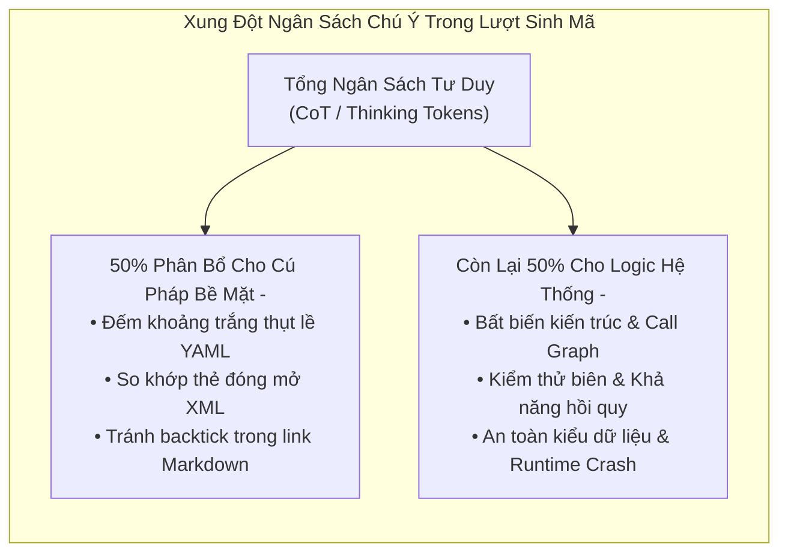
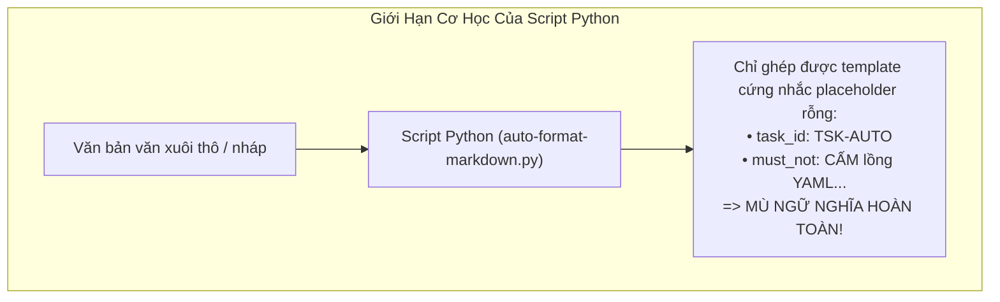
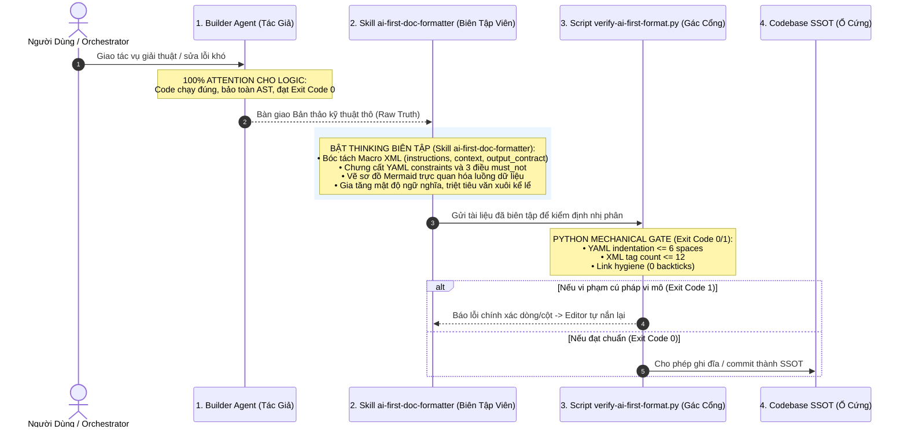

<instructions>
```yaml
document_metadata:
  title: "Bóc Tách Tác Động Của Bắt Bẻ Cú Pháp Bề Mặt Lên Chất Lượng Tư Duy Và Định Vị Kiến Trúc Tác Giả - Biên Tập Viên"
  archetype: "archetype-4-architecture-adr"
  version: "1.1.0"
  status: "ACTIVE"
rules:
  - must_not: "CẤM ép buộc mô hình thực hiện đồng thời suy luận logic sâu và nắn chỉnh cú pháp vi mô trong cùng một bước sinh mã."
  - must_not: "CẤM ngộ nhận script Python có khả năng tự động biên tập ngữ nghĩa thay thế năng lực thinking của mô hình."
  - must_not: "CẤM để tài liệu nháp phi cấu trúc lưu hành làm chân lý SSOT gây ngộ độc ngữ cảnh trung gian cho các lượt chạy sau."
```
</instructions>

<context>

# BÓC TÁCH TÁC ĐỘNG CỦA CÚ PHÁP BỀ MẶT LÊN TƯ DUY & KIẾN TRÚC "TÁC GIẢ - BIÊN TẬP VIÊN" (AUTHOR - EDITOR PATTERN)

Tài liệu này giải quyết điểm nghẽn nhận thức: *Bắt bẻ cú pháp XML/YAML trong khi code làm suy giảm chất lượng tư duy ra sao? Tại sao Python không thể tự động biên tập ngữ nghĩa? Và làm thế nào để vừa bảo vệ Attention Budget của Builder vừa không làm ô nhiễm ngữ cảnh trung gian của hệ thống?*

---

## 1. Cơ Chế Thần Kinh Của LLM: Xung Đột Ngân Sách Chú Ý (Attention Budget Collision)

Trong kiến trúc Transformer, ngân sách chú ý (Attention Budget) và chuỗi token suy luận (Thinking Tokens) là tài nguyên hữu hạn được phân bổ tuần tự:



### 1.1. Hiện tượng "Attention Bleeding" do Cú pháp Vi mô
Khi hệ thống áp đặt đồng thời quá nhiều ràng buộc định dạng bề mặt vào cùng một bước tạo mã:
- **Phân tán ma trận Self-Attention**: Các attention heads phải liên tục duy trì trạng thái đếm khoảng trắng ($\le 6$ spaces) và kiểm tra thẻ XML mở/đóng.
- **Hội chứng "Thiên lệch làm vừa lòng linter" (Linter Placation Bias)**: Mô hình ưu tiên sinh đầu ra vượt qua regex của Guard, dẫn đến việc cắt ngắn hoặc đơn giản hóa phần suy luận logic phức tạp.
- **Hậu quả thực tế trong phiên 5eebf587**: Agent sinh ra toàn bộ thẻ XML và YAML cực kỳ đẹp mắt, vượt qua 7 guard hình thức, nhưng lại **quên mất việc kiểm tra xem công cụ `call_mcp_tool` có tồn tại trong Go registry hay không**, dẫn đến sập toàn bộ hệ thống trong IDE.

---

## 2. Giới Hạn Của Script Máy: Tại Sao Python Không Thể Tự Biên Tập Ngữ Nghĩa?

Một sai lầm thiết kế phổ biến là kỳ vọng script Python (`auto-format-markdown.py`) có thể tự động "sửa ngầm" các tài liệu văn xuôi phi cấu trúc thành chuẩn AI-First Triad trên đĩa cứng:



### 2.1. Phân biệt rạch ròi hai bản chất công việc
1. **Kiểm tra / Sửa cú pháp máy (Syntactic Linting)**: Đếm khoảng trắng, sửa dấu ngoặc, chuẩn hóa link regex. Đây là việc **Python làm rất tốt** (nhanh, tốn ít CPU, tất định).
2. **Biên tập & Chưng cất cấu trúc ngữ nghĩa (Semantic Distillation)**:
   - Đọc hiểu nghiệp vụ để trích xuất **Bất biến kiến trúc (Invariants)**.
   - Phân tích rủi ro để thiết lập **Ranh giới phủ định (Negative Space - 3 điều `must_not`)**.
   - Vẽ sơ đồ **Mermaid Flowchart / Sequence** mô hình hóa luồng dữ liệu.
   - Nén mật độ thông tin, triệt tiêu văn phong kể lể dài dòng.
   - **Đây là CÔNG VIỆC TƯ DUY (Cognitive Work)**, bắt buộc phải sử dụng năng lực `Thinking` của mô hình thông qua một Skill chuyên trách như `ai-first-doc-formatter`.

---

## 3. Kiến Trúc Hợp Nhất: Mô Hình "Tác Giả - Biên Tập Viên" (The Author - Editor Pattern)

Để vừa bảo phóng thích 100% Attention cho Builder khi viết code, vừa đảm bảo tài liệu lưu lại trên đĩa cứng đạt độ nén ngữ nghĩa cao và không làm ngộ độc context trung gian của các turn kế tiếp:



---

## 4. Ma Trận 6 Điểm Định Vị Thời Điểm Biên Tập (Milestone Gating Matrix)

Thay vì chạy linter bắt bẻ từng bước gõ phím nhỏ, việc biên tập và kiểm định tài liệu được kích hoạt theo các **Mốc Chuyển Giao Quyết Định (Milestone Cognitive Gates)**:

```yaml
milestone_gates:
  gate_1_spec_approval:
    milestone: "Hoàn tất soạn thảo spec.md, plan.md, hoặc tasks.md."
    action: "BẮT BUỘC kích hoạt ai-first-doc-formatter biên tập trước khi bàn giao cho Builder."
    rationale: "Ngăn chặn ngộ độc ngữ cảnh trung gian (Context Poisoning) cho Builder."
  gate_2_daily_coding:
    milestone: "Builder đang viết mã nguồn src/** và unit tests."
    action: "VÔ HIỆU HÓA toàn bộ linter cú pháp hình thức trong PreToolUse."
    rationale: "Bảo tồn 100% Thinking Budget cho logic thuật toán và an toàn kiểu dữ liệu."
  gate_3_doc_publishing:
    milestone: "Xuất bản báo cáo kỹ thuật hoặc tài liệu kiến trúc Docs/**."
    action: "Chạy ai-first-doc-formatter và xác thực qua verify-ai-first-format.py."
    rationale: "Bảo đảm tài liệu lưu trữ lâu dài đạt chuẩn AI-First Triad."
  gate_4_chat_streaming:
    milestone: "Phản hồi hội thoại tương tác nhanh với người dùng."
    action: "Sử dụng Markdown tự nhiên, cấm ép thẻ XML macro phức tạp."
    rationale: "Cực tiểu hóa độ trễ phản hồi (Turn Latency)."
  gate_5_syntax_failure_threshold:
    milestone: "Tỷ lệ lỗi cú pháp bề mặt vượt quá 15% tổng số turn."
    action: "Tách bước biên tập tài liệu thành một Subagent riêng biệt (Dedicated Editor Subagent)."
    rationale: "Ngăn chặn vòng lặp sửa format vô tận trong phiên làm việc chính."
  gate_6_pre_commit_audit:
    milestone: "Chuẩn bị commit các thay đổi tài liệu vào Git."
    action: "Kích hoạt verify-ai-first-format.py tại Git pre-commit hook."
    rationale: "Chốt chặn cơ học cấp hệ điều hành đảm bảo zero vi phạm lọt vào repository."
```

---

## 5. Kết Luận Kiến Trúc

1. **Phân định dứt khoát**: Linter máy (Python) chịu trách nhiệm kiểm tra cú pháp nhị phân; Mô hình ngôn ngữ (qua Skill `ai-first-doc-formatter`) chịu trách nhiệm tư duy biên tập cấu trúc ngữ nghĩa.
2. **Khắc phục xung đột**: Loại bỏ hoàn toàn linter hình thức khỏi sự kiện `PreToolUse` trong lúc code; chỉ kích hoạt biên tập tại các mốc bàn giao đặc tả để triệt tiêu đồng thời cả hai nguy cơ *Attention Bleeding* và *Intermediate Context Poisoning*.

</context>

<output_contract>
```yaml
verification_gate:
  command: "python .agents/skills/ai-first-doc-formatter/scripts/verify-ai-first-format.py Docs/AGENTS_ANALYSTS/harness-architecture-evaluation/01-attention-pedantry-and-doc-formatting.md"
  expected_exit_code: 0
acceptance_criteria:
  - "Chứng minh sự khác biệt bản chất giữa Syntactic Linting và Semantic Distillation."
  - "Thiết lập mô hình Tác giả - Biên tập viên giải phóng Thinking Budget."
  - "Định vị 6 mốc kích hoạt biên tập ngăn chặn Context Poisoning."
```
</output_contract>
