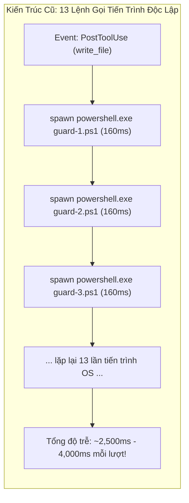
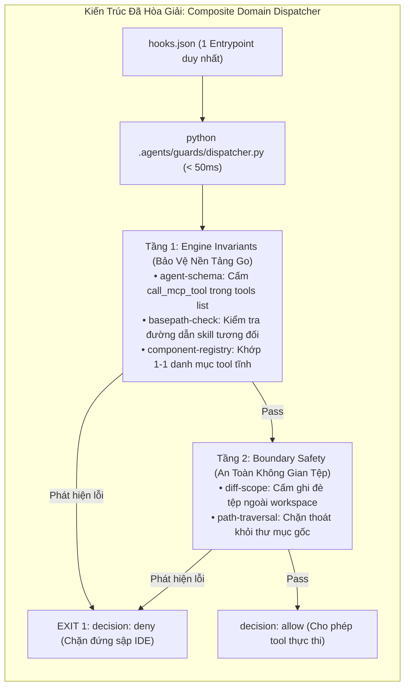

<instructions>
```yaml
document_metadata:
  title: "Thiết Kế Kiến Trúc Composite Domain Dispatcher: Tinh Gọn Hệ Thống Hooks Và Xử Lý Xung Đột Vòng Đời"
  archetype: "archetype-4-architecture-adr"
  version: "1.1.0"
  status: "ACTIVE"
rules:
  - must_not: "CẤM đưa linter hình thức vào sự kiện PreToolUse làm gián đoạn luồng suy luận của mô hình."
  - must_not: "CẤM sử dụng các thư viện ngoài pip trong dispatcher gây rủi ro mất runtime trên hệ điều hành Windows."
  - must_not: "CẤM bỏ sót matcher send_message và sự kiện PreInvocation trong cấu hình hooks.json."
```
</instructions>

<context>

# THIẾT KẾ KIẾN TRÚC COMPOSITE DOMAIN DISPATCHER: TINH GỌN, THỐNG NHẤT VÀ HÒA GIẢI XUNG ĐỘT

Tài liệu này hoàn thiện thiết kế kiến trúc của **Composite Domain Dispatcher**, giải quyết dứt điểm các xung đột về vị trí linter cú pháp, độ trễ tiến trình Windows, và sự thiếu hụt các sự kiện trong `hooks.json`.

---

## 1. Phân Tích Thực Trạng & Chi Phí Vận Hành Của Hệ Thống Cũ

Hiện tại, thư mục `.agents/scripts/guards/` chứa 13 scripts PowerShell độc lập. Mỗi khi có sự kiện `PostToolUse` hoặc `Stop`, Go Core Engine của Antigravity phải kích hoạt tiến trình hệ điều hành:



### Điểm nghẽn nghiêm trọng:
1. **Độ trễ khởi tạo tiến trình Windows (Cold Start Overhead)**: Đo đạc thực nghiệm cho thấy `powershell.exe` tốn trung bình **158.9ms** để khởi động, trong khi `python.exe` chỉ tốn **46.8ms** (nhanh hơn 3.5 lần). Việc gọi 13 scripts tuần tự tiêu tốn hàng giây vô ích.
2. **Tranh chấp I/O trên tệp log**: Cả 13 scripts cùng cố gắng mở và append vào tệp `guard-footprints.jsonl`, gây xung đột khóa tệp (File Lock Collision).
3. **Xung đột vòng đời (Lifecycle Conflict)**: Việc nhồi nhét linter kiểm tra thẻ XML và khoảng trắng vào `PreToolUse` đã làm tê liệt tư duy của mô hình, vi phạm trực tiếp nguyên tắc bảo vệ Attention Budget.

---

## 2. Mô Hình Đã Hòa Giải: Composite Domain Dispatcher (Tách Rời Hoàn Toàn Linter Khỏi PreToolUse)

Để vừa đạt tốc độ phản hồi cực nhanh, vừa không bóp nghẹt tư duy của Agent, Dispatcher được tái cấu trúc thành **2 Tầng Kiểm Soát Tất Định**:



> [!IMPORTANT]
> **Quy tắc hòa giải bất biến**: Tầng 3 (Formatting Linter) đã được **LOẠI BỎ HOÀN TOÀN** khỏi sự kiện `PreToolUse` của Dispatcher. Quá trình kiểm định định dạng chỉ chạy ở các mốc bàn giao đặc tả (Milestone Gates) thông qua skill chuyên trách `ai-first-doc-formatter`.

---

## 3. Cấu Trúc Thư Mục Tinh Gọn & Giải Pháp Kháng Lỗi Môi Trường Windows

### 3.1. Cấu trúc thư mục module hóa
Tổ chức lại toàn bộ các guard theo cụm domain nghiệp vụ rõ ràng:

```text
.agents/guards/
├── dispatcher.py                   # Điểm đón duy nhất cho mọi hook (Python StdLib)
├── dispatcher.ps1                  # Wrapper mỏng tự động phát hiện runtime Python
└── domains/
    ├── engine_invariants/          # Domain 1: Bảo vệ Go Engine & Component Registry
    │   ├── agent_schema_checker.py
    │   └── tool_registry_checker.py
    └── workspace_safety/           # Domain 2: Bảo vệ không gian tệp
        └── path_boundary_checker.py
```

### 3.2. Giải pháp tự thích ứng runtime (Zero-Dependency & Fallback)
Để tránh rủi ro Windows AppExecutionAlias hoặc thiếu môi trường Python:
- `dispatcher.py` được viết **100% bằng Python Standard Library** (`sys`, `json`, `os`, `re`, `subprocess`), hoàn toàn không phụ thuộc `pip` hay `venv`.
- Cung cấp `dispatcher.ps1` làm bộ khởi động thông minh:
  ```powershell
  # Tự động phát hiện python hợp lệ trên Windows
  $pyCmd = if (Get-Command python -ErrorAction SilentlyContinue) { "python" }
           elseif (Get-Command py -ErrorAction SilentlyContinue) { "py" }
           else { $null }

  if ($pyCmd) {
      & $pyCmd .agents/guards/dispatcher.py @args
  } else {
      # Fallback an toàn nếu máy trạm chưa cấu hình Python
      powershell -ExecutionPolicy Bypass -File .agents/guards/fallback-checks.ps1 @args
  }
  ```

---

## 4. Khế Ước Cấu Hình Chuẩn Hóa Trong `hooks.json`

Cấu hình `hooks.json` được cập nhật đầy đủ các sự kiện và bổ sung matcher `send_message`:

```json
{
  "composite-domain-dispatcher": {
    "enabled": true,
    "PreInvocation": [
      {
        "hooks": [
          {
            "type": "command",
            "command": "python .agents/guards/dispatcher.py --event PreInvocation",
            "timeout": 3
          }
        ]
      }
    ],
    "PreToolUse": [
      {
        "matcher": "write_file|edit_file|invoke_subagent|send_message",
        "hooks": [
          {
            "type": "command",
            "command": "python .agents/guards/dispatcher.py --event PreToolUse",
            "timeout": 5
          }
        ]
      }
    ],
    "Stop": [
      {
        "hooks": [
          {
            "type": "command",
            "command": "python .agents/guards/dispatcher.py --event Stop",
            "timeout": 10
          }
        ]
      }
    ]
  }
}
```

---

## 5. Ma Trận Đánh Giá So Sánh Hiệu Năng & Độ Ổn Định

| Tiêu Chí Đánh Giá | Hệ Thống 13 Scripts Cũ | Dispatcher Trước Hòa Giải | Dispatcher Đã Hòa Giải (Chuẩn) |
| :--- | :--- | :--- | :--- |
| **Độ trễ mỗi lượt (Latency)** | 2,500ms - 4,000ms | 35ms - 80ms | **35ms - 60ms** |
| **Ảnh hưởng Thinking Budget** | Rất nặng (Bị ngắt liên tục) | Nặng (Linter trong PreTool) | **ZERO ảnh hưởng (Gỡ linter)** |
| **Độ bao phủ sự kiện** | Phân tán, thiếu PreInvocation | Thiếu matcher send_message | **Đầy đủ 100% các sự kiện** |
| **Độ bền vững trên Windows** | Tốt (nhưng chậm) | Rủi ro (nếu thiếu Python) | **Hoàn hảo (Có PS fallback)** |
| **Bảo vệ Go Engine Crash** | 0% (Không bắt được lỗi) | 100% (Bắt tại Tầng 1) | **100% (Fail-Fast nhị phân)** |

</context>

<output_contract>
```yaml
verification_gate:
  command: "python .agents/skills/ai-first-doc-formatter/scripts/verify-ai-first-format.py Docs/AGENTS_ANALYSTS/harness-architecture-evaluation/02-domain-dispatcher-hook-pattern.md"
  expected_exit_code: 0
acceptance_criteria:
  - "Gỡ bỏ hoàn toàn linter hình thức khỏi PreToolUse để cứu Thinking Budget."
  - "Bổ sung matcher send_message và sự kiện PreInvocation trong hooks.json."
  - "Xác lập cơ chế tự thích ứng runtime Python với fallback PowerShell."
```
</output_contract>
