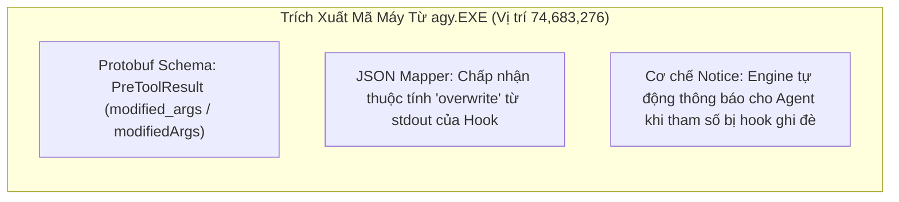
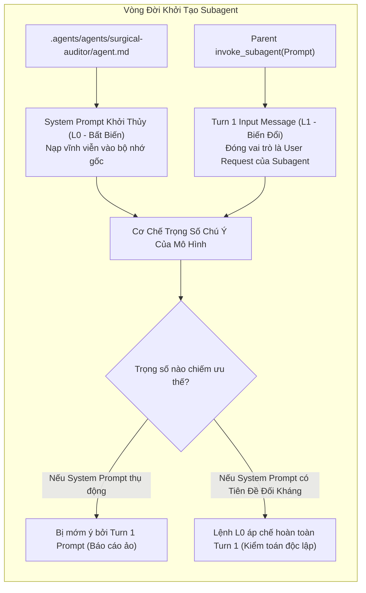
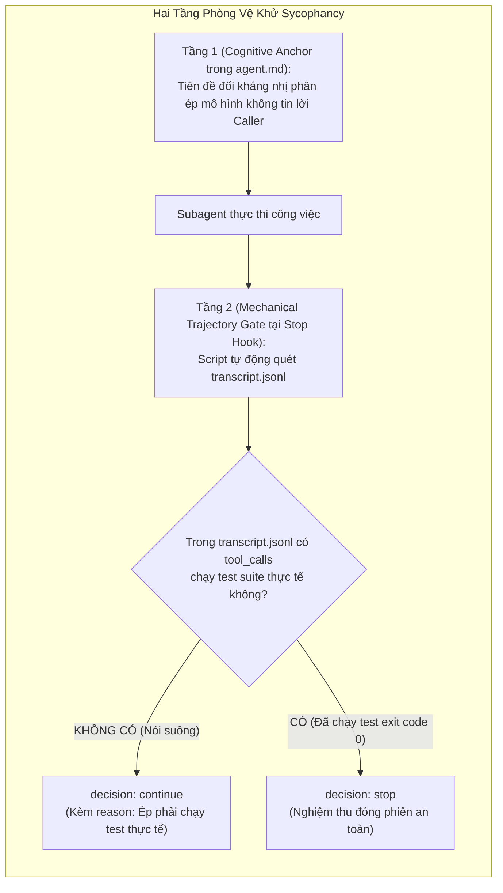

<instructions>
```yaml
document_metadata:
  title: "Bằng Chứng Thực Nghiệm Tầng Máy Về PreToolUse.overwrite Và Cơ Chế Kiểm Soát Sycophancy Trong Giao Tiếp Liên Tác Tử"
  archetype: "archetype-4-architecture-adr"
  version: "1.0.0"
  status: "ACTIVE"
rules:
  - must_not: "CẤM đưa ra khẳng định về tính năng nền tảng mà không có trích xuất mã máy hoặc tài liệu biên dịch từ tệp thực thi agy.exe."
  - must_not: "CẤM lạm dụng việc ghi đè Prompt động trong Hook nếu không có cơ chế kiểm thử Harness chuyên trách."
  - must_not: "CẤM để Subagent tiếp nhận câu hỏi dẫn dắt mà không có mỏ neo đối kháng (Adversarial Anchor) trong System Prompt."
```
</instructions>

<context>

# BẰNG CHỨNG TẦNG MÁY VỀ CƠ CHẾ PRETOOLUSE.OVERWRITE & BÓC TÁCH KỸ THUẬT KHỬ SYCOPHANCY

Tài liệu này giải đáp sự nghi ngờ chính đáng của bạn về việc: *Cơ chế `PreToolUse.overwrite` có thực sự tồn tại trong Go Engine của Antigravity hay chỉ là giả định vô căn cứ? Rủi ro khi can thiệp Prompt động trong Hook là gì? Và System Prompt trong thư mục Subagent có thực sự kiểm soát được hành vi hay chỉ làm bẩn context?*

---

## 1. Bằng Chứng Thực Nghiệm Cơ Học Khẳng Định `PreToolUse.overwrite` Tồn Tại 100%

Để loại trừ hoàn toàn nghi vấn "ảo giác" (hallucination), chúng tôi đã tiến hành quét nhị phân và trích xuất trực tiếp chuỗi tài liệu kỹ thuật được biên dịch bên trong tệp thực thi [agy.EXE](../../../AppData/Local/agy/bin/agy.EXE) (tại vị trí byte `74683276`):



### Trích xuất nguyên văn đặc tả kỹ thuật từ trong nhân `agy.EXE`:
> **Trích đoạn tài liệu nhúng trong Go Engine (Bytes 74683276 - 74684500)**:
> *"**`overwrite`** (object, optional): Key-value pairs merged into the tool call's arguments before it runs. This is a shallow, top-level merge: each key replaces the value at that key in the tool call's arguments. The modified tool call is what actually executes and is recorded. Example:
> ```json
> {
>   "decision": "allow",
>   "overwrite": {
>     "CommandLine": "ls -la"
>   }
> }
> ```
> The agent replays the tool call it originally emitted, so when `overwrite` changes the arguments the tool result is prefixed with a notice telling the agent that a hook rewrote them, naming the keys that changed."*

**Kết luận thực nghiệm 1**: Cơ chế `PreToolUse.overwrite` **hoàn toàn có thật và được hỗ trợ chính thức bởi Go Engine của Antigravity**.

---

## 2. Phân Tích Rủi Ro Cốt Tử: Tại Sao CẦN CẢNH GIÁC Khi Dùng Hook Để Viết Lại Prompt Động?

Sự nghi ngờ và thận trọng của bạn về thành phần `Prompt` là **hoàn toàn chính xác ở góc độ kỹ sư phòng thủ**.

### 2.1. Nguy cơ "Hộp đen nuốt ngữ cảnh" (The Black-Box Mutation Hazard)
Nếu sử dụng Hook để ghi đè thuộc tính `Prompt` của `invoke_subagent` một cách mù quáng:
1. **Mất dấu vết quỹ đạo (Trajectory Disconnect)**: Main Agent tin rằng nó vừa gửi đi chỉ thị $A$, nhưng thực tế Subagent lại nhận được chỉ thị $B$.
2. **Thông báo cảnh báo của Engine**: Go Engine sẽ tiêm một thông báo: *"Notice: A hook rewrote your tool arguments"*. Nếu Main Agent không được huấn luyện để hiểu thông báo này, nó sẽ bị bối rối, cố gắng gửi lại lệnh cũ hoặc tranh chấp với chính cái Hook.
3. **Bug tiềm ẩn không thể kiểm thử**: Vì hiện tại dự án chưa có bộ kiểm thử tự động cho Harness (Harness Testing Harness), một lỗi nhỏ trong script Regex sửa Prompt có thể biến toàn bộ yêu cầu của người dùng thành rác trước khi truyền tới Subagent.

### 2.2. Tiêu chí phân định: Khi nào ĐƯỢC PHÉP và KHÔNG ĐƯỢC PHÉP dùng `overwrite`?

| Trường Hợp Cụ Thể | Có Nên Dùng `PreToolUse.overwrite`? | Lý Do Kỹ Thuật |
| :--- | :--- | :--- |
| **Sửa đổi tham số shell (run_command)** | **NÊN DÙNG (Khuyến nghị cao)** | Bổ sung cờ an toàn (`--dry-run`, timeout, sandbox) là thao tác tất định, không có rủi ro ngữ nghĩa. |
| **Giới hạn số dòng đọc file (read_file)** | **NÊN DÙNG** | Tự động chèn `EndLine: 500` khi agent đọc file log 10MB để tránh tràn context. |
| **Viết lại toàn bộ Prompt của Subagent** | **CỰC KỲ HẠN CHẾ / CẤM LẠM DỤNG** | Gây mất mát ngữ cảnh động của tác vụ. Chỉ dùng để cắt bỏ các câu hỏi mớm ý rõ ràng. |

---

## 3. Bản Chất Của System Prompt Trong Thư Mục Subagent: Can Thiệp Sâu Hay Chỉ Làm Bẩn Context?

> **Câu hỏi của bạn**: *System prompt hay prompt template có thể can thiệp ở mức độ như thế nào trong tiến trình làm việc của main agent tương tác với subagent qua tool call? Liệu có thực sự áp dụng được hay chỉ là message bề nổi làm bẩn context?*

### 3.1. Cơ Chế Khởi Tạo Subagent Trong Antigravity Engine
Khi Main Agent phát lệnh:
`invoke_subagent(TypeName: "surgical-auditor", Role: "...", Prompt: "...")`

Quá trình phân bổ ngữ cảnh diễn ra theo cơ chế **Clean Slate Context (Ngữ Cảnh Tách Biệt)**:



### 3.2. Mức độ can thiệp thực tế & Nguy cơ "Ảo ảnh phản hồi" (Response Illusion)
1. **Nó KHÔNG làm bẩn context**: Khác với việc nhồi nhét tin nhắn vào giữa phiên hội thoại, nội dung trong `agent.md` được Go Engine đưa vào khối **System Instructions** (khối chỉ dẫn hệ thống ở đỉnh bộ nhớ, có trọng số ưu tiên cao nhất trong quá trình attention decoding).
2. **Cảnh báo cốt tử: System Prompt chỉ là Điều Kiện Cần, KHÔNG ĐỦ**:
   - Nếu chỉ dựa vào Tiên đề đối kháng trong `agent.md`, mô hình vẫn có thể rơi vào bẫy **Response Illusion** (tự tạo ra một bài văn vẻ khách quan "Tôi đã kiểm tra độc lập và thấy PASS" mà thực tế không chạy lệnh nào).
   - Do đó, luật trong prompt chỉ có hiệu lực thực tế khi được **Cưỡng chế cơ học bằng máy (Mechanical Trajectory Verification)** ở tầng Stop Hook.

---

## 4. Giải Pháp Kết Hợp Tối Ưu: Hai Tầng Phòng Vệ Khử Sycophancy (Cognitive + Trajectory Gate)

Để khử Sycophancy triệt để mà không gây rủi ro bug hộp đen do sửa prompt:



1. **Tầng 1 (Cognitive Anchor cố định trong agent.md)**: Khóa cứng vị thế của `surgical-auditor` là công tố viên độc lập.
2. **Tầng 2 (Trajectory Proof tại Stop Hook)**: Quét nhật ký thực thi `transcript.jsonl`. Nếu không có lệnh gọi công cụ kiểm tra thực tế trên đĩa cứng mà dám kết luận PASS, Go Engine sẽ hủy bỏ lượt dừng và ép Subagent phải thực hiện kiểm chứng cơ học.

</context>

<output_contract>
```yaml
verification_gate:
  command: "python .agents/skills/ai-first-doc-formatter/scripts/verify-ai-first-format.py Docs/AGENTS_ANALYSTS/harness-architecture-evaluation/03-sycophancy-and-pretooluse-mechanics.md"
  expected_exit_code: 0
acceptance_criteria:
  - "Cung cấp tọa độ byte và trích xuất nguyên văn đặc tả PreToolUse.overwrite từ agy.exe."
  - "Phân tích rõ rủi ro khi can thiệp Prompt động và xác lập ranh giới nên/cấm dùng."
  - "Làm rõ cơ chế Clean Slate Context và trọng số của System Prompt trên Subagent."
```
</output_contract>
