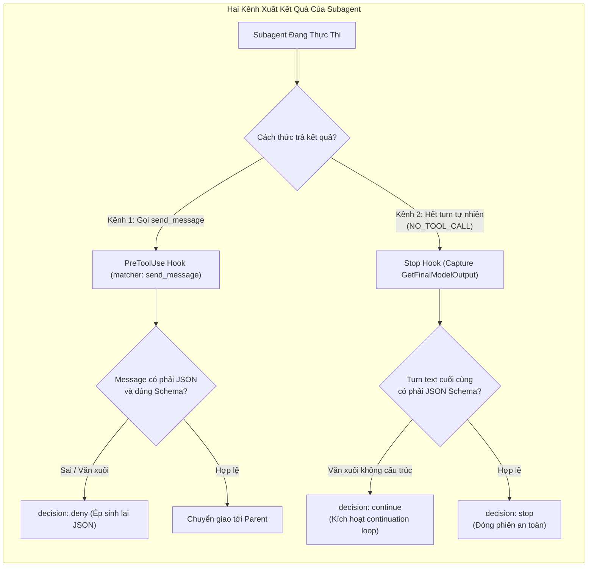
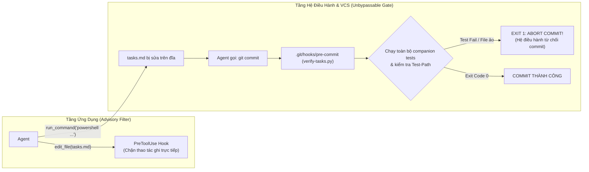
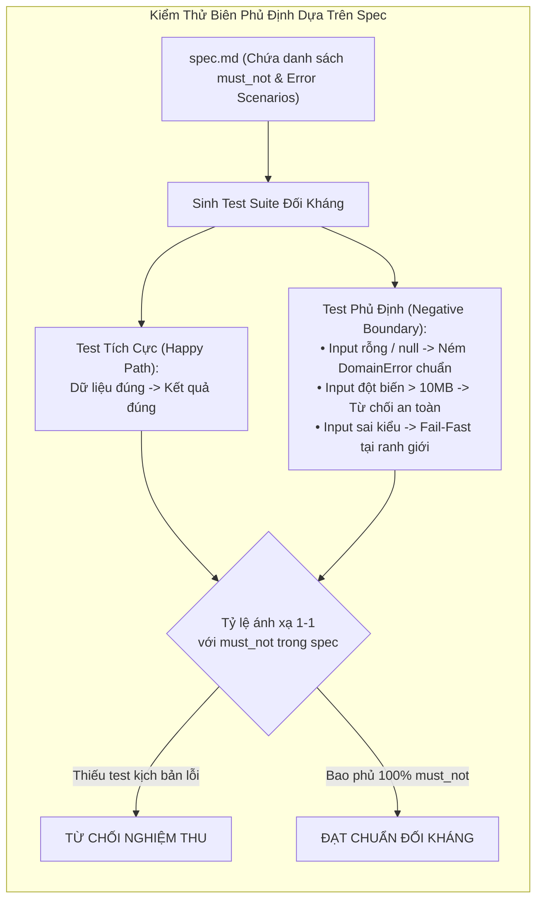

<instructions>
```yaml
document_metadata:
  title: "Ma Trận Phân Định Ranh Giới Quy Tắc - Mã Máy, Cưỡng Chế JSON Hai Kênh Và Kiểm Thử Biên Đối Kháng"
  archetype: "archetype-4-architecture-adr"
  version: "1.1.0"
  status: "ACTIVE"
rules:
  - must_not: "CẤM chuyển đổi các bài toán ngữ nghĩa linh hoạt thành script cơ học cứng nhắc làm triệt tiêu không gian suy luận."
  - must_not: "CẤM phụ thuộc duy nhất vào tool hook để khóa tasks.md mà bỏ quên chốt chặn Git Pre-Commit."
  - must_not: "CẤM làm bẩn workspace bằng việc đột biến trực tiếp mã nguồn trên đĩa cứng để thử nghiệm test."
```
</instructions>

<context>

# MA TRẬN PHÂN ĐỊNH RANH GIỚI RULE - MÃ MÁY & KIẾN TRÚC PHÒNG VỆ HAI KÊNH

Tài liệu này hoàn thiện các giải pháp kỹ thuật sâu sắc cho 3 bài toán:
1. *Cưỡng chế cấu trúc JSON trên Subagent ở chế độ tương tác qua Cơ chế Hai Kênh (Dual-Channel Gating).*
2. *Bịt kín lỗ hổng lách luật sửa `tasks.md` bằng chốt chặn cấp hệ điều hành Git Pre-Commit Hook.*
3. *Khắc phục bệnh test hời hợt bằng Kiểm thử Biên Phủ định (Spec-Driven Negative Testing) mà không vi phạm nguyên tắc AST Invariance.*

---

## 1. Cơ Chế Cưỡng Chế Cấu Trúc JSON Phản Hồi Hai Kênh (Dual-Channel Subagent Gating)

> **Băn khoăn của bạn**: *Trong tiến trình tương tác thực tế, Subagent có thể trả kết quả qua tool `send_message` hoặc kết thúc tự nhiên ở turn cuối (NO_TOOL_CALL). Làm thế nào để ép buộc cấu trúc JSON trong cả 2 trường hợp?*

### 1.1. Mô Hình Chốt Chặn Hai Kênh (Dual-Channel Defense)



### 1.2. Cơ chế thực thi chi tiết
1. **Kênh 1 (Kênh Tin Nhắn Chủ Động - `PreToolUse`)**:
   Khi Subagent gọi `send_message`, Hook `PreToolUse` bắt lấy tham số `Message`. Nếu nội dung là văn xuôi giải thích dài dòng $\rightarrow$ Ném `decision: deny` với lý do `[SCHEMA_VIOLATION]`. Subagent buộc phải tự đóng gói lại thành JSON.
2. **Kênh 2 (Kênh Kết Thúc Tự Nhiên - `Stop` Hook)**:
   Nếu Subagent không gọi `send_message` mà kết thúc bằng tin nhắn cuối turn, Go Engine kích hoạt `Stop` Hook. Script kiểm tra `StopHookArgs.GetFinalModelOutput()`. Nếu phản hồi cuối cùng không parse được theo JSON Contract $\rightarrow$ Hook trả về `decision: "continue"` kèm lý do vi phạm. Go Engine sẽ kích hoạt cơ chế continuation loop (`max_stop_hook_continuations`), từ chối kết thúc phiên và ép Subagent phải sửa lại phản hồi thành JSON hợp lệ. Ngược lại, khi đạt chuẩn, Hook trả về `decision: "stop"` để hoàn tất đóng phiên.

---

## 2. Khóa Cứng Trạng Thái `tasks.md`: Chốt Chặn Tầng Git Pre-Commit Thay Vì Tool Hook

> **Lỗ hổng đã bóc tách**: *Nếu chỉ chặn write_file/edit_file, Agent hoàn toàn có thể dùng run_command chạy lệnh PowerShell/Bash ghi đè tasks.md để lách luật.*

### 2.1. Phân Tầng Chốt Chặn: Ứng Dụng vs Hệ Điều Hành



### 2.2. Quy tắc cơ học bất khả kháng
- **Lớp phòng vệ 1 (Tool Hook)**: Đóng vai trò cảnh báo sớm, chặn các lệnh `write_file`/`edit_file` vô tình sửa vào `tasks.md`.
- **Lớp phòng vệ 2 (Git Pre-Commit Hook)**: Đây là **chốt chặn tối thượng**. Bất kể `tasks.md` bị sửa bằng cách nào (kể cả qua lệnh shell tinh vi trong `run_command`), khi Agent thực hiện `git commit`, hook `.git/hooks/pre-commit` sẽ:
  1. Quét git diff của `tasks.md`.
  2. Nếu phát hiện bất kỳ mục nào chuyển từ `[ ]` sang `[x]`, tự động kích hoạt bài test tương ứng.
  3. Kiểm tra bằng `Test-Path` xem tất cả các tệp mã nguồn cam kết có thực sự tồn tại trên đĩa hay không.
  4. Nếu bài test không đạt `Exit Code 0` hoặc tệp không tồn tại $\rightarrow$ Git lập tức hủy bỏ commit với mã lỗi 1.

---

## 3. Ma Trận Phân Định 4 Vùng: Bảo Vệ Không Gian Tư Duy (Thinking Space)

```yaml
governance_quadrants:
  quadrant_1_hard_mechanical_invariants:
    domain: "Cấu hình Go Component Registry, cú pháp Frontmatter, Git index clean/dirty, Exit Code."
    enforcement: "MÃ MÁY 100% (Script Python/Git Hook với Exit Code 0/1)."
    rationale: "Go Engine là nhị phân cứng; sai 1 ký tự là sập IDE. CẤM để LLM suy nghĩ về cú pháp này."
  quadrant_2_workspace_safety_boundaries:
    domain: "Ranh giới ghi đè tệp ngoài workspace, xóa nhầm thư mục hệ thống."
    enforcement: "HOOK CHẶN NHỊ PHÂN (PreToolUse path validation)."
    rationale: "Bảo vệ an toàn dữ liệu ổ đĩa của người dùng."
  quadrant_3_cognitive_reasoning_and_architecture:
    domain: "Lựa chọn giải thuật, cấu trúc module, thiết kế interface, đối soát nghiệp vụ spec."
    enforcement: "TƯ DUY MÔ HÌNH (System Prompt Guidelines & Thinking Tokens)."
    rationale: "CẤM cơ giới hóa bằng script; việc này bóp nghẹt tính sáng tạo và khả năng thích ứng."
  quadrant_4_semantic_document_formatting:
    domain: "Bóc tách Macro XML, chưng cất YAML constraints, vẽ sơ đồ Mermaid."
    enforcement: "MÔ HÌNH TÁC GIẢ - BIÊN TẬP VIÊN (Skill ai-first-doc-formatter)."
    rationale: "Biên tập là công việc tư duy ngữ nghĩa, Python chỉ làm nhiệm vụ linter kiểm định."
```

---

## 4. Khắc Phục Bệnh "Viết Test Hời Hợt": Kiểm Thử Biên Phủ Định (Spec-Driven Negative Testing)

> **Cảnh báo chuẩn xác của bạn**: *Tự ý đột biến mã nguồn trên đĩa cứng (Mutation Testing) làm bẩn workspace và vi phạm nguyên tắc AST Invariance.*

Thay vì cố tình làm hỏng file code trên đĩa, ta áp dụng kỹ thuật **Kiểm Thử Biên Phủ Định (Negative Property Testing)** dựa 100% trên đặc tả:



### Tiêu chuẩn nghiệm thu bộ test không hời hợt:
1. **Ánh xạ 1-1 với Negative Space**: 100% các điều cấm (`must_not`) và kịch bản lỗi nêu trong `spec.md` bắt buộc phải có ít nhất một test case tương ứng kiểm chứng việc hệ thống từ chối hoặc ném lỗi đúng cách.
2. **Kiểm tra trạng thái Red-First (Strict Spec TDD)**: Bộ test đối kháng phải được commit ở bước đặc tả trước khi Builder viết code triển khai.

</context>

<output_contract>
```yaml
verification_gate:
  command: "python .agents/skills/ai-first-doc-formatter/scripts/verify-ai-first-format.py Docs/AGENTS_ANALYSTS/harness-architecture-evaluation/04-structured-output-and-rule-to-script-matrix.md"
  expected_exit_code: 0
acceptance_criteria:
  - "Hiện thực hóa cơ chế cưỡng chế JSON hai kênh qua PreToolUse và Stop hook."
  - "Khóa chặt trạng thái tasks.md bằng Git Pre-Commit Hook thay vì Tool Hook."
  - "Áp dụng kiểm thử biên phủ định 100% thay vì mutation test làm bẩn đĩa cứng."
```
</output_contract>
