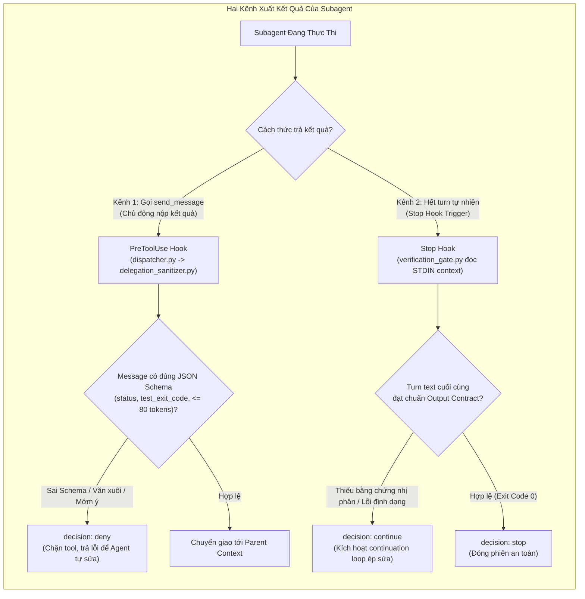
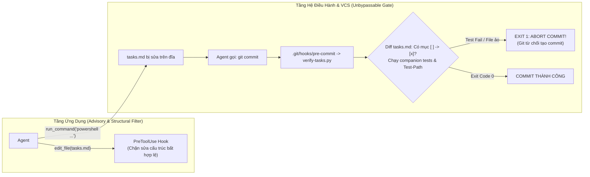
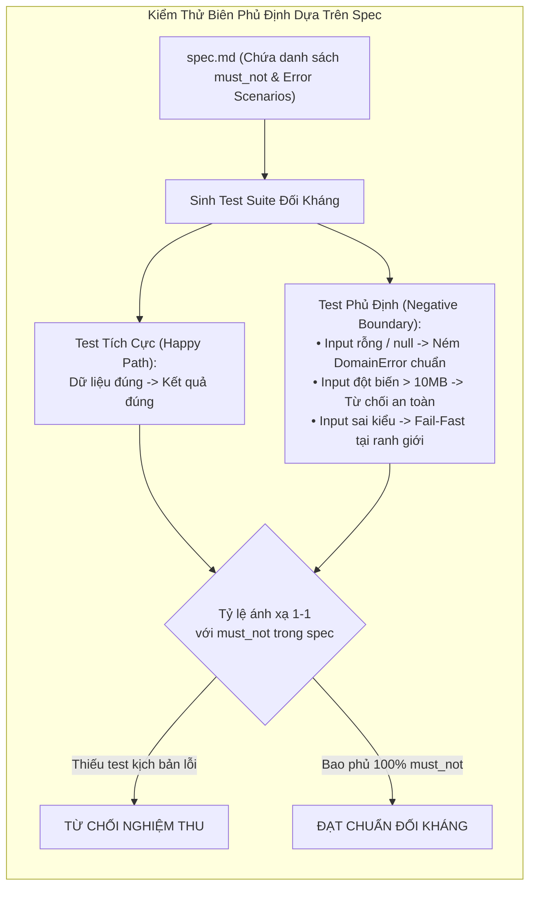

<instructions>
```yaml
document_metadata:
  title: "Ma Trận Phân Định Ranh Giới Quy Tắc - Mã Máy, Cưỡng Chế JSON Hai Kênh Và Kiểm Thử Biên Đối Kháng"
  archetype: "archetype-4-architecture-adr"
  version: "2.0.0"
  status: "ACTIVE"
rules:
  - must_not: "CẤM chuyển đổi các bài toán ngữ nghĩa linh hoạt thành script cơ học cứng nhắc làm triệt tiêu không gian suy luận."
  - must_not: "CẤM phụ thuộc duy nhất vào tool hook để khóa tasks.md mà bỏ quên chốt chặn Git Pre-Commit."
  - must_not: "CẤM làm bẩn workspace bằng việc đột biến trực tiếp mã nguồn trên đĩa cứng để thử nghiệm test."
  - must_not: "CẤM giả định engine Go (agy.exe) cho phép can thiệp luồng Go runtime nội bộ; chỉ được tương tác qua CLI Hooks STDIN/STDOUT."
```
</instructions>

<context>

# MA TRẬN PHÂN ĐỊNH RANH GIỚI RULE - MÃ MÁY & KIẾN TRÚC PHÒNG VỆ HAI KÊNH

Tài liệu này hoàn thiện các giải pháp kỹ thuật sâu sắc cho 4 bài toán:
1. *Cưỡng chế cấu trúc JSON trên Subagent ở chế độ tương tác qua Cơ chế Hai Kênh (Dual-Channel Gating).*
2. *Bịt kín lỗ hổng lách luật sửa `tasks.md` bằng chốt chặn cấp hệ điều hành Git Pre-Commit Hook kết hợp với Tool Hook.*
3. *Khắc phục bệnh test hời hợt bằng Kiểm thử Biên Phủ định (Spec-Driven Negative Testing) mà không vi phạm nguyên tắc AST Invariance.*
4. *Kế hoạch hành động triển khai (Implementation Backlog) để khớp nối toàn diện với hiện trạng `.agents` và tầng Engine Go (`agy.exe`).*

---

## 1. Cơ Chế Cưỡng Chế Cấu Trúc JSON Phản Hồi Hai Kênh (Dual-Channel Subagent Gating)

### 1.1. Khớp Nối Thực Tế Với Tầng Engine Go (`agy.exe`)

Trong Antigravity Go Engine (`agy.exe`), quy trình thực thi là closed-box binary:
- **Engine giao tiếp với hook scripts qua chuẩn IPC JSON STDIN/STDOUT.**
- Subagent không thể can thiệp vào hàm nội tại `GetFinalModelOutput()` của Go runtime mà chỉ tương tác qua 2 cổng hook định nghĩa tại [hooks.json](.agents/hooks.json):
  1. `PreToolUse`: Chặn các cuộc gọi tool (`send_message`, `invoke_subagent`, `run_command`, `write_file`, `edit_file`).
  2. `Stop`: Chặn hoàn thành phiên làm việc khi Agent phát sinh phản hồi cuối turn (hoặc không gọi tool nào).

### 1.2. Sơ Đồ Kiến Trúc Hai Kênh



### 1.3. Chi Tiết Thực Thi & Tình Trạng Triển Khai
1. **Kênh 1 (Kênh Tin Nhắn Chủ Động - `PreToolUse`)**:
   - **Hiện trạng:** Đã vận hành tại [delegation_sanitizer.py](.agents/scripts/guards/domains/engine_invariants/delegation_sanitizer.py). Chặn các câu hỏi dẫn dắt `?`, lọc ký tự mớm ý, và ép độ dài payload < 2000 ký tự (CRIT-DEL-06).
   - **Khoảng trống cần bổ sung:** Hiện tại bộ lọc đang dùng regex/substring heuristic. Cần tích hợp schema validator chặt chẽ đối chiếu trực tiếp với [completion_payload.schema.json](schemas/completion_payload.schema.json).
2. **Kênh 2 (Kênh Kết Thúc Tự Nhiên - `Stop` Hook)**:
   - **Hiện trạng:** Đã vận hành tại [verification_gate.py](.agents/scripts/guards/verification_gate.py). Tiếp nhận JSON payload qua STDIN từ `agy.exe`, kiểm tra các artifact tài liệu AI-first qua `verify-ai-first-format.py`.
   - **Cơ chế phản hồi:** Khi vi phạm, trả về `{"decision": "continue", "explanation": "..."}` để `agy.exe` kích hoạt continuation loop. Khi hoàn thành, trả về `{"decision": "stop"}`.

---

## 2. Khóa Cứng Trạng Thái `tasks.md`: Chốt Chặn Git Pre-Commit Kết Hợp Tool Hook

### 2.1. Phân Tầng Chốt Chặn: Ứng Dụng vs Hệ Điều Hành



### 2.2. Quy Tắc Cơ Học Bất Khả Kháng
- **Lớp phòng vệ 1 (Tool Hook)**: Đóng vai trò cảnh báo sớm trong [hooks.json](.agents/hooks.json), ngăn chặn việc sửa trực tiếp các checkpoint quan trọng trong `tasks.md` mà chưa có tín hiệu hoàn thành.
- **Lớp phòng vệ 2 (Git Pre-Commit Hook)**: Chốt chặn tối thượng ở tầng OS:
  1. Quét git diff staging của `tasks.md`.
  2. Bắt buộc kiểm tra: nếu có bất kỳ checkbox `[ ]` nào chuyển thành `[x]`, script `verify-tasks.py` phải tự động chạy lệnh kiểm thử được định nghĩa trong task node đó.
  3. Kiểm tra tính hiện hữu của file bằng `Test-Path` trên ổ đĩa.
  4. Nếu không đạt `Exit Code 0` hoặc file chưa tạo $\rightarrow$ Hủy commit với mã lỗi 1.

---

## 3. Ma Trận Phân Định 4 Vùng: Bảo Vệ Không Gian Tư Duy (Thinking Space)

```yaml
governance_quadrants:
  quadrant_1_hard_mechanical_invariants:
    domain: "Cấu hình Go Component Registry, cú pháp Frontmatter, Git index clean/dirty, Exit Code nhị phân."
    enforcement: "MÃ MÁY 100% (Script Python/Git Hook với Exit Code 0/1)."
    rationale: "Go Engine là nhị phân cứng; sai 1 ký tự là sập IDE. CẤM để LLM phỏng đoán."
    current_status: "Đang vận hành qua verification_gate.py và các linter scripts."
  quadrant_2_workspace_safety_boundaries:
    domain: "Ranh giới ghi đè tệp ngoài workspace, sửa nhầm thư mục hệ thống, path traversal."
    enforcement: "HOOK CHẶN NHỊ PHÂN TRƯỚC THỰC THI (PreToolUse path validation)."
    rationale: "Bảo vệ tuyệt đối an toàn dữ liệu ổ đĩa."
    current_status: "Đang nằm lệch pha tại PostToolUse (workspace_guard.py - chỉ advisory). CẦN CHUYỂN SANG PreToolUse để chặn chủ động (Active Deny)."
  quadrant_3_cognitive_reasoning_and_architecture:
    domain: "Lựa chọn giải thuật, thiết kế interface, phân bổ blast radius, suy luận nghiệp vụ."
    enforcement: "TƯ DUY MÔ HÌNH (System Prompt Guidelines & Thinking Tokens)."
    rationale: "CẤM cơ giới hóa bằng script; việc này bóp nghẹt khả năng thích ứng kỹ thuật."
    current_status: "Đang vận hành chuẩn xác qua Andrew Principles L0 Core."
  quadrant_4_semantic_document_formatting:
    domain: "Bóc tách Macro XML, chưng cất YAML constraints, vẽ sơ đồ Mermaid, AI-First Triad."
    enforcement: "MÔ HÌNH TÁC GIẢ - BIÊN TẬP VIÊN (Skill ai-first-doc-formatter)."
    rationale: "Biên tập là công việc tư duy ngữ nghĩa, Python chỉ đóng vai trò linter kiểm định."
    current_status: "Đang vận hành tốt qua verify-ai-first-format.py."
```

---

## 4. Kiểm Thử Biên Phủ Định Dựa Trên Đặc Tả (Spec-Driven Negative Testing)

Khắc phục triệt để bệnh "viết test hời hợt" mà không vi phạm nguyên tắc **AST Invariance**:



---

## 5. Kế Hoạch Triển Khai Bổ Sung (Implementation Backlog)

Dựa trên kết quả đối soát hiện trạng, các hạng mục kỹ thuật bắt buộc triển khai cho Phase tiếp theo bao gồm:

```yaml
implementation_backlog:
  - id: "IMPL-TASK-01"
    name: "Xây dựng Script verify-tasks.py"
    target_path: ".agents/scripts/guards/verify-tasks.py"
    objective: "Parse cú pháp Markdown tasks.md, trích xuất companion test command, đối soát Test-Path tệp mã nguồn và xác thực tính hợp lệ của việc chuyển đổi checkbox [ ] -> [x]."
    verification: "python .agents/scripts/guards/verify-tasks.py specs/feature/tasks.md"

  - id: "IMPL-TASK-02"
    name: "Thiết lập Git Pre-Commit Hook"
    target_path: ".git/hooks/pre-commit"
    objective: "Tạo file shell hook kích hoạt verify-tasks.py khi git commit có thay đổi trên tasks.md; hủy commit nếu exit code != 0."
    verification: "Thử tạo commit với task giả mạo -> Git phải reject."

  - id: "IMPL-TASK-03"
    name: "Tái định tuyến Workspace Guard sang PreToolUse"
    target_path: ".agents/hooks.json"
    objective: "Di chuyển cơ chế kiểm tra an toàn đường dẫn tệp (file path isolation) từ PostToolUse sang PreToolUse để ném decision: deny trước khi lệnh ghi/xóa tệp diễn ra."
    verification: "Kiểm tra schema hooks.json và test unit dispatch."

  - id: "IMPL-TASK-04"
    name: "Tích hợp JSON Schema Validator tại PreToolUse cho send_message"
    target_path: ".agents/scripts/guards/domains/engine_invariants/delegation_sanitizer.py"
    objective: "Nâng cấp delegation_sanitizer.py để validate cấu trúc Message của send_message đối chiếu trực tiếp schemas/completion_payload.schema.json."
    verification: "Gửi tin nhắn sai schema -> Nhận [SCHEMA_VIOLATION] deny."
```

---

## 6. Định Vị Xung Đột Kiến Trúc Với Doc 05 (Native Swarm Forking)

```yaml
architectural_reconciliation:
  status: "ISOLATED_ADAPTER_STRATEGY"
  analysis:
    doc_04_scope: "Tối ưu hóa các chốt chặn kiểm soát qua CLI Hooks (PreToolUse, Stop, Git Pre-Commit) độc lập với mô hình Subagent."
    doc_05_conflict: "Doc 05 đề xuất Native Swarm Forking (in-memory AST & Token Cache) bãi bỏ Subagent IPC rời rạc."
  decision_strategy:
    - "Các cơ chế của Doc 04 (Git Pre-Commit Hook, verify-tasks.py, Workspace Guard PreToolUse, Negative Testing) là BẤT BIẾN và áp dụng được cho CẢ HAI mô hình (Subagent IPC hoặc Native Swarm)."
    - "Cơ chế Kênh 1 (send_message Schema Validation) được đóng gói dưới dạng Modular Guard. Khi chuyển dịch sang Doc 05, cơ chế này sẽ chuyển thành State Gate kiểm soát Forked Worker Context mà không làm phá vỡ logic kiểm định cốt lõi."
```

</context>

<output_contract>
```yaml
verification_gate:
  command: "python .agents/skills/ai-first-doc-formatter/scripts/verify-ai-first-format.py Docs/AGENTS_ANALYSTS/harness-architecture-evaluation/04-structured-output-and-rule-to-script-matrix.md"
  expected_exit_code: 0
acceptance_criteria:
  - "Khớp nối chính xác kiến trúc IPC JSON STDIN/STDOUT của Go Engine agy.exe."
  - "Xác định rõ ràng tình trạng thực tế của Kênh 1, Kênh 2 và chốt chặn Workspace Safety."
  - "Thiết lập Implementation Backlog với 4 task cụ thể (verify-tasks.py, Git pre-commit, PreToolUse Guard, JSON Validator)."
  - "Định vị và giải tỏa xung đột kiến trúc với Doc 05 (Native Swarm Forking)."
```
</output_contract>
