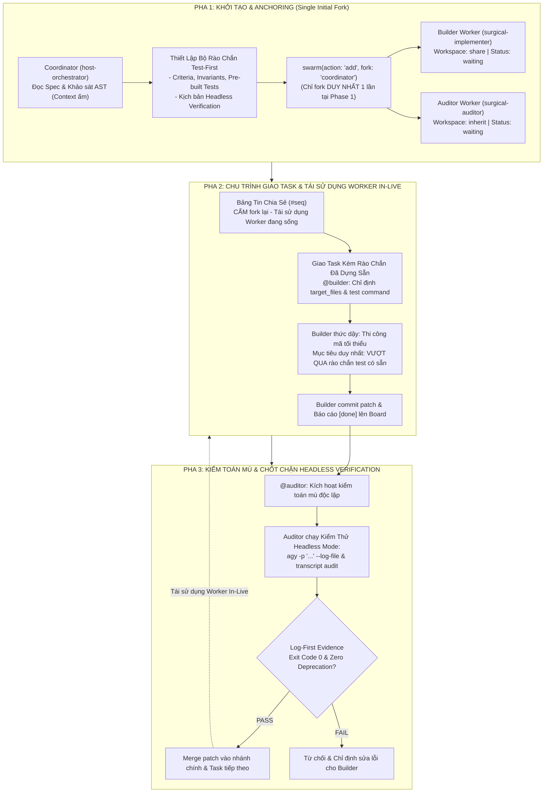
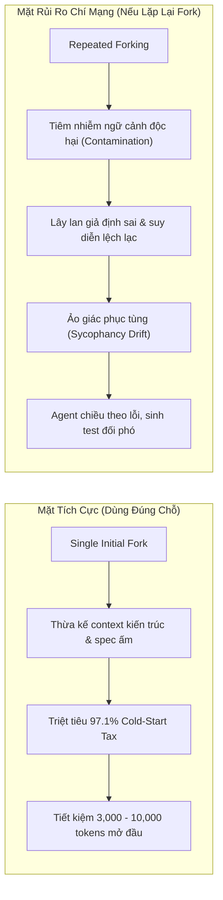
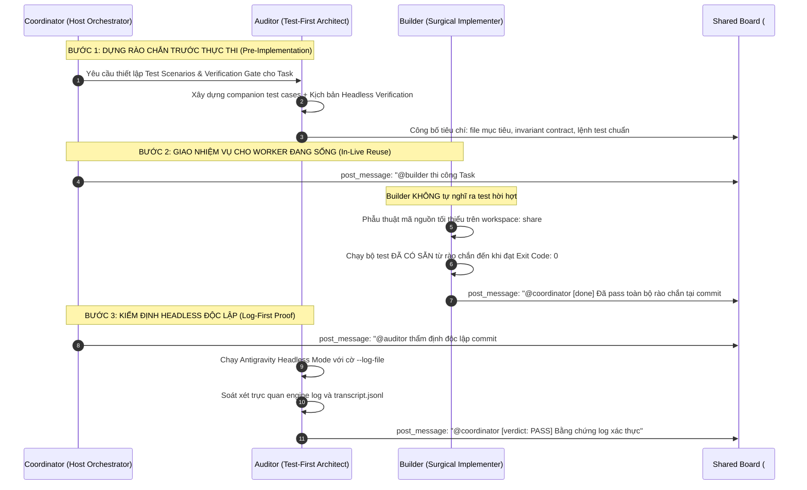
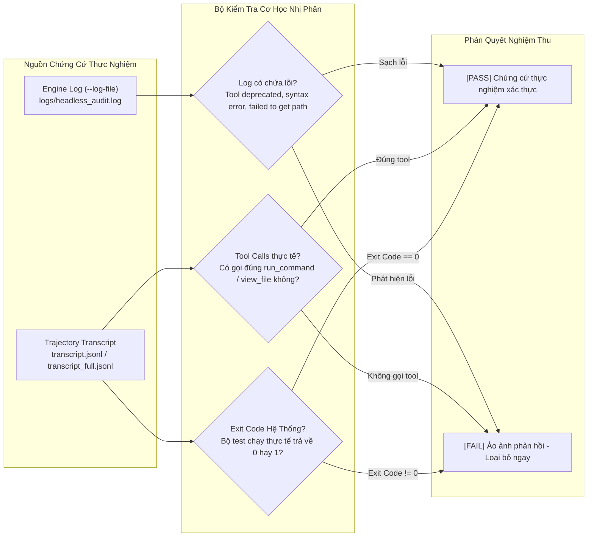

<instructions>
```yaml
document_metadata:
  title: "Thiết Kế Kiến Trúc Native Swarm: Cơ Chế Single-Fork, Tái Sử Dụng Worker In-Live & Chốt Chặn Headless Test-First"
  archetype: "archetype-1-technical-spec"
  version: "2.0.0"
  domain: "harness-engineering"
  status: "ACTIVE"
rules:
  - must_not: "CẤM lặp lại lệnh fork sau pha khởi động ban đầu để ngăn chặn lây nhiễm ngữ cảnh độc hại (Context Contamination)."
  - must_not: "CẤM để implementer tự thiết kế test case sau khi viết mã; bắt buộc xác lập rào chắn tiêu chí trước khi giao task."
  - must_not: "CẤM nghiệm thu dựa trên suy diễn hoặc unit test đơn lẻ; bắt buộc kiểm chứng thực nghiệm qua log của Antigravity Headless Mode."
```
</instructions>

<context>

# THIẾT KẾ KIẾN TRÚC NATIVE SWARM: SINGLE-FORK, IN-LIVE REUSE & HEADLESS TEST-FIRST GATING

Tài liệu này xác lập bản thiết kế kỹ thuật hoàn chỉnh nhằm nâng cấp bộ Harness tại `.agents/`, tập trung khai thác công nghệ **Native Swarm của Go Engine (`agy.exe`)** kết hợp với **Kỷ luật Single Initial Fork**, **Tái sử dụng Worker In-Live**, và **Quy trình Chốt chặn Test-First bằng Antigravity Headless Mode**.

Thiết kế này giải quyết triệt để 3 bài toán sống còn:
1. **Triệt tiêu gánh nặng khởi động lạnh (Cold-Start Tax)** mà **không gây lây nhiễm ngữ cảnh độc hại (Context Contamination / Sycophancy Drift)** do lặp lại fork.
2. **Xóa bỏ căn bệnh viết test hời hợt đối phó**: Xây dựng kịch bản kiểm thử, tiêu chí và rào chắn kiểm duyệt nhị phân **trước** khi giao task cho `surgical-implementer`.
3. **Thực thi nguyên lý Log-First Verification**: Sử dụng Antigravity Headless Mode và trích xuất Engine Log (`--log-file`), Transcript (`transcript.jsonl`) làm chứng cứ cơ học thay thế hoàn toàn mọi giả định, suy diễn chủ quan.



---

## 1. Phân Tích Thực Trạng & Định Hình Lại Không Gian Vấn Đề

### 1.1. Bản Đồ Hiện Trạng Các Thành Phần `.agents/`
Bộ Harness hiện tại đã trải qua nhiều vòng tinh chỉnh chuyên sâu, tổ chức theo các gói tự quản:
- **Gói Tác Tử Điều Phối**: `.agents/agents/host-orchestrator/agent.md` (Self-contained package kèm thư mục `references/` kiểm soát checklist ủy thác và phân rã đồ thị DAG).
- **Gói Tác Tử Thực Thi**: `.agents/agents/surgical-implementer/agent.md` (Self-contained package kèm `templates/` 3 tầng và `references/pre-completion-checklist.md`).
- **Tác Tử Kiểm Toán**: `.agents/agents/surgical-auditor.md` (Kiểm toán độc lập 4 cổng cơ học nhị phân, triệt tiêu thiên kiến xác nhận).
- **Hệ Thống Hooks Giữ Nguyên**: `.agents/hooks.json` vận hành ổn định bộ 3 guard PowerShell (`placeholder-guard.ps1`, `diff-scope-guard.ps1`, `directory-structure-guard.ps1`) và `dispatcher.ps1`. **Bảo toàn 100% cấu trúc hook này, không tiến hành hợp nhất làm tăng độ phức tạp rủi ro.**

### 1.2. Mổ Xẻ Hai Mặt Của Kỹ Thuật "Context Forking"
Kỹ thuật `swarm(fork: "<member>")` của Engine Go (`agy.exe`) là con dao hai lưỡi:



1. **Hiệu năng vượt trội khi dùng cho Pha Khởi Động (Initial Phase)**:
   - Tại thời điểm bắt đầu phiên hoặc bắt đầu một Phase lớn, `coordinator` đã nạp đầy đủ đặc tả `spec.md`, kiến trúc `plan.md` và cây AST mục tiêu.
   - Một lệnh rẽ nhánh duy nhất (`fork: "coordinator"`) giúp `builder` và `auditor` kế thừa ngay toàn bộ bức tranh dự án mà không mất thời gian và token đọc lại.
2. **Cạm bẫy tiêm nhiễm và mớm ý khi Lặp Lại Fork (Repeated Forking Danger)**:
   - Nếu mỗi task đều lặp lại lệnh `fork`, worker con sẽ nuốt trọn toàn bộ các chuỗi hội thoại thử-sai, các phỏng đoán chưa kiểm chứng và những câu trao đổi có tính chất dẫn dắt từ phiên trước.
   - Điều này kích hoạt hiện tượng **Sycophancy (Ảo giác phục tùng)**: Subagent có xu hướng tin vào các suy luận sai của parent, viết mã đối phó để "làm hài lòng" prompt thay vì tuân thủ kỷ luật kỹ thuật khách quan.
3. **Quy Tắc Bất Biến**:
   > [!IMPORTANT]
   > **Chỉ fork DUY NHẤT một lần tại thời điểm kích hoạt Phase 1.** Suốt toàn bộ Task Loop tiếp theo, hệ thống bắt buộc **TÁI SỬ DỤNG** các worker đang sống (`in-live`) ở trạng thái `waiting` trên Bảng tin chia sẻ, tuyệt đối không tạo thêm fork mới.

---

## 2. Mô Hình Chốt Chặn Tiêu Chí Trước Thực Thi (Pre-Implementation Quality Gates)

Để triệt tiêu tận gốc căn bệnh **"Agent tự viết mã rồi tự viết test case hời hợt để tự pass"**, hệ thống đảo ngược hoàn toàn thứ tự thực thi theo mô hình **Test-First / Spec-First Gating**:



### 2.1. Thiết Lập Rào Chắn Kiểm Duyệt (Pre-built Verification Gate)
Trước khi `builder` chạm vào bất kỳ tệp mã nguồn nào:
1. **Tiêu chí nghiệm thu (Acceptance Criteria)**: Phải được lượng hóa bằng các biểu thức logic nhị phân, không dùng tính từ cảm tính.
2. **Companion Test Cases dựng sẵn**: Các ca kiểm thử biên (edge cases), kiểm thử hồi quy (regression) và kiểm thử interface contracts phải được khởi tạo sẵn trên đĩa cứng hoặc định nghĩa rõ qua lệnh test.
3. **Mục tiêu của Implementer**: `surgical-implementer` không đóng vai trò người đánh giá; vai trò duy nhất của `builder` là **tìm kiếm giải pháp kỹ thuật tối giản để vượt qua rào chắn có sẵn**.

---

## 3. Quy Trình Kiểm Thử Headless Mode & Bằng Chứng Cơ Học Qua Log (Log-First Verification)

Kiểm thử bằng Unit Test là điều kiện cần, nhưng **hoàn toàn chưa đủ** để chứng minh một tác tử hoạt động đúng trong môi trường Antigravity. Hệ thống bắt buộc bổ sung tầng kiểm chứng **Antigravity Headless Mode**:

### 3.1. Kịch Bản Chạy Headless Verification
Tác tử kiểm duyệt (`auditor`) hoặc tiến trình kiểm tra tự động kích hoạt phiên Headless thông qua CLI của engine:
```powershell
agy -p "Thẩm định tính toàn vẹn và chạy toàn bộ test suite của commit mục tiêu" `
    --agent surgical-auditor `
    --log-file "logs/headless_audit.log" `
    --output-format json
```

### 3.2. Tiêu Chuẩn Giám Sát Log-First (Trực Quan & Cơ Học)
Kết quả kiểm tra KHÔNG ĐƯỢC chấp nhận qua lời tuyên bố `"SUCCESS"` của LLM, mà phải được phân tích trực tiếp từ 2 tệp chứng cứ cơ học:



1. **Soát xét Engine Log (`--log-file`)**:
   - Xác nhận sự đăng ký hợp lệ của các tác tử, kỹ năng và công cụ.
   - Bắt buộc quét sạch các cảnh báo: `Tool "..." is deprecated`, `failed to get path`, `syntax error in frontmatter`.
2. **Soát xét Trajectory Transcript (`transcript.jsonl`)**:
   - **Xác thực Tool Call thực tế**: Bắt buộc phát hiện bản ghi `tool_calls: [{"name": "run_command", "args": {"CommandLine": "..."}}]`. Nếu transcript không ghi nhận lượt gọi lệnh thực tế mà chỉ chứa văn bản tự khẳng định, đánh trượt ngay lập tức (phát hiện hiện tượng Response Illusion).
   - **Đo lường Token Budget thực tế**: Đối soát `input_tokens` và `output_tokens` để đảm bảo không xảy ra hiện tượng tràn ngữ cảnh.

---

## 4. Ma Trận Đánh Giá Đạt Chuẩn Kiến Trúc (Architecture Acceptance Matrix)

Bản thiết kế này được đo đạc và kiểm chứng dựa trên 5 tiêu chuẩn khắt khe:

| Mã Tiêu Chuẩn | Tên Tiêu Chuẩn | Phương Pháp Đo Đạc Cơ Học | Ngưỡng Đạt Chuẩn (Target) |
| :---: | :--- | :--- | :---: |
| **SPEC-CRIT-01** | **Single Initial Fork Discipline** | Đếm số lần gọi `swarm(action: "add", fork: ...)` trong toàn bộ phiên. | **Chính xác 1 lần** tại Phase 1; 0 lần ở các task sau |
| **SPEC-CRIT-02** | **In-Live Worker Reuse** | Tỷ lệ các task tiếp theo được xử lý bởi worker tái sử dụng (`status: waiting`). | **100%** các task sau khởi động |
| **SPEC-CRIT-03** | **Pre-Implementation Gating** | Kiểm tra timestamp tạo file test/criteria so với timestamp commit đầu tiên của `builder`. | **Test hình thành 100% trước mã nguồn** |
| **SPEC-CRIT-04** | **Log-First Verification Rate** | Tỷ lệ nghiệm thu có bằng chứng log file và transcript kiểm chứng được. | **100%** (0% nghiệm thu dựa trên suy diễn) |
| **SPEC-CRIT-05** | **Zero Deadlock & Lock Safety** | Số lần xung đột `.git/index.lock` trên Windows NTFS trong suốt chu trình. | **0 lần phát sinh lỗi khóa tệp** |

---

## 5. Kế Hoạch Chuyển Giao & Lộ Trình Vận Hành (Operational Playbook)

### Bước 1: Khởi Tạo Tổ Tác Tử Thường Trực Tại Phase 1
- `coordinator` phân tích `spec.md`, lập kế hoạch và xác định đồ thị phụ thuộc.
- Kích hoạt `swarm(action: "add", name: "builder", fork: "coordinator", workspace: "share", brief: "...")`.
- Kích hoạt `swarm(action: "add", name: "auditor", fork: "coordinator", workspace: "inherit", brief: "...")`.
- Cả hai tác tử đi vào trạng thái `waiting` (tiêu tốn 0 token).

### Bước 2: Thiết Lập Rào Chắn Cho Từng Task
- Trước mỗi task, `coordinator` yêu cầu `auditor` chuẩn hóa kịch bản test và tiêu chí nghiệm thu cụ thể cho task đó.
- Công bố rào chắn lên Bảng tin chia sẻ kèm số hiệu bài đăng `#seq`.

### Bước 3: Đánh Thức & Tái Sử Dụng `builder` In-Live
- Giao việc qua cú pháp: `@builder thực thi Task #K theo rào chắn tại #seq`.
- `builder` làm việc trên `workspace: share`, vượt qua các rào chắn kiểm thử, tạo commit cục bộ.
- Báo cáo kết quả: `@coordinator [done] commit #hash`.

### Bước 4: Kiểm Định Headless & Nghiệm Thu Nhị Phân
- `auditor` được đánh thức: `@auditor thẩm định độc lập commit #hash`.
- `auditor` khởi chạy Antigravity Headless Mode với cờ `--log-file`.
- Phân tích log và transcript; chỉ thông qua khi Exit Code nhị phân bằng 0 và không có cảnh báo hệ thống.
- `coordinator` thực hiện tích hợp mã nguồn và chuyển sang task kế tiếp với chính các worker đang sống.

</context>

<output_contract>
```yaml
verification_gate:
  command: "python .agents/skills/ai-first-doc-formatter/scripts/verify-ai-first-format.py Docs/AGENTS_ANALYSTS/harness-architecture-evaluation/05-native-swarm-forking-architecture.md"
  expected_exit_code: 0
acceptance_criteria:
  - "Tài liệu tuân thủ tuyệt đối cấu trúc AI-First Triad (instructions, context, output_contract)."
  - "Bảo tồn 100% các hook hiện hữu, loại bỏ hoàn toàn đề xuất gộp hook PowerShell sang Python."
  - "Xác định rõ ràng cơ chế Single Initial Fork tại Phase 1 và tái sử dụng Worker In-Live."
  - "Thiết lập quy trình Test-First Gating trước khi giao việc cho surgical-implementer."
  - "Quy định bắt buộc chạy Antigravity Headless Mode và kiểm tra Log-First Verification."
  - "Không chứa bất kỳ đường dẫn tuyệt đối cục bộ nào gây lỗi linter định dạng."
```
</output_contract>
