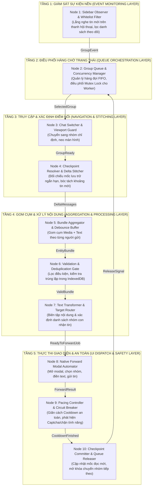
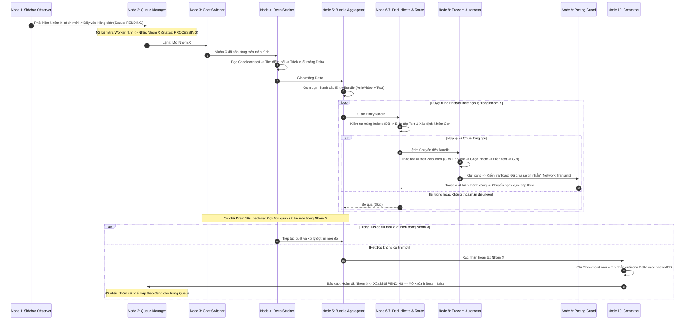
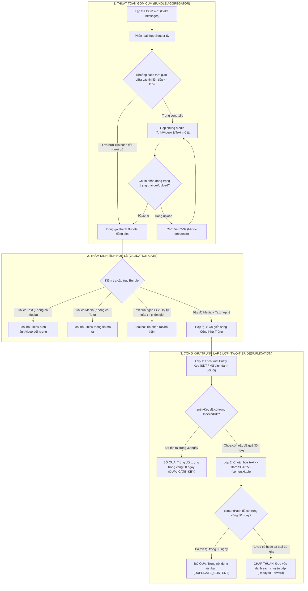
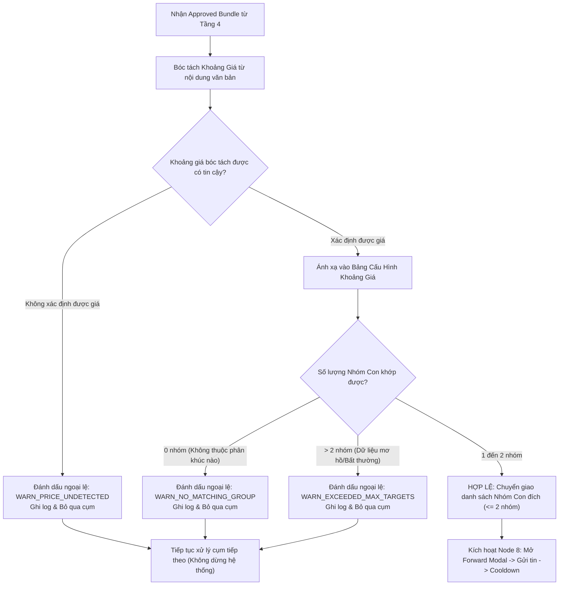
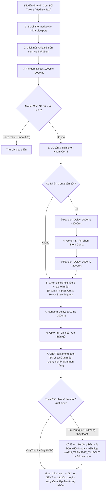
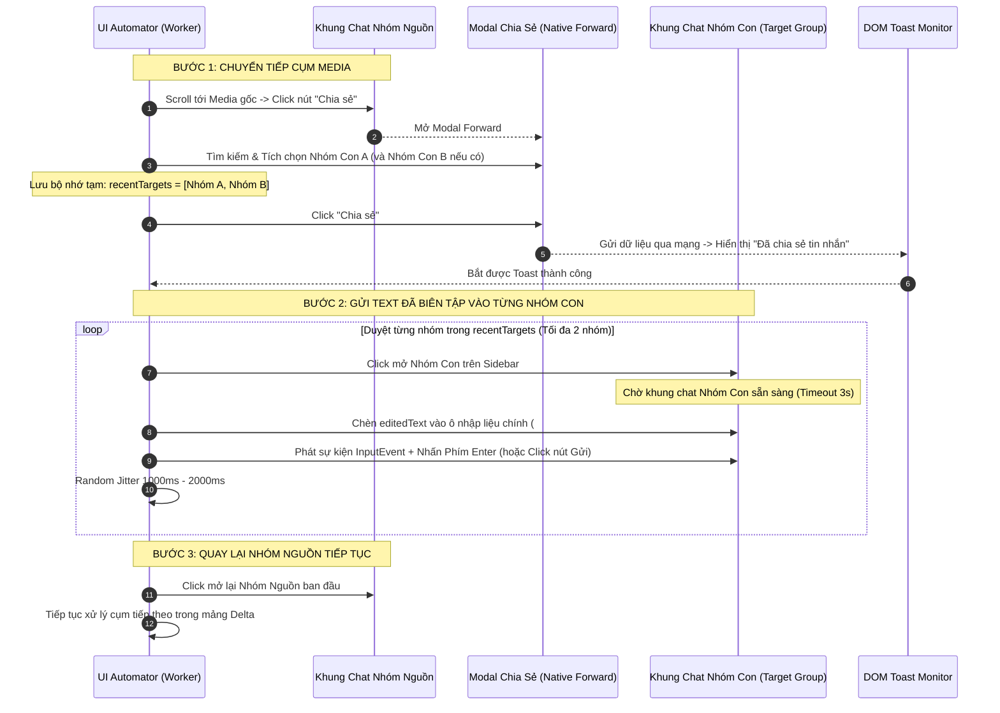

# TÀI LIỆU THIẾT KẾ KHUNG LUỒNG NGHIỆP VỤ (BUSINESS WORKFLOW SPECIFICATION)
**Dự án**: Hệ thống Tự Động Hóa Thu Thập, Biên Tập & Phân Phối Tin Nhắn Zalo Đa Nhóm (Personal Account 24/7)  
**Phiên bản**: 2.1 (Official Flow Architecture Baseline)  
**Ngày cập nhật**: 08/11/2026  
**Nền tảng**: Zalo Web (`chat.zalo.me`) — Chromium Extension Manifest V3 + IndexedDB (Dexie.js)  
**Tài liệu tham chiếu**:
- Tài liệu kiến trúc kỹ thuật Extension: [tai_lieu_thiet_ke_so_bo_zalo_automation.md](file:///c:/Users/ADMIN/Documents/workspace/Sales/EXTENSIONS/Docs/tai_lieu_thiet_ke_so_bo_zalo_automation.md)
- Đặc tả hợp đồng dữ liệu & cổng nghiệm thu: [he_thong_tu_dong_hoa_zalo_extension_spec.md](file:///c:/Users/ADMIN/Documents/workspace/Sales/EXTENSIONS/Docs/he_thong_tu_dong_hoa_zalo_extension_spec.md)

---

## 1. MÔ HÌNH PHÂN TẦNG KIẾN TRÚC (LAYERED ARCHITECTURE - LAYER 1 TỔNG QUÁT)

Hệ thống được bóc tách thành **5 tầng (Layers)** độc lập về mặt trách nhiệm. Mỗi tầng chỉ giao tiếp với tầng kế tiếp thông qua các hợp đồng dữ liệu chuẩn hóa, đảm bảo tính bất đồng bộ và chống ô nhiễm trạng thái.



---

## 2. LUỒNG TUẦN TỰ GIỮA CÁC NODE ĐỘC LẬP (INTER-NODE INTERACTION SEQUENCE)



---

## 3. MA TRẬN NGOẠI LỆ TỔNG QUÁT CỦA TỪNG NODE (EXCEPTION & EDGE-CASE MATRIX)

Để đảm bảo hệ thống tự phục hồi 24/24, mỗi Node ở Layer 1 phải xử lý các ngoại lệ độc lập sau:

| Node | Tên Node | Ngoại Lệ Tiềm Ẩn (Edge Case) | Cơ Chế Xử Lý & Hạ Cấp Êm Ái (Handling Strategy) |
| :--- | :--- | :--- | :--- |
| **N1** | **Sidebar Observer** | - Nhóm nguồn bị trôi khỏi khung nhìn của Sidebar do quá nhiều đoạn chat khác đẩy lên.<br>- Nguy cơ bị nghẽn (Block) khi Worker đang bận thao tác trong khung chat nhóm khác.<br>- **Quản trị danh sách Whitelist**: Người dùng muốn linh hoạt thêm/bớt nhóm cần theo dõi mà không phải sửa code. | - **Quyết định thiết kế (Đã chốt)**: Lắng nghe song song liên tục thông qua `MutationObserver` độc lập trên DOM Sidebar (chạy qua cơ chế Microtask của trình duyệt). Dù Worker đang bận xử lý trong nhóm chat, Observer vẫn tức thời ghi nhận mọi badge/preview tin mới từ các nhóm khác và đẩy vào Hàng chờ, triệt tiêu hoàn toàn rủi ro sót tin do single-thread.<br>- **Cấu hình trực quan (Đã chốt)**: Đi kèm giao diện Popup / Options UI cho phép người vận hành tick chọn trực tiếp từ danh sách nhóm hiện có trên Zalo hoặc nhập tên nhóm; cấu hình được lưu vào `app_settings` (IndexedDB / `chrome.storage.local`) và nạp động (hot-reload) vào Observer mà không cần khởi động lại Extension.<br>- Duy trì selector theo conversation ID/dataset kết hợp tên nhóm đã chuẩn hóa. |
| **N2** | **Queue Manager** | - Nhóm đang trong trạng thái `PROCESSING` lại tiếp tục có tin mới đến.<br>- Tràn hàng chờ khi có quá nhiều nhóm đổ tin cùng lúc.<br>- **Mất dữ liệu hàng chờ khi tab bị Reload / Sập kết nối 24/7**. | - **Quyết định thiết kế (Đã chốt)**: **Drain-with-10s-Quiet-Window**: Khi đang xử lý một nhóm, hệ thống ưu tiên xử lý dứt điểm cho nhóm đó. Sau mỗi đợt gửi, giữ một cửa sổ quan sát đệm 10 giây (Inactivity Timeout). Nếu trong 10s không có tin mới phát sinh trong nhóm ➔ Chuyển trạng thái sang `DONE` / `COMPLETED`, sau đó nhấc nhóm cũ nhất tiếp theo trong Hàng chờ (FIFO).<br>- Nếu trong 10s có tin mới ➔ Reset đệm 10s và xử lý tiếp đợt tin mới đó trước khi rời đi.<br>- **Cơ chế Phục hồi Bền bỉ (Persistent Recovery - Đã chốt)**: Hàng chờ được lưu trực tiếp vào bảng `group_dispatch_queue` trong IndexedDB. Khi trang bị reload (do rớt mạng hoặc Watchdog khởi động lại), hệ thống tự động: (1) Đọc lại các nhóm `PENDING` từ IndexedDB để bảo toàn đúng thứ tự ưu tiên, và (2) Quét đối soát lại Sidebar để bổ sung các nhóm mới phát sinh trong lúc reload. |
| **N3** | **Chat Switcher** | - Click mở nhóm nhưng giao diện Zalo bị đơ/lag mạng, khung chat không hiển thị.<br>- Bị pop-up cuộc gọi/tin nhắn riêng tư che khuất.<br>- **Nút '99+' tin chưa đọc dồn ứ ở góc phải màn hình**. | - Cơ chế Timeout (chờ tối đa 5s); nếu DOM khung chat không tải thì thử lại 1 lần, sau đó đánh dấu lỗi và bỏ qua nhóm để tránh treo hệ thống.<br>- Tự động đóng các modal không liên quan.<br>- **Quyết định thiết kế (Đã chốt từ UI thực tế)**: **TUYỆT ĐỐI BỎ QUA nút '99+'**. Hệ thống không click vào nút nhảy lên tin chưa đọc của Zalo. Luôn giữ vị trí cố định ở đáy màn hình (Bottom Viewport), chỉ quét các tin mới nhất từ đáy lên đến điểm nối (hoặc 5-10 tin gần nhất). Điều này ngăn ngừa hoàn toàn tình trạng bị kéo ngược về lịch sử cũ, tránh lag DOM ảo hóa và tránh gửi trùng bài đăng cũ. |
| **N4** | **Delta Stitcher** | - **Không tìm thấy Điểm Nối**: Do lần đầu chạy hệ thống, hoặc do tin nhắn đổ về quá nhiều làm điểm nối cũ bị cuộn mất khỏi DOM ảo hóa.<br>- Tin nhắn điểm nối cũ bị người gửi xóa/thu hồi. | - **Quyết định thiết kế (Đã chốt)**: **Ưu tiên an toàn tuyệt đối**. Nếu không tìm thấy Điểm Nối, hệ thống **không cuộn ngược lên** (tránh lag DOM ảo hóa và rủi ro gửi nhầm tin cũ). Thay vào đó, áp dụng cơ chế Fallback: Chỉ lấy tối đa `5 đến 10 tin mới nhất ở đáy viewport` để xử lý và cập nhật ngay Checkpoint mới tại đáy. |
| **N5** | **Bundle Aggregator** | - Người gửi đang gửi dở (ảnh thứ 4, thứ 5 đang tải lên mạng chậm chưa hiện xong).<br>- Hai người khác nhau gửi xen kẽ tin nhắn trong cùng 1 giây. | - Kích hoạt bộ đếm đệm chờ (Micro-debounce 2-3s) nếu phát hiện tin nhắn gần nhất có dấu hiệu đang upload.<br>- Tách Bundle theo định danh người gửi (`senderId`). |
| **N6** | **Deduplication Gate** | - Trùng lặp nội dung văn bản nhưng ảnh khác nhau, hoặc cùng ảnh nhưng sửa một vài ký tự trong văn bản. | - Kiểm tra 2 lớp: Lớp 1 theo `entityKey` cốt lõi (SĐT/Mã định danh); Lớp 2 theo `contentHash` văn bản chuẩn hóa. |
| **N7** | **Target Router** | - Bài viết không khớp với bất kỳ quy tắc phân loại nhóm con nào. | - Không gửi đi, ghi log `SKIPPED_NO_MATCHING_TARGET` và chuyển sang bài tiếp theo. |
| **N8** | **Forward Automator** | - Không tìm thấy nút "Chia sẻ" trên thẻ media.<br>- Gõ tên nhóm con trong Modal nhưng không tìm ra nhóm.<br>- Chèn text bị mất dấu hoặc không kích hoạt state của React. | - Cuộn media vào giữa viewport (`scrollIntoView({ block: 'center' })`).<br>- Tìm kiếm nhóm con theo ký tự không dấu; nếu không thấy thì bỏ qua nhóm con đó.<br>- Sử dụng `InputEvent` kết hợp `document.execCommand('insertText')`. |
| **N9** | **Pacing & Safety Guard** | - **Zalo hiển thị Captcha hoặc thông báo hạn chế gửi tin**.<br>- Zalo tự động đăng xuất tài khoản. | - **KÍCH HOẠT CIRCUIT BREAKER**: Ngay lập tức tạm dừng luồng Worker, chuyển trạng thái hệ thống sang `PAUSED`, giữ nguyên hàng chờ và phát âm thanh cảnh báo/gửi webhook. |
| **N10** | **Committer & Releaser** | - Trình duyệt bị tắt đột ngột hoặc sập tab trước khi kịp cập nhật Checkpoint. | - Checkpoint được ghi ngay sau khi chuyển tiếp thành công từng bài thay vì đợi hết toàn bộ nhóm, đảm bảo tính bền vững (Idempotency). |


---

## 4. BÓC TÁCH CHI TIẾT TẦNG 4: GOM CỤM ĐA PHƯƠNG TIỆN & KHỬ TRÙNG (LAYER 4 SPECIFICATION)

Tầng 4 chịu trách nhiệm biến tập các thẻ DOM tin nhắn thô (Raw Messages) thành các đối tượng nghiệp vụ hoàn chỉnh (**`EntityBundle`**), sau đó thẩm định điều kiện hợp lệ và kiểm tra trùng lặp trước khi cho phép chuyển sang tầng thực thi giao diện.

### 4.1. Sơ đồ Luồng Gom cụm & Khử trùng 2 lớp (Layer 4 Detailed Flow)



---

### 4.2. Hợp đồng Dữ liệu Đối tượng `EntityBundle` (Data Contract)

Một `EntityBundle` hợp lệ đầu ra của Tầng 4 phải thỏa mãn cấu trúc sau:

```typescript
interface EntityBundle {
  bundleId: string;               // UUID hoặc BUNDLE_<timestamp>_<senderId>
  sourceGroupId: string;          // ID của Nhóm Nguồn
  senderId: string;               // ID người đăng gốc
  senderName: string;             // Tên người đăng
  
  // Thành phần Đa phương tiện
  mediaElements: {
    type: 'IMAGE' | 'VIDEO';
    domSelector: string;          // Selector định vị trên DOM Zalo
    previewUrl?: string;          // URL blob/preview
  }[];
  
  // Thành phần Văn bản
  rawText: string;                // Toàn bộ text gốc gom được từ các bubble
  normalizedText: string;         // Text sau khi hạ chữ thường, bỏ khoảng trắng thừa
  contentHash: string;            // SHA-256 của normalizedText
  
  // Định danh Nghiệp vụ trích xuất
  extractedKeys: {
    phoneNumbers: string[];       // Danh sách số điện thoại tìm thấy
    itemCodes: string[];          // Mã căn, mã sản phẩm (nếu có)
    primaryKey: string;           // Khóa chính dùng để query deduplication
  };
  
  createdAt: number;
}
```

---

### 4.3. Ma trận Ngoại lệ Chi tiết của Tầng 4 (Layer 4 Edge Cases)

| Mã | Tình Huống Biên (Edge Case) | Phân Tích Kỹ Thuật | Phương Án Xử Lý |
| :--- | :--- | :--- | :--- |
| **L4-01** | **Zalo gom ảnh thành Grid Album** | Zalo Web hiển thị 4 ảnh thành 1 thẻ grid duy nhất, chỉ có 1 nút "Chia sẻ" chung cho cả album. | Nhận diện thẻ bao album (`.grid-photo` hoặc tương đương); khi bấm nút Chia sẻ trên thẻ này, Zalo tự động đính kèm toàn bộ ảnh trong album vào modal. |
| **L4-02** | **Người gửi chia 2 tin nhắn văn bản nối tiếp** | Tin 1: "Bán nhà 3 tầng phố X...", Tin 2: "Giá 4 tỷ LH 0901234567". | Thuật toán gom cụm sẽ ghép (concatenate) 2 đoạn text bằng dấu xuống dòng (`\n`) nếu khoảng cách giữa 2 tin `<= 15 giây` và không bị chen ngang. |
| **L4-03** | **Người thứ 3 chen ngang tin nhắn chat** | Giữa cụm 5 ảnh và 1 text của Người A, xuất hiện 1 tin nhắn "ib em giá" của Người B. | Phân loại theo `senderId`. Tin của B được tách riêng vào bundle của B (và sẽ bị loại ở Cổng Thẩm Định do không có media); bundle của A vẫn được gom trọn vẹn. |
| **L4-04** | **Số điện thoại bị cố tình viết cách hoặc mã hóa** | Ví dụ: `090.123.4567`, `090 123 4567`, `O9O1234567` (chữ O thay số 0). | Bộ chuẩn hóa (Normalizer) thay thế chữ O/o thành 0, xóa dấu chấm, dấu gạch ngang, khoảng trắng trước khi chạy Regex nhận diện SĐT 10 số. |


---

## 5. BÓC TÁCH CHI TIẾT TẦNG ĐIỀU HƯỚNG & THỰC THI (LAYER 5: ROUTER & EXECUTION SPEC)

### 5.1. Quy tắc Định tuyến theo Khoảng Giá (Price Range Routing Rule)
- Tiêu chí phân loại chính của các Nhóm Con dựa trên **Khoảng Giá (Price Range)**.
- **Giới hạn số lượng**: Mỗi đối tượng chỉ được phép khớp với **tối đa 2 Nhóm Con** (do nằm ở vùng ranh giới hoặc giao thoa giữa 2 khoảng giá liền kề).
- Khi mở Native Forward Modal, hệ thống chỉ tick chọn tối đa 2 nhóm con tương ứng này trong 1 lần gửi.

### 5.2. Sơ đồ Luồng Điều hướng & Xử lý Ngoại lệ Định tuyến (Routing Exception Flow)



### 5.3. Bảng Phân loại Ngoại lệ Điều hướng & Cảnh báo (Routing Warnings)

| Mã Cảnh Báo | Tình Huống | Hành Động Hệ Thống | Trạng Thái Bản Ghi |
| :--- | :--- | :--- | :--- |
| `WARN_PRICE_UNDETECTED` | Bài đăng không ghi giá rõ ràng (chỉ ghi: "giá thỏa thuận", "giá ib", "giá liên hệ"). | Ghi log vào `system_logs`, hiển thị cảnh báo vàng trên Panel để người vận hành kiểm tra sau; bỏ qua cụm này. | `SKIPPED_PRICE_UNDETECTED` |
| `WARN_NO_MATCHING_GROUP` | Giá bóc tách được nằm ngoài toàn bộ các dải giá của các Nhóm Con đã cấu hình. | Ghi log cảnh báo; bỏ qua cụm này và tiếp tục cụm kế tiếp. | `SKIPPED_OUT_OF_RANGE` |
| `WARN_EXCEEDED_MAX_TARGETS` | Bài đăng khớp từ 3 nhóm con trở lên (ví dụ bài rao bán nhiều căn với các mức giá khác nhau). | Ghi log bất thường; bỏ qua cụm để tránh gửi nhầm lẫn; tiếp tục cụm kế tiếp. | `SKIPPED_AMBIGUOUS_PRICE` |


---

## 6. ĐẶC TẢ CHI TIẾT THAO TÁC GIAO DIỆN & CƠ CHẾ GIÃN CÁCH (UI AUTOMATION & MICRO-PACING)

### 6.1. Nguyên lý Giãn cách Tự nhiên (Natural Pacing & UI Micro-Jitter)
- **Không áp dụng Cooldown tĩnh kéo dài (20s-35s)**: Quá trình chuyển tiếp media (ảnh, video) trên Zalo Web vốn dĩ đã có độ trễ truyền tải mạng tự nhiên (Network Transmission Latency).
- **Trọng tâm bảo vệ tài khoản**: Chèn độ trễ ngẫu nhiên (**Micro-Jitter: 1000ms – 2000ms**) vào giữa từng thao tác HTML/UI để mô phỏng 100% phản xạ người thật.

### 6.2. Sơ đồ Luồng Thao tác UI Tuần tự cho 1 Cụm Đối tượng (Micro-Action Flow)



### 6.3. Bảng Chuẩn Hóa Thông Số Thời Gian UI (Micro-Timing Specs)

| Thao Tác UI | Phương Thức Tương Tác Kỹ Thuật | Độ Trễ Trước Thao Tác (Random Jitter) |
| :--- | :--- | :--- |
| **Kích hoạt Modal** | `btnShare.click()` (Hoặc trigger qua menu ngữ cảnh) | `1000ms – 2000ms` |
| **Chọn Nhóm Con 1** | Gõ `inputSearch.value` + dispatch `InputEvent` + click checkbox | `1000ms – 2000ms` |
| **Chọn Nhóm Con 2** | Gõ `inputSearch.value` + dispatch `InputEvent` + click checkbox | `1000ms – 2000ms` |
| **Điền Lời Nhắn** | Gán qua `HTMLTextAreaElement.prototype` setter + `InputEvent` | `1000ms – 2000ms` |
| **Bấm Gửi** | Click nút `[data-translate-inner='STR_SHARE']` | `1000ms – 2000ms` |


---

## 7. ĐẶC TẢ CHI TIẾT CƠ CHẾ CHUYỂN TIẾP 2 PHA (TWO-PHASE DISPATCH: MEDIA FORWARD + TEXT INJECTION)

### 7.1. Bối cảnh Kỹ thuật Cốt lõi
- **Hạn chế của Zalo Web**: Không thể can thiệp sửa nội dung văn bản trực tiếp trong lúc Forward cụm media gốc (hoặc Zalo không hỗ trợ gửi kèm văn bản đã biên tập trong modal chia sẻ cụm album).
- **Giải pháp 2 Pha (Two-Phase Dispatch Pattern)**:
  1. **Pha 1 (Forward Cụm Media)**: Sử dụng nút Chia sẻ gốc để forward Ảnh/Video chất lượng cao sang các Nhóm Con đích (tối đa 2 nhóm).
  2. **Pha 2 (Gửi Văn bản Biên tập vào Nhóm Con)**: Hệ thống ghi nhớ danh sách Nhóm Con vừa nhận media, lần lượt chuyển sang từng Nhóm Con để gửi đoạn `editedText` vào ô chat chính.
  3. **Pha 3 (Quay về Nhóm Nguồn)**: Tự động click quay lại Nhóm Nguồn để tiếp tục quét các cụm tiếp theo.

### 7.2. Sơ đồ Tuần tự Chi tiết Luồng 2 Pha (Two-Phase Sequence Diagram)



### 7.3. Ma trận Ngoại lệ của Luồng 2 Pha

| Mã | Ngoại Lệ Tiềm Ẩn | Nguy Cơ | Giải Pháp Phòng Vệ |
| :--- | :--- | :--- | :--- |
| **2P-01** | **Chuyển sang Nhóm Con nhưng không quay lại được Nhóm Nguồn** | Hệ thống bị kẹt lại ở Nhóm Con, làm đứt gãy toàn bộ chu trình giám sát. | Lưu biến `currentSourceGroupId` cố định trong suốt phiên xử lý của nhóm. Sau khi gửi text vào Nhóm Con, luôn gọi hàm `returnToSourceGroup()`. Nếu sau 2 lần thử không quay lại được ➔ Kích hoạt cờ reload trang để tự phục hồi. |
| **2P-02** | **Sau khi gửi ảnh sang Nhóm Con, thành viên khác trong Nhóm Con nhắn tin chèn vào giữa ảnh và text** | Text mô tả bị tách xa khỏi cụm ảnh vừa gửi. | Tối ưu thời gian chuyển sang Nhóm Con (ngay sau khi nhận Toast "Đã chia sẻ tin nhắn"), chuyển tab và gửi text trong vòng `< 2 giây` với micro-jitter tối thiểu. |
| **2P-03** | **Nhóm Con có bật tính năng 'Chặn thành viên nhắn tin' (Chỉ trưởng/phó nhóm được chat)** | Extension không tìm thấy ô nhập liệu `#chat-input` ở Nhóm Con. | Kiểm tra thuộc tính `disabled` hoặc thông báo "Chỉ trưởng/phó nhóm gửi tin". Nếu bị chặn ➔ Bỏ qua việc gửi text ở nhóm đó, ghi log `WARN_TARGET_GROUP_MUTED` và chuyển ngay sang nhóm tiếp theo. |
