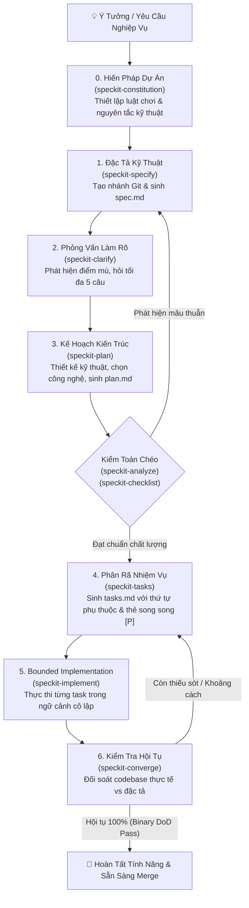

# Hướng Dẫn Toàn Diện Spec Kit: 01. Tổng Quan & Spec-Driven Development (SDD) Core

> Tài liệu này được biên soạn cho các kỹ sư phần mềm, kiến trúc sư hệ thống và lập trình viên muốn làm chủ phương pháp **Spec-Driven Development (SDD)** kết hợp với bộ công cụ **Spec Kit** trên nền tảng Antigravity.

---

## 1. Mở Đầu: Spec-Driven Development (SDD) Là Gì?

### 1.1. Khái niệm cốt lõi

Trong mô hình phát triển phần mềm truyền thống kéo dài hàng thập kỷ, mã nguồn (*code*) luôn là trung tâm quyền lực ("Code is King"). Các tài liệu đặc tả (*specifications*), tài liệu thiết kế kiến trúc thường chỉ đóng vai trò như dàn giáo (*scaffolding*) tạm bợ: được dựng lên ban đầu rồi nhanh chóng bị lãng quên, trở nên lỗi thời ngay khi dòng code đầu tiên được viết ra.

**Spec-Driven Development (SDD)** lật ngược hoàn toàn mô hình này (*"Flips the script"*):

> **Đặc tả kỹ thuật (Specification) trở thành đối tượng có thể thực thi trực tiếp (Executable Specifications).**  
> Thay vì chỉ là tài liệu tĩnh dùng để đọc hiểu, bản đặc tả kỹ thuật là **nguồn chân lý duy nhất (Single Source of Truth - SSOT)**, điều phối và trực tiếp sinh ra mã nguồn thực thi, kế hoạch kiểm thử và cơ chế hội tụ thông qua các AI Agent chuyên trách.

SDD vận hành trên 4 trụ cột triết lý:
1. **Phát triển định hướng ý định (Intent-Driven Development)**: Luôn xác lập ranh giới tường minh cho câu hỏi **Cái gì ("What")** trước khi đi vào giải quyết câu hỏi **Làm thế nào ("How")**.
2. **Khung nguyên tắc & Giới hạn tối thượng (Rich Specification with Guardrails)**: Bản đặc tả không được viết tùy tiện mà tuân thủ các nguyên tắc thiết kế bất biến được định nghĩa từ trước (Hiến pháp dự án - Constitution).
3. **Tinh chỉnh đa tầng (Multi-step Refinement)**: Thay vì cố gắng sinh toàn bộ hệ thống bằng một prompt duy nhất (One-shot Prompting), SDD phân tách quy trình thành các pha biệt lập có cổng kiểm định nhị phân.
4. **Kiểm chứng xác định (Mechanical Determinism)**: Mỗi pha chỉ được coi là hoàn thành khi có bằng chứng cơ học thực tế (exit code 0, test pass, không có phần tử mồ côi).

---

### 1.2. So Sánh Đối Đầu: "Vibe Coding" vs "Spec-Driven Development"

Trong làn sóng AI hỗ trợ lập trình, phong cách phổ biến của nhiều lập trình viên là **"Vibe Coding"** (lập trình theo cảm hứng). Hãy xem sự khác biệt sống còn giữa hai phương pháp tiếp cận này:

| Tiêu Chí Đánh Giá | Vibe Coding (Prompt Ngẫu Hứng) | Spec-Driven Development (SDD) |
| :--- | :--- | :--- |
| **Bản chất tiếp cận** | Cảm tính, thử-và-sai (*Trial-and-Error*), phụ thuộc vào sự may rủi của phản hồi LLM. | Kỹ thuật công nghệ phần mềm phòng thủ (*Defensive Systems Engineering*), có kiểm chứng. |
| **Xử lý sự mơ hồ (Ambiguity)** | LLM tự ý suy đoán ngữ nghĩa bị khuyết thiếu, dễ dẫn đến ảo giác (*Hallucination*). | Bắt buộc dừng lại để làm rõ qua phỏng vấn phản xạ (**Stop-and-Clarify**). |
| **Quản lý ngữ cảnh (Context Window)** | Prompt dồn dập khiến bộ nhớ ngữ cảnh bị tràn, agent quên kiến trúc ban đầu và sinh code mâu thuẫn. | Phân bổ ngữ cảnh theo đợt bị chặn (**Bounded Runs**), tách biệt rõ ràng từng nhiệm vụ. |
| **Kiến trúc mã nguồn** | Chắp vá (*Spaghetti*), trùng lặp, vi phạm các mẫu thiết kế của dự án, dễ để lại mã mồ côi. | Tối giản triệt để (**Occam's Parsimony**), tuân thủ nghiêm ngặt Hiến pháp dự án và Design Matrix. |
| **Khả năng kiểm thử & bảo trì** | Khó hoặc không thể kiểm thử tự động vì không có chuẩn đo lường ban đầu. | Mỗi User Story gắn liền với tiêu chí nghiệm thu độc lập (**Given-When-Then**), kiểm thử tự động ngay từ đầu. |
| **Khả năng cộng tác & mở rộng** | Không ai (kể cả chính tác giả) kiểm soát được toàn bộ mã nguồn sau một thời gian phát sinh. | Mọi thành viên trong team và AI đều đọc hiểu và đồng thuận trên các artifact chuẩn hóa (`spec.md`, `plan.md`). |

> [!WARNING]  
> **Nguy cơ tiềm ẩn của Vibe Coding:** Khi dự án vượt quá vài nghìn dòng mã hoặc chứa các ràng buộc doanh nghiệp phức tạp, Vibe Coding sẽ tạo ra "núi nợ kỹ thuật" không thể tái cấu trúc, mã nguồn bị thoái hóa và agent sẽ liên tục xóa nhầm code cũ khi thêm tính năng mới.

---

## 2. Vòng Đời Chu Trình SDD 6 Bước Chuẩn

Chu trình phát triển tính năng trong Spec Kit tuân thủ quy trình khép kín, trong đó mỗi bước đóng vai trò là một cổng kiểm soát chất lượng (Quality Gate).



### Các Giai Đoạn Vận Hành Chính
1. **Thiết lập nền móng (Governance)**: Xác lập Hiến pháp kỹ thuật (`constitution.md`).
2. **Khám phá & Đặc tả (Discovery & Specification)**: Lấy yêu cầu từ ngôn ngữ tự nhiên -> `spec.md` -> Phỏng vấn làm rõ điểm mù (`clarify`).
3. **Quyết định kiến trúc (Architecture & Planning)**: Khóa giải pháp kỹ thuật -> `plan.md` -> Kiểm tra chất lượng và tính nhất quán chéo (`checklist`, `analyze`).
4. **Phân rã & Lập trình phòng thủ (Execution & Convergence)**: Sinh `tasks.md` -> Thực thi theo đợt an toàn (`implement`) -> Đối soát độ lệch giữa mã và đặc tả (`converge`).

---

## 3. Cấu Trúc Thư Mục Hệ Thống `.specify/`

Thư mục `.specify/` nằm tại thư mục gốc của repository, đóng vai trò là "bộ não điều hành" của Spec Kit trong dự án:

```text
.specify/
├── memory/
│   ├── constitution.md              <-- Hiến pháp hiện hành chi phối toàn dự án
│   └── .constitution-template.json  <-- Dữ liệu schema mẫu cho hiến pháp
├── templates/
│   ├── constitution-template.md     <-- Template khung cho hiến pháp
│   ├── spec-template.md             <-- Template đặc tả tính năng (User Stories, Acceptance Scenarios)
│   ├── plan-template.md             <-- Template kiến trúc kỹ thuật (Tech Stack, Architecture Decisions)
│   ├── tasks-template.md            <-- Template danh sách task thực thi theo pha
│   └── checklist-template.md        <-- Template bộ tiêu chí kiểm định chất lượng yêu cầu
├── scripts/
│   └── powershell/
│       ├── create-new-feature.ps1   <-- Tự động checkout nhánh git mới và khởi tạo spec.md
│       ├── setup-plan.ps1           <-- Khởi tạo plan.md và liên kết với nhánh hiện tại
│       ├── setup-tasks.ps1          <-- Khởi tạo tasks.md và giải quyết đường dẫn tuyệt đối
│       ├── check-prerequisites.ps1  <-- Kiểm tra môi trường (git, cli, dependencies)
│       ├── resolve-template.ps1     <-- Điền giá trị biến môi trường vào template
│       └── common.ps1               <-- Thư viện hàm phụ trợ dùng chung cho scripts
├── workflows/
│   ├── workflow-registry.json       <-- Đăng ký các workflow có sẵn
│   └── speckit/
│       └── workflow.yml             <-- Định nghĩa các chuỗi hành động tích hợp
└── integrations/
    ├── agy.manifest.json            <-- Khai báo cấu hình tích hợp cho Antigravity IDE
    └── speckit.manifest.json        <-- Manifest siêu dữ liệu của Spec Kit
```

> [!NOTE]  
> Các script PowerShell trong thư mục `.specify/scripts/powershell/` được thiết kế để trả về định dạng JSON có cấu trúc (`-Json`). Điều này cho phép Agent đọc được kết quả thực thi một cách cơ học tuyệt đối mà không cần phân tích chuỗi văn bản tự do.

---

## 4. Hướng Dẫn Chi Tiết Bộ 9 Kỹ Năng (Spec Kit Skills)

Bộ 9 kỹ năng được tổ chức tương thích với chuẩn Antigravity Agent, có thể được kích hoạt thông qua lệnh slash command (ví dụ `/speckit-specify`) hoặc được subagent triệu hồi tự động.

---

### 4.1. `speckit-constitution`

- **Tên kỹ năng**: `speckit-constitution`
- **Mục đích cốt lõi**: Khởi tạo hoặc cập nhật **Hiến pháp dự án (Project Constitution)**. Đây là tài liệu pháp lý kỹ thuật tối cao quy định các ràng buộc kiến trúc, tiêu chuẩn bảo mật, thư viện được phép dùng, tiêu chuẩn mã hóa và các vùng cấm tuyệt đối (Negative Space).
- **Khi nào kích hoạt**: 
  - Khi bắt đầu một dự án mới (Greenfield).
  - Khi team muốn bổ sung các quy tắc bắt buộc (ví dụ: "Cấm dùng `any` trong TypeScript", "Mọi endpoint phải có rate-limiting", "Bắt buộc dùng Postgres thay vì MySQL").
- **Đầu vào (Input)**: Ý định quản trị của người dùng dưới dạng văn bản tự nhiên (ví dụ: `/speckit-constitution bổ sung quy tắc cấm dùng ORM nặng, chỉ dùng sqlc`).
- **Đầu ra (Artifacts sinh ra)**: [`.specify/memory/constitution.md`](file:///.specify/memory/constitution.md).
- **Lưu ý quan trọng**:
  > [!IMPORTANT]  
  > Kỹ năng này có cơ chế **Scope Guard**: Tuyệt đối không được phép sinh code ứng dụng, sửa file nguồn hoặc cài package trong quá trình chạy `speckit-constitution`. Nếu người dùng vô tình nhập yêu cầu code, skill sẽ trích xuất chúng thành danh sách `Next Actions` và yêu cầu chuyển sang `speckit-specify`.

---

### 4.2. `speckit-specify`

- **Tên kỹ năng**: `speckit-specify`
- **Mục đích cốt lõi**: Chuyển hóa ý tưởng tính năng thô sơ thành tài liệu đặc tả kỹ thuật chi tiết theo mẫu chuẩn [`.specify/templates/spec-template.md`](file:///.specify/templates/spec-template.md).
- **Khi nào kích hoạt**: Khi muốn xây dựng một tính năng mới hoặc thay đổi lớn trong hành vi hệ thống.
- **Quy trình thực thi**:
  1. Tự động chạy script [`.specify/scripts/powershell/create-new-feature.ps1`](file:///.specify/scripts/powershell/create-new-feature.ps1) để tạo nhánh Git mới (ví dụ: `001-user-authentication`).
  2. Tạo thư mục đặc tả: `specs/001-user-authentication/spec.md`.
  3. Phân rã yêu cầu thành các **User Stories có thứ tự ưu tiên (P1, P2, P3...)**.
  4. Mỗi User Story phải có các kịch bản nghiệm thu độc lập được diễn đạt theo cú pháp **Given-When-Then**.
- **Đầu vào (Input)**: Mô tả ngắn gọn về tính năng (ví dụ: `/speckit-specify Hệ thống xác thực người dùng qua JWT với Refresh Token xoay vòng`).
- **Đầu ra (Artifacts sinh ra)**: File `spec.md` tại thư mục nhánh tính năng tương ứng.
- **Lưu ý quan trọng**:
  > [!TIP]  
  > Không đề cập đến chi tiết kỹ thuật cài đặt sâu (như tên bảng DB, tên hàm cụ thể) trong `spec.md`. `spec.md` phải tập trung vào hành vi quan sát được từ phía người dùng/người gọi API ("What", not "How").

---

### 4.3. `speckit-clarify`

- **Tên kỹ năng**: `speckit-clarify`
- **Mục đích cốt lõi**: Quét toàn bộ `spec.md` để tìm kiếm các vùng khuyết thiếu thông tin, điểm mơ hồ, mâu thuẫn hoặc chưa được đặc tả đầy đủ (*Underspecified areas*). Sau đó tổ chức phỏng vấn có định hướng với người dùng (tối đa 5 câu hỏi trọng tâm) và tự động ghi nhận câu trả lời trở lại vào `spec.md`.
- **Khi nào kích hoạt**: Ngay sau khi chạy `speckit-specify` và trước khi lập kế hoạch `speckit-plan`.
- **Đầu vào (Input)**: File `spec.md` hiện tại và phản hồi của người dùng cho các câu hỏi làm rõ.
- **Đầu ra (Artifacts sinh ra)**: File `spec.md` được cập nhật với mục các quyết định làm rõ (*Clarification Log / Clarifications*).
- **Lưu ý quan trọng**:
  > [!IMPORTANT]  
  > Áp dụng nghiêm ngặt nguyên lý **Stop-and-Clarify**: Thay vì đưa ra các câu hỏi mở miên man, skill chỉ chọn ra tối đa 5 câu hỏi có tác động kiến trúc lớn nhất (ví dụ: cách xử lý lỗi mạng, giới hạn kích thước file upload, chiến lược phân trang mặc định).

---

### 4.4. `speckit-checklist`

- **Tên kỹ năng**: `speckit-checklist`
- **Mục đích cốt lõi**: Tạo bộ danh mục kiểm tra chất lượng viết yêu cầu — được mệnh danh là **"Unit Tests for English"** (Bài kiểm thử đơn vị cho văn bản đặc tả).
- **Khi nào kích hoạt**: Khi bạn muốn kiểm chứng xem tài liệu đặc tả có đủ sắc bén, rõ ràng và có thể kiểm thử được hay không trước khi đầu tư nguồn lực viết code.
- **Bản chất khác biệt**:
  - ❌ **Không phải là kiểm thử code**: Không kiểm tra xem button có click được không hay API có trả về 200 không.
  - ✅ **Là kiểm định chất lượng yêu cầu**: Kiểm tra xem câu chữ trong spec có bị chung chung ("giao diện thân thiện", "tốc độ nhanh") hay đã được lượng hóa rõ ràng ("thời gian phản hồi < 200ms ở 95th percentile").
- **Đầu ra (Artifacts sinh ra)**: File `checklist.md` tại thư mục của tính năng.

---

### 4.5. `speckit-plan`

- **Tên kỹ năng**: `speckit-plan`
- **Mục đích cốt lõi**: Thiết lập kế hoạch kiến trúc kỹ thuật (**"How"**). Xác định công nghệ, cấu trúc dữ liệu, giao thức giao tiếp, cơ chế bảo mật và sơ đồ tuần tự để đáp ứng trọn vẹn bản đặc tả `spec.md`.
- **Khi nào kích hoạt**: Khi `spec.md` đã được làm rõ thông qua `clarify` và sẵn sàng thiết kế giải pháp kỹ thuật.
- **Quy trình thực thi**:
  1. Chạy script [`.specify/scripts/powershell/setup-plan.ps1`](file:///.specify/scripts/powershell/setup-plan.ps1) để sinh file `plan.md` từ [`.specify/templates/plan-template.md`](file:///.specify/templates/plan-template.md).
  2. Rà soát đối chiếu với [`.specify/memory/constitution.md`](file:///.specify/memory/constitution.md) để đảm bảo không vi phạm các quy tắc kiến trúc chung.
  3. Đưa ra các quyết định kiến trúc then chốt (Architectural Decisions), mô hình thực thể dữ liệu và ranh giới ảnh hưởng (Blast Radius).
- **Đầu ra (Artifacts sinh ra)**: File `plan.md`.

---

### 4.6. `speckit-analyze`

- **Tên kỹ năng**: `speckit-analyze`
- **Mục đích cốt lõi**: Thực hiện kiểm toán chéo không phá hủy (*Non-destructive cross-artifact consistency analysis*) giữa bộ 3 tài liệu: `spec.md`, `plan.md` và `tasks.md`.
- **Khi nào kích hoạt**: Trước khi bắt đầu viết code thực tế (`speckit-implement`).
- **Nội dung kiểm toán**:
  - Mọi yêu cầu trong `spec.md` đã có giải pháp tương ứng trong `plan.md` chưa?
  - Mọi thành phần trong `plan.md` đã được phân bổ thành các task cụ thể trong `tasks.md` chưa?
  - Có task nào trong `tasks.md` bị "mồ côi" (không phục vụ bất kỳ User Story nào trong `spec.md`) hay không?
  - Có mâu thuẫn về công nghệ hoặc phạm vi giữa các tài liệu không?
- **Đầu ra (Artifacts sinh ra)**: Báo cáo phân tích tính nhất quán hiển thị trực tiếp cho lập trình viên.

---

### 4.7. `speckit-tasks`

- **Tên kỹ năng**: `speckit-tasks`
- **Mục đích cốt lõi**: Phân rã bản kế hoạch `plan.md` thành danh sách công việc chi tiết, có thứ tự phụ thuộc chặt chẽ và có thể hành động được ngay (`tasks.md`).
- **Khi nào kích hoạt**: Sau khi `plan.md` hoàn thành và trước khi lập trình.
- **Cấu trúc sinh ra trong `tasks.md`**:
  - Phân chia theo từng pha: Phase 1 (Setup/Foundation), Phase 2 (Core Logic), Phase 3 (Integration/Testing).
  - Đánh số định danh duy nhất cho từng task: `T001`, `T002`, `T003`...
  - Gắn thẻ song song: Đánh dấu nhãn `[P]` (Parallel) cho các nhiệm vụ độc lập có thể giao cho các Subagent chạy đồng thời mà không xung đột file.
  - Mỗi task gắn liền với file đích cần chỉnh sửa hoặc tạo mới.
- **Đầu ra (Artifacts sinh ra)**: File `tasks.md`.

---

### 4.8. `speckit-implement`

- **Tên kỹ năng**: `speckit-implement`
- **Mục đích cốt lõi**: Trực tiếp viết mã nguồn, cấu hình và bài kiểm thử để hoàn thành các mục công việc trong `tasks.md`.
- **Khi nào kích hoạt**: Khi đã có đầy đủ `spec.md`, `plan.md`, `tasks.md` và đã vượt qua bước phân tích `analyze`.
- **Nguyên tắc vận hành then chốt**:
  - Duyệt tuần tự qua các task chưa hoàn thành (được đánh dấu `[ ]`).
  - Sau khi hoàn thành một task và kiểm chứng thành công, cập nhật trạng thái thành `[X]`.
  - Hỗ trợ cơ chế **Bounded Runs** để bảo vệ cửa sổ ngữ cảnh (xem chi tiết tại Mục 5).
- **Đầu ra (Artifacts sinh ra)**: Mã nguồn ứng dụng, bài test, và trạng thái cập nhật trong `tasks.md`.

---

### 4.9. `speckit-converge`

- **Tên kỹ năng**: `speckit-converge`
- **Mục đích cốt lõi**: Đánh giá toàn diện trạng thái codebase thực tế so với bản đặc tả (`spec.md`), kế hoạch (`plan.md`) và danh sách nhiệm vụ (`tasks.md`). Tìm kiếm khoảng cách (*Gap Analysis*) và bổ sung các task còn thiếu để đảm bảo mã nguồn và tài liệu hoàn toàn hội tụ 100%.
- **Khi nào kích hoạt**: Khi toàn bộ task trong `tasks.md` đã được đánh dấu `[X]`, nhưng muốn bảo đảm rằng không có trường hợp biên (edge case) nào bị bỏ sót trong thực tế.
- **Đầu ra (Artifacts sinh ra)**: Bổ sung các task mới vào cuối `tasks.md` (nếu còn thiếu sót) hoặc cấp chứng chỉ hoàn thành nghiệm thu (Binary DoD Pass).

---

## 5. Chiến Lược Thực Thi Bounded Runs: Bí Quyết Chống "Ngáo Ngữ Cảnh"

Trong quá trình triển khai các tính năng lớn, hiện tượng phổ biến nhất của các AI Coding Agent là **suy giảm nhận thức do cạn kiệt cửa sổ ngữ cảnh (Context Window Exhaustion)**:
- Agent bắt đầu quên mất các ràng buộc ban đầu trong `plan.md`.
- Bỏ qua các task trong `tasks.md`.
- Sinh code trùng lặp hoặc tự xóa đi những đoạn code đã chạy ổn định trước đó.
- Xuất hiện ảo giác (*Hallucination*) ngay trước hoặc sau khi bộ nhớ ngữ cảnh bị nén (*Context Compaction*).

Để giải quyết triệt để vấn đề này, Spec Kit áp dụng phương pháp **Bounded Runs (Thực thi trong phạm vi đóng kín)**.

### 4 Lựa Chọn Triển Khai Thực Chiến

#### Lựa chọn 1: Giới Hạn Số Lượng Task Trong Mỗi Lần Triệu Hồi (Scope by Task Range)
Thay vì để agent chạy một lèo qua hàng chục task, hãy chỉ thị rõ ràng phạm vi dừng:
```text
/speckit-implement chỉ thực thi các task từ T001 đến T005, sau đó dừng lại và báo cáo tiến độ
```
Hoặc giới hạn theo từng Phase:
```text
/speckit-implement chỉ thực hiện Phase 1 (Foundation Setup), sau đó dừng lại
```
Vì các task đã hoàn thành được lưu vết bằng `[X]` trong `tasks.md`, lần gọi tiếp theo agent sẽ tự động tiếp tục từ task còn dang dở với một context window hoàn toàn tươi mới.

#### Lựa chọn 2: Ủy Nhiệm Cho Các Subagents Chạy Song Song (Sub-agent Delegation)
Với các task được đánh dấu nhãn song song `[P]`:
```text
/speckit-implement ủy quyền các task song song [P] cho sub-agent độc lập xử lý
```
Mỗi sub-agent sẽ sở hữu một ngữ cảnh riêng biệt chỉ chứa duy nhất thông tin của task đó và trích đoạn kế hoạch liên quan. Phiên làm việc chính của bạn sẽ không bao giờ bị tràn bộ nhớ.

#### Lựa chọn 3: Kết Hợp Giới Hạn Pha & Ủy Quyền Subagent
Dành cho các tính năng quy mô trung bình đến lớn:
```text
/speckit-implement chỉ thực hiện Phase 2 (Core Business Logic), ủy quyền các task [P] cho sub-agents
```

#### Lựa chọn 4: Phân Rã Tính Năng Siêu Lớn Thành "Spec of Specs"
Nếu một tính năng quá đồ sộ mà ngay cả một Phase đơn lẻ cũng vượt quá khả năng xử lý của context window, hãy chia nhỏ tính năng thành các sub-features độc lập. Mỗi sub-feature sẽ có vòng đời `spec.md` -> `plan.md` -> `tasks.md` riêng biệt và liên kết về một lộ trình kiến trúc chung (Roadmap).

### Bảng Hướng Dẫn Chọn Lựa Chiến Lược

| Tình huống thực tế | Chiến lược tối ưu | Ưu điểm |
| :--- | :--- | :--- |
| Tính năng nhỏ (< 10 tasks) | Chạy trực tiếp `speckit-implement` | Nhanh chóng, không tốn công cấu hình |
| Tính năng vừa (10 - 25 tasks) | Giới hạn từng đợt 5-7 tasks hoặc theo từng Phase | Đơn giản, an toàn tuyệt đối cho mọi Agent |
| Dự án hỗ trợ Subagents và có nhiều task độc lập | Ủy quyền task `[P]` cho Subagents | Tối đa hóa tốc độ nhờ xử lý song song |
| Tính năng cấp Enterprise phức tạp | "Spec of Specs" (Phân rã thành nhiều Spec con) | Kiến trúc tường minh, không bao giờ mất dấu |

---

## 6. Tổng Kết: Check-list Bắt Đầu Nhanh Cho Kỹ Sư

Để bắt đầu làm việc với Spec Kit ngay hôm nay, hãy thực hiện theo đúng trình tự sau:

1. [ ] Kiểm tra và cập nhật quy tắc dự án:  
   `speckit-constitution [nội quy kỹ thuật]`
2. [ ] Khởi tạo tính năng mới:  
   `speckit-specify [mô tả ý tưởng]`
3. [ ] Phỏng vấn làm rõ điểm mù:  
   `speckit-clarify`
4. [ ] Thiết kế kiến trúc giải pháp:  
   `speckit-plan`
5. [ ] Phân rã danh sách nhiệm vụ:  
   `speckit-tasks`
6. [ ] Kiểm toán tính nhất quán chéo:  
   `speckit-analyze`
7. [ ] Bắt đầu thực thi theo từng chặng an toàn:  
   `speckit-implement chỉ thực hiện Phase 1`
8. [ ] Kiểm tra hội tụ và đóng nhánh tính năng:  
   `speckit-converge`

---
*Tài liệu thuộc bộ cẩm nang Spec Kit - Antigravity Extension.*
