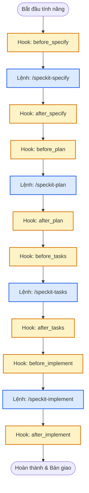

# Hướng Dẫn Toàn Diện Về Hooks & Extensions Trong Spec Kit

Tài liệu này cung cấp hướng dẫn chuyên sâu và có tính sư phạm cao về cơ chế **Extensions** và hệ thống **Hooks** trong hệ sinh thái **Spec Kit**. Hướng dẫn được thiết kế dành cho cả lập trình viên mới bắt đầu lẫn các kiến trúc sư phần mềm muốn chuẩn hóa chất lượng mã nguồn và tự động hóa quy trình phát triển dựa trên đặc tả (Spec-Driven Development).

---

## Mục Lục

1. [Tổng Quan: Extension & Hook Trong Spec Kit Là Gì?](#1-tổng-quan-extension--hook-trong-spec-kit-là-gì)
   - [1.1 Khái niệm Extension: Plugin mở rộng sức mạnh](#11-khái-niệm-extension-plugin-mở-rộng-sức-mạnh)
   - [1.2 Khái niệm Hook: "Middleware" & "Event Triggers" tự động](#12-khái-niệm-hook-middleware--event-triggers-tự-động)
   - [1.3 Phân biệt: Command vs Hook vs Runtime Event](#13-phân-biệt-command-vs-hook-vs-runtime-event)
2. [Hệ Thống Vòng Đời & Sự Kiện (Lifecycle Events)](#2-hệ-thống-vòng-đời--sự-kiện-lifecycle-events)
   - [2.1 Sơ đồ vòng đời phát triển Spec-Driven](#21-sơ-đồ-vòng-đời-phát-triển-spec-driven)
   - [2.2 Danh mục các sự kiện chuẩn (Core Standard Events)](#22-danh-mục-các-sự-kiện-chuẩn-core-standard-events)
   - [2.3 Runtime Events (Sự kiện cấp Agent runtime)](#23-runtime-events-sự-kiện-cấp-agent-runtime)
   - [2.4 Cơ chế Cổng chất lượng (Quality Gates) & Fail-Fast](#24-cơ-chế-cổng-chất-lượng-quality-gates--fail-fast)
3. [Cấu Hình & Cú Pháp Khai Báo Extension & Hooks](#3-cấu-hình--cú-pháp-khai-báo-extension--hooks)
   - [3.1 Bố cục thư mục chuẩn trong dự án](#31-bố-cục-thư-mục-chuẩn-trong-dự-án)
   - [3.2 Manifest `extension.yml` (Schema 1.0)](#32-manifest-extensionyml-schema-10)
   - [3.3 Cấu hình cấp dự án trong `.specify/extensions.yml`](#33-cấu-hình-cấp-dự-án-trong-specifyextensionsyml)
   - [3.4 Thứ tự ưu tiên nạp cấu hình (Configuration Precedence)](#34-thứ-tự-ưu-tiên-nạp-cấu-hình-configuration-precedence)
4. [Các Ca Sử Dụng Thực Tế (Practical Use Cases)](#4-các-ca-sử-dụng-thực-tế-practical-use-cases)
   - [4.1 Ca 1: Chạy Linter & Type Check tự động sau khi Code (`after_implement`)](#41-ca-1-chạy-linter--type-check-tự-động-sau-khi-code-after_implement)
   - [4.2 Ca 2: Quét bí mật (Secret Detection) trước khi triển khai (`before_implement`)](#42-ca-2-quét-bí-mật-secret-detection-trước-khi-triển-khai-before_implement)
   - [4.3 Ca 3: Kiểm tra hợp đồng API (Contract Verification) sau thiết kế (`after_plan`)](#43-ca-3-kiểm-tra-hợp-đồng-api-contract-verification-sau-thiết-kế-after_plan)
   - [4.4 Ca 4: Tự động đồng bộ Issues lên Jira/Linear sau khi lập Tasks (`after_tasks`)](#44-ca-4-tự-động-đồng-bộ-issues-lên-jiralinear-sau-khi-lập-tasks-after_tasks)
5. [Quản Trị CLI & Khắc Phục Sự Cố (Troubleshooting)](#5-quản-trị-cli--khắc-phục-sự-cố-troubleshooting)
   - [5.1 Lệnh CLI thông dụng](#51-lệnh-cli-thông-dụng)
   - [5.2 Các lỗi thường gặp và cách khắc phục](#52-các-lỗi-thường-gặp-và-cách-khắc-phục)
6. [Nguyên Tắc Thực Hành Tốt Nhất (Best Practices)](#6-nguyên-tắc-thực-hành-tốt-nhất-best-practices)

---

## 1. Tổng Quan: Extension & Hook Trong Spec Kit Là Gì?

### 1.1 Khái niệm Extension: Plugin mở rộng sức mạnh

Trong phát triển phần mềm hiện đại, kiến trúc nguyên khối thường dẫn đến phình to và khó bảo trì. Spec Kit áp dụng nguyên lý **Micro-kernel** (nhân tối giản):
- Phần lõi (*Core*) của Spec Kit chỉ tập trung duy nhất vào quy trình đặc tả: làm rõ yêu cầu (`specify`), lập kế hoạch (`plan`), phân rã tác vụ (`tasks`), và dẫn dắt lập trình (`implement`).
- Mọi tính năng kết nối bên ngoài (Jira, Linear, GitHub, SonarQube, v.v.), hoặc các bước tự động kiểm tra chuyên biệt đều được đóng gói thành các **Extension**.

> [!NOTE]
> **Hình tượng hóa Extension**: Giống như các **Extension/Plugin** trong trình duyệt Chrome hay VS Code. Nhân của trình duyệt chỉ render web, còn extension sẽ bổ sung thêm trình chặn quảng cáo, quản lý mật khẩu hoặc bộ dịch ngôn ngữ khi bạn cài đặt chúng.

Lợi ích của mô hình Extension:
- **Clean Core**: Dự án gọn nhẹ, không mang theo các thư viện thừa thãi.
- **Tùy biến cao**: Mỗi dự án chỉ cài những gì thực sự cần (ví dụ: team dùng Jira cài `jira`, team dùng Linear cài `linear`).
- **Tái sử dụng & Chia sẻ**: Các tiện ích có thể đóng gói độc lập theo phiên bản (`versioned packages`) và phân phối qua catalog nội bộ hoặc cộng đồng.

---

### 1.2 Khái niệm Hook: "Middleware" & "Event Triggers" tự động

Nếu **Extension** cung cấp công cụ, thì **Hook** chính là **sợi dây kích hoạt** tự động kết nối công cụ đó vào các thời điểm then chốt trong chu trình phát triển.

> [!TIP]
> **Hình tượng hóa Hook**:
> - **Giống Webhook / Database Trigger**: Khi một sự kiện xảy ra (ví dụ: `AFTER INSERT`), hệ thống tự động gọi một hành động tiếp theo.
> - **Giống Middleware trong Backend Frameworks** (ExpressJS/FastAPI): Trước khi xử lý request (`pre-processing`) hoặc sau khi tạo xong response (`post-processing`), các lớp middleware sẽ can thiệp để kiểm tra xác thực, nén dữ liệu, hoặc log thông tin.

Trong Spec Kit, Hook cho phép lập trình viên hoặc AI Agent:
1. Chèn thêm kiểm tra điều kiện an toàn **TRƯỚC** khi một lệnh được thực thi (*Pre-command hook*).
2. Tự động hóa các tác vụ phụ trợ **SAU** khi một bước hoàn thành (*Post-command hook*).

---

### 1.3 Phân biệt: Command vs Hook vs Runtime Event

Nhiều người mới bắt đầu thường nhầm lẫn giữa ba khái niệm này. Bảng đối chiếu dưới đây sẽ làm rõ:

| Tiêu chí | Command (Lệnh) | Extension Hook (Hook) | Runtime Event (Sự kiện Runtime) |
| :--- | :--- | :--- | :--- |
| **Cách kích hoạt** | Do người dùng hoặc Agent gõ trực tiếp (ví dụ: `/speckit-implement`, `/speckit-jira-sync`). | Kích hoạt tự động khi một lệnh của Spec Kit bắt đầu hoặc kết thúc. | Kích hoạt bởi vòng đời của chính Coding Agent (IDE/Tool level). |
| **Phương thức thực thi** | Gửi chỉ dẫn Markdown/Prompts tới Coding Agent để tương tác. | Gửi gợi ý/chỉ thị Markdown vào ngữ cảnh hội thoại của Agent. | Thực thi trực tiếp kịch bản mã (Bash, PowerShell, Python) ngầm ở backend. |
| **Tính chủ động** | Người dùng chủ động 100%. | Có thể cấu hình: Bắt buộc (Automatic) hoặc Tùy chọn hỏi ý kiến (Optional Prompt). | Hoàn toàn vô hình, tự động chạy ngầm bảo vệ hệ thống. |
| **Ví dụ điển hình** | `/speckit-plan`: Sinh tài liệu thiết kế. | Sau khi sinh tasks xong, nhắc: *"Bạn có muốn tạo Jira Issue không?"*. | Chặn Agent gọi công cụ khi phát hiện đường dẫn nằm trong danh sách cấm (`pre_tool_use`). |

---

## 2. Hệ Thống Vòng Đời & Sự Kiện (Lifecycle Events)

### 2.1 Sơ đồ vòng đời phát triển Spec-Driven

Dưới đây là luồng thực thi tiêu chuẩn trong Spec Kit với các điểm chèn Hook (Pre & Post):



---

### 2.2 Danh mục các sự kiện chuẩn (Core Standard Events)

Spec Kit định nghĩa sẵn các sự kiện gắn liền với từng giai đoạn tạo lập tài liệu và mã nguồn:

#### Nhóm 1: Pre-command Hooks (Chạy TRƯỚC lệnh)
- `before_specify`: Kiểm tra môi trường, yêu cầu nghiệp vụ thô, hoặc tính sẵn sàng của repo trước khi viết đặc tả (`spec.md`).
- `before_plan`: Kiểm tra file `spec.md` đã được phê duyệt chưa, kiến trúc tham chiếu đã tải đủ chưa trước khi lập kế hoạch (`plan.md`).
- `before_tasks`: Đảm bảo kế hoạch đã hoàn tất và cấu trúc thư mục mục tiêu đã rõ ràng.
- `before_implement`: Kiểm tra trạng thái Git sạch sẽ (`git status --porcelain`), kiểm tra không còn conflict trước khi cho Agent sinh mã.
- `before_analyze`, `before_checklist`, `before_clarify`, `before_constitution`: Các hook bảo vệ trước các bước phân tích, thẩm định hay tinh chỉnh hiến pháp dự án.

#### Nhóm 2: Post-command Hooks (Chạy SAU lệnh)
- `after_specify`: Tự động đồng bộ spec lên Confluence/Notion, hoặc kích hoạt AI review tài liệu.
- `after_plan`: Kiểm tra hợp đồng giao tiếp (API Contracts), kiến trúc hướng module, tính tương thích ngược.
- `after_tasks`: Đồng bộ danh sách công việc sang Jira, Linear, GitHub Issues hoặc Asana.
- `after_implement`: Chạy định dạng mã (`prettier`/`black`), kiểm tra cú pháp (`eslint`/`mypy`), và chạy unit tests.

#### Nhóm 3: Bundled Bug Extension Events (Dành riêng cho luồng sửa lỗi)
Nếu dự án kích hoạt extension sửa lỗi (`bug`), hệ sinh thái cung cấp thêm các điểm chặn:
- `before_bug_assess` / `after_bug_assess`: Trước và sau khi phân tích nguyên nhân lỗi.
- `before_bug_fix` / `after_bug_fix`: Trước và sau khi áp dụng bản vá lỗi mã nguồn.
- `before_bug_test` / `after_bug_test`: Trước và sau khi chạy kiểm thử hồi quy xác nhận bản vá.

---

### 2.3 Runtime Events (Sự kiện cấp Agent runtime)

Bên cạnh các Hook theo lệnh tài liệu, Spec Kit hỗ trợ các **Runtime Events**. Đây là những sự kiện mức thấp gắn liền với vòng đời làm việc của Agent trong IDE:

- `session_start`: Chạy ngay khi phiên chat với Coding Agent khởi động (thích hợp để nạp biến môi trường, khởi tạo kết nối DB thử nghiệm).
- `pre_tool_use`: Chạy ngay trước khi Agent chuẩn bị gọi một tool/command (kiểm duyệt tham số, chặn can thiệp file nhạy cảm).
- `post_tool_use`: Chạy sau khi tool thực thi xong (lọc output, kiểm tra xem tool có gây lỗi rò rỉ dữ liệu không).
- `user_prompt_submit`: Kích hoạt khi người dùng vừa gửi câu hỏi/yêu cầu.
- `stop` / `session_end`: Thu dọn tài nguyên, ghi log phiên làm việc.

> [!IMPORTANT]
> **Điểm khác biệt quan trọng**:
> - Hook thông thường gửi chỉ dẫn **Markdown** vào hội thoại để Agent hiểu và thực hiện bước kế tiếp.
> - Runtime Events **chạy trực tiếp kịch bản thực thi** (script file) trên hệ thống máy chủ/máy trạm của bạn. Nếu script trả về exit code khác 0, tiến trình bị chặn đứng.

---

### 2.4 Cơ chế Cổng chất lượng (Quality Gates) & Fail-Fast

Nguyên lý cốt lõi của Spec Kit là **Deterministic Verification (Kiểm định tất định)** theo triết lý phòng thủ:
- Một **Quality Gate** là một trạm kiểm soát được cắm thông qua Hook.
- Khi một điều kiện kỹ thuật không đạt (ví dụ: Type check thất bại, Linter báo 2 errors, có hardcode secret), Hook sẽ kích hoạt cơ chế **Fail-Fast**:
  - Dừng ngay lập tức chu trình thực thi.
  - Không cho phép chuyển tiếp sang giai đoạn sau (ví dụ: không cho phép chuyển từ `implement` sang merge mã nguồn).
  - Trả về báo cáo lỗi cụ thể để Agent hoặc Lập trình viên khắc phục tại chỗ.

---

## 3. Cấu Hình & Cú Pháp Khai Báo Extension & Hooks

### 3.1 Bố cục thư mục chuẩn trong dự án

Khi bạn khởi tạo dự án với Spec Kit (`specify init`) và cài đặt các tiện ích, cấu trúc quản lý Extension và Hook được tổ chức khoa học như sau:

```text
my-project/
├── .specify/
│   ├── extensions.yml              # Quản lý trung tâm danh sách extensions & hooks của dự án
│   ├── extension-catalogs.yml     # Danh sách các kho extension khả dụng
│   ├── extensions/                 # Nơi lưu trữ mã nguồn các extensions đã cài đặt
│   │   ├── .registry               # File JSON theo dõi trạng thái cài đặt và phiên bản
│   │   ├── git/                    # Thư mục extension 'git'
│   │   │   ├── extension.yml       # Bản khai báo (Manifest) của extension git
│   │   │   └── commands/           # Các lệnh mở rộng do extension cung cấp
│   │   └── jira/                   # Thư mục extension 'jira'
│   │       ├── extension.yml
│   │       ├── jira-config.yml     # File cấu hình của team (commit lên git)
│   │       ├── local-config.yml    # Cấu hình override cá nhân (được gitignore)
│   │       └── jira-config.template.yml # File mẫu hướng dẫn cấu hình
│   ├── scripts/                    # Các script bổ trợ
│   └── templates/                  # Templates cho spec, plan, tasks
```

---

### 3.2 Manifest `extension.yml` (Schema 1.0)

Khi phát triển một Extension, bạn định nghĩa các Hook mà extension của mình hỗ trợ bên trong file `extension.yml`:

```yaml
schema_version: "1.0"

extension:
  id: quality-guard
  name: Code Quality & Security Guard
  version: "1.0.0"
  description: "Tự động hóa kiểm tra mã nguồn, bảo mật và tương thích hợp đồng"
  author: "DevOps Team"

requires:
  speckit_version: ">=0.1.0"

provides:
  commands:
    - name: speckit.quality-guard.lint-and-test
      file: commands/lint-and-test.md
      description: "Chạy quy trình kiểm tra mã và kiểm thử"
    - name: speckit.quality-guard.secret-scan
      file: commands/secret-scan.md
      description: "Quét lỗ hổng rò rỉ khóa bí mật"

# Khai báo Hook gắn liền với vòng đời Spec Kit
hooks:
  # Cú pháp 1: Ánh xạ đơn (Single mapping)
  before_implement:
    command: "speckit.quality-guard.secret-scan"
    priority: 5
    optional: false        # Bắt buộc chạy tự động
    description: "Quét mã bảo mật trước khi cho phép lập trình"

  # Cú pháp 2: Danh sách ánh xạ nhiều lệnh (Multiple commands)
  after_implement:
    - command: "speckit.quality-guard.lint-and-test"
      priority: 10
      optional: false
      description: "Kiểm tra kiểu dữ liệu, định dạng mã và chạy tests"
    - command: "speckit.jira.sync-status"
      priority: 20
      optional: true         # Tùy chọn, sẽ hỏi người dùng qua prompt
      prompt: "Bạn có muốn đồng bộ tiến độ hoàn thành lên Jira không?"
      description: "Cập nhật trạng thái Task sang Done trên Jira"

# Khai báo Runtime Events (sự kiện chạy kịch bản trực tiếp)
events:
  session_start:
    command: "speckit.quality-guard.init-env"
```

---

### 3.3 Cấu hình cấp dự án trong `.specify/extensions.yml`

File `.specify/extensions.yml` đóng vai trò là "bảng điều khiển" cấp dự án, kiểm soát những hook nào được kích hoạt:

```yaml
# Danh sách các extension đã cài đặt và kích hoạt trong repo
installed:
  - quality-guard
  - jira

settings:
  auto_execute_hooks: true

# Thiết lập chi tiết từng hook tại dự án
hooks:
  before_implement:
    - extension: quality-guard
      command: speckit.quality-guard.secret-scan
      enabled: true
      optional: false
      priority: 5
      description: "Quét khóa bí mật và token bị lọt vào mã nguồn"
      condition: null

  after_implement:
    - extension: quality-guard
      command: speckit.quality-guard.lint-and-test
      enabled: true
      optional: false
      priority: 10
      description: "Đảm bảo mã nguồn vượt qua linter và unit test"
      condition: null

  after_tasks:
    - extension: jira
      command: speckit.jira.specstoissues
      enabled: true
      optional: true
      priority: 15
      prompt: "Bạn có muốn đẩy toàn bộ danh sách tasks sang Jira không?"
      description: "Tạo tự động Epic và Story trên Jira"
```

#### Giải thích các thuộc tính trong Hook:
- `extension`: Tên định danh ID của extension đăng ký hook.
- `command`: Tên lệnh định danh namespace (`speckit.{extension-id}.{command-name}`).
- `enabled`: Bật (`true`) hoặc Tắt (`false`) hook mà không cần gỡ extension.
- `optional`: 
  - Nếu là `false`: Hook trở thành **Automatic Hook** — Agent sẽ tự động chạy thông qua chỉ thị `EXECUTE_COMMAND`.
  - Nếu là `true`: Hook trở thành **Optional Hook** — Agent sẽ hiển thị dòng hỏi `prompt` để người dùng xác nhận có chạy hay không.
- `priority`: Số nguyên $\ge 1$ quy định độ ưu tiên sắp xếp (mặc định là `10`, số càng nhỏ chạy càng sớm).
- `condition`: Biểu thức điều kiện kiểm tra (ví dụ: `env.CI is set` hoặc `config.features.lint == true`).

---

### 3.4 Thứ tự ưu tiên nạp cấu hình (Configuration Precedence)

Khi một Extension thực thi, cấu hình được hòa trộn (merge) theo thứ tự từ thấp đến cao (càng về sau càng có quyền ghi đè cao nhất):

```text
[1. Giá trị mặc định trong Manifest (defaults / config.defaults)]
                           ⬇ (bị ghi đè bởi)
[2. File cấu hình dự án (.specify/extensions/{ext}/{ext}-config.yml)]
                           ⬇ (bị ghi đè bởi)
[3. File ghi đè cục bộ trên máy lập trình viên (local-config.yml)]
                           ⬇ (bị ghi đè bởi)
[4. Biến môi trường hệ thống (Ví dụ: SPECKIT_JIRA_PROJECT_KEY)]
```

> [!TIP]
> **Quy ước đặt tên biến môi trường**:
> Định dạng là `SPECKIT_{EXTENSION}_{KEY}`. Dấu gạch nối trong ID extension chuyển thành dấu gạch dưới, và các trường phân tách bằng gạch dưới sẽ tự động biến thành object lồng nhau.
> *Ví dụ*: `SPECKIT_QUALITY_GUARD_API_KEY="xyz"` sẽ gán vào cấu hình `api.key = "xyz"`.

---

## 4. Các Ca Sử Dụng Thực Tế (Practical Use Cases)

Phần này hướng dẫn triển khai 4 kịch bản thực tế điển hình nhất mà mọi nhóm phát triển phần mềm đều cần.

---

### 4.1 Ca 1: Chạy Linter & Type Check tự động sau khi Code (`after_implement`)

**Mục tiêu**: Ngay sau khi Coding Agent viết mã theo lệnh `/speckit-implement`, hệ thống tự động kiểm tra định dạng và tính toàn vẹn kiểu dữ liệu. Nếu có lỗi, Agent phải sửa ngay lập tức trước khi thông báo hoàn tất.

#### Bước 1: Tạo Script kiểm tra đa nền tảng
Chúng ta có thể chuẩn bị file script kiểm tra chất lượng mã nguồn bằng PowerShell hoặc Bash:

**Script PowerShell** (`.specify/scripts/powershell/run-quality-gate.ps1`):
```powershell
[CmdletBinding()]
param()

$ErrorActionPreference = "Stop"
Write-Host "=== [QUALITY GATE] Bắt đầu kiểm tra Linter & Type Check ===" -ForegroundColor Cyan

# 1. Chạy Type Check (ví dụ với TypeScript)
Write-Host "-> Đang kiểm tra Type Check (tsc)..."
& npx tsc --noEmit
if ($LASTEXITCODE -ne 0) {
    Write-Error "[FAIL] Phát hiện lỗi Type Check! Vui lòng sửa lỗi trước khi tiếp tục."
    exit 1
}

# 2. Chạy Linter (ví dụ với ESLint)
Write-Host "-> Đang kiểm tra Linter (eslint)..."
& npx eslint src/ --ext .ts,.tsx --max-warnings 0
if ($LASTEXITCODE -ne 0) {
    Write-Error "[FAIL] Linter vi phạm quy chuẩn! Không đạt tiêu chuẩn chất lượng."
    exit 1
}

Write-Host "=== [SUCCESS] Toàn bộ mã nguồn đạt chuẩn 100%! ===" -ForegroundColor Green
exit 0
```

#### Bước 2: Tạo file Command Markdown của Extension
File: `.specify/extensions/quality-guard/commands/lint-and-test.md`
```markdown
---
description: "Chạy kiểm tra chất lượng mã và báo cáo lỗi nếu có"
---

# Lệnh Kiểm Tra Chất Lượng Mã Nguồn (Lint & Test)

## Hướng dẫn cho AI Agent:
Bạn vừa hoàn thành việc sinh mã. Hãy thực hiện kiểm định cơ học ngay lập tức:

1. Chạy lệnh kiểm tra bằng PowerShell:
   ```powershell
   powershell -ExecutionPolicy Bypass -File .specify/scripts/powershell/run-quality-gate.ps1
   ```
2. **Quy tắc xử lý kết quả**:
   - Nếu exit code bằng 0: Thông báo "Mã nguồn sạch và hoàn toàn hợp lệ".
   - Nếu script báo lỗi: Đọc chi tiết lỗi từ output của console, tự động sửa đổi các file mã nguồn liên quan và chạy lại lệnh kiểm tra cho đến khi đạt mã thoát 0.
```

#### Bước 3: Đăng ký Hook trong `.specify/extensions.yml`
```yaml
hooks:
  after_implement:
    - extension: quality-guard
      command: speckit.quality-guard.lint-and-test
      enabled: true
      optional: false    # Bắt buộc thực thi tự động
      priority: 5
      description: "Cổng kiểm soát chất lượng cú pháp và kiểu dữ liệu sau khi code"
```

---

### 4.2 Ca 2: Quét bí mật (Secret Detection) trước khi triển khai (`before_implement`)

**Mục tiêu**: Ngăn chặn tình trạng lập trình viên hoặc AI vô tình chèn API Key, Database Password, Private Token vào mã nguồn trước khi bắt tay vào hiện thực hóa tính năng.

#### Bước 1: Tạo Script quét bảo mật bằng Python
File: `.specify/scripts/security-scan.py`
```python
import os
import re
import sys
from pathlib import Path

# Danh sách regex các định dạng mã bí mật nguy hiểm
PATTERNS = {
    "OpenAI API Key": r"sk-[a-zA-Z0-9]{32,}",
    "Generic Secret Key": r"(?i)(password|secret|apikey|token)\s*[:=]\s*['\"][a-zA-Z0-9_\-]{8,}['\"]",
    "Private Key": r"-----BEGIN (RSA|EC|DSA|OPENSSH) PRIVATE KEY-----",
    "AWS Access Key": r"AKIA[0-9A-Z]{16}"
}

def scan_files(target_dir):
    violation_found = False
    print(f"[*] Đang quét mã nhạy cảm trong thư mục: {target_dir}")
    
    for root, _, files in os.walk(target_dir):
        if any(skip in root for skip in [".git", "node_modules", ".specify", "venv"]):
            continue
        for file in files:
            file_path = Path(root) / file
            try:
                content = file_path.read_text(encoding="utf-8", errors="ignore")
                for key_name, pattern in PATTERNS.items():
                    matches = re.finditer(pattern, content)
                    for match in matches:
                        print(f"[CẢNH BÁO NGUY HIỂM] Phát hiện {key_name} tại: {file_path}")
                        violation_found = True
            except Exception as e:
                pass
                
    if violation_found:
        print("[FAIL] Phát hiện rò rỉ khóa bí mật! Từ chối tiếp tục.")
        sys.exit(1)
    else:
        print("[PASS] Không phát hiện bí mật rò rỉ trong mã nguồn.")
        sys.exit(0)

if __name__ == "__main__":
    scan_files(os.getcwd())
```

#### Bước 2: Khai báo Hook chặn trước
Trong file `.specify/extensions.yml`:
```yaml
hooks:
  before_implement:
    - extension: quality-guard
      command: speckit.quality-guard.secret-scan
      enabled: true
      optional: false
      priority: 1
      description: "Kiểm tra bảo mật và rò rỉ secret trước khi bắt đầu viết code"
```

> [!CAUTION]
> **Cổng chặn quan trọng**: Khi Hook này trả về mã lỗi (`exit code 1`), toàn bộ tiến trình triển khai sẽ bị dừng ngay tức khắc để bảo vệ an toàn cho cơ sở dữ liệu và tài khoản đám mây của doanh nghiệp.

---

### 4.3 Ca 3: Kiểm tra hợp đồng API (Contract Verification) sau thiết kế (`after_plan`)

**Mục tiêu**: Sau khi Agent lập xong file `plan.md`, Hook này kiểm tra xem các thiết kế endpoint mới có phá vỡ hợp đồng OpenAPI/JSON Schema hiện hành hay không.

#### Kịch bản triển khai Hook:
Đăng ký trong `.specify/extensions.yml`:
```yaml
hooks:
  after_plan:
    - extension: contract-checker
      command: speckit.contract-checker.verify-openapi
      enabled: true
      optional: false
      priority: 10
      description: "So sánh kế hoạch thiết kế với openapi.json để tránh Breaking Changes"
```

Nội dung file chỉ dẫn lệnh `verify-openapi.md`:
```markdown
---
description: "Kiểm tra tính toàn vẹn hợp đồng API"
---

# Kiểm Tra Tính Tương Thích Hợp Đồng API

## Nhiệm vụ của Agent:
1. Đọc nội dung file `plan.md` vừa được tạo ra.
2. Đối chiếu danh sách API Endpoints với file chuẩn `contracts/openapi.yaml`.
3. Nếu phát hiện có trường bắt buộc (`required field`) bị xóa hoặc đổi kiểu dữ liệu, hãy ghi chú rõ mục **"BREAKING CHANGES REPORT"** trong kế hoạch và yêu cầu xác nhận từ Technical Lead.
```

---

### 4.4 Ca 4: Tự động đồng bộ Issues lên Jira/Linear sau khi lập Tasks (`after_tasks`)

**Mục tiêu**: Sau khi phân rã các đầu việc trong `tasks.md`, cung cấp cho người dùng một tùy chọn (Optional Prompt) để tự động đẩy các task này thành các User Stories trên Jira.

#### Khai báo Hook tương tác:
Trong `.specify/extensions.yml`:
```yaml
hooks:
  after_tasks:
    - extension: jira
      command: speckit.jira.specstoissues
      enabled: true
      optional: true
      priority: 10
      prompt: "Bạn có muốn đồng bộ danh sách nhiệm vụ từ tasks.md lên dự án Jira không?"
      description: "Tự động phân loại Epic, Story và tạo link tương ứng"
```

#### Cách Spec Kit hiển thị thông điệp Hook tới Agent:
Khi lệnh `/speckit-tasks` hoàn tất, Spec Kit sẽ gắn thêm đoạn văn bản sau vào cuối phản hồi của Agent:

```markdown
## Extension Hooks

**Optional Hook**: jira
Command: `/speckit-jira-specstoissues`
Description: Tự động phân loại Epic, Story và tạo link tương ứng

Prompt: Bạn có muốn đồng bộ danh sách nhiệm vụ từ tasks.md lên dự án Jira không?
To execute: `/speckit-jira-specstoissues`
```

Lập trình viên chỉ cần gõ đồng ý, và Agent sẽ thực hiện lệnh tạo Issue thông qua Jira MCP Server một cách hoàn toàn tự động.

---

## 5. Quản Trị CLI & Khắc Phục Sự Cố (Troubleshooting)

### 5.1 Lệnh CLI thông dụng

Spec Kit CLI cung cấp bộ lệnh hoàn chỉnh để quản lý Extension:

```bash
# 1. Tìm kiếm extension trong các catalog đang hoạt động
specify extension search
specify extension search jira
specify extension search --tag security

# 2. Xem thông tin chi tiết của extension (phiên bản, yêu cầu MCP, hooks cung cấp)
specify extension info jira

# 3. Cài đặt extension
specify extension add github                      # Cài từ catalog mặc định
specify extension add jira --version 1.0.0        # Cài đúng phiên bản cụ thể
specify extension add --dev ./my-custom-extension # Cài đặt phục vụ phát triển nội bộ

# 4. Liệt kê các extension đang cài đặt trong dự án
specify extension list

# 5. Tạm thời vô hiệu hóa hoặc kích hoạt lại extension
specify extension disable jira
specify extension enable jira

# 6. Cập nhật extension lên bản mới nhất
specify extension update
specify extension update jira

# 7. Gỡ bỏ extension
specify extension remove jira
specify extension remove jira --keep-config       # Gỡ tiện ích nhưng giữ lại file cấu hình
```

---

### 5.2 Các lỗi thường gặp và cách khắc phục

#### Lỗi 1: Hook không được kích hoạt sau khi chạy lệnh
- **Nguyên nhân**:
  1. Trường `enabled` trong `.specify/extensions.yml` đang bị đặt thành `false`.
  2. File `extension.yml` có điều kiện `condition` không thỏa mãn.
  3. Lỗi thụt dòng (Indentation) trong file YAML cấu hình.
- **Cách khắc phục**:
  - Mở `.specify/extensions.yml` và kiểm tra giá trị `enabled: true`.
  - Kiểm tra xem tên hook event có đúng chuẩn không (`after_tasks`, `after_implement`, không viết hoa, không gõ nhầm dấu gạch dưới).

#### Lỗi 2: Extension không tương thích phiên bản (`CompatibilityError`)
- **Triệu chứng**: Thông báo lỗi `Extension requires spec-kit >=0.2.0, but you have 0.1.0`.
- **Cách khắc phục**:
  - Nâng cấp phiên bản Spec Kit:
    ```bash
    uv tool upgrade specify-cli
    ```
  - Hoặc cài đặt phiên bản cũ hơn của extension tương thích với Spec Kit hiện tại:
    ```bash
    specify extension add jira --version 0.1.0
    ```

#### Lỗi 3: Lỗi thiếu công cụ MCP (`MCP Tool Not Available`)
- **Triệu chứng**: Agent báo lỗi `Tool 'jira-mcp-server/epic_create' not found`.
- **Cách khắc phục**:
  - Nhiều Extension cần MCP Server hỗ trợ để tương tác với các dịch vụ bên ngoài. Hãy kiểm tra mục `requires.tools` trong `specify extension info <tên-extension>`.
  - Khởi động lại IDE hoặc Coding Agent sau khi cập nhật file cấu hình MCP.

---

## 6. Nguyên Tắc Thực Hành Tốt Nhất (Best Practices)

Để khai thác tối đa sức mạnh của Extensions và Hooks mà không làm nặng dự án, hãy tuân thủ 5 nguyên tắc vàng sau:

1. **Nguyên tắc Tối giản (Occam's Parsimony)**:
   - Chỉ cài đặt các extension thực sự phục vụ công việc hàng ngày của nhóm.
   - Tránh cài đặt quá nhiều extension dư thừa làm tăng thời gian nạp context của Agent.

2. **Quản lý Git thông minh (Version Control Best Practices)**:
   - **Bắt buộc commit**:
     - `.specify/extensions.yml` (bảng cấu hình chung cho cả team).
     - `.specify/extensions/*/*-config.yml` (cấu hình môi trường dùng chung).
   - **Tuyệt đối không commit (Phải đưa vào `.gitignore`)**:
     - `.specify/extensions/.cache/` (cache dữ liệu tải về).
     - `.specify/extensions/.backup/` (bản sao lưu).
     - `.specify/extensions/*/local-config.yml` (chứa override hoặc credential cá nhân).
     - `.specify/extensions/.registry` (trạng thái cục bộ).

3. **Thiết lập Cổng kiểm định tất định (Deterministic Quality Gates)**:
   - Đặt `optional: false` cho các bước sống còn: Linter, Type Check, Security Scan.
   - Đặt `optional: true` cho các bước giao tiếp bên ngoài: Gửi thông báo Slack, cập nhật Jira, đồng bộ Notion.

4. **Khai thác biến môi trường cho CI/CD**:
   - Sử dụng tiền tố `SPECKIT_{EXT}_{KEY}` trong GitHub Actions, GitLab CI để truyền bí mật an toàn mà không cần lưu khóa trong repo:
     ```yaml
     env:
       SPECKIT_JIRA_PROJECT_KEY: ${{ secrets.JIRA_PROJECT_KEY }}
     ```

5. **Xây dựng kịch bản Fail-Fast rõ ràng**:
   - Mọi script kiểm thử khi phát hiện lỗi phải trả về mã thoát nhị phân rõ ràng (`exit 1` khi lỗi, `exit 0` khi thành công).
   - Cung cấp thông báo lỗi chi tiết, chỉ rõ tên file và dòng lỗi để AI Agent có thể tự sửa chữa ngay lập tức mà không cần con người can thiệp.

---

*Tài liệu thuộc bộ hướng dẫn chuẩn hóa phát triển của hệ thống Spec Kit.*
*Phiên bản tài liệu: 1.0 - Ngày cập nhật: 2026-11-08.*