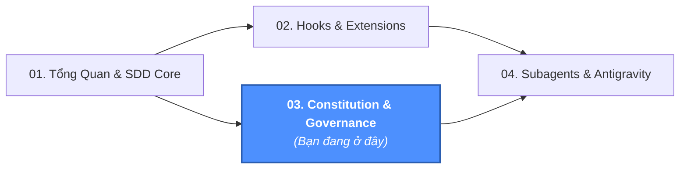
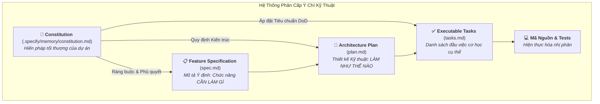
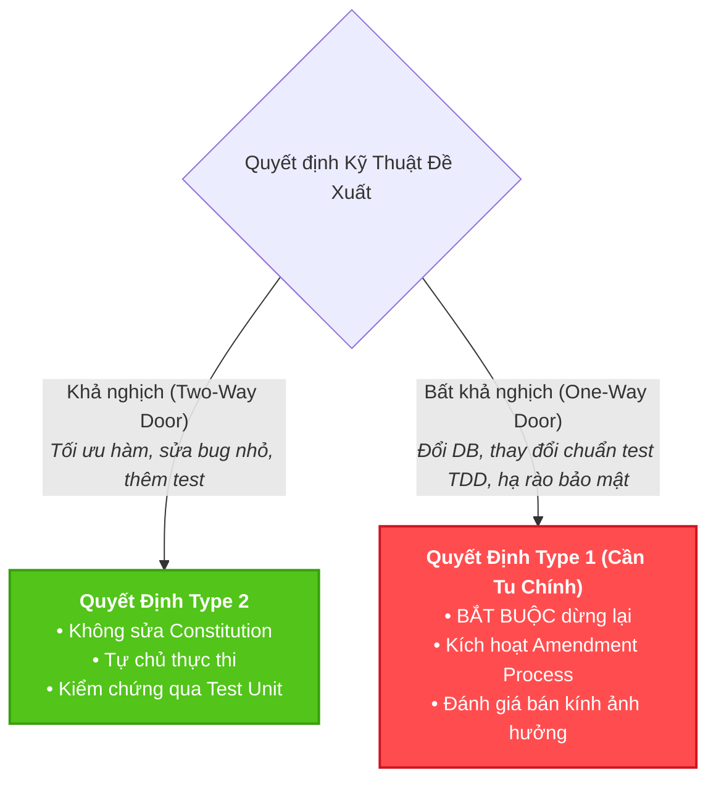
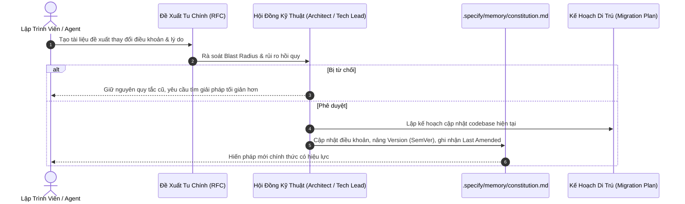
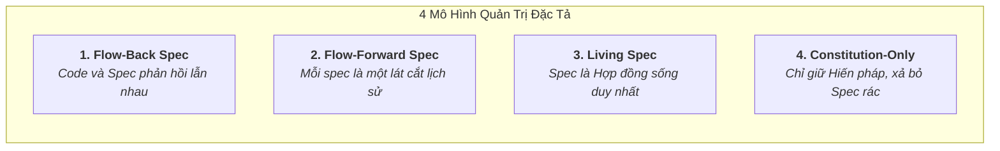

# ⚖️ Chuyên Đề 03: Constitution (Hiến Pháp Dự Án), Rules & Quản Trị AI Agent

> **Tóm tắt chuyên đề:**  
> Trong mô hình lập trình cùng AI Agent, một "Hiến pháp dự án" (**Project Constitution**) không phải là tài liệu hình thức mà là **bộ luật tối thượng có tính ràng buộc kỹ thuật tuyệt đối**. Chuyên đề này sẽ hướng dẫn bạn từ gốc rễ: tại sao AI cần Hiến pháp, cách phối hợp giữa Hiến pháp Spec Kit với các nguyên lý bất biến (**Andrew Principles**), cách khởi tạo bằng lệnh `/speckit-constitution`, và quy trình tu chính (Amendment Process) khi dự án mở rộng quy mô.

---

## 🗺️ Vị Trí Trong Hệ Thống Tài Liệu Spec Kit



---

## 1. Bản Chất Constitution: Vì Sao AI Agent Bắt Buộc Phải Có "Hiến Pháp"?

### 1.1. Căn bệnh "Bay bổng" (Hallucination) và thảm họa Vibe Coding
Khi làm việc với các Mô hình Ngôn ngữ Lớn (LLM), các nhà phát triển thường đối mặt với các hiện tượng tiêu cực:
- **Tự chế logic (Speculative Hallucination)**: AI tự ý phỏng đoán yêu cầu khi gặp đoạn mô tả chưa rõ ràng, thay vì hỏi lại lập trình viên.
- **Over-Engineering (Phức tạp hóa thái quá)**: Cần một hàm tính tổng đơn giản, nhưng AI tự động sinh ra một Abstract Factory, 3 Generic Interfaces, và một bộ cấu hình động chưa từng được yêu cầu.
- **Xâm lấn cú pháp (Syntactic Drift)**: Khi được giao sửa 1 dòng code, AI "tiện tay" format lại toàn bộ file, đổi kiểu đặt tên biến, xóa nhầm chú thích quan trọng hoặc nuốt ngoại lệ bằng khối `catch (e) {}` rỗng.

> [!CAUTION]
> **Rủi ro cốt lõi của Vibe Coding:**  
> Nếu bạn chỉ ra lệnh bằng ngôn ngữ tự nhiên chung chung mà không có **khung ràng buộc nhận thức (Cognitive Guardrails)**, AI sẽ tối ưu hóa câu trả lời dựa trên xác suất từ ngữ (Probabilistic Completion) thay vì tính toàn vẹn hệ thống (System Integrity).

### 1.2. Constitution là gì?
Trong hệ sinh thái **Spec Kit**, **Constitution (Hiến pháp dự án)** là một tài liệu Markdown đặc biệt được lưu trữ cố định tại:
```text
.specify/memory/constitution.md
```

Constitution định nghĩa **các nguyên tắc nền tảng không thể thương lượng (Non-negotiable Principles)**, các ranh giới cấm kỵ, và tiêu chuẩn kỹ thuật tối thượng của toàn bộ dự án.



### 1.3. Vị thế tối thượng của Constitution
- **Quyền phủ quyết (Superseding Authority)**: Mọi tài liệu đặc tả tính năng (`spec.md`), kế hoạch (`plan.md`), hay danh sách tác vụ (`tasks.md`) nếu xung đột với Constitution đều bị coi là **bất hợp lệ**.
- **Tính trường tồn (Long-lived Contract)**: Trong khi các thư mục tính năng (`specs/001-...`, `specs/002-...`) có thể hoàn tất và lưu trữ vào lịch sử, Constitution là tài liệu sống duy nhất đồng hành xuyên suốt toàn bộ vòng đời ứng dụng.
- **Neo nhận thức (Cognitive Anchor)**: Tại mỗi lượt sinh mã của AI Agent trong Spec Kit, nội dung của `constitution.md` luôn được tự động tải vào bộ nhớ ngữ cảnh để làm rào chắn phòng thủ.

---

## 2. Mối Quan Hệ Giữa Constitution Và Andrew Principles (System Rules)

Spec Kit đạt được độ an toàn phòng thủ tối đa khi kết hợp **Hiến pháp dự án (`constitution.md`)** với bộ quy chuẩn tư duy **Andrew Principles (L0 Behavioral Architecture)**.

### 2.1. Phân tầng kiến trúc nhận thức: L0 đến L3

| Cấp Độ | Tên Gọi | Vị Trí Lưu Trữ | Vai Trò & Thẩm Quyền |
| :--- | :--- | :--- | :--- |
| **L0 Core** | **Andrew Principles / System Rules** | `AGENTS.md`, `.agents/rules/` | **Quy tắc ứng xử cốt lõi của Agent**: Ràng buộc tư duy cấp hệ thống (Occam's Parsimony, AST Invariance, Mechanical Determinism). Bất biến trên mọi dự án. |
| **L1 Governance** | **Project Constitution** | `.specify/memory/constitution.md` | **Hiến pháp riêng của dự án**: Tech stack, quy ước thư viện (Library-First, CLI-First), chuẩn mực test, phân tầng kiến trúc, quy định bảo mật. |
| **L2 Intent** | **Feature Specification** | `.specify/specs/<feature>/spec.md` | **Đặc tả nghiệp vụ cụ thể**: User Stories, giao diện hợp đồng dữ liệu, tiêu chí nghiệm thu (Acceptance Criteria). |
| **L3 Execution** | **Plan & Tasks** | `plan.md`, `tasks.md` | **Kế hoạch & Nhiệm vụ thực thi**: Bóc tách công việc thành từng bước nhỏ có thể kiểm chứng cơ học. |

### 2.2. Ba trụ cột Andrew Principles được gắn chặt vào Hiến pháp

#### 1. Occam's Parsimony (Dao cạo Occam - Tối giản triệt để)
- **Nội dung**: Mọi dòng mã sinh ra phải là tập con tối thiểu và cần thiết tuyệt đối để đáp ứng đặc tả. Loại bỏ 100% cấu trúc dự phòng tương lai (*"You Aren't Gonna Need It - YAGNI"*).
- **Ranh giới cấm trong Constitution**: Cấm tạo Factory cho 1 thực thể đơn lẻ, cấm tạo Generic Wrapper khi chưa có 3 trường hợp sử dụng cụ thể, cấm tạo cấu hình động suy đoán.
- **Tiêu chuẩn kiểm định (Litmus Test)**: *Nếu một kỹ sư giàu kinh nghiệm có thể cắt giảm 50% dòng mã của AI mà hệ thống vẫn chạy đúng, mã đó vi phạm Hiến pháp và bị loại bỏ ngay lập tức.*

#### 2. AST Invariance (Bất biến cú pháp lân cận & Bán kính ảnh hưởng)
- **Nội dung**: Giới hạn phạm vi biến đổi cấu trúc tại đúng nút AST (Abstract Syntax Tree) mục tiêu. Bảo toàn 100% định dạng, khoảng trắng, thụt lề và comment xung quanh.
- **Truy vết 1-1**: Mọi dòng code thay đổi trong Git Diff phải có nguồn gốc giải thích được từ một yêu cầu trong `spec.md` hoặc `tasks.md`.
- **Thu hồi phần tử mồ côi (Anti-Entropy)**: Tự động dọn dẹp các biến, hàm, imports dư thừa do chính lượt sửa đổi hiện tại tạo ra.

#### 3. Mechanical Determinism (Định chế cơ học nhị phân)
- **Nội dung**: AI Agent **không bao giờ** được phép tự kết luận *"Tôi đã làm xong tính năng này"* chỉ dựa trên suy luận lý thuyết.
- **Quy chuẩn Exit Code 0**: Một tác vụ chỉ được coi là hoàn tất khi có bằng chứng thực thi cơ học từ môi trường thật (bộ chạy test, compiler, linter) trả về mã thoát nhị phân là `0`.

> [!NOTE]
> **Sự tương hỗ hoàn hảo:**  
> L0 (Andrew Principles) dạy cho AI **cách suy nghĩ kỷ luật**, trong khi L1 (Constitution) định nghĩa **luật chơi cụ thể của dự án**. Cả hai hợp thành một hệ thống phòng thủ đa tầng khiến AI không thể viết mã cẩu thả.

---

## 3. Hướng Dẫn Thiết Lập Constitution Cho Dự Án Thực Tế

### 3.1. Khởi tạo bằng Slash Skill `/speckit-constitution`

Để tạo mới hoặc cập nhật Hiến pháp dự án, trong Antigravity Chat bạn chỉ cần gõ lệnh:
```bash
/speckit-constitution
```

Lệnh này sẽ:
1. Đọc template chuẩn từ `.specify/templates/spec-template.md` và `.specify/memory/constitution.md`.
2. Kiểm tra các công nghệ hiện hữu trong codebase (package.json, pyproject.toml, go.mod,...).
3. Đặt các câu hỏi trọng tâm để bạn lựa chọn các nguyên tắc cốt lõi (TDD, Library-First, Clean Architecture, Security Rules,...).
4. Khởi tạo hoặc cập nhật file `.specify/memory/constitution.md` với đầy đủ thông tin phiên bản.

---

### 3.2. Năm điều khoản mẫu bắt buộc trong Constitution thực chiến

Dưới đây là 5 điều khoản tiêu chuẩn được đúc kết từ các dự án quy mô lớn:

#### Điều khoản I: Chuẩn Mực Mã Nguồn & Tối Giản Cấu Trúc (Occam's Rule)
- Ưu tiên hàm thuần túy (Pure Functions) và tính bất biến (Immutability).
- Hạn chế trạng thái toàn cục (Global State); ưu tiên Lexical Scope cục bộ.
- Không đưa vào mã giả lập (Mock/Stub), không để lại placeholder `// TODO` trên các nhánh logic chính.

#### Điều khoản II: Triết Lý Kiểm Thử Bắt Buộc (Test-First & Red-Green-Refactor)
- **Bắt buộc TDD**: Viết kiểm thử trước $\rightarrow$ Chạy kiểm thử thấy ĐỎ (Fail) $\rightarrow$ Viết mã tối thiểu để kiểm thử XANH (Pass) $\rightarrow$ Tối ưu hóa (Refactor).
- Tỷ lệ bao phủ kiểm thử (Test Coverage Gate) đạt tối thiểu $\ge 85\%$ cho tầng logic nghiệp vụ lõi (Business Domain).

#### Điều khoản III: Hợp Đồng Giao Diện Ổn Định & Lan Truyền Lỗi (Fail-Fast)
- Các API công khai (Public Signatures) một khi đã công bố thì không được tùy tiện thay đổi kiểu dữ liệu hoặc tham số.
- **Fail-Fast tại ranh giới**: Khi gặp dữ liệu sai hoặc lỗi hệ thống, bắt buộc phải ném lỗi (throw error) ngay lập tức kèm stack trace nguyên bản.
- **Nghiêm cấm tuyệt đối**: Cấm các khối `catch (e) {}` rỗng hoặc `except: pass` che giấu lỗi hệ thống.

#### Điều khoản IV: Ranh Giới An Toàn Dữ Liệu & Bảo Mật
- Mọi dữ liệu đầu vào từ người dùng hoặc hệ thống bên ngoài đều phải được kiểm định qua Schema Parser (Zod, Pydantic, Joi).
- Không bao giờ lưu trữ cứng (Hardcode) API Key, Token, Mật khẩu trong mã nguồn; bắt buộc nạp qua biến môi trường (`.env`).
- Mọi thao tác ghi đè, xóa dữ liệu nhạy cảm đều phải có cơ chế xác thực hoặc bản sao lưu khả nghịch.

#### Điều khoản V: Khả Năng Quan Sát & Giao Thức Text I/O (Observability)
- Các module và thư viện nội bộ phải hỗ trợ giao tiếp dạng dòng văn bản chuẩn (Standard Text In/Out Protocol).
- Ghi log có cấu trúc (Structured JSON Logging), phân cấp rõ ràng (`INFO`, `WARN`, `ERROR`), tuyệt đối không spam log bừa bãi.

---

### 3.3. File Mẫu Hoàn Chỉnh: `constitution.md` Cho Dự Án Thực Tế

Dưới đây là một mẫu cấu hình thực tế cho một dự án TypeScript/Node.js theo chuẩn Spec Kit:

```markdown
# MyProject Constitution

## Core Principles

### I. Library-First & Modular Boundaries
- Mọi tính năng nghiệp vụ phải được đóng gói độc lập dưới dạng module/thư viện tự trị.
- Các module chỉ giao tiếp qua giao diện (Interfaces/Contracts) được công bố rõ ràng.
- Cấm phụ thuộc vòng (Circular Dependencies).

### II. Test-First Engineering (NON-NEGOTIABLE)
- Mọi thay đổi logic đều phải đi kèm unit test hoặc integration test tương ứng.
- Quy trình TDD là bắt buộc: Test thất bại được duyệt trước khi mã nghiệp vụ được sinh ra.
- Tỷ lệ bao phủ kiểm thử toàn dự án duy trì tối thiểu 85%.

### III. Radical Parsimony (Occam's Razor)
- Mọi dòng mã thêm mới phải là tối thiểu để thỏa mãn `spec.md`.
- Tuyệt đối cấm các lớp trừu tượng đầu cơ: Generic đơn hình, Factory chỉ tạo 1 đối tượng.
- Giữ vững tỷ lệ tín hiệu trên độ nhiễu diff (Signal-to-Noise Ratio) $\ge 0.85$.

### IV. Fail-Fast & Explicit Error Propagation
- Không bao giờ nuốt ngoại lệ âm thầm (Silent Error Swallowing).
- Bắt lỗi tại tầng ranh giới và ghi log chi tiết; để lỗi nổ tự nhiên ở các tầng logic thuần túy.

### V. Security & Secret Zero-Tolerance
- 100% bí mật (Secrets, API Keys) phải nạp qua biến môi trường.
- Mọi dữ liệu ngoại vi bắt buộc phải validate bằng Zod schema trước khi đưa vào domain logic.

## Governance & Compliance

- Bản Hiến pháp này có hiệu lực tối cao, phủ quyết mọi đề xuất kiến trúc đi ngược lại.
- Mọi Pull Request vi phạm bất kỳ điều khoản nào ở trên sẽ bị từ chối tự động tại Quality Gate.
- Sửa đổi Hiến pháp bắt buộc phải tuân theo Quy trình Tu chính (Amendment Process).

**Version**: 1.0.0 | **Ratified**: 2026-11-08 | **Last Amended**: 2026-11-08
```

---

## 4. Quy Trình Sửa Đổi Hiến Pháp (Amendment Process) & Quản Trị Quy Mô Lớn

Khi một dự án phần mềm phát triển từ giai đoạn MVP (khởi tạo) lên quy mô Enterprise (hàng chục lập trình viên và hàng trăm tính năng), các quy tắc kỹ thuật ban đầu có thể cần được mở rộng hoặc cập nhật. Tuy nhiên, Hiến pháp không thể bị sửa đổi tùy tiện.

### 4.1. Khái niệm Tính Bất Biến Có Kiểm Soát (Controlled Immutability)
Hiến pháp được thiết kế với tính chất **ổn định cao (High Stability)**. Bạn không thể sửa Constitution chỉ vì một tính năng đơn lẻ gặp khó khăn khi triển khai. Thay vào đó, nó đòi hỏi sự cân nhắc có ý thức của cả đội ngũ kỹ thuật.

### 4.2. Phân loại Quyết định: Type 1 (Một chiều) vs Type 2 (Hai chiều)



- **Quyết định Type 2 (Two-Way Door)**: Có thể đảo ngược dễ dàng mà không để lại hậu quả nghiêm trọng. *Ví dụ: chọn thư viện format ngày tháng, refactor một hàm tính toán nội bộ.* $\rightarrow$ **Không cần sửa Constitution**.
- **Quyết định Type 1 (One-Way Door)**: Có chi phí đảo ngược cực kỳ đắt đỏ hoặc làm thay đổi căn bản kiến trúc hệ thống. *Ví dụ: chuyển từ REST sang gRPC, bãi bỏ quy định TDD, đổi cơ chế quản lý xác thực.* $\rightarrow$ **Bắt buộc kích hoạt Quy trình Tu chính Hiến pháp**.

---

### 4.3. Quy trình 4 bước Tu chính Hiến pháp (Amendment Workflow)



1. **Bước 1: Khởi thảo Đề xuất (RFC - Request for Comments)**  
   Mô tả rõ:
   - Điều khoản nào trong Constitution đang tạo ra rào cản bất hợp lý?
   - Dữ liệu thực tế chứng minh quy tắc cũ không còn phù hợp.
   - Nội dung điều khoản mới đề xuất thay thế.

2. **Bước 2: Phân tích Bán kính Ảnh hưởng (Blast Radius Audit)**  
   - Đánh giá xem nếu sửa điều khoản này, bao nhiêu module, bao nhiêu file `spec.md` cũ và bao nhiêu dòng mã hiện hữu sẽ bị ảnh hưởng.
   - Bắt buộc phải có giải pháp tương thích ngược (Backward Compatibility) hoặc lộ trình di trú rõ ràng.

3. **Bước 3: Phê duyệt Minh thị (Explicit Consensus)**  
   - Tu chính Hiến pháp không bao giờ được thông qua bởi một cá nhân đơn lẻ hoặc do AI tự ý quyết định. Bắt buộc phải có sự đồng thuận của **Tech Lead** hoặc **Principal Architect**.

4. **Bước 4: Ban hành & Nâng cấp Phiên bản (Ratification & Versioning)**  
   - Cập nhật trường phiên bản (`Version: X.Y.Z`) theo quy chuẩn Semantic Versioning:
     - **MAJOR**: Thay đổi căn bản các nguyên tắc cốt lõi (ví dụ: đổi từ TDD sang BDD, thay đổi hoàn toàn kiến trúc tầng).
     - **MINOR**: Bổ sung điều khoản mới mà không phá vỡ các điều khoản hiện tại.
     - **PATCH**: Làm rõ câu chữ, tinh chỉnh ngữ nghĩa giải thích.
   - Cập nhật trường `Last Amended: YYYY-MM-DD`.

---

### 4.4. Quản trị Constitution trong 4 mô hình lưu trữ đặc tả (Persistence Models)

Spec Kit cung cấp 4 chiến lược lưu trữ tài liệu đặc tả sau khi tính năng đã hoàn tất bàn giao. Dưới đây là vai trò của Constitution trong từng mô hình:



| Mô Hình | Cách Vận Hành Của Constitution | Ứng Dụng Thực Tế Phù Hợp |
| :--- | :--- | :--- |
| **1. Flow-Back Spec** | Constitution giữ vai trò thẩm phán tối cao. Khi code phản hồi ngược lại làm sửa `spec.md`, các sửa đổi đó vẫn **không được phép vượt qua lằn ranh đỏ của Constitution**. | Dự án linh hoạt, startup quy mô nhỏ cần tốc độ thích ứng nhanh. |
| **2. Flow-Forward Spec** | Constitution đóng vai trò nền móng bất biến. Mỗi khi yêu cầu nghiệp vụ thay đổi, một thư mục `specs/00X` mới được tạo ra để lưu vết lịch sử, tất cả đều phải tham chiếu tới cùng 1 Constitution. | Dự án tài chính, ngân hàng, y tế cần khả năng kiểm toán (Audit Trail) chặt chẽ. |
| **3. Living Spec** | Constitution đóng vai trò luật khung. `spec.md` là hợp đồng trung tâm, còn `plan.md` và `tasks.md` có thể bị xóa và sinh lại bất cứ lúc nào dựa trên `spec.md` và `constitution.md`. | Hệ thống phần mềm có hợp đồng API ổn định và domain nghiệp vụ phức tạp. |
| **4. Constitution-Only** | **Mô hình tối giản tối thượng**: Sau khi bàn giao tính năng, toàn bộ thư mục `specs/` được loại bỏ khỏi git history (được đưa vào `.gitignore`). **Chỉ có duy nhất `.specify/memory/constitution.md` được lưu vết trường tồn trong Git**. | Codebase của chính Spec Kit, các thư viện mã nguồn mở cần giữ kho mã sạch sẽ, không rác tài liệu thừa. |

> [!TIP]
> **Khuyến nghị cho dự án vừa và nhỏ:**  
> Nếu bạn mới bắt đầu với Spec Kit, hãy áp dụng mô hình **Living Spec** hoặc **Constitution-Only**. Hai mô hình này giúp bạn không bị sa đà vào việc duy trì quá nhiều file Markdown lịch sử mà vẫn đảm bảo AI sinh mã chuẩn chỉ 100%.

---

## 5. Bảng Kiểm Định Cổng Đóng (Governance Checklist & Definition of Done)

Trước khi nghiệm thu bất kỳ mã nguồn nào do AI Agent sinh ra, hãy đối chiếu với bảng kiểm soát nhị phân 5 cổng dưới đây:

| Cổng Kiểm Soát (Gate) | Tiêu Chí Kiểm Tra Theo Hiến Pháp & Rules | Phương Thức Xác Minh | Trạng Thái Đạt |
| :--- | :--- | :--- | :---: |
| **Gate 1: Semantic Integrity** | Mã giải quyết đúng 1-1 yêu cầu người dùng; không tự ý bịa đặt logic trong khoảng trống ngữ nghĩa. | Đọc đối chiếu `spec.md` | $\text{Đạt}$ |
| **Gate 2: Parsimony Compliance** | Không chứa cấu trúc thừa, generic đơn hình, hay code dự phòng cho tương lai (Occam's Parsimony). | Rà soát cấu trúc mã | $\text{Đạt}$ |
| **Gate 3: Blast Radius Containment** | Không format lại mã lân cận; không thay đổi các hàm ngoài phạm vi (AST Invariance). | `git diff --stat` | $\text{Đạt}$ |
| **Gate 4: Anti-Entropy Clean** | Không để lại biến mồ côi, import thừa hay type không dùng tới do lượt sửa đổi sinh ra. | Compiler / Linter | $\text{Đạt}$ |
| **Gate 5: Mechanical Proof** | Toàn bộ Unit Test và Integration Test chạy thành công với Exit Code 0; zero placeholder TODO. | Chạy Test Runner | $\text{Exit 0}$ |

---

## 6. Lời Kết & Bước Tiếp Theo

Constitution không sinh ra để trói buộc sự sáng tạo, mà để **giải phóng lập trình viên khỏi nỗi lo sửa sai cho AI**. Khi bạn đã có một Hiến pháp vững chãi, AI Agent không còn là một "thực tập sinh tùy hứng" mà trở thành một **kỹ sư phẫu thuật chuẩn xác (Surgical Implementer)**.

👉 **Mời bạn tiếp tục đọc:**  
[**Chuyên Đề 04: Mô Hình Phối Hợp Subagents, Workflows & Antigravity Trong Thực Chiến**](./04_subagents_workflows_va_antigravity.md) để học cách điều phối biệt đội đa đặc vụ (Planner, Builder, Auditor) vận hành trơn tru trên nền tảng Antigravity!
