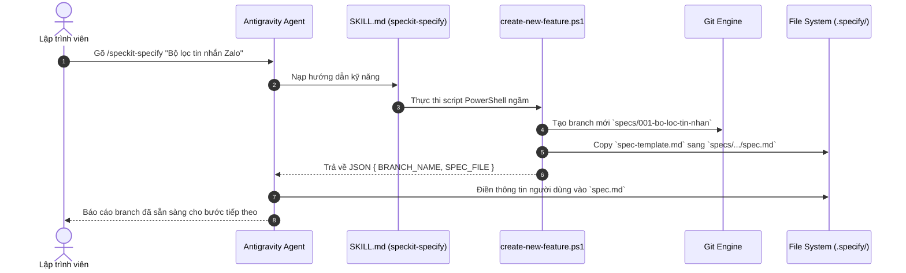
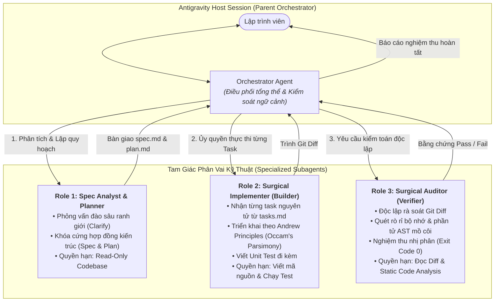
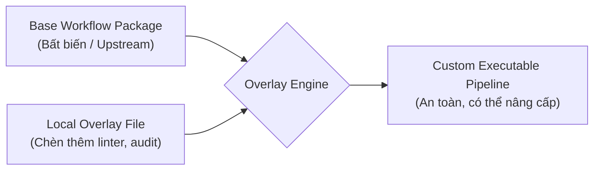
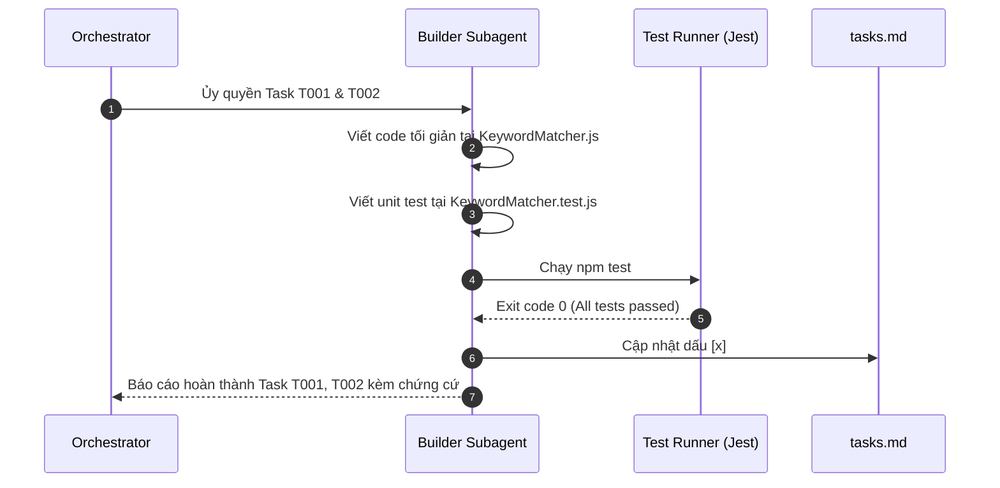
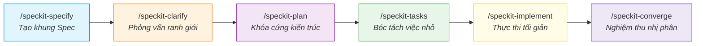

# Chuyên Đề 04: Workflows, Subagents & Tích Hợp Antigravity (agy)

> **Cẩm nang dành cho kỹ sư phần mềm và người mới bắt đầu**  
> *Làm chủ kiến trúc đa đặc vụ (Multi-Agent Architecture), chuỗi quy trình tự động hóa (Automated Workflows) và phương pháp tích hợp sâu Spec Kit vào Google Antigravity.*

---

## 🧭 Mục Tiêu Cốt Lõi Của Chuyên Đề

Khi chuyển từ lối làm việc thủ công sang tự động hóa với AI, lập trình viên thường mắc một sai lầm phổ biến: **Dồn toàn bộ công việc cho một AI duy nhất (Monolithic Agent)** — từ phân tích đề bài, vẽ kiến trúc, viết hàng nghìn dòng code cho đến tự chạy test và nghiệm thu. Kết quả là AI bị "loạn ngữ cảnh" (Context Bloat), sinh ra mã rác, ảo giác kỹ thuật và code chạy lỗi nhưng vẫn báo thành công.

Chuyên đề này hướng dẫn bạn giải quyết triệt để vấn đề trên thông qua 4 trụ cột:
1. **Hiểu rõ cách Antigravity (`agy`) tích hợp bản địa với Spec Kit**.
2. **Làm chủ Kiến trúc Đa Đặc Vụ (Multi-Agent Architecture)**: Phân chia vai trò rõ ràng giữa Planner, Builder và Auditor để triệt tiêu thiên kiến và ảo giác.
3. **Khai thác Spec Kit Workflows**: Tự động hóa chuỗi quy trình từ Spec $\rightarrow$ Plan $\rightarrow$ Tasks $\rightarrow$ Implement với các cổng kiểm duyệt (Review Gates) và cơ chế Workflow Overlays.
4. **Hướng dẫn thực hành Walkthrough A–Z**: Từng bước xây dựng một tính năng thực tế (*Zalo Extension Mini-Tool*) từ lệnh đầu tiên đến khi nghiệm thu đóng gói.

---

## 1. Antigravity (`agy`) Tích Hợp Với Spec Kit Như Thế Nào?

Spec Kit được thiết kế theo triết lý **Agent-Agnostic** (độc lập với nền tảng AI). Tuy nhiên, khi cài đặt integration `agy`, Spec Kit tự động biên dịch toàn bộ quy trình phát triển dựa trên đặc tả (SDD) thành hệ thống kỹ năng bản địa (**Native Skills**) mà Antigravity có thể hiểu và kích hoạt ngay tức thì.

### 1.1. Cấu Trúc Ánh Xạ Bản Địa (Native Skill Mapping)

Khi bạn khởi tạo hoặc cài đặt Antigravity vào dự án:
```bash
specify init my-project --integration agy
# hoặc cài vào dự án hiện có:
specify integration install agy
specify integration use agy
```

Spec Kit sẽ tạo ra file định danh tích hợp tại [`.specify/integrations/agy.manifest.json`](file:///c:/Users/ADMIN/Documents/workspace/Sales/EXTENSIONS/.specify/integrations/agy.manifest.json) và ánh xạ 9 kỹ năng chuẩn của SDD vào thư mục [`.agents/skills/`](file:///c:/Users/ADMIN/Documents/workspace/Sales/EXTENSIONS/.agents/skills/):

```
.
├── .specify/
│   ├── integrations/
│   │   └── agy.manifest.json        <-- Manifest quản lý phiên bản và mã băm SHA256
│   ├── memory/
│   │   └── constitution.md          <-- Hiến pháp dự án
│   ├── scripts/powershell/          <-- Bộ script tự động tạo branch, parse JSON
│   ├── templates/                   <-- Mẫu đặc tả chuẩn (spec, plan, tasks)
│   └── workflows/speckit/           <-- Workflow YAML tự động hóa
└── .agents/
    └── skills/                      <-- Nơi Antigravity đọc trực tiếp các lệnh slash
        ├── speckit-specify/SKILL.md
        ├── speckit-clarify/SKILL.md
        ├── speckit-constitution/SKILL.md
        ├── speckit-plan/SKILL.md
        ├── speckit-tasks/SKILL.md
        ├── speckit-implement/SKILL.md
        ├── speckit-converge/SKILL.md
        ├── speckit-checklist/SKILL.md
        └── speckit-analyze/SKILL.md
```

### 1.2. Giải Mã Cơ Chế Hoạt Động Của Một `SKILL.md`

Mỗi file trong `.agents/skills/speckit-<tên>/SKILL.md` là một bản hướng dẫn hành vi nghiêm ngặt dành cho Antigravity. Ví dụ, khi bạn gõ `/speckit-specify`:



> [!NOTE]
> Nhờ cơ chế đóng gói Native Skills, Antigravity không cần phải gọi qua một CLI trung gian cồng kềnh mỗi khi giao tiếp với người dùng. Agent trực tiếp đọc các tài liệu mẫu, tương tác với Git và duy trì sự nhất quán cấu trúc 100%.

---

## 2. Tại Sao Phải Phối Hợp Subagents? (Multi-Agent Architecture)

### 2.1. Vấn Nạn Của "Monolithic Agent" (Một Agent Làm Hết Mọi Việc)

Nếu bạn yêu cầu một phiên làm việc AI duy nhất thực hiện toàn bộ quy trình từ đầu đến cuối, các thảm họa kỹ thuật sau đây chắc chắn sẽ xảy ra:

| Vấn đề | Biểu hiện thực tế | Hậu quả kỹ thuật |
| :--- | :--- | :--- |
| **Token Context Bloat** | Cuộc trò chuyện kéo dài hàng chục lượt, chứa hàng nghìn dòng log, diff code và phân tích. | AI bị "mất trí nhớ ngắn hạn" (Context Rot), bỏ qua các quy tắc Hiến pháp đã dặn ở đầu phiên. |
| **Ảo Giác Thiết Kế (Hallucination)** | Khi đang viết chi tiết một hàm tiện ích, AI quên mất ranh giới API đã chốt trong `plan.md`. | Sinh thêm các hàm thừa, đổi kiểu dữ liệu (data types), làm gãy hợp đồng giao tiếp giữa các module. |
| **Thiên Kiến Tự Chấm Điểm (Confirmation Bias)** | AI tự viết code và tự kiểm tra code của chính mình. | Bỏ qua các edge cases, test giả lập hời hợt (Mock bừa bãi), báo cáo "đã kiểm tra thành công" dù code thực tế lỗi syntax. |
| **Rò Rỉ AST Mồ Côi** | Thay đổi một hàm nhưng không dọn các import cũ, biến cục bộ không dùng. | Tăng nợ kỹ thuật (Technical Debt), làm phình bundle size của ứng dụng. |

### 2.2. Tam Giác Phối Hợp Subagents Chuẩn (The Core Subagent Trinity)

Để triệt tiêu các vấn đề trên, Spec Kit kết hợp với kiến trúc Subagent của Antigravity thiết lập mô hình **3 Vai Trò Tách Biệt Tuyệt Đối**:



#### Chi Tiết 3 Vai Trò Kỹ Thuật:

1. **Role 1: Spec Analyst & Planner**
   - **Tư duy cốt lõi**: Hoài nghi tích cực (Defensive Design), không chấp nhận sự mơ hồ.
   - **Nhiệm vụ**: Đọc yêu cầu thô từ người dùng, chạy `/speckit-clarify` để phỏng vấn các điểm nghẽn logic (Data contracts, Storage limits, UI states), soạn thảo `spec.md` và `plan.md`.
   - **Môi trường**: Read-only, không viết code ứng dụng, giữ ngữ cảnh sạch sẽ thuần túy về mặt nghiệp vụ.

2. **Role 2: Surgical Implementer / Builder**
   - **Tư duy cốt lõi**: `Occam's Parsimony` — Mọi dòng code sinh ra phải là tập con tối thiểu cần thiết để giải quyết đúng task được giao; tuyệt đối không suy đoán tính năng tương lai.
   - **Nhiệm vụ**: Đọc [tasks.md](file:///c:/Users/ADMIN/Documents/workspace/Sales/EXTENSIONS/.specify/templates/tasks-template.md), thực hiện đúng 1 task tại một thời điểm, bảo toàn hình thái cú pháp (`AST Invariance`), viết unit test tương ứng và chạy đạt exit code 0.
   - **Môi trường**: Quyền ghi file trong phạm vi hẹp, có quyền chạy test runner.

3. **Role 3: Surgical Auditor / Verifier**
   - **Tư duy cốt lõi**: Không tin vào lời khẳng định bằng lời nói; chỉ tin vào bằng chứng cơ học nhị phân (Mechanical Determinism).
   - **Nhiệm vụ**: So sánh `git diff` với `spec.md`, phát hiện các biến/import mồ côi (Unused bindings), kiểm tra xem có đoạn mã nào vi phạm ranh giới cấm (Negative Space) hay không.
   - **Môi trường**: Chạy tĩnh, phân tích AST, kiểm tra test coverage độc lập.

> [!IMPORTANT]
> **Quy tắc Vàng về Xác Nhận**: Người viết mã (Builder) **không bao giờ** được phép là người tự nghiệm thu và đóng task. Quyền phê duyệt hoàn thành luôn thuộc về Subagent Auditor hoặc chính Lập trình viên thông qua cổng kiểm duyệt cơ học.

---

## 3. Workflows Tự Động Trong Spec Kit

Trong khi các slash command (`/speckit-*`) cho phép lập trình viên tương tác thủ công từng bước qua cửa sổ chat, **Spec Kit Workflows** cung cấp khả năng tự động hóa chuỗi hành động này thông qua các file cấu hình YAML/JSON.

### 3.1. Cấu Trúc Một File `workflow.yml` Chuẩn

File workflow tiêu biểu nằm tại [`.specify/workflows/speckit/workflow.yml`](file:///c:/Users/ADMIN/Documents/workspace/Sales/EXTENSIONS/.specify/workflows/speckit/workflow.yml):

```yaml
schema_version: "1.0"
workflow:
  id: "speckit"
  name: "Full SDD Cycle"
  version: "1.0.1"
  description: "Chuỗi SDD khép kín: specify -> plan -> tasks -> implement kèm Review Gates"

inputs:
  spec:
    type: string
    required: true
    prompt: "Mô tả tính năng bạn muốn xây dựng"
  integration:
    type: string
    default: "auto"

steps:
  # Bước 1: Khởi tạo đặc tả
  - id: specify
    command: speckit.specify
    integration: "{{ inputs.integration }}"
    input:
      args: "{{ inputs.spec }}"

  # Cổng kiểm duyệt số 1: Con người duyệt đặc tả
  - id: review-spec
    type: gate
    message: "Kiểm tra kỹ file spec.md trước khi chuyển sang lập kế hoạch kỹ thuật."
    options: [approve, reject]
    on_reject: abort

  # Bước 2: Thiết kế kiến trúc kỹ thuật
  - id: plan
    command: speckit.plan
    integration: "{{ inputs.integration }}"
    input:
      args: "{{ inputs.spec }}"

  # Cổng kiểm duyệt số 2: Con người duyệt kiến trúc
  - id: review-plan
    type: gate
    message: "Xác nhận cấu trúc dữ liệu, thư viện và hợp đồng API trong plan.md."
    options: [approve, reject]
    on_reject: abort

  # Bước 3: Bóc tách danh sách đầu việc
  - id: tasks
    command: speckit.tasks
    integration: "{{ inputs.integration }}"
    input:
      args: "{{ inputs.spec }}"

  # Bước 4: Thực thi mã hóa
  - id: implement
    command: speckit.implement
    integration: "{{ inputs.integration }}"
    input:
      args: "{{ inputs.spec }}"
```

### 3.2. Vòng Đời Thực Thi: Run, Review Gates & Khả Năng Khôi Phục (Resume)

Khi một workflow chạy qua CLI:
```bash
specify workflow run speckit --input spec="Xây dựng Mini-Tool Zalo Auto-Tag"
```

Quá trình diễn ra như sau:
1. **Khởi tạo định danh độc lập (Run ID)**: Mỗi lần chạy được gán một mã riêng (ví dụ `run_20261108_01`) và một thư mục trạng thái biệt lập.
2. **Gặp Review Gate (Cổng dừng)**:
   - Nếu chạy trong Terminal tương tác, hệ thống sẽ dừng lại và hỏi người dùng: `[approve / reject]`.
   - Nếu chạy không có TTY (ví dụ trên CI/CD hoặc chạy ngầm), workflow sẽ tự động chuyển sang trạng thái **PAUSED (Tạm dừng)**.
3. **Kiểm tra và Khôi phục (Resume)**:
   Người dùng có thể đọc file spec vừa sinh ra, chỉnh sửa trực tiếp, rồi dùng lệnh để tiếp tục:
   ```bash
   specify workflow status <run_id>
   specify workflow resume <run_id>
   ```
   > [!TIP]
   > Cơ chế **Idempotent Replay**: Khi resume, các bước đã hoàn thành trước đó sẽ được lấy lại từ bộ nhớ cache chứ không chạy lại từ đầu, giúp tiết kiệm tối đa chi phí token và tránh lặp lại các tác vụ thừa.

### 3.3. Cơ Chế Workflow Overlays: Tùy Biến Không Làm Vỡ Gốc

Khi làm việc trong dự án lớn, nhóm của bạn có thể muốn:
- Tự động chạy thêm một bước quét bảo mật (Security Scan) sau khi lập Spec.
- Chèn thêm một Subagent kiểm tra hiệu năng trước khi Implement.

Thay vì sửa trực tiếp vào file gốc của Spec Kit (dễ bị ghi đè khi cập nhật phiên bản), bạn sử dụng **Workflow Overlays**:



Các khả năng tùy biến của Overlay:
- **Named Slots**: Điền hành động cụ thể vào các vị trí được chừa sẵn.
- **Insert Step**: Chèn thêm một step vào trước hoặc sau một `step_id` bất kỳ (ví dụ: chèn `run-linter` sau `implement`).
- **Replace Step**: Thay thế một bước chuẩn bằng một custom script của dự án.
- **Remove Step**: Gỡ bỏ bước không cần thiết (chẳng hạn bỏ bước review nếu đang chạy trong môi trường Sandbox tự động).

---

## 4. Hướng Dẫn Thực Hành Toàn Diện: Từ A Đến Z

Dưới đây là kịch bản thực tế dành cho người mới: **Xây dựng tính năng "Zalo Extension Mini-Tool: Tự động phân loại và gắn thẻ khách hàng tiềm năng theo từ khóa tin nhắn"**.

### Kịch Bản Dự Án:
- **Tên tính năng**: `zalo-lead-auto-tagger`
- **Mục tiêu**: Một Chrome Extension Content Script nhúng vào giao diện Zalo Web (`chat.zalo.me`), tự động phát hiện tin nhắn có chứa các từ khóa mua hàng (như *"báo giá"*, *"tư vấn"*, *"đặt mua"*) để gắn nhãn màu nổi bật và lưu vào bộ nhớ cục bộ.

---

### Bước 1: Khởi Tạo Nhánh & Đặc Tả Nghiệp Vụ (`/speckit-specify`)

Mở Antigravity Chat và nhập:

```text
/speckit-specify Xây dựng tính năng Zalo Extension Mini-Tool tự động phân loại và gắn thẻ khách hàng tiềm năng dựa trên từ khóa tin nhắn trò chuyện trên web Zalo
```

#### Diễn tiến ngầm của hệ thống:
1. Antigravity kích hoạt script PowerShell [create-new-feature.ps1](file:///c:/Users/ADMIN/Documents/workspace/Sales/EXTENSIONS/.specify/scripts/powershell/create-new-feature.ps1).
2. Git tự động rẽ nhánh mới: `specs/001-zalo-lead-auto-tagger`.
3. File đặc tả kỹ thuật được tạo tại: `specs/001-zalo-lead-auto-tagger/spec.md`.
4. Agent điền khung đặc tả: Mô tả tổng quan, User Stories và Tiêu chí chấp nhận (Acceptance Criteria).

> [!NOTE]
> Bạn hãy mở file `spec.md` vừa sinh ra để lướt qua các User Stories xem đã đúng ý bạn chưa.

---

### Bước 2: Phỏng Vấn Sâu Ranh Giới Nghiệp Vụ (`/speckit-clarify`)

Thay vì vội vã bắt tay vào code, bạn kích hoạt Subagent phân tích để rà soát các điểm còn mập mờ:

```text
/speckit-clarify
```

Subagent đóng vai **Spec Analyst** sẽ đọc `spec.md` và đặt ra từ 3 đến 5 câu hỏi trọng tâm kỹ thuật:

```text
[Subagent - Spec Analyst]: Tôi phát hiện 3 điểm cần làm rõ trước khi thiết kế kiến trúc:

1. Cơ chế bắt tin nhắn: Bạn muốn quét tin nhắn qua MutationObserver (bắt thay đổi DOM thời gian thực) hay can thiệp vào tầng Network WebSocket của Zalo?
2. Lưu trữ dữ liệu: Danh sách từ khóa và thẻ khách hàng lưu trong Chrome Storage Sync (đồng bộ qua tài khoản Google) hay Chrome Storage Local (chỉ trên máy này)?
3. Tránh nghẽn hiệu năng: Nếu người dùng cuộn xem lịch sử chat hàng nghìn tin nhắn, bộ lọc có cần cơ chế Debounce/Throttle giới hạn số lần quét DOM không?
```

Bạn trả lời trực tiếp trong chat:
> *1: Dùng MutationObserver để an toàn, không can thiệp WebSocket.*  
> *2: Dùng Chrome Storage Local để không bị giới hạn 100KB của Sync.*  
> *3: Bắt buộc có Debounce 300ms để tránh giật lag trình duyệt.*

Ngay sau khi nhận câu trả lời, Subagent sẽ tự động ghi các quyết định này vào phần **Clarifications** trong `spec.md`.

---

### Bước 3: Chốt Kiến Trúc & Thiết Kế Kỹ Thuật (`/speckit-plan`)

Khi đặc tả nghiệp vụ đã sáng tỏ, ta kích hoạt bước lập phương án kiến trúc:

```text
/speckit-plan
```

Hệ thống sẽ sinh ra file `specs/001-zalo-lead-auto-tagger/plan.md`. File này bao gồm:
- **Kiến trúc module**: 
  - `MessageObserver.js`: Theo dõi DOM và debounce sự kiện.
  - `KeywordMatcher.js`: Thuật toán so khớp từ khóa thuần túy (Pure Function, dễ viết unit test).
  - `TagRenderer.js`: Chèn badge UI nhỏ gọn cạnh avatar hoặc tên người gửi.
  - `StorageManager.js`: Đọc/ghi cấu hình nhãn dán an toàn.
- **Ranh giới cấm (Negative Constraints)**:
  - CẤM sử dụng thư viện ngoài nặng nề như jQuery, Lodash.
  - CẤM can thiệp vào các thành phần gửi/nhận tin nhắn gốc của Zalo.

---

### Bước 4: Bóc Tách Checklist Công Việc (`/speckit-tasks`)

Chuyển đổi bản vẽ kiến trúc thành danh sách đầu việc có thể kiểm chứng cơ học:

```text
/speckit-tasks
```

File `specs/001-zalo-lead-auto-tagger/tasks.md` được sinh ra với định dạng Checklist phân tầng nghiêm ngặt:

```markdown
# Tasks for Feature: Zalo Lead Auto-Tagger

## Phase 1: Core Pure Logic (Pure JS & Unit Tests)
- [ ] T001: Khởi tạo module `KeywordMatcher.js` với hàm `matchKeywords(text, rules)`
- [ ] T002: Viết Jest Unit Test cho `KeywordMatcher` với các trường hợp: tiếng Việt có dấu, không dấu, viết hoa, viết thường

## Phase 2: Chrome Storage Adapter
- [ ] T003: Tạo `StorageManager.js` hỗ trợ lưu/đọc rule thẻ với fallback an toàn khi rỗng
- [ ] T004: Viết test giả lập Chrome Storage API

## Phase 3: DOM Observer & UI Injection
- [ ] T005: Tạo `MessageObserver.js` tích hợp `MutationObserver` kèm Debounce 300ms
- [ ] T006: Tạo `TagRenderer.js` để inject thẻ badge Tailwind/CSS vào tin nhắn mục tiêu
- [ ] T007: Ghép nối toàn bộ vào `content.js`

## Phase 4: Verification & Audit
- [ ] T008: Chạy toàn bộ test suite (yêu cầu exit code 0)
- [ ] T009: Kiểm toán Git Diff phát hiện biến mồ côi
```

---

### Bước 5: Ủy Quyền Thực Thi Mã Nguồn Cho Builder (`/speckit-implement`)

Bây giờ là lúc giao việc cho **Surgical Implementer Subagent**:

```text
/speckit-implement
```

#### Nguyên Tắc Hoạt Động Của Builder:
1. **Làm tuần tự từng task**: Đọc task `T001`, tạo file `src/utils/KeywordMatcher.js`.
2. **Occam's Parsimony**: Chỉ viết đúng hàm `matchKeywords`, không thêm thắt các cấu hình class dư thừa.
3. **Thực thi task `T002`**: Tạo file `tests/KeywordMatcher.test.js` và thực thi test trong terminal:
   ```powershell
   npm test tests/KeywordMatcher.test.js
   # Trả về: Exit code 0 (Pass 6/6 tests)
   ```
4. Đánh dấu `[x] T001` và `[x] T002` trong `tasks.md`.



---

### Bước 6: Nghiệm Thu Nhị Phân & Đóng Nhánh (`/speckit-converge`)

Sau khi toàn bộ các task được đánh dấu hoàn thành, bước cuối cùng là gọi **Surgical Auditor Subagent** để nghiệm thu độ hội tụ:

```text
/speckit-converge
```

Subagent Auditor thực hiện quét 4 cổng kiểm tra độc lập:
1. **Task Completeness Gate**: Kiểm tra xem còn dòng nào trong `tasks.md` chưa đánh dấu `[x]` không.
2. **Spec Consistency Gate**: So sánh code thực tế với các tiêu chí trong `spec.md`.
3. **Orphan AST Gate**: Quét xem có file nào import thư viện mà không dùng, hoặc biến khai báo thừa hay không.
4. **Binary Execution Gate**: Chạy toàn bộ test runner và linter trên toàn repository:
   ```powershell
   npm run lint && npm test
   ```

Khi tất cả các cổng đều trả về **PASS (Exit code 0)**:
- Subagent đưa ra kết luận: **Hội tụ hoàn toàn (Converged)**.
- Bạn có thể an tâm merge nhánh `specs/001-zalo-lead-auto-tagger` vào nhánh chính (`main`)!

---

## 5. Bảng Tóm Tắt & Lời Khuyên Vàng Cho Kỹ Sư



### 💡 4 Lời Khuyên Sống Còn Khi Pair-Programming Với AI:

1. **Đừng bao giờ bỏ qua bước `/speckit-clarify`**:
   10 phút trả lời các câu hỏi làm rõ của AI sẽ giúp bạn tiết kiệm 3 ngày debug vì AI hiểu sai đề bài.

2. **Một Subagent - Một Ngữ Cảnh**:
   Hãy để Subagent làm nhiệm vụ của nó trong một ngữ cảnh sạch sẽ. Đừng bắt một agent vừa chat phiếm, vừa đọc tài liệu dài ngoằng vừa viết code hạt nhân.

3. **Luôn yêu cầu bằng chứng cơ học (Exit Code 0)**:
   Nếu AI nói *"Tôi đã sửa xong và tính năng hoạt động hoàn hảo"*, hãy yêu cầu AI chạy test hoặc terminal command để in ra kết quả thực tế. Lời nói của AI là suy luận xác suất, chỉ có kết quả từ máy tính mới là sự thật khách quan.

4. **Tôn trọng tính bất biến của hợp đồng (`plan.md`)**:
   Khi đang ở pha `/speckit-implement`, nếu phát hiện kiến trúc chưa tối ưu, hãy quay lại cập nhật `plan.md` trước khi sửa code, tuyệt đối không tùy tiện sửa kiến trúc lúc đang code dở dang.

---

### 🔗 Tài Liệu Liên Quan Trong Chuỗi Hướng Dẫn:
- [01. Tổng Quan & Chu Trình SDD Core](./01_tong_quan_va_sdd_core.md)
- [02. Hệ Thống Hooks, Quality Gates & Extensions](./02_hooks_va_extensions.md)
- [03. Hiến Pháp Dự Án & Quản Trị AI (Andrew Principles)](./03_rules_constitution_va_governance.md)
