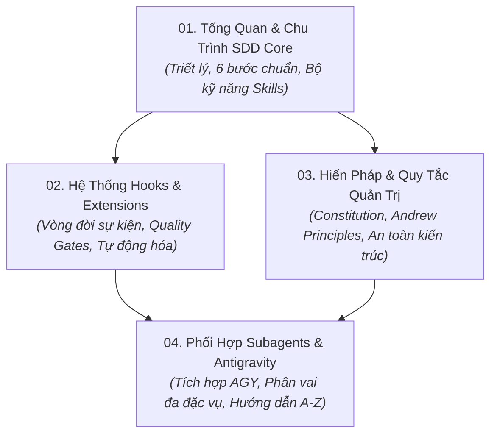

# 📚 Cẩm Nang Hướng Dẫn Toàn Diện Về Spec Kit & Spec-Driven Development (SDD)

> **Chào mừng bạn đến với tài liệu hướng dẫn Spec Kit dành cho Antigravity AI Agent!**  
> Bộ cẩm nang này được biên soạn dành riêng cho người mới bắt đầu, giúp bạn chuyển đổi hoàn toàn từ lối lập trình cảm tính ngẫu hứng (*"Vibe Coding"*) sang phương pháp kỹ nghệ phần mềm dựa trên đặc tả có cấu trúc (*"Spec-Driven Development"*).

---

## 🗺️ Bản Đồ Lộ Trình Học Tập (Learning Roadmap)

Hệ thống tài liệu được chia thành 4 chuyên đề độc lập nhưng liên kết chặt chẽ theo luồng tư duy công nghệ:

---

## 📑 Danh Mục Các Chuyên Đề

| File Tài Liệu | Chủ Đề Chính | Mục Tiêu Đạt Được |
| :--- | :--- | :--- |
| [**01_tong_quan_va_sdd_core.md**](./01_tong_quan_va_sdd_core.md) | **SDD Core & Bộ kỹ năng cơ bản** | Hiểu bản chất SDD, nắm vững ý nghĩa và cách kích hoạt 9 slash skills (`speckit-specify`, `speckit-plan`, `speckit-implement`,...) và cơ cấu thư mục `.specify/`. |
| [**02_hooks_va_extensions.md**](./02_hooks_va_extensions.md) | **Hooks, Quality Gates & Extensions** | Hiểu cách cài cắm kiểm thử tự động, linter, quét bảo mật trước và sau khi AI sinh mã; ngăn chặn rủi ro sinh mã lỗi. |
| [**03_rules_constitution_va_governance.md**](./03_rules_constitution_va_governance.md) | **Constitution (Hiến pháp) & Quản trị AI** | Nắm vững cách thiết lập "Luật tối thượng" cho AI Agent, kết hợp Andrew Principles (`Occam's Parsimony`, `AST Invariance`) để code luôn gọn gàng và không sinh mã rác. |
| [**04_subagents_workflows_va_antigravity.md**](./04_subagents_workflows_va_antigravity.md) | **Workflows, Subagents & Hướng dẫn A-Z** | Phân vai đa đặc vụ (Planner, Builder, Auditor), làm quen với workflows tự động và thực hành từng bước xây dựng một tính năng mẫu hoàn chỉnh. |

---

## 🚀 Tóm Tắt Nhanh: 6 Bước Vận Hành Chuẩn Trong Antigravity

Trong Antigravity Chat, bạn chỉ cần gọi trực tiếp các lệnh sau theo thứ tự:

1. `/speckit-constitution` *(Một lần cho dự án)*: Thiết lập các nguyên tắc cốt lõi của dự án.
2. `/speckit-specify <mô tả tính năng>`: Tạo Git branch riêng và khởi tạo bản đặc tả kỹ thuật Markdown.
3. `/speckit-clarify` *(Khuyến nghị)*: Để AI chủ động phỏng vấn bạn, làm rõ mọi điểm còn mơ hồ trước khi lập trình.
4. `/speckit-plan`: Lên kế hoạch kiến trúc, chọn thư viện, thiết kế dữ liệu.
5. `/speckit-tasks`: Bóc tách kế hoạch thành các danh sách đầu việc nhỏ (checklist) có thể kiểm chứng cơ học.
6. `/speckit-implement`: AI lần lượt thực thi các task, viết mã nguồn và kiểm thử.
7. `/speckit-converge`: Đánh giá tổng thể độ hội tụ của mã nguồn, kiểm tra xem có task nào còn sót lại hay không.

---

> [!TIP]
> **Dành cho người mới**: Hãy bắt đầu từ file [01_tong_quan_va_sdd_core.md](./01_tong_quan_va_sdd_core.md) để nắm bức tranh tổng thể trước khi đi vào các kỹ thuật nâng cao về Hook và Subagents.

