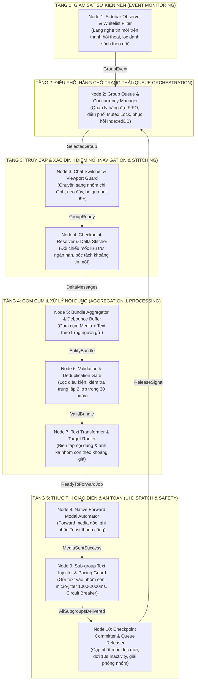
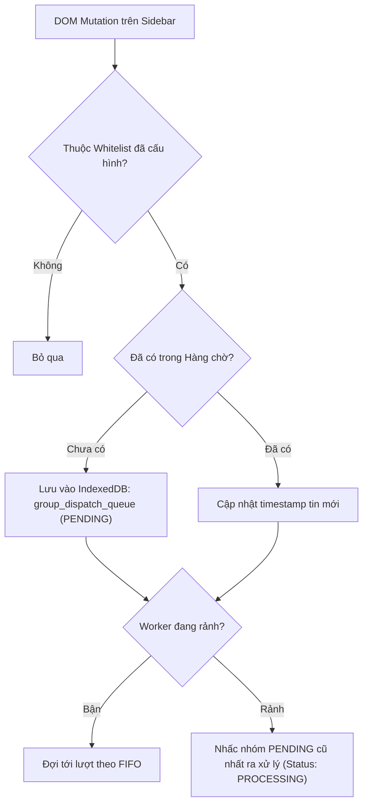
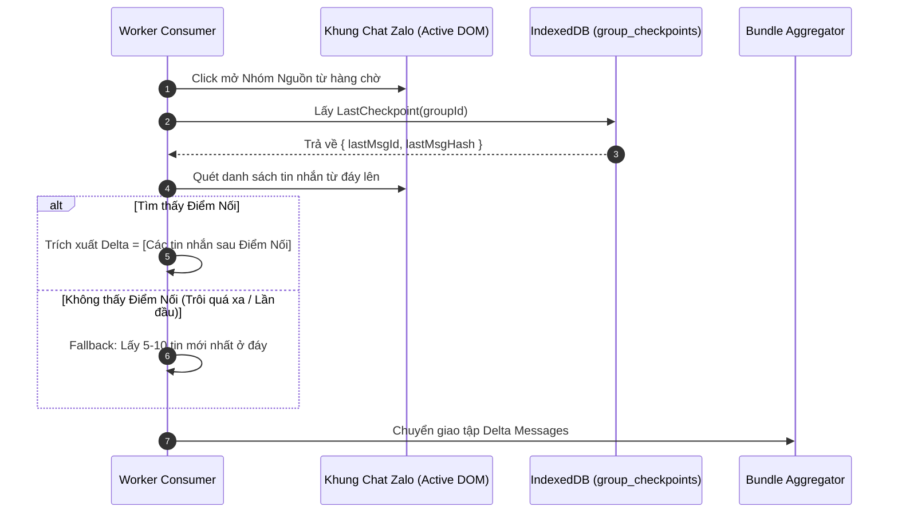
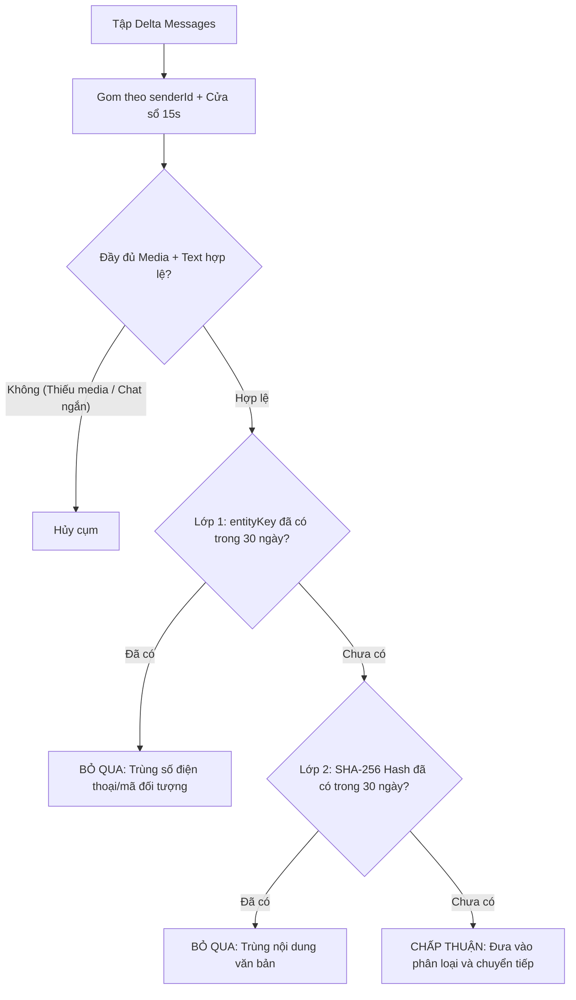
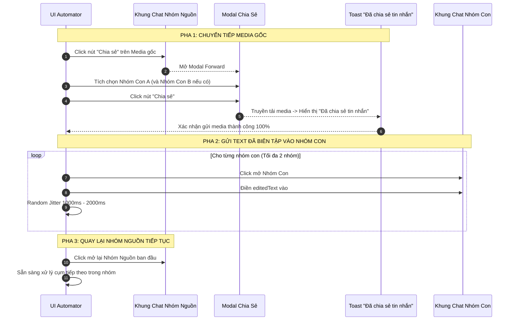

# TÀI LIỆU ĐẶC TẢ THIẾT KẾ HỆ THỐNG (FULL SYSTEM SPECIFICATION & WORKFLOWS)
**Dự án**: Hệ thống Tự Động Hóa Thu Thập, Biên Tập & Phân Phối Tin Nhắn Zalo Đa Nhóm (Personal Account 24/7)  
**Phiên bản**: 2.1 (Official Functional Baseline)  
**Ngày cập nhật**: 08/11/2026  
**Nền tảng**: Zalo Web (`chat.zalo.me`) — Chromium Extension Manifest V3 + TypeScript + IndexedDB (Dexie.js)  
**Tài liệu tham chiếu**:
- Tài liệu kiến trúc kỹ thuật Extension: [tai_lieu_thiet_ke_so_bo_zalo_automation.md](file:///c:/Users/ADMIN/Documents/workspace/Sales/EXTENSIONS/Docs/tai_lieu_thiet_ke_so_bo_zalo_automation.md)
- Sơ đồ luồng nghiệp vụ chi tiết: [business_flow.md](file:///c:/Users/ADMIN/Documents/workspace/Sales/EXTENSIONS/Docs/Diagrams/business_flow.md)

---

## 1. TỔNG QUAN HỆ THỐNG & NGUYÊN TẮC BẢO VỆ TÀI KHOẢN (SYSTEM OVERVIEW)

### 1.1. Bối cảnh & Mục tiêu Nghiệp vụ
Hệ thống giải quyết bài toán của người vận hành cá nhân (không sử dụng Zalo OA) cần:
1. Theo dõi đồng thời **danh sách các Nhóm Nguồn lớn (Whitelist Groups)** trên Zalo Web (lĩnh vực nguồn hàng, bất động sản, phòng trọ/căn hộ).
2. Tự động gom cụm các tin nhắn rời rạc (gồm Album ảnh, video và văn bản mô tả) của cùng một người gửi thành một đối tượng hoàn chỉnh (**`EntityBundle`**).
3. Lọc bỏ tin rác, kiểm tra chống trùng lặp tuyệt đối trong vòng **30 ngày gần nhất (Rolling Window)**.
4. Tự động điều hướng và chuyển tiếp bài đăng sang tối đa **2 Nhóm Con phù hợp theo khoảng giá (Price Range)**.
5. Thực hiện cơ chế chuyển tiếp **2 Pha**: Forward cụm media gốc qua hộp thoại chia sẻ Zalo, sau đó chuyển sang nhóm con điền văn bản đã biên tập vào khung chat, rồi tự động quay lại nhóm nguồn.
6. Chạy ổn định **24/24** mà **tuyệt đối không bị khóa tài khoản Zalo cá nhân**.

### 1.2. Các Nguyên Tắc Thiết Kế Bất Biến (Non-Negotiable Architecture Rules)
1. **Không can thiệp API ngầm không chính thức**: Không dùng các thư viện giả lập socket/API nhị phân (`zca-js`, `zlapi`) để tránh thuật toán chống bot của VNG. Mọi thao tác 100% mô phỏng hành vi người dùng thật trên DOM Zalo Web.
2. **Không tải về & Re-upload Media**: Sử dụng trực tiếp Native Forward Modal của Zalo để chuyển tiếp media gốc với tốc độ tức thời và giữ nguyên độ phân giải HD.
3. **Phân tách Độc lập Giám sát và Thực thi (Decoupled Producer-Consumer)**: Bộ giám sát Sidebar chạy nền bất đồng bộ, không bị nghẽn (non-blocking) bởi các thao tác click UI trong khung chat.
4. **Mô phỏng Thao tác Người thật (Micro-Jitter Pacing)**: Chèn độ trễ ngẫu nhiên **1000ms – 2000ms** vào giữa từng hành vi click, gõ text, chọn checkbox; tận dụng độ trễ truyền tải mạng tự nhiên của media làm khoảng nghỉ an toàn.
5. **Cầu chì Tự ngắt (Circuit Breaker)**: Dừng ngay lập tức toàn bộ hệ thống khi phát hiện Captcha hoặc thông báo hạn chế tính năng từ Zalo.

---

## 2. KIẾN TRÚC PHÂN TẦNG & 10 NODE ĐỘC LẬP (MODULAR ARCHITECTURE)

Hệ thống được module hóa thành 5 tầng với 10 Node chức năng độc lập, giao tiếp với nhau qua các hợp đồng dữ liệu chuẩn hóa:



---

## 3. ĐẶC TẢ CHI TIẾT CÁC LUỒNG VẬN HÀNH (DETAILED OPERATIONAL WORKFLOWS)

### 3.1. Luồng 1: Lắng Nghe Song Song & Quản Lý Hàng Chờ Bền Bỉ (N1, N2)
1. **Lắng nghe sự kiện (Non-blocking Observer)**:
   - Gắn `MutationObserver` lên vùng chứa danh sách chat Sidebar (`#conversationList`).
   - Observer chạy qua cơ chế Microtask của trình duyệt, hoạt động liên tục độc lập với các thao tác của Worker trong khung chat, đảm bảo không bỏ sót bất kỳ nhóm nào có tin mới.
   - Khi phát hiện badge chưa đọc hoặc tin nhắn mới, đối soát tên/ID nhóm với danh sách Whitelist (được cấu hình trực quan qua Popup UI).
2. **Quản lý hàng chờ (Persistent FIFO Queue)**:
   - Nếu nhóm thuộc Whitelist và chưa có trong hàng chờ: Đẩy nhóm vào bảng `group_dispatch_queue` (IndexedDB) với trạng thái `PENDING`.
   - Nếu nhóm đã có trong hàng chờ: Cập nhật timestamp tin mới nhất.
3. **Phục hồi sau sự cố (Crash / Reload Recovery)**:
   - Khi trang Zalo Web bị reload (do mạng chập chờn hoặc Watchdog tự phục hồi 24/7): Hệ thống tự động đọc lại các nhóm đang `PENDING` từ IndexedDB để bảo toàn thứ tự, đồng thời quét lại Sidebar một lượt để bổ sung các nhóm mới phát sinh trong lúc reload.



---

### 3.2. Luồng 2: Mở Nhóm, Neo Đáy & Nối Điểm Checkpoint (N3, N4)
1. **Truy cập & Neo màn hình (Bottom Viewport Guard)**:
   - Worker click mở nhóm nguồn trên Sidebar.
   - **Bỏ qua nút `99+`**: Tuyệt đối không click vào nút nhảy lên tin chưa đọc của Zalo. Luôn neo vị trí ở đáy màn hình hiện tại để tránh bị giật ngược về quá khứ và tránh lag DOM ảo hóa.
2. **Tìm Điểm Nối (Checkpoint Stitching)**:
   - Đọc bản ghi `group_checkpoints` của nhóm trong IndexedDB để lấy `lastMsgId` và `lastMsgHash`.
   - Quét các thẻ tin nhắn trên DOM từ dưới lên để tìm tin nhắn trùng khớp với checkpoint:
     - **Tìm thấy Điểm Nối**: Cắt lát toàn bộ các thẻ tin nhắn nằm SAU điểm nối làm tập **Delta Messages**.
     - **Không tìm thấy Điểm Nối** (do lần đầu chạy hoặc tin nhắn mới dồn ứ làm trôi điểm cũ khỏi DOM): Áp dụng **Fallback an toàn**: Chỉ lấy tối đa `5 đến 10 tin mới nhất ở đáy viewport` để xử lý, không cuộn ngược lên trên.



---

### 3.3. Luồng 3: Gom Cụm Đa Phương Tiện & Khử Trùng 2 Lớp (N5, N6)
1. **Thuật toán gom cụm (Bundle Aggregator)**:
   - Gom các thẻ tin nhắn trong tập Delta theo `senderId`.
   - Các tin nhắn liên tiếp (ảnh, video, text) của cùng một người gửi trong vòng `<= 15 giây` được gộp thành một `EntityBundle`.
   - Hỗ trợ Album ảnh Grid: Tự động nhận diện thẻ bao album để lấy trọn vẹn album ảnh gốc.
   - Thẩm định tính hợp lệ: Loại bỏ các cụm thiếu media (chỉ có text) hoặc thiếu mô tả (chỉ có media), và loại bỏ tin nhắn chat ngắn rác (< 20 ký tự).
2. **Khử trùng lặp 2 lớp trong 30 ngày (Two-Tier 30-day Rolling Deduplication)**:
   - **Lớp 1 (Entity Key)**: Trích xuất số điện thoại (chuẩn hóa các biến thể viết cách, chữ O thay số 0) hoặc mã sản phẩm. Kiểm tra xem `entityKey` đã tồn tại trong vòng 30 ngày trong bảng `entities` chưa. Nếu có ➔ Bỏ qua (`SKIPPED_DUPLICATE_KEY`).
   - **Lớp 2 (Content Hash)**: Chuẩn hóa văn bản (lowercase, loại bỏ khoảng trắng thừa) và tạo mã SHA-256 `contentHash`. Kiểm tra trong vòng 30 ngày. Nếu có ➔ Bỏ qua (`SKIPPED_DUPLICATE_CONTENT`).



---

### 3.4. Luồng 4: Phân Loại Theo Khoảng Giá & Chuyển Tiếp 2 Pha (N7, N8, N9)
1. **Định tuyến theo khoảng giá (Price Range Routing)**:
   - Bóc tách khoảng giá từ văn bản mô tả.
   - Ánh xạ vào danh sách các Nhóm Con đã cấu hình.
   - **Giới hạn số lượng**: Mỗi cụm đối tượng chỉ khớp với **tối đa 2 Nhóm Con** (do nằm ở vùng ranh giới hoặc giao thoa giá).
   - **Xử lý ngoại lệ**: Nếu không bóc tách được giá, hoặc khớp > 2 nhóm ➔ Ghi log cảnh báo `WARN`, bỏ qua cụm để kiểm tra thủ công sau, và **không làm dừng hệ thống** (tiếp tục cụm kế tiếp).
2. **Cơ chế Chuyển Tiếp 2 Pha (Two-Phase Dispatch)**:
   - **Pha 1 (Forward Media)**:
     - Cuộn cụm media gốc vào giữa màn hình, click nút "Chia sẻ".
     - Chờ mở Forward Modal, tìm và tích chọn tối đa 2 Nhóm Con đích. Lưu danh sách nhóm đích vào bộ nhớ tạm: `recentTargets`.
     - Click nút "Chia sẻ" xác nhận.
     - Giám sát DOM chờ Toast thông báo màu đen xuất hiện ở giữa màn hình: **`✔ Đã chia sẻ tin nhắn`** (hoặc timeout 10s xử lý kẹt).
   - **Pha 2 (Gửi Văn bản Biên tập vào Nhóm Con)**:
     - Lần lượt click mở từng nhóm trong `recentTargets`.
     - Điền đoạn `editedText` vào ô nhập liệu chính (`#chat-input`) của Nhóm Con, phát sự kiện `InputEvent` và nhấn Enter để gửi.
     - Áp dụng Micro-Jitter `1000ms – 2000ms` giữa các thao tác.
   - **Pha 3 (Quay về Nhóm Nguồn)**:
     - Tự động click quay lại Nhóm Nguồn ban đầu để tiếp tục xử lý cụm tiếp theo.



---

### 3.5. Luồng 5: Kết Thúc Nhóm, Cửa Sổ 10s Inactivity & Luân Chuyển (N10, N2)
1. **Xử lý cạn kiệt với đệm tĩnh lặng (Drain-with-10s-Quiet-Window)**:
   - Sau khi xử lý xong các cụm hiện có trong nhóm, hệ thống giữ một cửa sổ quan sát **10 giây đếm lùi**.
   - Nếu trong 10s có tin mới xuất hiện trong nhóm ➔ Tiếp tục quét và xử lý đợt tin đó.
   - Nếu hết 10s không có thêm tin mới ➔ Xác nhận nhóm đã xử lý dứt điểm.
2. **Cập nhật Checkpoint & Giải phóng Hàng chờ**:
   - Ghi tin nhắn mới nhất vừa xử lý vào `group_checkpoints` trong IndexedDB.
   - Cập nhật trạng thái nhóm trong `group_dispatch_queue` thành `COMPLETED` (hoặc xóa khỏi queue).
   - Giải phóng khóa `isBusy = false`.
   - Worker tiếp tục nhấc nhóm `PENDING` cũ nhất tiếp theo trong hàng chờ để xử lý lượt kế tiếp.

---

## 4. HỢP ĐỒNG KỸ THUẬT & SCHEMA DỮ LIỆU INDEXEDDB (TECHNICAL CONTRACTS)

Cơ sở dữ liệu cục bộ chạy trong Content Script của Extension mang tên `ZaloAutomationDB` (sử dụng thư viện **Dexie.js**):

```javascript
import Dexie from 'dexie';

export const db = new Dexie('ZaloAutomationDB');

db.version(1).stores({
  // 1. Quản lý Whitelist và Cấu hình chung
  app_settings: '&key, value, updatedAt',

  // 2. Điểm neo lưu trữ ngắn hạn của từng nhóm nguồn
  group_checkpoints: '&groupId, groupName, lastMsgId, lastMsgHash, lastMsgTimestamp, updatedAt',

  // 3. Hàng chờ điều phối các nhóm nguồn cần xử lý
  group_dispatch_queue: '&groupId, groupName, status, queuedAt, lastActiveAt',

  // 4. Cơ sở dữ liệu chống trùng lặp 30 ngày (Rolling Deduplication)
  entities: '++id, &entityKey, contentHash, sourceGroupId, primaryPhone, priceNumber, createdAt',

  // 5. Nhật ký cảnh báo và vận hành 24/24
  system_logs: '++id, level, eventType, details, timestamp'
});
```

### Chi tiết các Data Contract chính (JSON Structures):

#### 1. Entity Record (`entities`):
```json
{
  "id": 1024,
  "entityKey": "0901234567_P302",
  "contentHash": "8f4b2a7d6e1c...",
  "sourceGroupId": "g_18294018241",
  "primaryPhone": "0901234567",
  "priceNumber": 3500000,
  "rawText": "Chính chủ cho thuê phòng 302 giá 3.5tr full đồ LH 0901234567...",
  "editedText": "📌 [PHÒNG ĐẸP GIÁ TỐT]\n- Giá: 3.5 triệu/tháng\n- Chi tiết: Full đồ...",
  "targetGroupNames": ["PHÒNG TRỌ 3-4 TRIỆU", "HỘI TÌM PHÒNG KHU VỰC A"],
  "createdAt": 1761400000000
}
```

#### 2. Group Dispatch Item (`group_dispatch_queue`):
```json
{
  "groupId": "g_18294018241",
  "groupName": "KHO NGUỒN TỔNG HÀ NỘI",
  "status": "PROCESSING",
  "queuedAt": 1761400100000,
  "lastActiveAt": 1761400120000
}
```
*(Status: `PENDING` | `PROCESSING` | `COMPLETED`)*

#### 3. Group Checkpoint Item (`group_checkpoints`):
```json
{
  "groupId": "g_18294018241",
  "groupName": "KHO NGUỒN TỔNG HÀ NỘI",
  "lastMsgId": "msg_172984920192",
  "lastMsgHash": "a1b2c3d4e5f6...",
  "lastMsgTimestamp": 1761400115000,
  "updatedAt": 1761400125000
}
```

---

## 5. MA TRẬN PHÒNG VỆ NGOẠI LỆ & AN TOÀN 24/24 (RESILIENCE MATRIX)

| Mã | Tình Huống Ngoại Lệ | Phân Tích Nguy Cơ | Giải Pháp Phòng Vệ Kỹ Thuật |
| :--- | :--- | :--- | :--- |
| **EX-01** | **Zalo hiển thị Captcha hoặc thông báo hạn chế tài khoản** | Nếu tiếp tục click sẽ dẫn đến khóa tài khoản vĩnh viễn. | **CIRCUIT BREAKER**: Tức thì ngắt mọi tiến trình Worker, đổi trạng thái sang `PAUSED_BY_CIRCUIT_BREAKER`, phát âm thanh cảnh báo và giữ nguyên hàng chờ cho người dùng can thiệp. |
| **EX-02** | **Rớt mạng internet hoặc tab Zalo bị crash/trắng màn hình** | Đứt gãy luồng theo dõi 24/24. | **WATCHDOG 60s**: Phát hiện mất kết nối quá 60s ➔ Tự động gọi `window.location.reload()`. Sau khi trang tải xong, tự động khôi phục danh sách `PENDING` từ IndexedDB và tiếp tục. |
| **EX-03** | **Không tìm thấy Điểm Nối (Stitch Point) khi vừa mở nhóm** | Điểm nối cũ bị trôi khỏi DOM ảo hóa do lượng tin nhắn mới quá lớn. | **BOTTOM FALLBACK**: Tuyệt đối không cuộn ngược lên trên. Chỉ bóc tách tối đa 5-10 tin mới nhất ở đáy viewport và đặt Checkpoint mới tại đáy. |
| **EX-04** | **Nút '99+' tin chưa đọc dồn ứ ở góc trên khung chat** | Click vào sẽ nhảy lên quá khứ, gây tải hàng trăm tin cũ và lag máy. | **STRICT BOTTOM ANCHOR**: Bỏ qua hoàn toàn nút 99+, chỉ tương tác với các tin nhắn tại vùng nhìn thấy hiện tại ở đáy. |
| **EX-05** | **Modal Chia Sẻ bị kẹt quay spinner quá 10 giây** | Giao diện bị treo không thể chuyển sang cụm tiếp theo. | **TIMEOUT CANCELLATION**: Nếu sau 10s không xuất hiện toast "Đã chia sẻ tin nhắn", tự động kích hoạt phím Escape hoặc nút đóng Modal, ghi log `WARN_TRANSMIT_TIMEOUT` và bỏ qua cụm. |
| **EX-06** | **Chuyển sang Nhóm Con gửi Text nhưng không quay lại được Nhóm Nguồn** | Mất dấu ngữ cảnh làm việc. | Biến `currentSourceGroupId` được lưu cố định. Sử dụng hàm `returnToSource()` có retry 2 lần; nếu vẫn lỗi thì reload lại tab để khôi phục trạng thái chuẩn. |
| **EX-07** | **Nhóm Con có bật chế độ 'Chỉ trưởng/phó nhóm gửi tin'** | Không thể điền text vào ô `#chat-input`. | Kiểm tra trạng thái `disabled` của input; nếu bị khóa, bỏ qua việc gửi text ở nhóm này, ghi log `WARN_GROUP_MUTED` và chuyển sang nhóm tiếp theo. |

---

## 6. CỔNG NGHIỆM THU NHỊ PHÂN CHO GIAI ĐOẠN TRIỂN KHAI (BINARY ACCEPTANCE GATES)

Bản build Extension trước khi bàn giao đưa vào vận hành thực tế phải vượt qua 100% các tiêu chí nhị phân sau:

| Mã Gate | Hạng Mục Kiểm Tra | Tiêu Chí ĐẠT (`PASS`) | Tiêu Chí HỎNG (`FAIL`) |
| :--- | :--- | :--- | :--- |
| **GATE-01** | **Bắt Tin Song Song (Parallel Sidebar Observer)** | Khi Worker đang thao tác gửi tin trong Nhóm A, gửi tin nhắn mới vào Nhóm B thuộc Whitelist ➔ Nhóm B được ghi nhận vào `group_dispatch_queue` ngay lập tức mà không bị nghẽn. | Bị mất tin nhắn hoặc chỉ nhận diện Nhóm B sau khi đã xong toàn bộ Nhóm A. |
| **GATE-02** | **Bỏ Qua Nút 99+ & Fallback Đáy** | Mở một nhóm có badge `99+` ➔ Hệ thống không click vào nút 99+, chỉ lấy cụm tin mới nhất ở đáy và không gây lag trình duyệt. | Click vào nút 99+ làm cuộn trang lên trên hoặc treo DOM. |
| **GATE-03** | **Khử Trùng Lặp 30 Ngày** | Gửi lại một tin nhắn có cùng số điện thoại hoặc nội dung đã gửi 10 ngày trước ➔ Bị chặn 100% với trạng thái `SKIPPED_DUPLICATE`. | Hệ thống mở Modal forward lại lần thứ 2 cho cùng 1 đối tượng. |
| **GATE-04** | **Xác Nhận Toast "Đã chia sẻ tin nhắn"** | Hệ thống chỉ chuyển sang bước gửi text vào Nhóm Con sau khi đã xuất hiện thông báo toast thành công trên màn hình. | Chuyển nhóm quá sớm khi media chưa gửi xong dẫn đến lỗi. |
| **GATE-05** | **Chu Trình 2 Pha Hoàn Hảo** | Chuyển tiếp media ➔ Chuyển sang tối đa 2 nhóm con điền text ➔ Tự động quay lại đúng Nhóm Nguồn ban đầu. | Bị kẹt lại ở Nhóm Con hoặc không gửi được đoạn text đã biên tập. |
| **GATE-06** | **Cửa Sổ Tĩnh Lặng 10s (Drain Inactivity)** | Sau khi gửi xong tin cuối trong nhóm, hệ thống đợi đúng 10s quan sát; nếu không có tin mới mới chuyển sang nhóm chờ tiếp theo. | Rời nhóm ngay lập tức trong khi người gửi đang chuẩn bị gửi thêm bài mới. |
| **GATE-07** | **Phục Hồi Sau F5 / Crash** | Chủ động ấn F5 tải lại trang Zalo Web trong lúc hàng chờ đang có 3 nhóm `PENDING` ➔ Sau khi trang tải xong, hệ thống tự phục hồi hàng chờ và tiếp tục xử lý đúng thứ tự. | Mất sạch hàng chờ hoặc đứng yên không tiếp tục chạy. |
