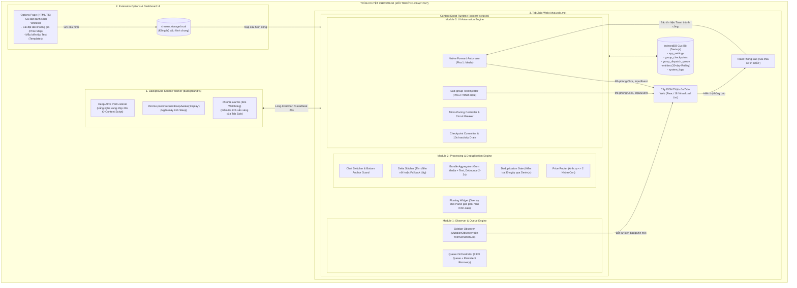
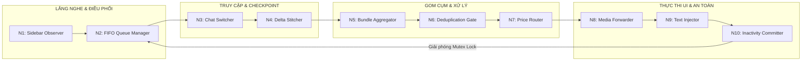

# TÀI LIỆU THIẾT KẾ KIẾN TRÚC KỸ THUẬT EXTENSION (EXTENSION TECHNICAL ARCHITECTURE & DESIGN SPEC)
**Dự án**: Hệ thống Tự động hóa Thu thập, Biên tập & Phân phối Tin nhắn Zalo Đa Nhóm (Personal Account 24/7)  
**Phiên bản**: 2.1 (Official Architecture Baseline — Extension Focused)  
**Ngày cập nhật**: 08/11/2026  
**Nền tảng mục tiêu**: Zalo Web (`chat.zalo.me`) — Chromium Extension (Manifest V3) + TypeScript + IndexedDB (Dexie.js)  
**Tài liệu tham chiếu liên kết**:
- Sơ đồ luồng nghiệp vụ chi tiết: [business_flow.md](file:///c:/Users/ADMIN/Documents/workspace/Sales/EXTENSIONS/Docs/Diagrams/business_flow.md)
- Đặc tả hợp đồng dữ liệu & cổng nghiệm thu: [he_thong_tu_dong_hoa_zalo_extension_spec.md](file:///c:/Users/ADMIN/Documents/workspace/Sales/EXTENSIONS/Docs/he_thong_tu_dong_hoa_zalo_extension_spec.md)

---

## 1. BỐI CẢNH NGHIỆP VỤ & RANH GIỚI BẤT BIẾN (DOMAIN ANCHORING & BOUNDARIES)

### 1.1. Bối cảnh & Bài toán Vận hành
Người dùng là cá nhân (vận hành tài khoản Zalo cá nhân, không sở hữu Zalo Official Account - OA) cần:
1. **Giám sát liên tục 24/7 đồng thời nhiều Nhóm Nguồn lớn (Whitelist Groups)** trên Zalo Web (các nhóm nguồn hàng, bất động sản, phòng trọ/căn hộ).
2. **Gom cụm đa phương tiện (Entity Bundle)**: Tự động kết nối các tin nhắn rời rạc (Album ảnh, video, văn bản mô tả) của cùng một người gửi trong khung thời gian ngắn thành một đối tượng hoàn chỉnh.
3. **Thẩm định & Khử trùng lặp 2 lớp**: Kiểm tra điều kiện tối thiểu (phải có cả Media và Text hợp lệ) và kiểm tra chống trùng lặp tuyệt đối trong vòng **30 ngày gần nhất (Rolling 30-Day Window)** theo số điện thoại / mã đối tượng (`entityKey`) và mã băm văn bản chuẩn hóa (`contentHash`).
4. **Phân loại & Định tuyến**: Tự động bóc tách khoảng giá và điều hướng bài đăng sang tối đa **2 Nhóm Con (Target Sub-groups)** phù hợp.
5. **Cơ chế Chuyển tiếp 2 Pha (Two-Phase Dispatch)**:
   - *Pha 1*: Sử dụng hộp thoại chia sẻ gốc (Native Forward Modal) để forward cụm Media (Ảnh/Video) giữ nguyên chất lượng HD và tốc độ truyền tải nội bộ của Zalo.
   - *Pha 2*: Lần lượt chuyển sang từng Nhóm Con để điền đoạn văn bản đã biên tập (`editedText`) vào khung chat chính (`#chat-input`) và gửi.
   - *Pha 3*: Tự động quay lại Nhóm Nguồn để tiếp tục chu trình.
6. **Vận hành an toàn 24/7**: Tuyệt đối không bị khóa tài khoản Zalo nhờ mô phỏng thao tác người thật (Micro-Jitter), không gọi API ngầm, và có cầu chì tự ngắt (Circuit Breaker).

### 1.2. Từ điển Thuật ngữ Kỹ thuật Extension (Extension Domain Glossary)

| Thuật ngữ | Định nghĩa trong phạm vi Extension |
| :--- | :--- |
| **Whitelist Groups (Nhóm Nguồn Theo Dõi)** | Tập hợp các nhóm Zalo cộng đồng được người dùng cấu hình qua giao diện Extension để giám sát tin mới. |
| **Target Sub-groups (Nhóm Con Đích)** | Các nhóm Zalo được phân loại theo khoảng giá/khu vực để nhận bài đăng phân phối lại. |
| **Entity Bundle (Gói Đối Tượng)** | Cụm dữ liệu hoàn chỉnh gồm: Mảng Media DOM Selector + Văn bản gốc + Văn bản biên tập + Định danh người gửi + Khóa nghiệp vụ (`entityKey`). |
| **Two-Phase Dispatch (Chuyển Tiếp 2 Pha)** | Mẫu thiết kế giải quyết giới hạn của Zalo Web: Pha 1 Forward Media qua Modal gốc; Pha 2 Chuyển tab sang Nhóm Con gõ văn bản biên tập vào `#chat-input`. |
| **Micro-Jitter Pacing** | Khoảng trễ ngẫu nhiên từ `1000ms – 2000ms` chèn vào giữa các thao tác click chuột/gõ phím nhằm mô phỏng 100% hành vi cơ học của con người. |
| **Strict Bottom Anchor** | Nguyên tắc bất biến: Luôn giữ khung chat ở đáy màn hình hiện tại, **tuyệt đối không click nút "99+"** để tránh giật lag DOM ảo hóa và tránh gửi trùng tin nhắn cũ. |
| **Drain Inactivity Window (10s)** | Khoảng đệm tĩnh lặng 10 giây sau khi xử lý xong các tin hiện có trong nhóm; nếu không có tin mới phát sinh thì mới giải phóng nhóm để chuyển sang nhóm kế tiếp. |
| **Keep-Awake Port** | Kênh kết nối `chrome.runtime.Port` duy trì liên tục nhịp tim (Heartbeat 20s) giữa Content Script và Background Service Worker để ngăn Extension rơi vào trạng thái ngủ đông. |

### 1.3. Không gian Phủ định Tuyệt đối (Extension Negative Space — 6 Điều CẤM)
1. **CẤM sử dụng API ngầm / Reverse-engineered API (`zca-js`, `zlapi`)**: VNG kiểm soát chữ ký gói tin WebSocket và `zpw_enk` rất nghiêm ngặt. Việc gọi API ngầm từ bên ngoài sẽ dẫn đến khóa tài khoản vĩnh viễn ngay lập tức. Mọi thao tác 100% phải tương tác qua DOM thật trên trình duyệt.
2. **CẤM tải về (Download) & Tải lên lại (Re-upload) Media**: Tốn băng thông máy móc, làm giảm độ phân giải video/ảnh và phá vỡ tính năng forward tức thời của Zalo.
3. **CẤM click vào nút "99+" tin chưa đọc của Zalo**: Việc nhảy ngược về quá khứ sẽ làm trình duyệt tải hàng trăm DOM nodes, gây nghẽn luồng UI và rủi ro gửi nhầm các tin đã xử lý từ trước.
4. **CẤM thực thi đồng thời nhiều thao tác UI (No Concurrent UI Actions)**: Trình duyệt là đơn luồng UI. Mọi thao tác mở Modal, chuyển nhóm, gõ phím bắt buộc phải đi qua cơ chế khóa tương hỗ **Mutex Lock (FIFO)**.
5. **CẤM vượt quá ngưỡng an toàn**: Không gửi quá 2 Nhóm Con cho 1 bài đăng, không bỏ qua các khoảng trễ Micro-Jitter `1000ms – 2000ms`.
6. **CẤM nuốt ngoại lệ (Silent Error Swallowing)**: Mọi lỗi xuất hiện (không tìm thấy selector, timeout toast, modal kẹt) bắt buộc phải ghi log vào `system_logs` và kích hoạt kịch bản hủy an toàn, không để treo Worker.

---

## 2. KIẾN TRÚC HỆ THỐNG EXTENSION MANIFEST V3 (MV3 ARCHITECTURE SPEC)

Hệ thống được thiết kế hoàn toàn theo chuẩn **Chrome Extension Manifest V3**, phân tách rạch ròi giữa 4 vùng ngữ cảnh (Execution Contexts):



### 2.1. Phân Tách Ngữ Cảnh & Trách Nhiệm Từng Module

#### A. Background Service Worker (`background.ts`)
- **Trách nhiệm**: Đảm bảo Extension sống sót 24/7 mà không bị trình duyệt Chrome đưa vào chế độ ngủ đông (Throttling / Idle Suspension).
- **Cơ chế triển khai**:
  - `chrome.power.requestKeepAwake('display')`: Giữ màn hình và tiến trình CPU luôn ở mức ưu tiên cao, ngăn hệ điều hành đưa máy vào trạng thái Sleep.
  - `chrome.runtime.onConnect`: Thiết lập cổng kết nối liên tục (Long-lived Port) với Content Script. Service Worker phản hồi lại mỗi gói tin Heartbeat để reset bộ đếm idle 30s của Chrome MV3.
  - `chrome.alarms`: Định kỳ mỗi 60 giây kiểm tra xem tab `https://chat.zalo.me/*` có đang mở không. Nếu tab bị tắt đột ngột, Service Worker có thể tự động tạo lại tab mới.

#### B. Content Script Runtime (`content-script.ts`)
- **Trách nhiệm**: Chạy trực tiếp trong ngữ cảnh của trang Zalo Web, chịu trách nhiệm cho toàn bộ 10 Node chức năng (Giám sát, Bóc tách, Khử trùng, Điều hướng và Thao tác UI).
- **Ranh giới thực thi (Isolated World)**: Content Script hoạt động an toàn trong môi trường biệt lập, giao tiếp với DOM thật thông qua các chuẩn Web API tiêu chuẩn (`MutationObserver`, `dispatchEvent`, `InputEvent`).

#### C. Cơ sở Dữ liệu Cục bộ (`IndexedDB` qua `Dexie.js`)
- **Vị trí**: Được lưu trữ trực tiếp trong origin `https://chat.zalo.me`.
- **Hiệu năng**: Cho phép truy vấn chỉ mục (Indexed Search) đối với các khóa `entityKey` và `contentHash` trong vòng `< 2ms`, lưu trữ lịch sử chống trùng lặp lên tới hàng chục nghìn bài đăng trong 30 ngày mà không làm chậm trình duyệt.

#### D. Bảng điều khiển Giao diện Kép (Dual UI Surfaces)
1. **Options Page / Popup**: Giao diện quản trị toàn diện, cho phép bật/tắt các nhóm trong Whitelist, chỉnh sửa các dải phân loại giá, xem lại bảng log `system_logs`.
2. **Injected Floating Widget**: Thanh trạng thái nhỏ được inject nổi ở góc dưới bên phải giao diện Zalo Web:
   - Hiển thị trạng thái Worker: `IDLE`, `PROCESSING`, hoặc `PAUSED_CIRCUIT_BREAKER`.
   - Hiển thị tên nhóm đang xử lý và số lượng nhóm đang chờ (`Queue Count`).
   - Nút bấm khẩn cấp **"DỪNG KHẨN CẤP (EMERGENCY STOP)"** cho phép người vận hành ngắt ngay lập tức mọi tiến trình tự động chỉ với 1 click.

---

## 3. THIẾT KẾ CƠ SỞ DỮ LIỆU EXTENSION (INDEXEDDB SCHEMA — DEXIE.JS)

Toàn bộ dữ liệu vận hành được lưu trữ độc lập tại `ZaloAutomationDB` trên IndexedDB của origin Zalo Web:

```typescript
import Dexie, { Table } from 'dexie';

export interface AppSetting {
  key: string;
  value: any;
  updatedAt: number;
}

export interface GroupCheckpoint {
  groupId: string;             // ID chuẩn hóa của nhóm nguồn
  groupName: string;           // Tên nhóm nguồn
  lastMsgId: string;           // ID của tin nhắn cuối cùng đã xử lý
  lastMsgHash: string;         // SHA-256 nội dung tin nhắn cuối
  lastMsgTimestamp: number;    // Thời điểm của tin nhắn cuối
  updatedAt: number;
}

export interface GroupDispatchItem {
  groupId: string;             // ID nhóm nguồn
  groupName: string;           // Tên nhóm nguồn
  status: 'PENDING' | 'PROCESSING' | 'COMPLETED';
  queuedAt: number;            // Thời điểm đưa vào hàng chờ
  lastActiveAt: number;        // Thời điểm tin mới nhất phát sinh
}

export interface EntityRecord {
  id?: number;
  entityKey: string;           // Khóa chính: Số ĐT chuẩn hóa + Mã căn (ví dụ: "0901234567_P302")
  contentHash: string;         // SHA-256 của chuỗi văn bản đã chuẩn hóa
  sourceGroupId: string;       // ID nhóm nguồn phát sinh bài
  primaryPhone?: string;       // Số điện thoại trích xuất được
  priceNumber?: number;        // Giá trích xuất dạng số (VNĐ)
  rawText: string;             // Văn bản gốc thu thập được
  editedText: string;          // Văn bản đã qua xử lý biên tập
  targetGroupNames: string[];  // Danh sách các nhóm con đã gửi (tối đa 2 nhóm)
  createdAt: number;           // Timestamp lưu trữ (dùng cho bộ lọc Rolling 30 ngày)
}

export interface SystemLog {
  id?: number;
  level: 'INFO' | 'WARN' | 'ERROR' | 'CRITICAL';
  eventType: string;           // Mã sự kiện: "FORWARD_SUCCESS", "WARN_PRICE_UNDETECTED", etc.
  details: string;             // Thông tin chi tiết / Stack trace
  timestamp: number;
}

export class ZaloAutomationDatabase extends Dexie {
  app_settings!: Table<AppSetting, string>;
  group_checkpoints!: Table<GroupCheckpoint, string>;
  group_dispatch_queue!: Table<GroupDispatchItem, string>;
  entities!: Table<EntityRecord, number>;
  system_logs!: Table<SystemLog, number>;

  constructor() {
    super('ZaloAutomationDB');
    this.version(1).stores({
      app_settings: '&key, updatedAt',
      group_checkpoints: '&groupId, updatedAt',
      group_dispatch_queue: '&groupId, status, queuedAt',
      entities: '++id, &entityKey, contentHash, sourceGroupId, createdAt',
      system_logs: '++id, level, eventType, timestamp'
    });
  }
}

export const db = new ZaloAutomationDatabase();
```

---

## 4. CHI TIẾT CÁC MODULE THỰC THI (10 FUNCTIONAL NODES SPEC)



### Module 1: Giám Sát Sự Kiện & Điều Phối Hàng Chờ (N1, N2)
- **Node 1 (Sidebar Observer & Whitelist Filter)**:
  - Gắn `MutationObserver` liên tục trên thẻ danh sách hội thoại Sidebar (`#conversationList`).
  - Sử dụng cơ chế Microtask của trình duyệt, chạy song song độc lập với các thao tác click UI trong khung chat, đảm bảo không bỏ sót tin mới ngay cả khi Worker đang bận.
  - Khi phát hiện badge đỏ hoặc tin nhắn mới từ nhóm thuộc Whitelist ➔ Gửi sự kiện tới Node 2.
- **Node 2 (Group Queue & Concurrency Manager)**:
  - Quản lý hàng đợi FIFO lưu trong bảng `group_dispatch_queue` (IndexedDB).
  - Quản lý cờ khóa đơn luồng: `isWorkerBusy: boolean`.
  - Cơ chế **Persistent Recovery**: Khi tab Zalo bị F5 / Reload, Node 2 tự động đọc lại các bản ghi `PENDING` từ IndexedDB để khôi phục hàng chờ theo đúng thứ tự thời gian.

### Module 2: Truy Cập Khung Chat & Xác Định Điểm Nối (N3, N4)
- **Node 3 (Chat Switcher & Viewport Guard)**:
  - Mô phỏng click vào nhóm nguồn từ Sidebar để mở khung chat.
  - **Quy tắc Strict Bottom Anchor**: Luôn giữ vị trí cuộn ở đáy khung chat. **Tuyệt đối không click nút "99+" tin chưa đọc** để bảo vệ hiệu năng DOM và tránh trôi về quá khứ.
- **Node 4 (Checkpoint Resolver & Delta Stitcher)**:
  - Truy vấn `group_checkpoints` để lấy `lastMsgId` và `lastMsgHash`.
  - Quét danh sách tin nhắn trên DOM từ dưới đáy lên để tìm Điểm Nối (Stitch Point):
    - *Tìm thấy*: Cắt tập hợp các tin nhắn nằm SAU điểm nối làm mảng **Delta Messages**.
    - *Không tìm thấy (do lần đầu chạy hoặc tin mới dồn quá nhiều làm trôi khỏi DOM)*: Áp dụng cơ chế **Fallback an toàn**: Chỉ bóc tách `5 đến 10 tin mới nhất ở đáy viewport` để xử lý và cập nhật ngay Checkpoint tại đáy.

### Module 3: Gom Cụm Đa Phương Tiện & Khử Trùng Lặp (N5, N6, N7)
- **Node 5 (Bundle Aggregator & Debounce Buffer)**:
  - Gom các tin nhắn trong mảng Delta theo `senderId`.
  - Nếu các tin nhắn liên tiếp của cùng một người gửi diễn ra trong khoảng `<= 15 giây` ➔ Gộp chung thành một `EntityBundle`.
  - Thẩm định cấu trúc: Loại bỏ các tin nhắn thiếu Media (chỉ có text) hoặc thiếu Text (chỉ có media), loại bỏ tin nhắn ngắn rác (`< 20 ký tự`).
- **Node 6 (Validation & Two-Tier Deduplication Gate)**:
  - **Lớp 1 (Entity Key)**: Trích xuất SĐT (chuẩn hóa các dạng viết cách, dấu chấm, chữ O thay số 0) hoặc mã căn. Truy vấn IndexedDB xem `entityKey` đã tồn tại trong vòng 30 ngày chưa. Nếu có ➔ Bỏ qua (`SKIPPED_DUPLICATE_KEY`).
  - **Lớp 2 (Content Hash)**: Chuẩn hóa văn bản và băm SHA-256 `contentHash`. Kiểm tra trong vòng 30 ngày. Nếu có ➔ Bỏ qua (`SKIPPED_DUPLICATE_CONTENT`).
- **Node 7 (Text Transformer & Target Router)**:
  - Bóc tách khoảng giá từ văn bản mô tả.
  - Ánh xạ vào bảng cấu hình phân loại nhóm con: Giới hạn **tối đa 2 Nhóm Con** cho 1 bài đăng.
  - Nếu không phát hiện được giá hoặc khớp `> 2 nhóm` ➔ Ghi log cảnh báo `WARN`, bỏ qua bài đăng này để kiểm tra thủ công và tiếp tục xử lý bài tiếp theo (không dừng hệ thống).

### Module 4: Thực Thi Giao Diện 2 Pha & Kiểm Soát An Toàn (N8, N9, N10)
- **Node 8 (Native Forward Modal Automator — Pha 1)**:
  - Cuộn cụm Media gốc vào giữa màn hình (`scrollIntoView({ block: 'center' })`).
  - Click nút "Chia sẻ (Forward)" trên thẻ Media.
  - Trong Modal, gõ tìm kiếm và tích chọn tối đa 2 Nhóm Con đích.
  - Click nút "Chia sẻ" xác nhận gửi.
  - Giám sát DOM chờ thông báo Toast xuất hiện ở giữa màn hình: **`✔ Đã chia sẻ tin nhắn`** (Network Transmit Check).
- **Node 9 (Sub-group Text Injector & Pacing Guard — Pha 2 & 3)**:
  - Lần lượt click mở từng Nhóm Con đích từ Sidebar.
  - Điền đoạn `editedText` vào ô `#chat-input` bằng hàm `setReactInputValue` và phát phím Enter để gửi.
  - Chèn **Micro-Jitter `1000ms – 2000ms`** giữa mỗi thao tác.
  - Sau khi gửi xong các nhóm con, tự động click mở lại **Nhóm Nguồn** ban đầu.
- **Node 10 (Checkpoint Committer & Inactivity Drain)**:
  - Cơ chế **Drain 10s Inactivity**: Sau khi gửi xong cụm cuối cùng trong nhóm, Worker giữ cửa sổ quan sát đếm lùi **10 giây**.
  - Nếu trong 10s có tin mới phát sinh trong nhóm ➔ Tiếp tục xử lý đợt tin đó.
  - Nếu hết 10s không có tin mới ➔ Cập nhật Checkpoint mới vào IndexedDB, chuyển trạng thái nhóm trong Queue thành `COMPLETED`, giải phóng khóa `isWorkerBusy = false` để nhấc nhóm tiếp theo trong FIFO.

---

## 5. CƠ CHẾ TƯƠNG TÁC DOM & KÍCH HOẠT SỰ KIỆN REACT 18

Trên Zalo Web (xây dựng bằng React 18 SPA), việc gán thuộc tính DOM thông thường sẽ không kích hoạt React State re-render. Extension bắt buộc phải sử dụng các kỹ thuật mô phỏng chuẩn sau:

### 5.1. Hàm Kích Hoạt Giá Trị Ô Nhập Liệu (`setReactInputValue`)
```typescript
export function setReactInputValue(
  element: HTMLInputElement | HTMLTextAreaElement,
  value: string
): void {
  // Lấy native value setter từ prototype chuẩn của HTML element
  const prototype = Object.getPrototypeOf(element);
  const nativeValueSetter = Object.getOwnPropertyDescriptor(prototype, 'value')?.set;
  
  if (nativeValueSetter) {
    nativeValueSetter.call(element, value);
  } else {
    element.value = value;
  }

  // Phát chuỗi sự kiện mô phỏng hành vi gõ bàn phím của người thật
  element.dispatchEvent(new Event('input', { bubbles: true }));
  element.dispatchEvent(new Event('change', { bubbles: true }));
}
```

### 5.2. Hàm Mô Phỏng Độ Trễ Ngẫu Nhiên (Micro-Jitter)
```typescript
export function randomJitter(minMs: number = 1000, maxMs: number = 2000): Promise<void> {
  const delay = Math.floor(Math.random() * (maxMs - minMs + 1)) + minMs;
  return new Promise((resolve) => setTimeout(resolve, delay));
}
```

### 5.3. Hàm Chờ Đợi Toast Xuất Hiện (Toast Monitor)
```typescript
export function waitForToastSuccess(timeoutMs: number = 10000): Promise<boolean> {
  return new Promise((resolve) => {
    const startTime = Date.now();
    const interval = setInterval(() => {
      // Tìm kiếm thẻ thông báo nổi của Zalo
      const toastElement = document.querySelector('.toast-content, .z-toast, [data-translate-inner="STR_SHARED_MESSAGE"]');
      if (toastElement && toastElement.textContent?.includes('Đã chia sẻ')) {
        clearInterval(interval);
        resolve(true);
      } else if (Date.now() - startTime > timeoutMs) {
        clearInterval(interval);
        resolve(false); // Timeout kẹt mạng
      }
    }, 200);
  });
}
```

---

## 6. MA TRẬN PHÒNG VỆ NGOẠI LỆ EXTENSION & TỰ PHỤC HỒI (RESILIENCE MATRIX)

| Mã | Tình Huống Ngoại Lệ | Phân Tích Kỹ Thuật | Phương Án Phòng Vệ Của Extension |
| :--- | :--- | :--- | :--- |
| **EX-01** | **Zalo hiển thị Captcha hoặc chặn gửi tin tạm thời** | Tiếp tục tự động click sẽ kích hoạt thuật toán chống bot và dẫn đến khóa tài khoản vĩnh viễn. | **CIRCUIT BREAKER**: Lập tức chuyển cờ `isCircuitBreakerActive = true`, dừng toàn bộ Worker, phát âm thanh cảnh báo và giữ nguyên hàng chờ cho người dùng can thiệp thủ công. |
| **EX-02** | **Trình duyệt Chrome reload tab Zalo do thiếu RAM hoặc mất mạng** | Đứt gãy luồng theo dõi 24/7, nguy cơ mất toàn bộ danh sách nhóm đang chờ. | **PERSISTENT FIFO RECOVERY**: Sau khi tab tải lại xong, Content Script tự động đọc lại các bản ghi `PENDING` từ bảng `group_dispatch_queue` (IndexedDB) để tiếp tục xử lý đúng thứ tự. |
| **EX-03** | **Không tìm thấy Điểm Nối (Stitch Point)** | Lần đầu chạy hoặc tin nhắn mới đổ về quá nhiều làm điểm nối cũ bị cuộn mất khỏi Virtualized DOM. | **BOTTOM FALLBACK ANCHOR**: Tuyệt đối không cuộn ngược lên. Chỉ bóc tách 5–10 tin mới nhất ở đáy màn hình và đặt Checkpoint mới ngay tại đáy. |
| **EX-04** | **Modal Chia Sẻ bị kẹt quay spinner quá 10 giây** | Mạng chập chờn khiến nút chia sẻ bị treo, không xuất hiện toast xác nhận. | **TIMEOUT CANCELLATION**: Sau 10 giây không thấy Toast, script tự động bấm phím `Escape` hoặc click nút Đóng modal, ghi log `WARN_TRANSMIT_TIMEOUT` và bỏ qua bài này để không làm nghẽn hàng chờ. |
| **EX-05** | **Sau khi gửi ảnh sang Nhóm Con, chuyển sang gửi text thì nhóm bị khóa chat** | Nhóm Con bật chế độ "Chỉ trưởng/phó nhóm gửi tin", ô `#chat-input` bị ẩn hoặc `disabled`. | Kiểm tra trạng thái `disabled` của ô chat trước khi gõ; nếu bị khóa, bỏ qua bước gửi text, ghi log `WARN_GROUP_MUTED` và chuyển ngay sang nhóm tiếp theo. |
| **EX-06** | **Chuyển sang Nhóm Con nhưng không click quay lại được Nhóm Nguồn** | Mất ngữ cảnh nhóm đang làm việc do danh sách chat bị trôi. | Biến `currentSourceGroupId` được lưu cố định. Thử click lại nhóm nguồn 2 lần; nếu vẫn thất bại thì kích hoạt cờ reload tab để tự đưa về trạng thái sạch ban đầu. |

---

## 7. TIÊU CHUẨN ĐÁNH GIÁ THIẾT KẾ & SẴN SÀNG CHO GIAI ĐOẠN TIẾP THEO (DESIGN GATEWAYS)

Trước khi chuyển sang giai đoạn chia nhỏ tác vụ (Task Breakdown) và triển khai mã nguồn, bản thiết kế kiến trúc này phải đáp ứng đầy đủ 5 tiêu chuẩn kỹ thuật bất biến:

1. **Tính Đơn Nhất Của Sự Thật (Single Source of Truth)**: Tài liệu này và tài liệu [he_thong_tu_dong_hoa_zalo_extension_spec.md](file:///c:/Users/ADMIN/Documents/workspace/Sales/EXTENSIONS/Docs/he_thong_tu_dong_hoa_zalo_extension_spec.md) hoàn toàn khớp nhau về thuật ngữ, số lượng Node (10 Node), cấu trúc Schema (Dexie.js) và cơ chế Chuyển tiếp 2 Pha.
2. **Loại Bỏ Hoàn Toàn Giả Định Lỗi Thời**: Không còn bất kỳ đoạn mô tả nào về việc "Gửi text trong modal forward" hay "Cooldown tĩnh 35s" của bản nháp V1 cũ.
3. **Tuân Thủ Tuyệt Đối Chuẩn Manifest V3**: Quy định rõ cơ chế Keep-Awake qua Port kết nối giữa Content Script và Background Service Worker.
4. **An Toàn DOM & Không Giả Lập Ngầm**: 100% thao tác dựa trên tương tác giao diện người dùng thực trên Zalo Web.
5. **Cơ Chế Phục Hồi Nhị Phân (Binary Determinism)**: Mọi trạng thái dừng/lỗi đều có cơ chế Fallback rõ ràng được kiểm chứng qua mã lỗi trong `system_logs`.
