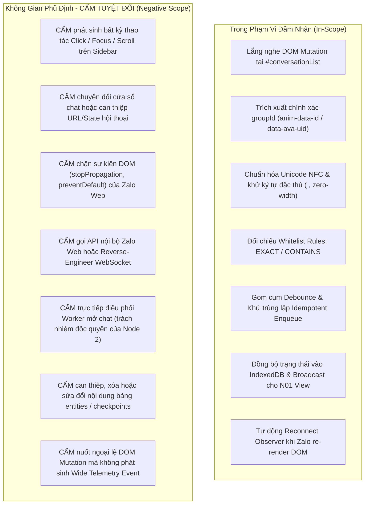
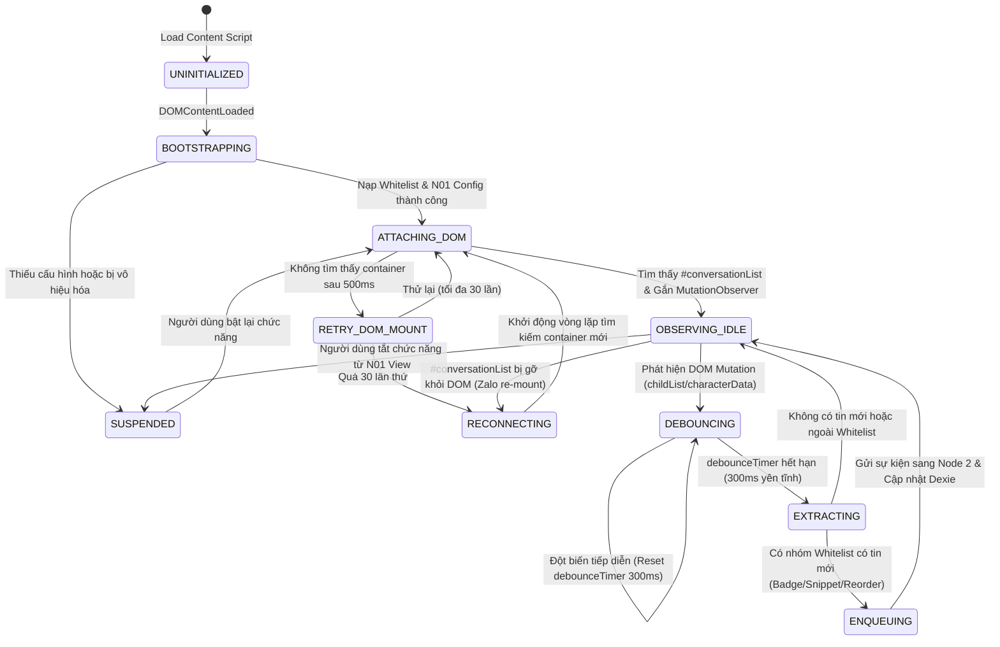
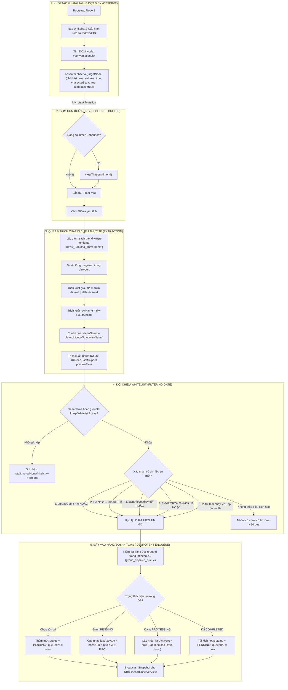
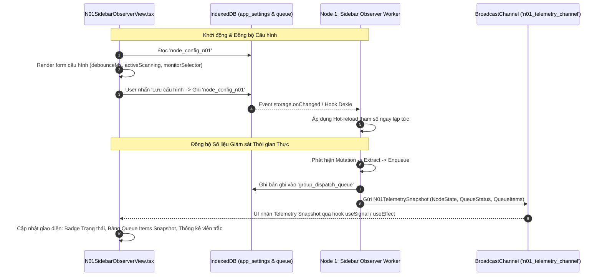

# ĐẶC TẢ THIẾT KẾ KIẾN TRÚC & HỢP ĐỒNG KỸ THUẬT NODE 01
# SIDEBAR OBSERVER & WHITELIST FILTER ENGINE

**Mã định danh Node**: `N01_SIDEBAR_OBSERVER`  
**Tên chính thức**: Background Sidebar Mutation Observer & Whitelist Stream Ingestion Engine  
**Tầng kiến trúc**: Tầng 1 — Giám Sát Sự Kiện Nền (Event Monitoring & Stream Ingestion Layer)  
**Ngữ cảnh thực thi**: Long-running Content Script Worker trên Zalo Web (`https://chat.zalo.me/*`)  
**Tiêu chuẩn tài liệu**: Software Design Document (SDD) / Spec-Kit Specification Standard  
**Tài liệu tham chiếu hệ thống**:
- Khung luồng nghiệp vụ tổng quan: [business_flow.md](file:///c:/Users/ADMIN/Documents/workspace/Sales/EXTENSIONS/Docs/Init/Diagrams/business_flow.md)
- Thiết kế sơ bộ Zalo Automation: [tai_lieu_thiet_ke_so_bo_zalo_automation.md](file:///c:/Users/ADMIN/Documents/workspace/Sales/EXTENSIONS/Docs/Init/tai_lieu_thiet_ke_so_bo_zalo_automation.md)
- Đặc tả hợp đồng dữ liệu & Cổng kiểm định: [he_thong_tu_dong_hoa_zalo_extension_spec.md](file:///c:/Users/ADMIN/Documents/workspace/Sales/EXTENSIONS/Docs/Init/he_thong_tu_dong_hoa_zalo_extension_spec.md)
- Đặc tả Node 02 (Queue Manager): [02_group_queue_manager_node.md](file:///c:/Users/ADMIN/Documents/workspace/Sales/EXTENSIONS/Docs/Start-node/02_group_queue_manager_node.md)
- Snapshot DOM Zalo Sidebar thực tế: [sidebar.html](file:///c:/Users/ADMIN/Documents/workspace/Sales/EXTENSIONS/Temps/zalo-element/sidebar.html)
- Giao diện giám sát UI Node 01: [N01SidebarObserverView.tsx](file:///c:/Users/ADMIN/Documents/workspace/Sales/EXTENSIONS/src/screens/features/nodes/N01SidebarObserverView.tsx)

---

## 1. MỤC TIÊU & PHẠM VI (NODE OBJECTIVE & SCOPE)

### 1.1. Mục tiêu Cốt lõi
1. **Vận hành Worker Độc lập Song song Toàn thời gian (Long-running Background Observer)**:  
   Khởi chạy và duy trì một tiến trình quan sát bất đồng bộ liên tục 24/7 trên Zalo Web. Node 1 hoạt động hoàn toàn độc lập, tách biệt về mặt ngữ cảnh thực thi với luồng điều khiển giao diện (UI Execution Thread của Node 3 đến Node 10). Mọi thao tác mở modal, cuộn tin nhắn, nhấp chuột hoặc chờ độ trễ mạng (cooldown/pacing) của Worker chính tuyệt đối không được làm gián đoạn, block hoặc làm trễ chu trình phát hiện tin mới trên Sidebar.
2. **Theo dõi Biến động DOM Thực tế (DOM Mutation Tracking)**:  
   Lắng nghe các đột biến vi mô (Microtask DOM Mutations) tại container danh sách hội thoại ảo hóa (`#conversationList`) thông qua `MutationObserver` của trình duyệt, kết hợp cơ chế quét dự phòng chủ động (Active Polling Fallback).
3. **Lọc Dòng Sự Kiện Theo Danh Sách Cho Phép (Whitelist Filtering)**:  
   Trích xuất định danh duy nhất (`groupId`), tên hiển thị (`groupName`), huy hiệu chưa đọc (`unreadCount`), dấu hiệu tin mới (`isUnread`), thời gian tương đối (`previewTime`), và nội dung xem trước (`lastSnippet`). Thực hiện đối chiếu thời gian thực với cấu hình Whitelist đang hoạt động với độ trễ cực tiểu (< 50ms).
4. **Phát hiện Tin Mới & Xếp hàng Bất biến (Idempotent Enqueueing)**:  
   Tổng hợp các tín hiệu chỉ báo tin mới (Unread Counter Badge, Unread Dot Badge, Font-weight Bold Time, Unread Message Class, Snippet Mutation, DOM Reordering), thực hiện khử rung (Debouncing 300ms) và khử trùng lặp (Deduplication) trước khi đẩy vào Hàng đợi Điều phối (`group_dispatch_queue`) lưu trữ tại IndexedDB.
5. **Cung cấp Cầu nối Khả năng Quan sát Toàn diện (Observability Bridge)**:  
   Xuất bản trạng thái vận hành thời gian thực (`IDLE`, `PROCESSING`, `DRAINED`), số liệu viễn trắc (Telemetry Metrics) và ảnh chụp nhanh các phần tử trong Queue phục vụ trực tiếp cho màn hình điều khiển `N01SidebarObserverView.tsx`.

### 1.2. Ranh giới & Không gian Phủ định (In-Scope vs Negative Scope)



---

## 2. BẤT BIẾN KIẾN TRÚC & QUY TẮC PHÒNG VỆ (TYPE 1 INVARIANTS)

Để đảm bảo hệ thống tự động hóa vận hành 24/7 ổn định, Node 1 bắt buộc phải tuân thủ nghiêm ngặt 6 bất biến kiến trúc cấp 1 (Type 1 Invariants):

- **INV-N01-001 (Zero UI Interference)**: Node 1 là một **Passive Observer**. Tuyệt đối không được thực hiện bất kỳ lệnh ghi nào vào DOM (`element.innerHTML = ...`, `element.click()`, `element.focus()`, `element.scrollIntoView()`). Mọi thao tác chỉ dừng ở mức đọc thuộc tính DOM (`getAttribute`, `textContent`, `classList`, `getBoundingClientRect`).
- **INV-N01-002 (Non-blocking Concurrency Guarantee)**: Chu kỳ xử lý trích xuất và lọc của Node 1 phải hoàn thành trong khung thời gian microtask `<= 16ms` (1 animation frame). Nếu danh sách hội thoại có đột biến lớn, Node 1 phải đưa tác vụ phân tích nặng vào `requestIdleCallback` hoặc chia nhỏ chunking qua microtask để không gây giật lag giao diện Zalo của người dùng.
- **INV-N01-003 (Idempotent Enqueue Mandate)**: Cùng một sự kiện tin mới của một `groupId` xuất hiện nhiều lần liên tiếp trong khoảng thời gian debounce (ví dụ 10 mutation do render liên tục) chỉ được tạo ra **duy nhất 1 thao tác enqueue** hoặc cập nhật timestamp `lastActiveAt` trong cơ sở dữ liệu. Tuyệt đối không sinh bản ghi trùng lặp trong hàng đợi.
- **INV-N01-004 (Strict DOM Source of Truth)**: Mọi selector và thuộc tính định danh phải bám sát 100% cấu trúc HTML thực tế được trích xuất từ Zalo Web (`sidebar.html`). Tuyệt đối cấm sử dụng các selector giả định vu vơ (như `.conv-item-title`, `.badge-count` không tồn tại trong Zalo Web).
- **INV-N01-005 (Unicode Normalization Invariant)**: Toàn bộ chuỗi tên nhóm (`groupName`) trích xuất từ DOM hoặc nhập từ Whitelist bắt buộc phải đi qua hàm chuẩn hóa `str.normalize('NFC').replace(/[\u00A0\s]+/g, ' ').trim()` trước khi so sánh.
- **INV-N01-006 (Hot-reload Without Reload Invariant)**: Mọi thay đổi cấu hình Whitelist từ trang Options hoặc thay đổi tham số tại `N01SidebarObserverView.tsx` phải có hiệu lực ngay lập tức trong chu kỳ mutation tiếp theo của Node 1 mà không yêu cầu người dùng phải tải lại trang (Zero F5 requirement).

---

## 3. GIẢI PHÃI CẤU TRÚC DOM ZALO SIDEBAR (REAL-WORLD DOM ANATOMY)

Toàn bộ thông số kỹ thuật bên dưới được phân tích trực tiếp từ tệp [sidebar.html](file:///c:/Users/ADMIN/Documents/workspace/Sales/EXTENSIONS/Temps/zalo-element/sidebar.html).

### 3.1. Sơ đồ Phân cấp Cây DOM Thực tế (DOM Tree Hierarchy)

```
nav#sidebarNav.flx.h100.show-chat
 ├── div#main-tab.nav__tabs.flx.flx-col.flx-sp-btw.WEB (Tab điều hướng chính bên trái)
 │    ├── div.nav__tabs__top
 │    │    └── div.leftbar-tab.selected[data-id="div_Main_TabMsg"][title="Tin nhắn"]
 │    └── div.nav__tabs__bottom (zCloud, My Documents, Cài đặt...)
 └── div.flx-cell.flx.flx-col.rel.ovf-hidden.conv-list-semi-compact (Vùng hiển thị danh sách hội thoại)
      ├── div#contact-search.gridv2.flx-al-c.web (Khung tìm kiếm)
      │    └── input#contact-search-input[data-id="txt_Main_Search"]
      ├── div.msg-filters-bar.flx.flx-al-c.ver3 (Thanh chuyển đổi tab lọc hội thoại)
      │    └── div.tab-main.flx.flx-al-c.w100.rel.small.border-bottom
      │         ├── div.tab-item:has(div-b14[data-translate-inner="STR_TAB_CONV_FOCUS"]) (Tab "Ưu tiên")
      │         │    └── div.z-noti-badge-container > div-b14[data-translate-inner="STR_TAB_CONV_FOCUS"] ("Ưu tiên")
      │         └── div.tab-item.selected:has(div-b14[data-translate-inner="STR_TAB_CONV_OTHER"]) (Tab "Khác" - đang chọn)
      │              └── div.z-noti-badge-container > div-b14[data-translate-inner="STR_TAB_CONV_OTHER"] ("Khác")
      └── div#conversationListId.w100.h100.web[data-id="div_TabMsg_ThrdChList"] (Container bao ngoài danh sách)
           └── div.virtualized-scroll (Khung cuộn ảo hóa)
                └── div#conversationList.ReactVirtualized__Grid.ReactVirtualized__List[role="grid"] (Lưới ảo hóa React)
                     └── div.ReactVirtualized__Grid__innerScrollContainer (Vùng chứa tương đối chứa các item)
                          ├── div.msg-item[data-id="div_TabMsg_ThrdChItem"][anim-data-id="g1206626154231863388"] (Thẻ item 1)
                          │    └── div.gridv2.conv-item.conv-rel.lv-2.fluid.tiny.grid-fluid-8
                          │         ├── div.conv-item__avatar.grd-ava.grid-item (Cột Avatar)
                          │         │    └── img[data-ava-uid="g1206626154231863388"]
                          │         ├── div-b16.conv-item-title__name.truncate.grid-item (Cột Tên nhóm)
                          │         │    ├── i.fa.fa-Community_16_Filled.community__conv-indicator (Icon cộng đồng nếu là nhóm)
                          │         │    └── div.truncate (Chuỗi tên hiển thị chứa &nbsp;)
                          │         ├── div.conv-item-title__more.rel.grid-item (Cột Thời gian & Mute)
                          │         │    ├── i.fa.fa-Notif_Off_24_Filled.conv__mute (Icon tắt thông báo)
                          │         │    └── span.preview-time.--b (Thời gian: có class --b khi có tin mới)
                          │         ├── div.conv-item-body.flx.flx-al-c.truncate.grid-item (Cột Nội dung tin nhắn xem trước)
                          │         │    └── div.z-conv-message.--unread (Tin nhắn: có class --unread khi chưa đọc)
                          │         │         ├── span.z-conv-message__preview-sender-name ("Linh Nguyễn: ")
                          │         │         └── div.inline > span.inline ("https://drive...")
                          │         └── div.conv-item-body__action.hasOption.grid-item (Cột Huy hiệu thông báo)
                          │              └── div.conv-action__unread-v2
                          │                   └── div.z-noti-badge.--big.--counter.--noti-disable (Huy hiệu đỏ đếm số)
                          │                        └── i.fa.fa-5_Plus_24_Line.z-noti-badge__content.--big
                          └── div.msg-item[data-id="div_TabMsg_ThrdChItem"][anim-data-id="g7140739336053443835"] (Thẻ item 4 - Dot badge)
                               └── ...
                                    └── div.conv-item-body__action
                                         └── div.z-noti-badge.--big.--dot.--noti-disable (Huy hiệu chấm đỏ)
```

### 3.2. Bảng Ma trận Selector Chuẩn hóa (Verified Selectors Matrix)

| Mục tiêu Dữ liệu | Selector Ưu tiên 1 (Primary Verified Selector) | Selector Dự phòng (Fallback Selectors) | Thuộc tính / Nguồn trích xuất giá trị | Ghi chú kỹ thuật |
| :--- | :--- | :--- | :--- | :--- |
| **Root Navigation** | `#sidebarNav` | `nav.show-chat` | Cây DOM gốc thanh điều hướng | Kiểm tra sự tồn tại của Sidebar |
| **Tab Tin nhắn chính** | `div.leftbar-tab[data-id="div_Main_TabMsg"]` | `#main-tab .leftbar-tab.selected` | Class `selected` | Đảm bảo Zalo đang ở tab Chat |
| **Tab "Ưu tiên" (Focus)** | `.msg-filters-bar .tab-item:has(div-b14[data-translate-inner="STR_TAB_CONV_FOCUS"])` | `div-b14[data-translate-inner="STR_TAB_CONV_FOCUS"]` | Sự hiện diện của class `.selected` trên `div.tab-item` | Nhận diện Zalo đang hiển thị tab Ưu tiên |
| **Tab "Khác" (Other)** | `.msg-filters-bar .tab-item:has(div-b14[data-translate-inner="STR_TAB_CONV_OTHER"])` | `div-b14[data-translate-inner="STR_TAB_CONV_OTHER"]` | Sự hiện diện của class `.selected` trên `div.tab-item` | Nhận diện Zalo đang hiển thị tab Khác |
| **Badge Tab Ẩn Đối Diện** | `.tab-item:not(.selected) .z-noti-badge-container .z-noti-badge` | `.tab-item:not(.selected) [class*="badge"]` | Sự xuất hiện của phần tử badge trên tab | Cảnh báo có tin mới tại Tab đang ẩn |
| **Container Hội Thoại** | `#conversationList` | `#conversationListId, div[data-id="div_TabMsg_ThrdChList"]` | Phần tử gắn `MutationObserver` | Container ReactVirtualized Grid |
| **Vùng chứa Cuộn ảo** | `.ReactVirtualized__Grid__innerScrollContainer` | `.virtualized-scroll` | Vùng chứa trực tiếp các phần tử con | Theo dõi `childList` và vị trí `top` |
| **Thẻ Hội Thoại (Item)**| `div.msg-item[data-id="div_TabMsg_ThrdChItem"]` | `div.msg-item[anim-data-id]` | Toàn bộ khối DOM của 1 cuộc hội thoại | Chiều cao cố định `height: 78px;` |
| **Mã Định Danh Nhóm (`groupId`)** | `element.getAttribute('anim-data-id')` | `element.querySelector('img[data-ava-uid]')?.getAttribute('data-ava-uid')` | Thuộc tính chuỗi (bắt đầu bằng `g...`) | **Định danh bất biến duy nhất của nhóm** |
| **Tên Nhóm (`groupName`)** | `div-b16.conv-item-title__name .truncate` | `div-16.conv-item-title__name .truncate, .conv-item-title__name > div` | `textContent` (giải mã HTML entities) | Lưu ý thẻ tùy biến của Zalo: `div-b16`, `div-16` |
| **Icon Nhóm / Community** | `i.community__conv-indicator` | `i.fa-Community_16_Filled` | Sự hiện diện của element (boolean) | Phân biệt Nhóm Cộng đồng và chat 1-1 |
| **Thời gian Tương đối** | `.preview-time` | `.conv-item-title__more span.preview-time` | `textContent` (ví dụ: `8 phút`, `2 giờ`) | Kiểm tra class `--b` (Bold/Mới có tin) |
| **Dấu hiệu Tin Chưa Đọc (Text)** | `.z-conv-message.--unread` | `.z-conv-message` | Class `--unread` | Xuất hiện khi hội thoại có tin mới |
| **Người gửi tin cuối** | `.z-conv-message__preview-sender-name` | `.z-conv-message span:first-child` | `textContent` (bỏ dấu `:` ở cuối) | Người phát biểu tin nhắn cuối cùng |
| **Nội dung tóm tắt (`snippet`)** | `.z-conv-message__preview-message .inline` | `.z-conv-message .inline` | `textContent` chuẩn hóa | Dùng để so sánh delta nội dung |
| **Huy hiệu Đỏ Đếm số** | `.conv-action__unread-v2 .z-noti-badge.--counter` | `.z-noti-badge.--counter` | Class icon con: `fa-<N>_24_Line` | Trích xuất số lượng tin chưa đọc |
| **Huy hiệu Chấm Đỏ** | `.conv-action__unread-v2 .z-noti-badge.--dot` | `.z-noti-badge.--dot` | Sự hiện diện của element (boolean) | Nhóm tắt chuông hoặc tin mới dạng dot |
| **Trạng thái Đã Đọc** | `.conv-item-body.span-all` | Không tồn tại `.conv-action__unread-v2` | Class `span-all` trên body | Item chiếm toàn bộ bề ngang khi đã đọc |

### 3.3. Thuật toán Trích xuất Số lượng từ Icon Class của Zalo
Zalo Web sử dụng cơ chế render số lượng badge bằng Font Icon thay vì in thẻ text thông thường khi số lượng từ 1 đến 5+:
```typescript
/**
 * Trích xuất unreadCount từ thẻ badge của Zalo Web
 */
export function extractUnreadBadgeCount(badgeElement: Element | null): { unreadCount: number; isDot: boolean } {
  if (!badgeElement) return { unreadCount: 0, isDot: false };

  // Trường hợp 1: Chấm đỏ không có số (Dot notification)
  if (badgeElement.classList.contains('--dot')) {
    return { unreadCount: 1, isDot: true };
  }

  // Trường hợp 2: Badge có đếm số (--counter)
  if (badgeElement.classList.contains('--counter')) {
    const iconChild = badgeElement.querySelector('i[class*="fa-"]');
    if (iconChild) {
      const classList = iconChild.className;
      if (classList.includes('fa-5_Plus_24_Line')) return { unreadCount: 5, isDot: false };
      if (classList.includes('fa-4_24_Line')) return { unreadCount: 4, isDot: false };
      if (classList.includes('fa-3_24_Line')) return { unreadCount: 3, isDot: false };
      if (classList.includes('fa-2_24_Line')) return { unreadCount: 2, isDot: false };
      if (classList.includes('fa-1_24_Line')) return { unreadCount: 1, isDot: false };
    }
    // Fallback: nếu Zalo cập nhật render số trực tiếp dạng text
    const textVal = parseInt(badgeElement.textContent?.trim() || '0', 10);
    if (!isNaN(textVal) && textVal > 0) return { unreadCount: textVal, isDot: false };

    return { unreadCount: 1, isDot: false };
  }

  return { unreadCount: 0, isDot: false };
}
```

---

## 4. HỢP ĐỒNG KỸ THUẬT & GIAO DIỆN DỮ LIỆU (DATA CONTRACTS)

### 4.1. Hợp đồng Cấu hình Whitelist (`WhitelistConfigSchema`)
Lưu tại bảng `app_settings` trong IndexedDB (key: `whitelist_groups`):

```typescript
import { z } from 'zod';

export const WhitelistMatchRuleSchema = z.enum(['EXACT', 'CONTAINS']);
export type WhitelistMatchRule = z.infer<typeof WhitelistMatchRuleSchema>;

export const WhitelistGroupItemSchema = z.object({
  groupId: z.string().min(1, 'groupId không được rỗng'), // Ví dụ: "g1206626154231863388"
  groupName: z.string().min(1, 'groupName không được rỗng'), // Ví dụ: "TL21House - NGUỒN <4tr"
  matchRule: WhitelistMatchRuleSchema.default('CONTAINS'),
  isActive: z.boolean().default(true),
  priority: z.number().int().min(1).max(10).default(1),
  tags: z.array(z.string()).default([]),
  notes: z.string().optional(),
});
export type WhitelistGroupItem = z.infer<typeof WhitelistGroupItemSchema>;

export const WhitelistSettingsPayloadSchema = z.object({
  whitelistGroups: z.array(WhitelistGroupItemSchema),
  scanDebounceMs: z.number().int().min(100).max(2000).default(300),
  lastUpdated: z.number().int().positive(),
});
export type WhitelistSettingsPayload = z.infer<typeof WhitelistSettingsPayloadSchema>;
```

### 4.2. Hợp đồng Cấu hình Vận hành Node 01 (`N01ConfigSchema`)
Lưu tại bảng `app_settings` trong IndexedDB (key: `node_config_n01`):

```typescript
export const N01ConfigSchema = z.object({
  debounceMs: z.number().int().min(100).max(2000).default(300),
  activeScanning: z.boolean().default(false),
  scanIntervalMs: z.number().int().min(2000).max(30000).default(5000),
  monitorSelector: z.string().min(1).default('#conversationList, div[data-id="div_TabMsg_ThrdChList"]'),
});
export type N01Config = z.infer<typeof N01ConfigSchema>;
```

### 4.3. Hợp đồng Sự kiện Phát hiện Nhóm Mới (`GroupDetectedEventSchema`)
Được Node 1 phát sinh nội bộ và chuyển tiếp trực tiếp sang Node 2 (Queue Manager):

```typescript
export const DetectionSourceSchema = z.enum([
  'BADGE_COUNTER_MUTATION',
  'BADGE_DOT_MUTATION',
  'UNREAD_CLASS_MUTATION',
  'SNIPPET_MUTATION',
  'REORDER_TOP_MUTATION',
  'ACTIVE_POLL_DISCOVERY',
]);
export type DetectionSource = z.infer<typeof DetectionSourceSchema>;

export const GroupDetectedEventSchema = z.object({
  eventId: z.string().uuid(), // Định danh duy nhất sự kiện phát hiện
  groupId: z.string().min(1),  // Định danh chuẩn hóa: "g1206626154231863388"
  groupName: z.string().min(1), // Tên hiển thị chuẩn hóa sau khi strip HTML entities
  unreadCount: z.number().int().nonnegative().default(0), // Số lượng tin chưa đọc
  isUnread: z.boolean(),        // Có dấu hiệu tin mới (badge hoặc class --unread)
  lastSnippet: z.string().default(''), // Đoạn tin nhắn cuối xem trước
  senderName: z.string().optional(),   // Tên người gửi tin nhắn cuối
  previewTime: z.string().default(''), // Chuỗi thời gian (ví dụ: "8 phút")
  isMuted: z.boolean().default(false), // Nhóm có bị tắt chuông hay không
  detectedAt: z.number().int().positive(), // Unix timestamp (ms)
  source: DetectionSourceSchema,
  priority: z.number().int().default(1),
});
export type GroupDetectedEvent = z.infer<typeof GroupDetectedEventSchema>;
```

### 4.4. Hợp đồng Trạng thái và Viễn trắc Quan sát (`N01ObservabilityContract`)
Dùng để đồng bộ trạng thái thời gian thực từ Background Worker lên giao diện `N01SidebarObserverView.tsx`:

```typescript
export type Node01State = 'UNINITIALIZED' | 'OBSERVING_IDLE' | 'DEBOUNCING' | 'EXTRACTING' | 'RECONNECTING' | 'SUSPENDED';
export type QueueProcessingStatus = 'IDLE' | 'PROCESSING' | 'DRAINED';

export interface QueueItemSnapshot {
  id?: number;
  groupId: string;
  groupName: string;
  status: 'PENDING' | 'PROCESSING' | 'COMPLETED' | 'FAILED';
  enqueuedAt: number;
  lastActiveAt: number;
  retryCount: number;
  priority: number;
  unreadCount: number;
  lastSnippet: string;
}

export interface N01TelemetrySnapshot {
  nodeState: Node01State;
  queueStatus: QueueProcessingStatus;
  isObserverActive: boolean;
  totalMutationsObserved: number;
  totalEventsEmitted: number;
  totalIgnoredNonWhitelist: number;
  lastMutationAt: number | null;
  lastEventEmittedAt: number | null;
  activeConversationCount: number;
  pendingQueueItems: QueueItemSnapshot[];
  processingQueueItem: QueueItemSnapshot | null;
}
```

### 4.5. Mối Tương Thích & Đồng Bộ Hợp Đồng Schema Dự Án (`src/contracts/schemas.ts`)
Hệ thống hiện tại đang định nghĩa hợp đồng hàng đợi cơ sở tại [schemas.ts](file:///c:/Users/ADMIN/Documents/workspace/Sales/EXTENSIONS/src/contracts/schemas.ts#L21-L28):

```typescript
// Schema hiện tại trong codebase:
export const QueueStatusSchema = z.enum(['PENDING', 'PROCESSING', 'FAILED', 'COMPLETED']);
export type QueueStatus = z.infer<typeof QueueStatusSchema>;

export const DispatchQueueItemSchema = z.object({
  id: z.number().int().positive().optional(),
  groupId: z.string().min(1),
  status: QueueStatusSchema,
  retryCount: z.number().int().nonnegative().default(0),
  enqueuedAt: z.number().int().positive(),
});
export type DispatchQueueItem = z.infer<typeof DispatchQueueItemSchema>;
```

**Khoảng cách kỹ thuật & Nhu cầu mở rộng của Node 1**:
1. `groupName?: string`: Cần lưu trực tiếp tên nhóm nguồn tại thời điểm enqueue để phục vụ giao diện điều khiển `N01SidebarObserverView.tsx` render tức thì danh sách hàng đợi (Zero-join overhead), tránh việc phải query bất đồng bộ ngược sang bảng settings/DOM mỗi khi render.
2. `lastActiveAt?: number`: Bắt buộc phải có để hỗ trợ cơ chế Debounce đa đột biến và cửa sổ Inactivity Drain 10s tại Node 10 (khi nhóm đang `PROCESSING` mà có tin mới đổ về, Node 1 cập nhật `lastActiveAt = now` để Worker không bị đóng sớm).

**Hợp đồng tương thích mở rộng (Backward-compatible Extension)**:
```typescript
export const ExtendedDispatchQueueItemSchema = DispatchQueueItemSchema.extend({
  groupName: z.string().optional(),                      // Tên nhóm chuẩn hóa từ Whitelist
  lastActiveAt: z.number().int().positive().optional(),  // Thời điểm phát sinh tin nhắn mới nhất
});
export type ExtendedDispatchQueueItem = z.infer<typeof ExtendedDispatchQueueItemSchema>;
```
*Lưu ý kiến trúc*: Việc bổ sung 2 trường tùy chọn (`optional()`) này hoàn toàn tương thích ngược với index Dexie hiện có (`'++id, groupId, status, enqueuedAt'`) trong [database.ts](file:///c:/Users/ADMIN/Documents/workspace/Sales/EXTENSIONS/src/db/database.ts#L22) và không yêu cầu bump version IndexedDB.

### 5.1. Sơ đồ Máy Trạng thái (FSM Diagram)



### 5.2. Bảng Chuyển Trạng thái (State Transition Table)

| Trạng thái Nguồn | Sự kiện Kích hoạt | Điều kiện Kiểm tra | Hành động Thực thi | Trạng thái Đích |
| :--- | :--- | :--- | :--- | :--- |
| `UNINITIALIZED` | Content script nạp | Tab `chat.zalo.me` sẵn sàng | Khởi tạo state RAM, mở Dexie DB | `BOOTSTRAPPING` |
| `BOOTSTRAPPING` | Nạp cấu hình hoàn tất | Cấu hình hợp lệ | Đăng ký `chrome.storage.onChanged` | `ATTACHING_DOM` |
| `ATTACHING_DOM` | Query DOM | Tìm thấy `#conversationList` | Khởi tạo & `observer.observe()` | `OBSERVING_IDLE` |
| `ATTACHING_DOM` | Query DOM | Không thấy `#conversationList` | Đặt timer retry 500ms (lần N < 30) | `ATTACHING_DOM` |
| `ATTACHING_DOM` | Hết số lần retry | N >= 30 lần | Ghi log cảnh báo `DOM_MOUNT_TIMEOUT` | `RECONNECTING` |
| `OBSERVING_IDLE` | DOM Mutation | Container nhận mutation record | Khởi động timer `debounceMs` (300ms) | `DEBOUNCING` |
| `DEBOUNCING` | Mutation tiếp tục đến | Timer chưa timeout | Clear timer cũ, tạo timer mới (Reset) | `DEBOUNCING` |
| `DEBOUNCING` | Timeout 300ms | Đã qua 300ms không có mutation | Gom nhóm mutation records, bắt đầu quét | `EXTRACTING` |
| `EXTRACTING` | Duyệt danh sách item | Nhóm thuộc Whitelist && Có tin mới | Đóng gói `GroupDetectedEvent` | `ENQUEUING` |
| `EXTRACTING` | Duyệt danh sách item | Không có nhóm thỏa mãn | Bỏ qua, giải phóng bộ nhớ tạm | `OBSERVING_IDLE` |
| `ENQUEUING` | Dispatch sang Node 2 | DB transaction thành công | Broadcast Telemetry Snapshot cho View | `OBSERVING_IDLE` |
| `OBSERVING_IDLE` | Container Disconnected | `!document.contains(container)` | Disconnect observer cũ, bật rescue loop | `RECONNECTING` |

---

## 6. THUẬT TOÁN PHÁT HIỆN & XẾP HÀNG BẤT BIẾN (DETECTION & INGESTION ALGORITHM)

### 6.1. Luồng Hoạt động Chi tiết (End-to-End Processing Flow)



### 6.2. Thuật toán Chuẩn hóa Unicode & Khử Ký Tự Nhiễu DOM
Zalo Web render tên nhóm chứa rất nhiều ký tự đặc thù: HTML entities `&nbsp;`, `&lt;`, `&gt;`, các khoảng trắng Unicode không phân tách (Non-breaking space `\u00A0`), khoảng trắng zero-width (`\u200B`), và định dạng tổ hợp Unicode (NFD/NFC).

```typescript
/**
 * Chuẩn hóa triệt để chuỗi văn bản trích xuất từ DOM Zalo
 */
export function normalizeZaloText(input: string): string {
  if (!input) return '';
  return input
    // 1. Chuyển đổi Unicode sang dạng chuẩn hóa thống nhất NFC
    .normalize('NFC')
    // 2. Thay thế non-breaking space (\u00A0) và khoảng trắng đặc thù bằng dấu space chuẩn
    .replace(/[\u00A0\u1680\u180e\u2000-\u200b\u202f\u205f\u3000\ufeff]/g, ' ')
    // 3. Gom cụm nhiều khoảng trắng liên tiếp thành 1 dấu cách
    .replace(/\s+/g, ' ')
    // 4. Loại bỏ khoảng trắng ở hai đầu
    .trim();
}

/**
 * Kiểm tra đối chiếu Whitelist
 */
export function matchWhitelist(
  cleanName: string,
  groupId: string,
  whitelist: WhitelistGroupItem[]
): WhitelistGroupItem | null {
  const normalizedCleanName = cleanName.toLowerCase();
  
  for (const item of whitelist) {
    if (!item.isActive) continue;

    // So khớp trực tiếp theo groupId nếu Whitelist có khai báo groupId cụ thể
    if (item.groupId && item.groupId.trim() !== '') {
      if (item.groupId.trim() === groupId) return item;
    }

    // So khớp theo Tên nhóm
    const normalizedTargetName = normalizeZaloText(item.groupName).toLowerCase();
    if (item.matchRule === 'EXACT') {
      if (normalizedCleanName === normalizedTargetName) return item;
    } else if (item.matchRule === 'CONTAINS') {
      if (normalizedCleanName.includes(normalizedTargetName)) return item;
    }
  }

  return null;
}
```

### 6.3. Đa Tín Hiệu Nhận Diện Tin Mới (Multi-Signal Fusion Detection)
Để tuyệt đối không bỏ sót tin nhắn mới ngay cả khi Zalo Web thay đổi cách hiển thị, Node 1 áp dụng chiến lược **Hợp nhất đa tín hiệu (Multi-Signal Fusion)**. Một cuộc hội thoại được đánh dấu là `CÓ TIN MỚI` khi thỏa mãn **ít nhất một (OR)** trong 5 điều kiện sau:

1. **Tín hiệu Badge Số (`SIGNAL_BADGE_COUNTER`)**: Thẻ `.z-noti-badge.--counter` xuất hiện và chứa số lượng `unreadCount >= 1`.
2. **Tín hiệu Badge Chấm (`SIGNAL_BADGE_DOT`)**: Thẻ `.z-noti-badge.--dot` xuất hiện (áp dụng cho nhóm bị tắt thông báo Mute nhưng có tin mới đẩy tới).
3. **Tín hiệu Lớp Chưa Đọc (`SIGNAL_UNREAD_CLASS`)**: Thẻ `.z-conv-message` mang class `--unread`.
4. **Tín hiệu Đậm Thời Gian (`SIGNAL_BOLD_TIME`)**: Thẻ `.preview-time` mang class `--b` (chỉ thị Zalo vừa cập nhật tin mới trong vòng vài giây/phút).
5. **Tín hiệu Đột biến Snippet & Reorder (`SIGNAL_SNIPPET_DELTA`)**: Đoạn nội dung xem trước `lastSnippet` khác với giá trị đã lưu trong bộ đệm RAM gần nhất (`lastKnownSnippetMap.get(groupId)`), HOẶC vị trí index của item nhảy vọt lên vị trí đầu tiên (Index 0) của danh sách cuộn.

---

## 7. KHẢ NĂNG QUAN SÁT & TÍCH HỢP GIAO DIỆN GIÁM SÁT (VIEW INTEGRATION)

Nhằm đáp ứng yêu cầu hiển thị và quản lý trực tiếp từ tệp [N01SidebarObserverView.tsx](file:///c:/Users/ADMIN/Documents/workspace/Sales/EXTENSIONS/src/screens/features/nodes/N01SidebarObserverView.tsx), Node 1 thiết lập một kênh đồng bộ trạng thái hai chiều và cung cấp toàn bộ dữ liệu quan sát thời gian thực phục vụ giám sát vận hành.

### 7.1. Cấu trúc Đồng bộ Trạng thái Xử lý Hàng Đợi (Queue State Pipeline)
Giao diện View yêu cầu component hiển thị trực quan **Huy hiệu Trạng thái Xử lý Hàng đợi (Queue Processing Status Badge)** với 3 trạng thái định danh chuẩn hóa:

1. **Trạng thái `IDLE` (Trực chờ / Hàng đợi Rỗng)**:
   - **Giao diện**: Badge màu Xanh lam nhạt hoặc Xám (`bg-blue-50 text-blue-700 border-blue-200` hoặc `bg-gray-100 text-gray-700 border-gray-200`), icon biểu thị `⚪ Sẵn sàng / Chờ tin mới`.
   - **Ngữ nghĩa**: Hàng đợi không có phần tử nào ở trạng thái `PENDING` hoặc `PROCESSING`. Node 1 đang ở trạng thái trực chờ (`OBSERVING_IDLE`), sẵn sàng tiếp nhận đột biến mới từ Sidebar.
2. **Trạng thái `PROCESSING` (Đang Xử Lý / Có Hàng Đợi Chờ)**:
   - **Giao diện**: Badge màu Vàng / Cam nhấp nháy nhẹ (`bg-amber-50 text-amber-700 border-amber-300` hoặc `bg-orange-50 text-orange-700 border-orange-300`), icon biểu thị `⚡ Đang xử lý / Có nhóm chờ`.
   - **Ngữ nghĩa**: Đang có ít nhất một nhóm đang được Worker mở và thao tác UI (`status === 'PROCESSING'`) HOẶC đang có các nhóm nguồn chờ trong hàng đợi (`status === 'PENDING'`).
3. **Trạng thái `DRAINED` (Đã Xử Lý Xong Toàn Bộ)**:
   - **Giao diện**: Badge màu Xanh lục tươi (`bg-emerald-50 text-emerald-700 border-emerald-300` hoặc `bg-green-50 text-green-700 border-green-300`), icon biểu thị `✅ Đã xử lý xong toàn bộ tin nhắn mới`.
   - **Ngữ nghĩa**: Toàn bộ các nhóm có tin mới trước đó đã hoàn tất xử lý (`COMPLETED`). Hàng đợi vừa được làm rỗng sạch sẽ, hệ thống xác nhận toàn bộ tin nhắn mới của các nhóm Whitelist đã được phân phối xong. Trạng thái này duy trì trong 5 giây trước khi tự động chuyển về `IDLE` nếu không có tin mới phát sinh thêm.

### 7.2. Đặc tả Bảng / Danh Sách Phần Tử Hàng Đợi (Queue Items Data Table)
Giao diện `N01SidebarObserverView.tsx` cần bổ sung một section bảng giám sát thời gian thực (**Danh Sách Hàng Đợi Nhóm Chờ Điều Phối**), hiển thị trực quan các nhóm đang nằm trong `group_dispatch_queue`:

| Cột Hiển Thị | Nguồn Dữ Liệu | Kiểu & Định Dạng Hiển Thị | Mục Đích Giám Sát |
| :--- | :--- | :--- | :--- |
| **Mã Nhóm (Group ID)** | `item.groupId` | Monospace font (ví dụ: `g12066...`), hỗ trợ nút sao chép nhanh (Copy icon) | Nhận diện chính xác định danh DOM |
| **Tên Nhóm** | `item.groupName` | Text in đậm (chuẩn hóa Unicode, giải mã entities), kèm icon cộng đồng nếu là nhóm | Kiểm tra tính chính xác khi khớp Whitelist |
| **Trạng Thái** | `item.status` | Tag/Badge: `PENDING` (Vàng), `PROCESSING` (Cam nhấp nháy) | Tiến độ điều phối của Worker |
| **Thời Điểm Vào Queue** | `item.enqueuedAt` | Format giờ `HH:mm:ss` + thời gian chờ tương đối (ví dụ: `15s trước`) | Theo dõi độ trễ điều phối FIFO |
| **Active Gần Nhất** | `item.lastActiveAt` | Format giờ `HH:mm:ss` + thời gian tương đối (ví dụ: `2s trước`) | Kiểm soát cửa sổ Inactivity Drain 10s |
| **Số Tin Chưa Đọc** | `item.unreadCount` | Badge đỏ số lượng (`5+`, `3`) hoặc nhãn `Chấm đỏ` (nếu là dot badge) | Mức độ cấp thiết của nhóm |
| **Lần Thử Lại** | `item.retryCount` | Số nguyên (`0/3`, highlight đỏ nếu `> 0`) | Cảnh báo sớm nguy cơ crash loop kẹt nhóm |

### 7.3. Chuẩn Hóa Bộ Chọn Mặc Định Trên Giao Diện UI (Selector Default Standardization)
Trong mã nguồn hiện tại của [N01SidebarObserverView.tsx](file:///c:/Users/ADMIN/Documents/workspace/Sales/EXTENSIONS/src/screens/features/nodes/N01SidebarObserverView.tsx#L16), cấu hình mặc định đang khai báo:
```typescript
// CŨ (Chứa giả định role="list" không tồn tại trong Zalo Web):
monitorSelector: '#conversationList, div[role="list"]'
```
**Yêu cầu Chuẩn hóa**:
Zalo Web sử dụng thư viện ReactVirtualized Grid với thuộc tính chuẩn là `role="grid"` (`<div id="conversationList" role="grid" aria-label="grid">`), hoàn toàn không sử dụng `role="list"`. Do đó, tài liệu đặc tả chuẩn hóa bộ chọn mặc định thành:
```typescript
// MỚI (Chuẩn hóa chính xác 100% theo DOM thực tế):
monitorSelector: '#conversationList, div[data-id="div_TabMsg_ThrdChList"]'
```
*Giải thích kỹ thuật*: Selector ưu tiên 1 là `#conversationList`. Nếu React Virtualized unmount hoặc re-mount làm mất ID tạm thời, selector dự phòng `div[data-id="div_TabMsg_ThrdChList"]` (container cha bất biến luôn tồn tại trên Zalo Web) sẽ lập tức bắt giữ DOM thay thế.

### 7.4. Hợp đồng Đồng bộ Viễn trắc Hai Chiều (Bidirectional Sync Contract)



### 7.5. Định dạng Bản ghi Snapshot Phần tử Hàng đợi hiển thị trên View
Mỗi phần tử hiển thị trong danh sách Queue của `N01SidebarObserverView` có cấu trúc:
```typescript
export interface ViewQueueItemDisplay {
  groupId: string;             // "g1206626154231863388"
  groupName: string;           // "🏆TL21House🏆- NGUỒN <4tr"
  statusBadge: 'PENDING' | 'PROCESSING' | 'COMPLETED' | 'FAILED';
  enqueuedAtFormatted: string; // "09:20:15"
  lastActiveAtFormatted: string; // "09:20:25"
  waitingTimeSeconds: number;  // 12s
  retryCount: number;          // 0
  priority: number;            // 1
  unreadBadgeText: string;     // "5+ tin mới" hoặc "Chấm đỏ"
  snippetPreview: string;      // "Linh Nguyễn: https://drive..."
}
```

---

## 8. MA TRẬN KHẢ NĂNG CHỊU LỖI & TÌNH HUỐNG BIÊN (RESILIENCE & EDGE CASES)

| Mã Ngoại Lệ | Tình Huống Biên Thực Tế | Phân Tích Cơ Chế Gốc | Giải Pháp Phòng Vệ & Tự Phục Hồi | Mức Độ Rủi Ro |
| :--- | :--- | :--- | :--- | :--- |
| **N01-ERR-01** | **React Virtualized unmount các item khuất khỏi màn hình** | Zalo Web sử dụng `ReactVirtualized__Grid`. Khi danh sách dài, các nhóm nguồn cuộn xuống dưới bị unmount hoàn toàn khỏi DOM để tiết kiệm RAM. | 1. Duy trì bộ đệm `Map<groupId, LastKnownSnapshot>` trong RAM.<br>2. Theo dõi sự kiện cuộn của container.<br>3. Khi có tin mới, Zalo tự động đẩy item lên đỉnh danh sách (`top: 0px`), item sẽ lập tức được mount vào đầu DOM và bị bắt bởi MutationObserver. | **CRITICAL** |
| **N01-ERR-02** | **Nhóm Whitelist nằm ở Tab "Khác" trong khi Zalo đang mở Tab "Ưu tiên"** | Zalo chia Sidebar thành 2 tab: "Ưu tiên" (`STR_TAB_CONV_FOCUS`) và "Khác" (`STR_TAB_CONV_OTHER`). Nhóm ở tab kia sẽ không render trong DOM cuộn. | 1. Quan sát badge đỏ xuất hiện trên chính nút tab header của Tab "Khác" (`.tab-main .tab-item:not(.selected) .z-noti-badge-container`).<br>2. Nếu phát hiện badge tại Tab đối diện, ghi nhận cờ `hasUnreadInOtherTab = true` và phát tín hiệu cảnh báo trên UI View để người dùng/hệ thống biết. | **HIGH** |
| **N01-ERR-03** | **Tên nhóm chứa ký tự HTML Entities, Emoji & Non-breaking Spaces** | Tên nhóm chứa `&nbsp;`, `&lt;4tr`, emoji phức tạp dẫn đến hàm `===` thông thường bị sai lệch. | Sử dụng hàm `normalizeZaloText()` chuyển toàn bộ `\u00A0` thành space thường, giải mã entity qua parser an toàn không thực thi DOM, normalize Unicode NFC trước khi so sánh. | **HIGH** |
| **N01-ERR-04** | **Bão Đột Biến DOM (Mutation Storm) khi nhận hàng trăm tin nhắn/phút** | Nhiều nhóm chat nhảy liên tục, MutationObserver kích hoạt hàng ngàn records trong một giây gây nghẽn UI thread. | 1. Cơ chế Debounce 300ms gom cụm toàn bộ mutations.<br>2. Thực hiện trích xuất dữ liệu bên trong `requestAnimationFrame` kết hợp chunking.<br>3. Chỉ duyệt các thẻ con trực tiếp thay vì đệ quy toàn bộ cây DOM. | **HIGH** |
| **N01-ERR-05** | **Zalo Web re-mount toàn bộ `#conversationList` (SPA Re-render)** | Khi người dùng chuyển đổi mạng hoặc tab nội bộ, React có thể thay thế toàn bộ node `#conversationList` bằng một node DOM mới, khiến observer cũ bị mồ côi (Detached Observer). | 1. Kiểm tra định kỳ `document.contains(observedElement)`.<br>2. Gắn một observer cha cấp cao trên `#sidebarNav` để phát hiện khi container con bị thay thế.<br>3. Tự động chuyển sang trạng thái `RECONNECTING` và tái gắn observer trong vòng `< 500ms`. | **MEDIUM** |
| **N01-ERR-06** | **Xung đột ghi đồng thời vào IndexedDB giữa Microtask và Timer** | Microtask của MutationObserver và timer Polling Fallback có thể cùng quét được một nhóm và cố gắng ghi vào `group_dispatch_queue`. | 1. Áp dụng Semaphore / RAM Mutex Lock cục bộ `isCommittingQueue`.<br>2. Sử dụng Dexie Transaction nguyên tử (`db.transaction('rw', db.group_dispatch_queue, ...)`).<br>3. Khóa bản ghi theo `groupId` duy nhất. | **HIGH** |
| **N01-ERR-07** | **Trình duyệt đóng băng Tab nền (Background Tab Throttling)** | Khi người dùng chuyển sang tab khác, Chrome giới hạn timer `setTimeout` xuống còn 1 lần/phút. | 1. MutationObserver là cơ chế DOM gốc không bị ảnh hưởng bởi Timer throttling khi có tin nhắn websocket đổ về DOM.<br>2. Kích hoạt Web Audio API giữ nhịp (Silent Audio Ping) nếu cấu hình chế độ Chạy Nền Bền Bỉ 24/7 được kích hoạt. | **LOW** |

---

## 9. KHUNG GHI LOG TELEMETRY (CANONICAL LOG LINES)

Tuân thủ nguyên tắc High-Cardinality Structured Logging (Serilog/Wide Events), Node 1 xuất bản log có cấu trúc đầy đủ ngữ cảnh mỗi khi hoàn tất một chu kỳ quét hoặc phát hiện nhóm:

```json
{
  "Timestamp": "2026-11-12T09:20:15.124Z",
  "NodeId": "N01_SIDEBAR_OBSERVER",
  "Operation": "IngestGroupMutation",
  "Level": "INFO",
  "Status": "SUCCESS",
  "DurationMs": 14,
  "CorrelationId": "CORR_N01_1799632815_g12066",
  "GroupId": "g1206626154231863388",
  "GroupName": "TL21House - NGUỒN <4tr",
  "MatchedRule": "CONTAINS",
  "MatchedKeyword": "NGUỒN <4tr",
  "DetectionSource": "BADGE_COUNTER_MUTATION",
  "UnreadCount": 5,
  "IsUnread": true,
  "PreviewTime": "8 phút",
  "HasSnippet": true,
  "SnippetLength": 42,
  "QueueAction": "ENQUEUED_NEW",
  "TotalActiveWhitelist": 12,
  "CurrentQueueDepth": 3,
  "MemoryFootprintKb": 420
}
```

---

## 10. TIÊU CHÍ KIỂM THỬ & CỔNG NGHIỆM THU NHỊ PHÂN (ACCEPTANCE GATES / DoD)

Tất cả tiêu chí nghiệm thu đều được thiết lập dưới dạng các vị từ kiểm chứng cơ học nhị phân (Đạt / Không đạt — 0 Exit Code):

### GATE-01: Kiểm thử Khả năng Giám sát Song song Bất đồng bộ (Non-blocking Verification)
- **Given**: Worker chính đang bị khóa trong thao tác UI dài hạn (Node 8 đang mở modal chia sẻ tin nhắn, `isWorkerBusy = true`, thời gian giữ lock 3000ms).
- **When**: Nhóm Whitelist `g1206626154231863388` nhận tin nhắn mới từ Zalo server, làm xuất hiện thẻ `.z-noti-badge.--counter` trên DOM Sidebar.
- **Then**: 
  - Node 1 phải phát hiện và ghi nhận bản ghi vào bảng `group_dispatch_queue` với `status = 'PENDING'` trong vòng `<= 500ms`.
  - Luồng UI của Worker không bị gián đoạn; giao diện Zalo không bị drop frame (FPS >= 55).

### GATE-02: Kiểm thử Bóc tách & Chuẩn hóa Dữ liệu DOM Thực tế (DOM Extraction Fidelity)
- **Given**: Đoạn HTML mẫu thực tế từ `sidebar.html` với thẻ chứa `anim-data-id="g1206626154231863388"`, tên nhóm `🏆TL21House🏆-&nbsp;NGUỒN&nbsp;&lt;4tr`, và badge `<i class="fa fa-5_Plus_24_Line ..."></i>`.
- **When**: Node 1 kích hoạt hàm trích xuất `extractConversationItemData(element)`.
- **Then**:
  - `groupId` trích xuất phải chính xác bằng `"g1206626154231863388"`.
  - `groupName` trích xuất sau khi chuẩn hóa phải bằng `"🏆TL21House🏆- NGUỒN <4tr"` (loại bỏ hoàn toàn `&nbsp;`).
  - `unreadCount` trích xuất phải bằng `5`.
  - `isUnread` phải bằng `true`.

### GATE-03: Kiểm thử Khử Trùng Lặp Tuyệt Đối (Idempotent Enqueueing Proof)
- **Given**: Nhóm `g3044141531267048156` nhận liên tiếp 15 DOM mutations trong vòng 200ms do Zalo render lại avatar, thời gian và snippet.
- **When**: Node 1 hoàn tất chu kỳ Debounce 300ms.
- **Then**:
  - Chỉ có duy nhất **1 sự kiện** `GroupDetectedEvent` được phát sinh.
  - Số lượng bản ghi của nhóm này trong `group_dispatch_queue` là đúng 1 bản ghi duy nhất.
  - Trường `lastActiveAt` được cập nhật tương ứng với thời điểm mutation cuối cùng.

### GATE-04: Kiểm thử Nạp Cấu hình Tức thì (Hot-Reload Compliance)
- **Given**: Node 1 đang chạy với Whitelist chỉ chứa `[Nhóm A]`. Nhóm `g9091120457462309576` (`Phòng Trống Sky Group`) có tin mới nhưng đang bị bỏ qua.
- **When**: Người dùng thêm `"Sky Group"` vào danh sách Whitelist qua UI và nhấn Lưu.
- **Then**:
  - Không cần tải lại trang (Zero F5).
  - Ngay tại đợt tin nhắn tiếp theo của nhóm `Sky Group`, Node 1 phải phát hiện và đẩy ngay vào `group_dispatch_queue` trong vòng `<= 300ms`.

### GATE-05: Kiểm thử Khả năng Đồng bộ với Giao diện N01 View (Observability Integration)
- **Given**: Giao diện `N01SidebarObserverView.tsx` đang mở trên tab Options / Dashboard.
- **When**: Hàng đợi có 2 nhóm đang ở trạng thái `PENDING` và 1 nhóm đang `PROCESSING`.
- **Then**:
  - Snapshot gửi qua kênh viễn trắc phải phản ánh chính xác: `queueStatus === 'PROCESSING'`.
  - Danh sách `pendingQueueItems` có độ dài đúng bằng 2.
  - `processingQueueItem` chứa đúng thông tin nhóm đang xử lý.
  - Khi toàn bộ nhóm hoàn tất, `queueStatus` tự động chuyển sang `'DRAINED'` rồi trở về `'IDLE'`.
