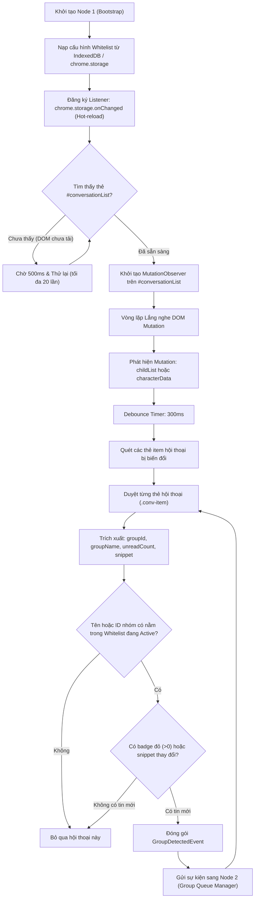

# ĐẶC TẢ CHI TIẾT NODE 01: SIDEBAR OBSERVER & WHITELIST FILTER

**Mã định danh Node**: `N01_SIDEBAR_OBSERVER`  
**Tầng kiến trúc**: Tầng 1 — Giám Sát Sự Kiện Nền (Event Monitoring Layer)  
**Ngữ cảnh thực thi**: Content Script (`content-script.ts`) trên Zalo Web (`https://chat.zalo.me/*`)  
**Tài liệu tham chiếu**:
- [business_flow.md](file:///c:/Users/ADMIN/Documents/workspace/Sales/EXTENSIONS/Docs/Init/Diagrams/business_flow.md)
- [tai_lieu_thiet_ke_so_bo_zalo_automation.md](file:///c:/Users/ADMIN/Documents/workspace/Sales/EXTENSIONS/Docs/Init/tai_lieu_thiet_ke_so_bo_zalo_automation.md)
- [he_thong_tu_dong_hoa_zalo_extension_spec.md](file:///c:/Users/ADMIN/Documents/workspace/Sales/EXTENSIONS/Docs/Init/he_thong_tu_dong_hoa_zalo_extension_spec.md)

---

## 1. MỤC TIÊU & PHẠM VI (NODE OBJECTIVE & SCOPE)

### 1.1. Mục tiêu Cốt lõi
- Giám sát liên tục 24/7 danh sách các cuộc hội thoại trên thanh Sidebar bên trái của Zalo Web (`#conversationList`).
- Tự động phát hiện khi có tin nhắn mới hoặc huy hiệu chưa đọc (Badge đỏ / Preview tin nhắn mới) xuất hiện tại bất kỳ nhóm chat nào.
- Trích xuất thông tin nhận diện nhóm (`groupId`, `groupName`) và đối chiếu tức thời với danh sách nhóm theo dõi (**Whitelist Groups**).
- Đẩy sự kiện phát hiện nhóm (`GroupDetectedEvent`) sang Node 2 (Queue Manager) để xếp hàng điều phối.
- Vận hành song song bất đồng bộ dựa trên cơ chế Microtask của trình duyệt (`MutationObserver`), đảm bảo **không bị nghẽn (Non-blocking)** ngay cả khi Worker đang bận thao tác UI trong khung chat chính.

### 1.2. Ranh giới & Không gian Phủ định (In-Scope vs Negative Scope)
- **Trong phạm vi (In-Scope)**:
  - Lắng nghe biến đổi DOM của thẻ cha danh sách hội thoại Sidebar.
  - Phân tích badge số tin chưa đọc hoặc cập nhật nội dung tin nhắn mới trên thẻ item cuộc hội thoại.
  - Đối chiếu tên nhóm hoặc ID nhóm với cấu hình Whitelist lưu trong `app_settings` (IndexedDB / `chrome.storage.local`).
  - Lắng nghe sự kiện cập nhật cấu hình Whitelist từ Options Page để áp dụng ngay lập tức mà không cần F5 trang (Hot-reload).
- **Ranh giới cấm (Negative Scope - CẤM TUYỆT ĐỐI)**:
  - **CẤM** tự ý click vào item hội thoại hoặc thay đổi URL/State của khung chat từ Node này (việc chuyển chat thuộc độc quyền Node 3).
  - **CẤM** gọi bất kỳ API ngầm, websocket hook không chính thức hoặc can thiệp dữ liệu mạng của Zalo.
  - **CẤM** chặn sự kiện (Stop propagation) làm ảnh hưởng đến trải nghiệm người dùng bình thường trên Zalo Web.

---

## 2. HỢP ĐỒNG KỸ THUẬT & DỮ LIỆU (INPUT/OUTPUT CONTRACTS)

### 2.1. Cấu hình Whitelist Đầu vào (`WhitelistConfig`)
Node 1 nhận cấu hình danh sách theo dõi từ bảng `app_settings` trong IndexedDB (key: `whitelist_groups`):

```typescript
export interface WhitelistGroupItem {
  groupId: string;          // ID duy nhất trích xuất từ DOM attribute (data-id) hoặc chuỗi băm chuẩn hóa
  groupName: string;        // Tên hiển thị của nhóm trên Zalo Web (chuẩn hóa trim space)
  matchRule: 'EXACT' | 'CONTAINS'; // Khớp chính xác hoặc khớp chuỗi con
  isActive: boolean;        // Bật/tắt theo dõi nhóm này
  priority: number;         // Mức độ ưu tiên xếp hàng (mặc định: 1)
}

export interface WhitelistSettingsPayload {
  whitelistGroups: WhitelistGroupItem[];
  scanDebounceMs: number;   // Thời gian debounce gom sự kiện mutation (mặc định: 300ms)
  lastUpdated: number;
}
```

### 2.2. Sự kiện Đầu ra (`GroupDetectedEvent`)
Khi phát hiện nhóm thuộc Whitelist có tin mới, Node 1 phát sự kiện sang Node 2 với cấu trúc:

```typescript
export interface GroupDetectedEvent {
  eventId: string;          // UUID v4: "EVT_<timestamp>_<random>"
  groupId: string;          // ID chuẩn hóa của nhóm nguồn
  groupName: string;        // Tên nhóm hiển thị trên DOM
  unreadCount: number;      // Số lượng tin chưa đọc trích xuất từ badge (0 nếu chỉ có preview tin mới)
  lastSnippet: string;      // Nội dung đoạn text xem trước của tin nhắn cuối trên sidebar
  detectedAt: number;       // Unix timestamp (ms) lúc phát hiện
  source: 'BADGE_MUTATION' | 'SNIPPET_MUTATION' | 'MANUAL_POLL';
}
```

---

## 3. LUỒNG XỬ LÝ CHI TIẾT & STATE MACHINE (EXECUTION ALGORITHM)

### 3.1. Sơ đồ Luồng Hoạt động (Flowchart)



### 3.2. Thuật toán Trích xuất & Lọc Whitelist (Extraction & Filtering Logic)
1. **Khởi tạo MutationObserver**:
   - Selector mục tiêu: `#conversationList`, `.conv-list`, hoặc container cha chứa danh sách hội thoại Zalo.
   - MutationObserverInit: `{ childList: true, subtree: true, characterData: true, attributes: true, attributeFilter: ['class', 'data-id'] }`.
2. **Debounce 300ms**:
   - DOM Zalo thường cập nhật nhiều mutation liên tiếp trong một tick rendering. Node 1 gom nhóm các mutation trong 300ms để tránh trigger sự kiện trùng lặp.
3. **Phân tích thẻ DOM hội thoại**:
   - Định vị phần tử `.conv-item` hoặc `div[data-id]`.
   - Trích xuất `groupId = element.getAttribute('data-id') || element.id`.
   - Trích xuất `groupName = element.querySelector('.conv-item-title, .truncate')?.textContent?.trim()`.
   - Trích xuất `unreadBadge = element.querySelector('.badge-count, .conv-unread-count')`. Nếu có số ➔ `unreadCount = parseInt(badge.textContent) || 1`.
   - Trích xuất `lastSnippet = element.querySelector('.conv-message, .snippet')?.textContent?.trim()`.
4. **Đối chiếu Whitelist**:
   - So sánh `groupName` với danh sách `whitelistGroups` có `isActive === true`.
   - Nếu `matchRule === 'EXACT'`: So khớp chuẩn hóa không phân biệt hoa thường và loại bỏ khoảng trắng thừa (`groupName.toLowerCase() === item.groupName.toLowerCase()`).
   - Nếu `matchRule === 'CONTAINS'`: So khớp chuỗi con (`groupName.toLowerCase().includes(item.groupName.toLowerCase())`).
5. **Gửi sự kiện sang Node 2**:
   - Gọi hàm callback trực tiếp trong module runtime: `queueManager.enqueueGroup(event)`.

---

## 4. XỬ LÝ LỖI, RETRY & EDGE CASES (RESILIENCE MATRIX)

| Mã Ngoại Lệ | Tình Huống Biên (Edge Case) | Phân Tích Kỹ Thuật | Cơ Chế Xử Lý & Phòng Vệ |
| :--- | :--- | :--- | :--- |
| **N01-E01** | **DOM `#conversationList` chưa sẵn sàng khi khởi động** | Trang Zalo Web tải SPA chậm hoặc mạng lag khiến container hội thoại chưa mount vào DOM. | Thử lại với chu kỳ đệm 500ms, lặp lại tối đa 20 lần (10s). Nếu vẫn không thấy, ghi log `ERROR` và tiếp tục poll mỗi 2s cho đến khi DOM sẵn sàng. |
| **N01-E02** | **Danh sách hội thoại bị ảo hóa (Virtualized List)** | Khi danh sách quá dài, Zalo unmount các node khuất khỏi màn hình, nhóm nguồn bị trôi khỏi tầm nhìn. | Duy trì bộ nhớ đệm `lastKnownState` của các nhóm trong Whitelist. Kết hợp sự kiện mutation với cơ chế rà soát nhẹ (Periodic Check mỗi 30s) cuộn nhẹ vùng sidebar nếu phát hiện nhóm Whitelist lâu chưa có tín hiệu. |
| **N01-E03** | **Tên nhóm chứa Emoji, icon đặc thù hoặc khoảng trắng Zero-width** | So khớp chuỗi thông thường bị lệch do ký tự ẩn Unicode. | Hàm chuẩn hóa loại bỏ toàn bộ khoảng trắng thừa, normalize Unicode NFC/NFKD (`str.normalize('NFC').trim()`). |
| **N01-E04** | **Người dùng thay đổi danh sách Whitelist trong Options** | Node 1 vẫn dùng danh sách Whitelist cũ trong RAM. | Đăng ký lắng nghe sự kiện `chrome.storage.onChanged`. Khi key `whitelist_groups` thay đổi, cập nhật ngay lập tức mảng nhớ trong bộ nhớ tạm của Node 1. |
| **N01-E05** | **Worker đang bận xử lý gửi tin trong khung chat** | Nguy cơ single-thread của JavaScript làm tắc nghẽn luồng lắng nghe tin mới. | `MutationObserver` hoạt động dựa trên cơ chế Microtask của trình duyệt. Dù Worker đang bận xử lý trong nhóm chat, các microtask vẫn tích lũy và thực thi ngay khi macro-task hoàn thành, đảm bảo không bỏ sót bất kỳ badge nào. |

---

## 5. PHỤ THUỘC KỸ THUẬT (TECHNICAL DEPENDENCIES)

1. **Chrome Extension APIs**:
   - `chrome.storage.local`: Đọc và đồng bộ danh sách Whitelist (`whitelist_groups`).
   - `chrome.storage.onChanged`: Lắng nghe thay đổi cấu hình thời gian thực.
2. **Web & Browser APIs**:
   - `MutationObserver`: Giám sát sự thay đổi cây DOM của danh sách hội thoại.
   - `window.performance.now()`: Định thời debounce chính xác.
3. **DOM Selectors (Zalo Web Baseline)**:
   - Container danh sách: `#conversationList`, `div[data-id="conversation-list"]`, `.conv-list`.
   - Item cuộc hội thoại: `.conv-item`, `div[id^="conv-item-"]`, `div[data-id]`.
   - Tên cuộc trò chuyện: `.conv-item-title`, `.truncate`, `span[title]`.
   - Huy hiệu chưa đọc: `.badge-count`, `.conv-unread-count`, `.z-badge`.
   - Đoạn trích tin nhắn cuối: `.conv-message`, `.snippet`.
4. **Cơ sở dữ liệu cục bộ**:
   - Đọc bảng `app_settings` (Dexie.js) khi khởi động nếu `chrome.storage` không khả dụng.

---

## 6. TIÊU CHÍ KIỂM THỬ & NGHIỆM THU (ACCEPTANCE CRITERIA / DoD)

### 6.1. Kịch bản Nghiệm thu Nhị phân (Binary Acceptance Gates)
- **GATE-01 (Bắt Tin Song Song - Non-blocking Observer)**:
  - **Given**: Worker đang trong trạng thái bận (`isWorkerBusy = true`), đang thực hiện mở modal và gửi tin nhắn trong Nhóm A.
  - **When**: Nhóm B (thuộc Whitelist) có tin nhắn mới đổ về, làm xuất hiện badge chưa đọc trên Sidebar.
  - **Then**: Node 1 phải phát hiện và gửi `GroupDetectedEvent` sang Node 2 trong vòng `< 500ms`, và Nhóm B phải được ghi nhận vào `group_dispatch_queue` mà không phụ thuộc vào trạng thái kết thúc của Nhóm A.
- **AC-02 (Hot-reload Whitelist Configuration)**:
  - **Given**: Node 1 đang chạy với Whitelist chứa [Nhóm X].
  - **When**: Người dùng thêm [Nhóm Y] vào Whitelist thông qua giao diện Options.
  - **Then**: Không cần F5 trang Zalo, ngay khi Nhóm Y có tin mới, Node 1 lập tức nhận diện và kích hoạt sự kiện cho Nhóm Y.
- **AC-03 (Chống Nhiễu Nhóm Ngoài Whitelist)**:
  - **Given**: Nhóm Z không thuộc Whitelist liên tục có tin nhắn mới (hàng trăm tin spam).
  - **Then**: Node 1 bỏ qua hoàn toàn, không phát ra bất kỳ `GroupDetectedEvent` nào, không ghi bản ghi rác vào IndexedDB.

