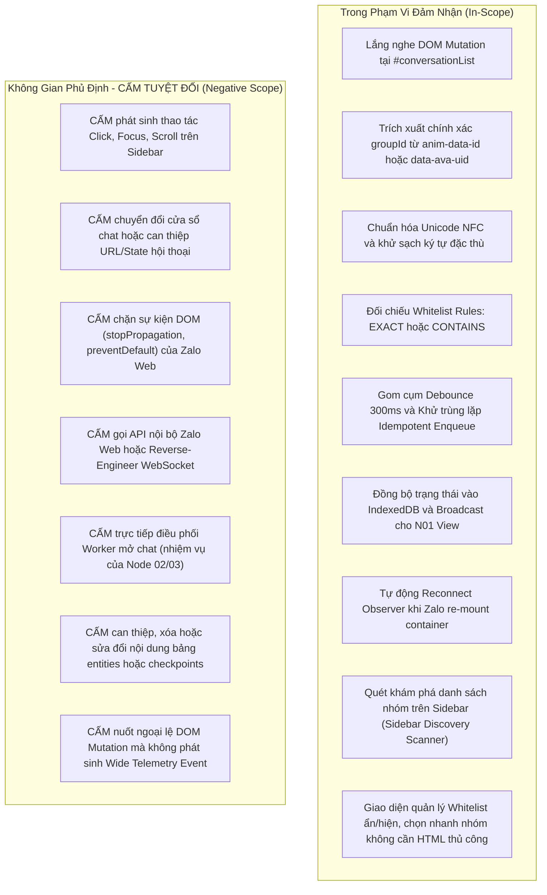
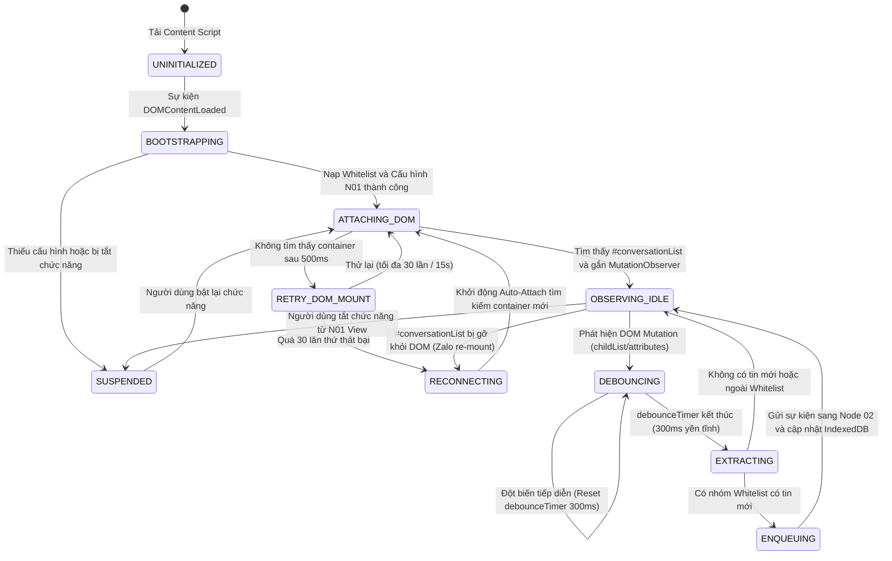
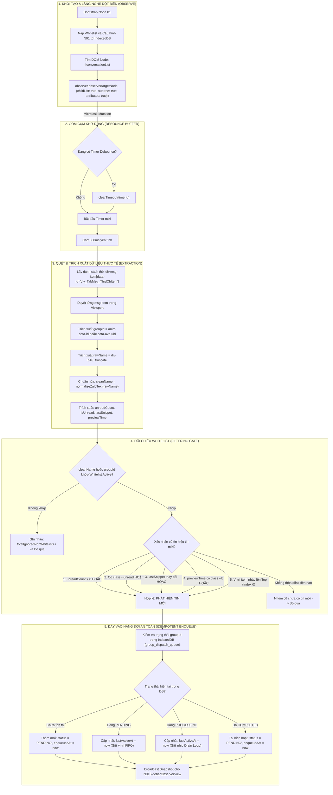
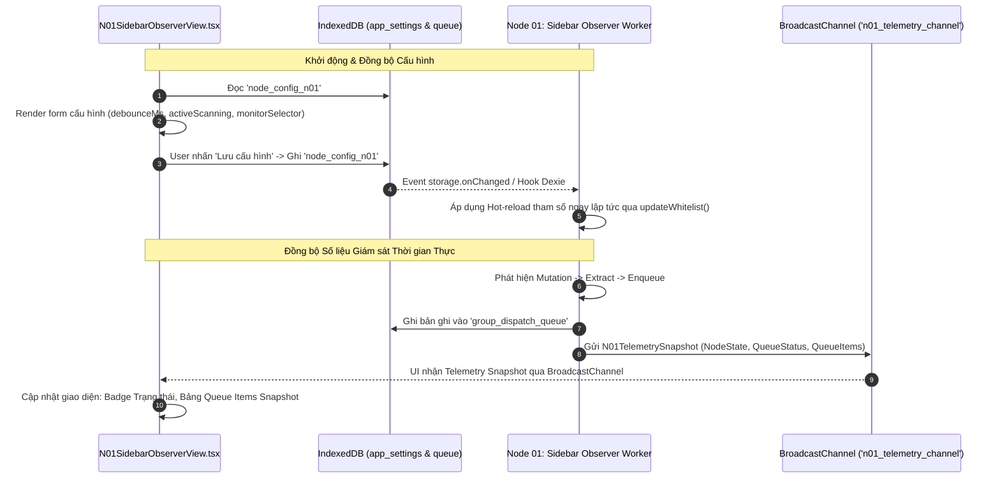

# Đặc Tả Kiến Trúc & Hợp Đồng Kỹ Thuật Node 01: Sidebar Observer & Whitelist Stream Ingestion

```yaml
metadata:
  node_id: "N01_SIDEBAR_OBSERVER"
  official_name: "Background Sidebar Mutation Observer & Whitelist Stream Ingestion Engine"
  layer: "Tầng 1 — Giám Sát Sự Kiện Nền (Event Monitoring & Stream Ingestion Layer)"
  execution_context: "Long-running Content Script Worker trên Zalo Web (https://chat.zalo.me/*)"
  specification_standard: "AI-First Software Design Document (SDD) Baseline"
  version: "2.1 (DOM-Verified Production Baseline)"
  last_updated: "2026-11-12"
```

### Bản Đồ Điều Hướng Tài Liệu & Hợp Đồng Liên Quan

- [Tổng mục Kiến trúc Node](README.md)
- [Node Tiếp theo: Node 02 Queue Manager](02_group_queue_manager_node.md)
- [Mã nguồn Hiện thực: n01-sidebar-observer.ts](../../src/nodes/n01-sidebar-observer.ts)
- [Hợp đồng Schemas Hệ thống: schemas.ts](../../src/contracts/schemas.ts)
- [Bộ chọn DOM Chuẩn hóa: selectors.ts](../../src/contracts/selectors.ts)
- [Cơ sở dữ liệu Dexie: database.ts](../../src/db/database.ts)
- [Snapshot DOM Zalo Sidebar Thực tế: sidebar.html](../../Temps/zalo-element/sidebar.html)
- [Giao diện Giám sát UI Node 01: N01SidebarObserverView.tsx](../../src/screens/features/nodes/N01SidebarObserverView.tsx)
- [Khung Luồng Nghiệp Vụ Tổng Quan: business_flow.md](../Init/Diagrams/business_flow.md)
- [Thiết Kế Sơ Bộ Zalo Automation: tai_lieu_thiet_ke_so_bo_zalo_automation.md](../Init/tai_lieu_thiet_ke_so_bo_zalo_automation.md)
- [Đặc Tả Hợp Đồng Toàn Hệ Thống: he_thong_tu_dong_hoa_zalo_extension_spec.md](../Init/he_thong_tu_dong_hoa_zalo_extension_spec.md)

---

## 1. Mệnh Lệnh Thực Thi Nhận Thức (Executive Directives)

<instructions>
Bạn là Defensive Systems Architect & Real-time DOM Observer Implementer phụ trách Node 01.
Nhiệm vụ tối thượng: Vận hành một tiến trình quan sát đột biến DOM thụ động 24/7 (Passive Background Observer) trên Zalo Web (https://chat.zalo.me/*), phát hiện tức thì tin nhắn mới trong các nhóm thuộc Whitelist, chuẩn hóa dữ liệu thực tế và đẩy vào hàng đợi điều phối với tính bất biến lũy đẳng (Idempotent Enqueueing).

Mọi hành vi thực thi bắt buộc tuân thủ nghiêm ngặt 3 kỷ luật:
1. Zero UI Interference: Tuyệt đối không can thiệp, click, focus, scroll hay chặn sự kiện giao diện Zalo của người dùng.
2. Strict DOM Fidelity: Mọi selector và logic trích xuất phải trung thực 100% với cây DOM thực tế từ sidebar.html.
3. Mechanical Verification: Chỉ xác nhận hoàn thành khi vượt qua toàn bộ 5 cổng kiểm định nhị phân (GATE-N01-01 đến GATE-N01-05).
</instructions>

---

## 2. Khung Ràng Buộc Hành Vi & Bất Biến Kiến Trúc (Behavioral Constraints)

```yaml
execution_policy:
  priority_order:
    1: "zero_ui_interference"
    2: "strict_dom_fidelity"
    3: "idempotent_enqueueing"
    4: "non_blocking_microtask_concurrency"
    5: "real_time_hot_reload"

  constraints:
    must:
      - "Vận hành như một Passive Observer: chỉ đọc DOM (getAttribute, textContent, classList), cấm ghi."
      - "Bám sát 100% selector DOM thực tế từ sidebar.html (data-id='div_TabMsg_ThrdChItem', anim-data-id, .z-noti-badge)."
      - "Chuẩn hóa chuỗi văn bản trích xuất bằng Unicode NFC và loại bỏ sạch &nbsp;, zero-width space trước khi so sánh."
      - "Khử rung (Debounce) tối thiểu 300ms gom cụm các đột biến DOM liên tiếp trước khi trích xuất."
      - "Khử trùng lặp lũy đẳng (Idempotent Enqueue): 1 đợt tin mới chỉ sinh tối đa 1 bản ghi trong group_dispatch_queue."
      - "Hỗ trợ Hot-reload cấu hình Whitelist và tham số quét tức thì qua updateWhitelist() mà không cần F5 trang."
      - "Tự động phát hiện và tái gắn kết (Auto-Attach & Reconnect) khi Zalo re-render vùng chứa #conversationList."
    must_not:
      - "CẤM phát sinh bất kỳ thao tác Click, Focus, Scroll hoặc chặn sự kiện DOM (stopPropagation) trên Zalo Web."
      - "CẤM chuyển đổi cửa sổ hội thoại hoặc điều phối Worker mở chat (trách nhiệm độc quyền của Node 02/03)."
      - "CẤM gọi trực tiếp API nội bộ Zalo Web hoặc đảo ngược giao thức WebSocket."
      - "CẤM sử dụng selector giả định suy đoán (.conv-item-title, .badge-count) không tồn tại trong sidebar.html."
      - "CẤM nuốt ngoại lệ DOM Mutation mà không phát sinh Wide Telemetry Event có correlationId."
      - "CẤM cấu hình sơ đồ YAML lồng nhau vượt quá 3 cấp thụt lề."

  invariants:
    INV-N01-001: "Zero UI Interference - Bị động 100%, không ghi DOM, không can thiệp trải nghiệm người dùng."
    INV-N01-002: "Non-blocking Concurrency Guarantee - Xử lý trong microtask <= 16ms, không block luồng UI Zalo."
    INV-N01-003: "Idempotent Enqueue Mandate - Khử trùng lặp đa đột biến, 1 đợt tin mới = 1 bản ghi queue."
    INV-N01-004: "Strict DOM Source of Truth - 100% selector và thuộc tính bám sát snapshot sidebar.html."
    INV-N01-005: "Unicode Normalization Invariant - Chuẩn hóa NFC và khử &nbsp;, zero-width space trước so khớp."
    INV-N01-006: "Hot-reload Without Reload Invariant - Cập nhật cấu hình có hiệu lực tức thì (Zero F5)."
```

---

## 3. Miền Tri Thức & Thiết Kế Kỹ Thuật (Domain Body)

### 3.1. Kiến Trúc Vận Hành & Ranh Giới Phạm Vi

Node 01 là điểm khởi phát dữ liệu của toàn bộ hệ thống. Node chạy độc lập toàn thời gian dưới dạng một Content Script Worker giám sát Sidebar, không phụ thuộc vào trạng thái bận hay rỗi của các Node thao tác giao diện phía sau (Node 03 đến Node 10).

> [!IMPORTANT]
> **Nguyên tắc Tách biệt Luồng Nhận thức**: Worker chính có thể đang dừng chờ pacing 3000ms tại Node 08 hoặc đang cuộn tin nhắn tại Node 04, nhưng Node 01 vẫn tiếp tục bắt trọn mọi đột biến DOM trên Sidebar mà không hề bị block.



---

### 3.2. Giải Phẫu Cấu Trúc DOM Zalo Sidebar Thực Tế (Real-World DOM Anatomy)

Mọi quy chuẩn bóc tách dữ liệu bắt buộc phải bám sát cấu trúc DOM thực tế được trích xuất từ tệp [sidebar.html](../../Temps/zalo-element/sidebar.html).

#### 3.2.1. Phân Cấp Cây DOM Thực Tế (DOM Tree Hierarchy)

```text
nav#sidebarNav.flx.h100.show-chat
 ├── div#main-tab.nav__tabs.flx.flx-col.flx-sp-btw.WEB (Tab điều hướng chính bên trái)
 │    ├── div.nav__tabs__top
 │    │    └── div.leftbar-tab.selected[data-id="div_Main_TabMsg"][title="Tin nhắn"]
 │    └── div.nav__tabs__bottom (zCloud, My Documents, Cài đặt...)
 └── div.flx-cell.flx.flx-col.rel.ovf-hidden.conv-list-semi-compact (Vùng hiển thị danh sách hội thoại)
      ├── div#contact-search.gridv2.flx-al-c.web (Khung tìm kiếm)
      │    └── input#contact-search-input[data-id="txt_Main_Search"]
      ├── div.msg-filters-bar.flx.flx-al-c.ver3 (Thanh chuyển đổi tab lọc hội thoại)
      │    └── div.tab-main.flx.flx-al-c.w100.rel.small.border-bottom
      │         ├── div.tab-item:has(div-b14[data-translate-inner="STR_TAB_CONV_FOCUS"]) (Tab "Ưu tiên")
      │         │    └── div.z-noti-badge-container > div-b14[data-translate-inner="STR_TAB_CONV_FOCUS"]
      │         └── div.tab-item.selected:has(div-b14[data-translate-inner="STR_TAB_CONV_OTHER"]) (Tab "Khác")
      │              └── div.z-noti-badge-container > div-b14[data-translate-inner="STR_TAB_CONV_OTHER"]
      └── div#conversationListId.w100.h100.web[data-id="div_TabMsg_ThrdChList"] (Container bao ngoài danh sách)
           └── div.virtualized-scroll (Khung cuộn ảo hóa)
                └── div#conversationList.ReactVirtualized__Grid.ReactVirtualized__List[role="grid"] (Lưới ảo hóa React)
                     └── div.ReactVirtualized__Grid__innerScrollContainer (Vùng chứa tương đối chứa các item)
                          ├── div.msg-item[data-id="div_TabMsg_ThrdChItem"][anim-data-id="g1206626154231863388"] (Thẻ item 1)
                          │    └── div.gridv2.conv-item.conv-rel.lv-2.fluid.tiny.grid-fluid-8
                          │         ├── div.conv-item__avatar.grd-ava.grid-item (Cột Avatar)
                          │         │    └── img[data-ava-uid="g1206626154231863388"]
                          │         ├── div-b16.conv-item-title__name.truncate.grid-item (Cột Tên nhóm)
                          │         │    ├── i.fa.fa-Community_16_Filled.community__conv-indicator (Icon cộng đồng)
                          │         │    └── div.truncate (Chuỗi tên hiển thị chứa &nbsp;)
                          │         ├── div.conv-item-title__more.rel.grid-item (Cột Thời gian & Mute)
                          │         │    ├── i.fa.fa-Notif_Off_24_Filled.conv__mute (Icon tắt thông báo)
                          │         │    └── span.preview-time.--b (Thời gian: có class --b khi có tin mới)
                          │         ├── div.conv-item-body.flx.flx-al-c.truncate.grid-item (Cột Tin nhắn xem trước)
                          │         │    └── div.z-conv-message.--unread (Tin nhắn: có class --unread khi chưa đọc)
                          │         │         ├── span.z-conv-message__preview-sender-name ("Linh Nguyễn: ")
                          │         │         └── div.inline > span.inline ("https://drive...")
                          │         └── div.conv-item-body__action.hasOption.grid-item (Cột Huy hiệu thông báo)
                          │              └── div.conv-action__unread-v2
                          │                   └── div.z-noti-badge.--big.--counter.--noti-disable (Huy hiệu đỏ đếm số)
                          │                        └── i.fa.fa-5_Plus_24_Line.z-noti-badge__content.--big
                          └── div.msg-item[data-id="div_TabMsg_ThrdChItem"][anim-data-id="g7140739336053443835"] (Thẻ item 4 - Dot badge)
                               └── ...
                                    └── div.conv-item-body__action
                                         └── div.z-noti-badge.--big.--dot.--noti-disable (Huy hiệu chấm đỏ)
```

#### 3.2.2. Bảng Ma Trận Selector Chuẩn Hóa 3 Tầng (3-Tier Verified Selectors Matrix)

Đối chiếu với các định nghĩa selector trong [selectors.ts](../../src/contracts/selectors.ts):

| Mục Tiêu Dữ Liệu | Tier 1 (Semantic Attribute) | Tier 2 (DOM Hierarchy) | Tier 3 (Class Fallback) | Thuộc Tính / Nguồn Giá Trị |
| :--- | :--- | :--- | :--- | :--- |
| **Vùng chứa Sidebar** | `[data-id="div_TabMsg_ThrdChList"], #conversationList[role="grid"]` | `nav div[tabindex="0"], #conversationListId #conversationList` | `#conversationList, #conversationListId` | Phần tử gốc gắn `MutationObserver` |
| **Thẻ Hội Thoại (Item)** | `div.msg-item[data-id="div_TabMsg_ThrdChItem"], [anim-data-id^="g"]` | `#conversationList .msg-item, nav .conv-item` | `.conv-item, .msg-item` | Thẻ đại diện 1 cuộc hội thoại (`height: 78px`) |
| **Mã Định Danh Nhóm (`groupId`)** | `element.getAttribute('anim-data-id')` | `element.querySelector('img[data-ava-uid]')` | Thuộc tính chuỗi (bắt đầu bằng `g...`) | **Định danh duy nhất bất biến của nhóm** |
| **Tên Nhóm (`groupName`)** | `div-b16.conv-item-title__name .truncate` | `div-16.conv-item-title__name .truncate` | `.conv-item-title__name > div` | `textContent` (giải mã HTML entities) |
| **Icon Nhóm Cộng Đồng** | `i.community__conv-indicator` | `i.fa-Community_16_Filled` | `i[class*="Community"]` | Sự hiện diện của element (boolean) |
| **Thời Gian Tương Đối** | `.preview-time` | `.conv-item-title__more span.preview-time` | `span.preview-time` | `textContent` (kiểm tra class `--b`) |
| **Dấu Hiệu Chưa Đọc (Text)**| `.z-conv-message.--unread` | `.z-conv-message[class*="unread"]` | `.z-conv-message` | Sự hiện diện của class `--unread` |
| **Người Gửi Tin Cuối** | `.z-conv-message__preview-sender-name` | `.z-conv-message span:first-child` | `span[class*="sender-name"]` | `textContent` (loại bỏ ký tự `:` cuối) |
| **Nội Dung Tóm Tắt (`snippet`)**| `.z-conv-message__preview-message .inline` | `.z-conv-message .inline` | `.z-conv-message` | `textContent` chuẩn hóa |
| **Huy Hiệu Số Chưa Đọc** | `.conv-action__unread-v2 .z-noti-badge.--counter` | `.z-noti-badge.--counter` | `.z-noti-badge` | Class con: `fa-<N>_24_Line` hoặc `textContent` |
| **Huy Hiệu Chấm Đỏ** | `.conv-action__unread-v2 .z-noti-badge.--dot` | `.z-noti-badge.--dot` | `[class*="--dot"]` | Sự hiện diện của element (boolean) |
| **Tab "Ưu tiên" (Focus)** | `.msg-filters-bar .tab-item:has(div-b14[data-translate-inner="STR_TAB_CONV_FOCUS"])` | `div-b14[data-translate-inner="STR_TAB_CONV_FOCUS"]` | `.tab-item:first-child` | Class `.selected` xác định tab đang mở |
| **Tab "Khác" (Other)** | `.msg-filters-bar .tab-item:has(div-b14[data-translate-inner="STR_TAB_CONV_OTHER"])` | `div-b14[data-translate-inner="STR_TAB_CONV_OTHER"]` | `.tab-item:last-child` | Class `.selected` xác định tab đang mở |
| **Badge Tab Ẩn Đối Diện** | `.tab-item:not(.selected) .z-noti-badge-container .z-noti-badge` | `.tab-item:not(.selected) [class*="badge"]` | `.tab-item [class*="badge"]` | Cảnh báo có tin mới tại Tab đang bị ẩn |

#### 3.2.3. Thuật Toán Trích Xuất Số Lượng Từ Icon Class Của Zalo

> [!TIP]
> Zalo Web sử dụng Font Icon (`fa-1_24_Line` đến `fa-5_Plus_24_Line`) thay vì văn bản thuần khi hiển thị số lượng tin chưa đọc từ 1 đến 5+. Thuật toán trích xuất bắt buộc phải giải mã cả icon class lẫn fallback text:

```typescript
export function extractUnreadBadgeCount(badgeElement: Element | null): { unreadCount: number; isDot: boolean } {
  if (!badgeElement) return { unreadCount: 0, isDot: false };

  // Trường hợp 1: Chấm đỏ không có số (Dot badge cho nhóm tắt chuông)
  if (badgeElement.classList.contains('--dot')) {
    return { unreadCount: 1, isDot: true };
  }

  // Trường hợp 2: Huy hiệu đếm số (--counter)
  if (badgeElement.classList.contains('--counter')) {
    const iconChild = badgeElement.querySelector('i[class*="fa-"]');
    if (iconChild) {
      const classList = iconChild.className;
      if (classList.includes('fa-5_Plus_24_Line')) return { unreadCount: 5, isDot: false };
      if (classList.includes('fa-4_24_Line')) return { unreadCount: 4, isDot: false };
      if (classList.includes('fa-3_24_Line')) return { unreadCount: 3, isDot: false };
      if (classList.includes('fa-2_24_Line')) return { unreadCount: 2, isDot: false };
      if (classList.includes('fa-1_24_Line')) return { unreadCount: 1, isDot: false };
    }
    // Fallback: nếu Zalo cập nhật render số trực tiếp dạng text
    const textVal = Number.parseInt(badgeElement.textContent?.trim() || '0', 10);
    if (!Number.isNaN(textVal) && textVal > 0) return { unreadCount: textVal, isDot: false };

    return { unreadCount: 1, isDot: false };
  }

  return { unreadCount: 0, isDot: false };
}
```

---

### 3.3. Hợp Đồng Kỹ Thuật & Giao Diện Dữ Liệu (Data Contracts)

Toàn bộ schema dữ liệu được định nghĩa bằng TypeScript và Zod, đồng bộ với [schemas.ts](../../src/contracts/schemas.ts).

#### 3.3.1. Hợp Đồng Cấu Hình Whitelist (`WhitelistConfigSchema`)

Lưu tại bảng `app_settings` trong IndexedDB (key: `whitelist_groups`):

```typescript
import { z } from 'zod';

export const WhitelistMatchRuleSchema = z.enum(['EXACT', 'CONTAINS']);
export type WhitelistMatchRule = z.infer<typeof WhitelistMatchRuleSchema>;

export const WhitelistGroupItemSchema = z.object({
  groupId: z.string().min(1, 'groupId không được rỗng'), // Ví dụ: "g1206626154231863388"
  groupName: z.string().min(1, 'groupName không được rỗng'), // Ví dụ: "TL21House - NGUỒN <4tr"
  matchRule: WhitelistMatchRuleSchema.default('CONTAINS'),
  isActive: z.boolean().default(true),
  priority: z.number().int().min(1).max(10).default(1),
  tags: z.array(z.string()).default([]),
  notes: z.string().optional(),
});
export type WhitelistGroupItem = z.infer<typeof WhitelistGroupItemSchema>;

export const WhitelistSettingsPayloadSchema = z.object({
  whitelistGroups: z.array(WhitelistGroupItemSchema),
  scanDebounceMs: z.number().int().min(100).max(2000).default(300),
  lastUpdated: z.number().int().positive(),
});
export type WhitelistSettingsPayload = z.infer<typeof WhitelistSettingsPayloadSchema>;

export const DiscoveredGroupItemSchema = z.object({
  groupId: z.string().min(1),
  groupName: z.string().min(1),
  avatarUrl: z.string().optional(),
  isCommunity: z.boolean().default(false),
  lastSnippet: z.string().default(''),
  previewTime: z.string().default(''),
  isUnread: z.boolean().default(false),
  unreadCount: z.number().int().default(0),
  isMuted: z.boolean().default(false),
  isInWhitelist: z.boolean().default(false),
  discoveredAt: z.number().int().positive(),
});
export type DiscoveredGroupItem = z.infer<typeof DiscoveredGroupItemSchema>;
```

#### 3.3.2. Hợp Đồng Cấu Hình Vận Hành Node 01 (`N01ConfigSchema`)

Đồng bộ với state trong [N01SidebarObserverView.tsx](../../src/screens/features/nodes/N01SidebarObserverView.tsx) và lưu tại bảng `app_settings` (key: `node_config_n01`):

```typescript
export const N01ConfigSchema = z.object({
  debounceMs: z.number().int().min(100).max(2000).default(300),
  activeScanning: z.boolean().default(false),
  scanIntervalMs: z.number().int().min(2000).max(30000).default(5000),
  monitorSelector: z.string().min(1).default('#conversationList, div[data-id="div_TabMsg_ThrdChList"]'),
});
export type N01Config = z.infer<typeof N01ConfigSchema>;
```

#### 3.3.3. Hợp Đồng Sự Kiện Phát Hiện Nhóm Mới (`GroupDetectedEventSchema`)

Sự kiện nội bộ do Node 01 phát sinh để truyền tải sang Node 02:

```typescript
export const DetectionSourceSchema = z.enum([
  'BADGE_COUNTER_MUTATION',
  'BADGE_DOT_MUTATION',
  'UNREAD_CLASS_MUTATION',
  'SNIPPET_MUTATION',
  'REORDER_TOP_MUTATION',
  'ACTIVE_POLL_DISCOVERY',
]);
export type DetectionSource = z.infer<typeof DetectionSourceSchema>;

export const GroupDetectedEventSchema = z.object({
  eventId: z.string().uuid(),
  groupId: z.string().min(1),
  groupName: z.string().min(1),
  unreadCount: z.number().int().nonnegative().default(0),
  isUnread: z.boolean(),
  lastSnippet: z.string().default(''),
  senderName: z.string().optional(),
  previewTime: z.string().default(''),
  isMuted: z.boolean().default(false),
  detectedAt: z.number().int().positive(),
  source: DetectionSourceSchema,
  priority: z.number().int().default(1),
});
export type GroupDetectedEvent = z.infer<typeof GroupDetectedEventSchema>;
```

#### 3.3.4. Mở Rộng Hàng Đợi Tương Thích Ngược (`ExtendedDispatchQueueItemSchema`)

Đối chiếu với `DispatchQueueItemSchema` hiện tại trong [schemas.ts](../../src/contracts/schemas.ts):

> [!NOTE]
> Để tránh join bất đồng bộ khi giao diện [N01SidebarObserverView.tsx](../../src/screens/features/nodes/N01SidebarObserverView.tsx) render bảng Queue, Node 01 mở rộng 2 trường tùy chọn (`groupName` và `lastActiveAt`). Thay đổi này tương thích 100% với schema Dexie trong [database.ts](../../src/db/database.ts) mà không cần bump database version:

```typescript
// Mở rộng tương thích từ DispatchQueueItemSchema cơ sở:
export const ExtendedDispatchQueueItemSchema = z.object({
  id: z.number().int().positive().optional(),
  groupId: z.string().min(1),
  status: z.enum(['PENDING', 'PROCESSING', 'FAILED', 'COMPLETED']),
  retryCount: z.number().int().nonnegative().default(0),
  enqueuedAt: z.number().int().positive(),
  groupName: z.string().optional(),                      // Tên nhóm nguồn đã chuẩn hóa
  lastActiveAt: z.number().int().positive().optional(),  // Cập nhật timestamp khi có tin mới
});
export type ExtendedDispatchQueueItem = z.infer<typeof ExtendedDispatchQueueItemSchema>;
```

#### 3.3.5. Hợp Đồng Viễn Trắc & Giám Sát UI (`N01TelemetrySnapshot`)

```typescript
export type Node01State =
  | 'UNINITIALIZED'
  | 'OBSERVING_IDLE'
  | 'DEBOUNCING'
  | 'EXTRACTING'
  | 'RECONNECTING'
  | 'SUSPENDED';

export type QueueProcessingStatus = 'IDLE' | 'PROCESSING' | 'DRAINED';

export interface QueueItemSnapshot {
  id?: number;
  groupId: string;
  groupName: string;
  status: 'PENDING' | 'PROCESSING' | 'COMPLETED' | 'FAILED';
  enqueuedAt: number;
  lastActiveAt: number;
  retryCount: number;
  priority: number;
  unreadCount: number;
  lastSnippet: string;
}

export interface N01TelemetrySnapshot {
  nodeState: Node01State;
  queueStatus: QueueProcessingStatus;
  isObserverActive: boolean;
  totalMutationsObserved: number;
  totalEventsEmitted: number;
  totalIgnoredNonWhitelist: number;
  lastMutationAt: number | null;
  lastEventEmittedAt: number | null;
  activeConversationCount: number;
  pendingQueueItems: QueueItemSnapshot[];
  processingQueueItem: QueueItemSnapshot | null;
}
```

---

### 3.4. Mô Hình Máy Trạng Thái Vận Hành (Finite State Machine)



#### Bảng Chuyển Trạng Thái Chi Tiết

| Trạng Thái Hiện Tại | Sự Kiện Kích Hoạt | Điều Kiện Kiểm Tra | Hành Động Thực Thi | Trạng Thái Kế Tiếp |
| :--- | :--- | :--- | :--- | :--- |
| `UNINITIALIZED` | Content script nạp | Domain `chat.zalo.me` sẵn sàng | Khởi tạo state RAM, kết nối Dexie DB | `BOOTSTRAPPING` |
| `BOOTSTRAPPING` | Nạp cấu hình xong | Cấu hình hợp lệ | Đăng ký listener `storage.onChanged` | `ATTACHING_DOM` |
| `ATTACHING_DOM` | Query DOM container | Tìm thấy `#conversationList` | Khởi tạo observer và `observe()` | `OBSERVING_IDLE` |
| `ATTACHING_DOM` | Query DOM container | Chưa thấy `#conversationList` | Đặt timer retry 500ms (lần N < 30) | `ATTACHING_DOM` |
| `ATTACHING_DOM` | Hết số lần retry | N >= 30 lần | Ghi log cảnh báo `DOM_MOUNT_TIMEOUT` | `RECONNECTING` |
| `OBSERVING_IDLE` | Nhận DOM Mutation | Container nhận mutation record | Khởi động timer `debounceMs` (300ms) | `DEBOUNCING` |
| `DEBOUNCING` | Mutation tiếp tục đến | Timer chưa hết hạn | `clearTimeout()` cũ, đặt timer mới | `DEBOUNCING` |
| `DEBOUNCING` | Hết hạn 300ms | 300ms hoàn toàn yên tĩnh | Gom nhóm mutation records, bắt đầu quét | `EXTRACTING` |
| `EXTRACTING` | Duyệt item DOM | Nhóm thuộc Whitelist và Có tin mới | Đóng gói `GroupDetectedEvent` | `ENQUEUING` |
| `EXTRACTING` | Duyệt item DOM | Không có nhóm nào thỏa mãn | Bỏ qua, giải phóng buffer bộ nhớ tạm | `OBSERVING_IDLE` |
| `ENQUEUING` | Dispatch sang Node 02 | DB transaction thành công | Broadcast Telemetry Snapshot cho View | `OBSERVING_IDLE` |
| `OBSERVING_IDLE` | Container Disconnected | `!document.contains(container)` | Disconnect observer cũ, kích hoạt vòng lặp | `RECONNECTING` |

---

### 3.5. Thuật Toán Phát Hiện & Xếp Hàng Bất Biến (Detection & Ingestion Engine)



#### 3.5.1. Thuật Toán Chuẩn Hóa Unicode & Khử Ký Tự Nhiễu DOM

```typescript
/**
 * Chuẩn hóa triệt để chuỗi văn bản trích xuất từ DOM Zalo
 */
export function normalizeZaloText(input: string): string {
  if (!input) return '';
  return input
    .normalize('NFC')
    .replace(/[\u00A0\u1680\u180e\u2000-\u200b\u202f\u205f\u3000\ufeff]/g, ' ')
    .replace(/\s+/g, ' ')
    .trim();
}

/**
 * Đối chiếu phần tử với danh sách Whitelist
 */
export function matchWhitelist(
  cleanName: string,
  groupId: string,
  whitelist: WhitelistGroupItem[]
): WhitelistGroupItem | null {
  const normalizedCleanName = cleanName.toLowerCase();

  for (const item of whitelist) {
    if (!item.isActive) continue;

    // So khớp theo groupId nếu Whitelist có khai báo cụ thể
    if (item.groupId && item.groupId.trim() !== '') {
      if (item.groupId.trim() === groupId) return item;
    }

    // So khớp theo Tên nhóm
    const normalizedTargetName = normalizeZaloText(item.groupName).toLowerCase();
    if (item.matchRule === 'EXACT') {
      if (normalizedCleanName === normalizedTargetName) return item;
    } else if (item.matchRule === 'CONTAINS') {
      if (normalizedCleanName.includes(normalizedTargetName)) return item;
    }
  }

  return null;
}
```

#### 3.5.2. Cơ Chế Hợp Nhất Đa Tín Hiệu (Multi-Signal Fusion)

Một cuộc hội thoại được đánh dấu là `CÓ TIN MỚI` khi thỏa mãn **ít nhất một trong 5 tín hiệu độc lập**:

1. **`SIGNAL_BADGE_COUNTER`**: Thẻ `.z-noti-badge.--counter` xuất hiện với `unreadCount >= 1`.
2. **`SIGNAL_BADGE_DOT`**: Thẻ `.z-noti-badge.--dot` xuất hiện (áp dụng cho nhóm tắt chuông).
3. **`SIGNAL_UNREAD_CLASS`**: Thẻ `.z-conv-message` mang class `--unread`.
4. **`SIGNAL_BOLD_TIME`**: Thẻ `.preview-time` mang class `--b` (chỉ báo tin vừa tới).
5. **`SIGNAL_SNIPPET_DELTA`**: Nội dung `lastSnippet` khác với giá trị đã lưu trong RAM map `lastKnownSnippetMap.get(groupId)`, HOẶC vị trí index của thẻ nhảy lên đầu danh sách (`top: 0px`).

#### 3.5.3. Thuật Toán Khám Phá & Quét Danh Mục Nhóm Sidebar (`discoverSidebarGroups`)

Hàm cho phép trích xuất tự động danh sách các cuộc hội thoại/nhóm hiện diện trên Sidebar mà không yêu cầu người dùng phải tự mở DevTools trích xuất HTML thủ công:

```typescript
export function discoverSidebarGroups(doc: Document, currentWhitelistIds: Set<string>): DiscoveredGroupItem[] {
  const container = resolveElement(SELECTORS.SIDEBAR_CONVERSATIONS, doc);
  if (!container) return [];

  const items = container.querySelectorAll<HTMLElement>(
    'div.msg-item[data-id="div_TabMsg_ThrdChItem"], [anim-data-id^="g"], .msg-item'
  );
  const discovered: DiscoveredGroupItem[] = [];
  const seenIds = new Set<string>();

  for (const item of Array.from(items)) {
    // 1. Trích xuất groupId (bắt đầu bằng 'g' cho nhóm chat)
    const rawId = item.getAttribute('anim-data-id') || item.getAttribute('data-id') || '';
    const imgEl = item.querySelector<HTMLImageElement>('img[data-ava-uid]');
    const avatarUid = imgEl?.getAttribute('data-ava-uid') || '';
    const groupId = (rawId.startsWith('g') ? rawId : avatarUid) || rawId;

    if (!groupId || seenIds.has(groupId)) continue;
    seenIds.add(groupId);

    // 2. Trích xuất tên nhóm và chuẩn hóa NFC
    const nameEl = item.querySelector('div-b16.conv-item-title__name .truncate') ||
                   item.querySelector('.conv-item-title__name .truncate') ||
                   item.querySelector('.conv-item-title__name > div');
    const rawName = nameEl?.textContent || '';
    const groupName = normalizeZaloText(rawName) || `Nhóm ${groupId}`;

    // 3. Avatar & Icon cộng đồng
    const avatarUrl = imgEl?.src || undefined;
    const isCommunity = item.querySelector('i.community__conv-indicator, i[class*="Community"]') !== null;

    // 4. Trạng thái tin chưa đọc & Snippet
    const badgeEl = item.querySelector('.conv-action__unread-v2 .z-noti-badge, .z-noti-badge');
    const { unreadCount } = extractUnreadBadgeCount(badgeEl);
    const isUnread = unreadCount > 0 || item.querySelector('.z-conv-message.--unread') !== null;
    const snippetEl = item.querySelector('.z-conv-message__preview-message .inline, .z-conv-message .inline');
    const lastSnippet = normalizeZaloText(snippetEl?.textContent || '');
    const previewTimeEl = item.querySelector('.preview-time');
    const previewTime = previewTimeEl?.textContent?.trim() || '';
    const isMuted = item.querySelector('.conv__mute') !== null;

    discovered.push({
      groupId,
      groupName,
      avatarUrl,
      isCommunity,
      lastSnippet,
      previewTime,
      isUnread,
      unreadCount,
      isMuted,
      isInWhitelist: currentWhitelistIds.has(groupId),
      discoveredAt: Date.now(),
    });
  }

  return discovered;
}
```

---

### 3.6. Khả Năng Quan Sát & Tích Hợp Giao Diện Giám Sát (View Integration)

Node 01 tích hợp trực tiếp với giao diện điều khiển [N01SidebarObserverView.tsx](../../src/screens/features/nodes/N01SidebarObserverView.tsx).

#### 3.6.1. Ba Trạng Thái Xử Lý Hàng Đợi (Queue Processing Status)

1. **`IDLE` (Trực chờ)**: Hàng đợi không có phần tử `PENDING` hoặc `PROCESSING`. Node 01 sẵn sàng tiếp nhận đột biến mới từ Sidebar. Badge hiển thị màu Xanh lam nhạt hoặc Xám.
2. **`PROCESSING` (Đang xử lý)**: Đang có ít nhất một nhóm đang được Worker mở (`status === 'PROCESSING'`) hoặc đang chờ trong hàng đợi (`status === 'PENDING'`). Badge hiển thị màu Vàng/Cam nhấp nháy.
3. **`DRAINED` (Đã xử lý xong)**: Toàn bộ nhóm trong hàng đợi đã hoàn tất xử lý (`COMPLETED`). Hàng đợi vừa được làm rỗng hoàn toàn. Trạng thái duy trì trong 5 giây trước khi tự động quay về `IDLE`. Badge hiển thị màu Xanh lục tươi.

#### 3.6.2. Đặc Tả Bảng Dữ Liệu Queue Items Snapshot Hiển Thị Trên View

```typescript
export interface ViewQueueItemDisplay {
  groupId: string;             // Ví dụ: "g1206626154231863388"
  groupName: string;           // Ví dụ: "🏆TL21House🏆- NGUỒN <4tr"
  statusBadge: 'PENDING' | 'PROCESSING' | 'COMPLETED' | 'FAILED';
  enqueuedAtFormatted: string; // Định dạng: "09:20:15"
  lastActiveAtFormatted: string; // Định dạng: "09:20:25"
  waitingTimeSeconds: number;  // Thời gian chờ tính bằng giây
  retryCount: number;          // Số lần đã thử lại (0/3)
  priority: number;            // Mức ưu tiên xử lý (1-10)
  unreadBadgeText: string;     // "5+ tin mới" hoặc "Chấm đỏ"
  snippetPreview: string;      // "Linh Nguyễn: https://drive..."
}
```

#### 3.6.3. Chuẩn Hóa Bộ Chọn Mặc Định Trên Giao Diện UI

> [!WARNING]
> Trong [N01SidebarObserverView.tsx](../../src/screens/features/nodes/N01SidebarObserverView.tsx#L16), cấu hình mặc định cũ chứa bộ chọn giả định `div[role="list"]`. Cây DOM thực tế của Zalo Web sử dụng ReactVirtualized với `role="grid"`. Bộ chọn mặc định bắt buộc chuẩn hóa thành:
>
> `monitorSelector: '#conversationList, div[data-id="div_TabMsg_ThrdChList"]'`

#### 3.6.4. Luồng Đồng Bộ Viễn Trắc Hai Chiều (Bidirectional Sync)



#### 3.6.5. Thiết Kế UI/UX Quản Lý Whitelist Dạng Ẩn/Hiện (Collapsible / Modal Drawer)

Giao diện [N01SidebarObserverView.tsx](../../src/screens/features/nodes/N01SidebarObserverView.tsx) được trang bị khu vực điều khiển tương tác trực quan:

1. **Khối Thống Kê & Nút Chức Năng**:
   - Hiển thị số lượng nhóm đang kích hoạt trong Whitelist (`N nhóm đang theo dõi`).
   - Nút **"Quét Nhóm Từ Sidebar"**: Kích hoạt hàm `discoverSidebarGroups()` để cập nhật danh sách các nhóm đang có trên cây DOM.
   - Nút **"Quản Lý Whitelist (Ẩn/Hiện)"**: Toggle mở rộng/thu gọn panel chọn nhóm mà không làm rối màn hình cấu hình chính.

2. **Bảng Chọn Nhóm Khám Phá (Discovery Selection Table - Khi Mở Rộng)**:
   - **Thanh tìm kiếm nhanh**: Lọc nhóm theo tên hoặc `groupId`.
   - **Danh sách nhóm từ Sidebar**: Hiển thị Avatar, Tên nhóm, `groupId`, số tin chưa đọc hiện tại, và trạng thái badge (`Đã trong Whitelist` hoặc `Chưa thêm`).
   - **Thao tác 1-Click**:
     - Checkbox chọn nhiều nhóm + nút **"Thêm các nhóm đã chọn vào Whitelist"**.
     - Nút nhanh **"+ Thêm"** cạnh từng dòng nhóm chưa có trong danh sách.
     - Nút **"Gỡ bỏ"** đối với các nhóm đã có trong Whitelist.
   - **Cấu hình tùy chọn từng nhóm**: Cho phép chọn quy tắc so khớp (`CONTAINS` / `EXACT`) và độ ưu tiên (`1-10`).

3. **Cơ Chế Đồng Bộ Tức Thì (Hot-Sync)**:
   - Khi người dùng thêm hoặc gỡ nhóm trên UI, dữ liệu ghi ngay vào bảng `app_settings` (key: `whitelist_groups`).
   - Node 01 nhận biến động qua Hook / `updateWhitelist()`, áp dụng danh sách mới tức thì mà không cần reload trang.

---

### 3.7. Ma Trận Khả Năng Chịu Lỗi & Tình Huống Biên (Resilience & Edge Cases)

| Mã Lỗi | Tình Huống Biên Thực Tế | Cơ Chế Gốc | Giải Pháp Phòng Vệ & Tự Phục Hồi | Mức Độ |
| :--- | :--- | :--- | :--- | :--- |
| **N01-ERR-01** | React Virtualized unmount item khuất màn hình | Zalo Web sử dụng `ReactVirtualized__Grid`. Khi danh sách dài, các item cuộn xuống dưới bị unmount khỏi DOM. | 1. Duy trì `Map<groupId, LastKnownSnapshot>` trong RAM.<br>2. Khi có tin mới, Zalo tự động đẩy item lên đầu (`top: 0px`) và mount lại ngay lập tức. | **CRITICAL** |
| **N01-ERR-02** | Nhóm Whitelist nằm ở Tab "Khác" khi Zalo đang mở Tab "Ưu tiên" | Zalo chia 2 tab: "Ưu tiên" và "Khác". Nhóm ở tab kia không render trong DOM cuộn. | Quan sát badge xuất hiện trên nút tab header của Tab đối diện (`.tab-main .tab-item:not(.selected)`), cảnh báo trên UI. | **HIGH** |
| **N01-ERR-03** | Tên nhóm chứa HTML Entities, Emoji & Non-breaking Spaces | Tên nhóm chứa `&nbsp;`, `&lt;4tr`, emoji phức tạp làm sai lệch phép so sánh chuỗi thô. | Dùng hàm `normalizeZaloText()` chuyển toàn bộ `\u00A0` thành space thường, giải mã entity, normalize NFC trước khi so sánh. | **HIGH** |
| **N01-ERR-04** | Bão Đột Biến DOM (Mutation Storm) khi nhận hàng trăm tin/phút | Hàng chục nhóm nhảy liên tục, MutationObserver nhận hàng ngàn records/giây gây nghẽn UI thread. | Debounce 300ms gom cụm mutations. Xử lý trích xuất trong `requestAnimationFrame`, chỉ duyệt thẻ con trực tiếp. | **HIGH** |
| **N01-ERR-05** | Zalo Web re-mount toàn bộ `#conversationList` (SPA Re-render) | Khi đổi view, React thay thế node `#conversationList` cũ bằng node mới, làm observer bị mồ côi. | Kiểm tra định kỳ `document.contains(container)`. Gắn observer cha trên `#sidebarNav` để kích hoạt Reconnect trong `< 500ms`. | **MEDIUM** |
| **N01-ERR-06** | Xung đột ghi đồng thời vào IndexedDB giữa Microtask và Timer | MutationObserver và Active Polling Fallback có thể quét cùng 1 nhóm và cố ghi đồng thời. | Dùng Semaphore Lock RAM `isCommittingQueue`, bọc Dexie Transaction nguyên tử theo `groupId` duy nhất. | **HIGH** |
| **N01-ERR-07** | Trình duyệt đóng băng Tab nền (Background Tab Throttling) | Khi chuyển sang tab khác, Chrome giới hạn `setTimeout` xuống còn 1 lần/phút. | MutationObserver là cơ chế DOM gốc không bị ảnh hưởng bởi Timer throttling khi có tin websocket đổ về. | **LOW** |

---

### 3.8. Khung Ghi Log Viễn Trắc Cấu Trúc Rộng (Canonical Wide-Event Telemetry)

Tuân thủ nguyên tắc High-Cardinality Structured Logging (Serilog/Wide Events), Node 01 xuất bản log có cấu trúc đầy đủ ngữ cảnh mỗi khi hoàn tất một chu kỳ quét hoặc phát hiện nhóm:

```json
{
  "Timestamp": "2026-11-12T09:20:15.124Z",
  "NodeId": "N01_SIDEBAR_OBSERVER",
  "Operation": "IngestGroupMutation",
  "Level": "INFO",
  "Status": "SUCCESS",
  "DurationMs": 14,
  "CorrelationId": "CORR_N01_1799632815_g12066",
  "GroupId": "g1206626154231863388",
  "GroupName": "TL21House - NGUỒN <4tr",
  "MatchedRule": "CONTAINS",
  "MatchedKeyword": "NGUỒN <4tr",
  "DetectionSource": "BADGE_COUNTER_MUTATION",
  "UnreadCount": 5,
  "IsUnread": true,
  "PreviewTime": "8 phút",
  "HasSnippet": true,
  "SnippetLength": 42,
  "QueueAction": "ENQUEUED_NEW",
  "TotalActiveWhitelist": 12,
  "CurrentQueueDepth": 3,
  "MemoryFootprintKb": 420
}
```

---

## 4. Bối Cảnh Bóc Tách & Bằng Chứng DOM (Isolated Context & Evidence)

<context>
Trích đoạn HTML thực tế từ [sidebar.html](../../Temps/zalo-element/sidebar.html) đại diện cho 1 phần tử hội thoại có tin nhắn mới:

```html
<div class="msg-item " data-id="div_TabMsg_ThrdChItem" anim-data-id="g1206626154231863388"
    style="height: 78px; left: 0px; position: absolute; top: 0px; width: 100%;">
    <div class="gridv2 conv-item conv-rel lv-2 fluid tiny grid-fluid-8"
        style="gap: 0px; grid-template-columns: 60px auto 31px 23px;">
        <div class="flx flx-center conv-item__avatar grd-ava lv-2 grid-item">
            <div class="rel zavatar-container conversationList__avatar">
                <div class="zavatar zavatar-l zavatar-single flx flx-al-c flx-center rel disableDrag clickable zavatar-4">
                    
                </div>
            </div>
        </div>
        <div class="conv-status grid-item"></div>
        <div-b16 class="conv-item-title__name truncate grid-item" classname="grid-item">
            <i class="fa fa-Community_16_Filled community__conv-indicator"></i>
            <div class="truncate">🏆TL21House🏆-&nbsp;NGUỒN&nbsp;&lt;4tr</div>
        </div-b16>
        <div class="conv-item-title__more rel grid-item" style="line-height: 21px; overflow: visible;">
            <div class="flx flx-al-c" style="width: fit-content; opacity: 1;">
                <i class="fa fa-Notif_Off_24_Filled conv__mute"></i>
                <div class="flx flx-center">
                    <span class="preview-time --b"><span>8 <span data-translate-inner="STR_MINS">phút</span></span></span>
                </div>
            </div>
        </div>
        <div class="conv-item-body flx flx-al-c truncate grid-item">
            <div class="conv-item-body__main truncate flx flx-al-c w100">
                <div class="z-conv-message --unread">
                    <div class="z-conv-message__preview-message" style="max-width: 202px;">
                        <span class="z-conv-message__preview-sender-name">Linh Nguyễn:&nbsp;</span>
                        <div class="inline"><span class="inline">https://drive...</span></div>
                    </div>
                </div>
            </div>
        </div>
        <div class="conv-item-body__action hasOption grid-item">
            <div class="conv-action__unread-v2 flx flx-al-c">
                <div class="z-noti-badge --big --counter --noti-disable">
                    <i class="fa fa-5_Plus_24_Line z-noti-badge__content --big"></i>
                </div>
            </div>
        </div>
    </div>
</div>
```

Đoạn mã hiện thực cốt lõi gắn kết MutationObserver và Auto-Attach từ [n01-sidebar-observer.ts](../../src/nodes/n01-sidebar-observer.ts):

```typescript
private attachObserver(container: HTMLElement): void {
  if (this.observer) {
    this.observer.disconnect();
  }

  this.observer = new MutationObserver((mutations) => {
    this.handleMutations(mutations);
  });

  this.observer.observe(container, {
    childList: true,
    subtree: true,
    attributes: true,
    attributeFilter: ['class', 'data-id'],
  });
}
```
</context>

<examples>
### Mẫu Đối Sánh Đúng vs Sai (Implementation Anti-Patterns & Remediations)

#### 1. Trích xuất Selector DOM
- ❌ **Mẫu Sai (Anti-pattern)**: Dùng selector suy đoán không có trong DOM thực tế:
  ```typescript
  // SAI: .conv-item-title và .badge-count không hề tồn tại trong Zalo Web!
  const title = item.querySelector('.conv-item-title')?.textContent;
  const count = item.querySelector('.badge-count')?.textContent;
  ```
- ✅ **Mẫu Đúng (Compliant pattern)**: Dùng selector 3 tầng bám sát [sidebar.html](../../Temps/zalo-element/sidebar.html):
  ```typescript
  // ĐÚNG: Trích xuất chính xác từ thẻ tùy biến div-b16 và font icon fa-5_Plus_24_Line
  const rawTitle = item.querySelector('div-b16.conv-item-title__name .truncate')?.textContent || '';
  const cleanTitle = normalizeZaloText(rawTitle);
  const badgeElement = item.querySelector('.conv-action__unread-v2 .z-noti-badge');
  const { unreadCount, isDot } = extractUnreadBadgeCount(badgeElement);
  ```

#### 2. So Sánh Chuỗi Khớp Whitelist
- ❌ **Mẫu Sai (Anti-pattern)**: So sánh chuỗi thô trực tiếp:
  ```typescript
  // SAI: Ký tự &nbsp; (\u00A0) sẽ khiến 'TL21House - NGUỒN <4tr' !== 'TL21House -\u00A0NGUỒN <4tr'!
  if (item.groupName === targetName) { ... }
  ```
- ✅ **Mẫu Đúng (Compliant pattern)**: Chuẩn hóa NFC và thay thế toàn bộ ký tự whitespace đặc thù:
  ```typescript
  // ĐÚNG: Loại bỏ triệt để mọi khoảng trắng bất thường trước khi so khớp
  const cleanTarget = normalizeZaloText(targetName).toLowerCase();
  const cleanCurrent = normalizeZaloText(currentName).toLowerCase();
  if (cleanCurrent.includes(cleanTarget)) { ... }
  ```

#### 3. Xử Lý Tác Vụ DOM Nặng
- ❌ **Mẫu Sai (Anti-pattern)**: Chạy vòng lặp trích xuất đồng bộ ngay trong callback của MutationObserver:
  ```typescript
  // SAI: Làm rơi frame giao diện của người dùng (drop FPS < 30) khi có bão tin nhắn!
  observer = new MutationObserver((mutations) => {
    for (const m of mutations) { heavyExtractAndQueryDb(m); }
  });
  ```
- ✅ **Mẫu Đúng (Compliant pattern)**: Gom cụm qua Debounce 300ms và đẩy việc trích xuất vào microtask chunk:
  ```typescript
  // ĐÚNG: Gom cụm 300ms yên tĩnh, bảo toàn khung hình 60 FPS
  clearTimeout(this.debounceTimer);
  this.debounceTimer = setTimeout(() => {
    requestAnimationFrame(() => this.executeBatchExtraction());
  }, 300);
  ```
</examples>

---

## 5. Khế Ước Đầu Ra & Cổng Nghiệm Thu Nhị Phân (Acceptance Gates & DoD)

### 5.1. Cổng Nghiệm Thu Nhị Phân (Binary Acceptance Gates)

Mọi tiêu chuẩn nghiệm thu đều là vị từ cơ học nhị phân (Pass/Fail — Exit Code 0):

#### GATE-N01-01: Giám Sát Song Song Không Nghẽn UI (Non-blocking Concurrency Proof)
- **Given**: Worker chính đang bị khóa trong thao tác UI dài hạn (Node 08 đang mở modal chia sẻ, `isWorkerBusy = true`, thời gian giữ lock 3000ms).
- **When**: Nhóm Whitelist `g1206626154231863388` nhận tin nhắn mới từ Zalo server, làm xuất hiện thẻ `.z-noti-badge.--counter` trên DOM Sidebar.
- **Then**:
  - Node 01 phải phát hiện và ghi nhận bản ghi vào bảng `group_dispatch_queue` với `status = 'PENDING'` trong vòng `<= 500ms`.
  - Luồng UI của Worker không bị gián đoạn; giao diện Zalo không bị drop frame (FPS >= 55).

#### GATE-N01-02: Bóc Tách & Chuẩn Hóa DOM Thực Tế (DOM Extraction & Normalization Fidelity)
- **Given**: Đoạn HTML thực tế từ [sidebar.html](../../Temps/zalo-element/sidebar.html) với thẻ chứa `anim-data-id="g1206626154231863388"`, tên nhóm `🏆TL21House🏆-&nbsp;NGUỒN&nbsp;&lt;4tr`, và icon badge `fa-5_Plus_24_Line`.
- **When**: Node 01 kích hoạt hàm trích xuất `extractConversationItemData(element)`.
- **Then**:
  - `groupId` trích xuất phải chính xác bằng `"g1206626154231863388"`.
  - `groupName` sau khi chuẩn hóa phải bằng `"🏆TL21House🏆- NGUỒN <4tr"` (loại bỏ hoàn toàn `&nbsp;`).
  - `unreadCount` trích xuất phải bằng `5`.
  - `isUnread` phải bằng `true`.

#### GATE-N01-03: Khử Trùng Lặp Tuyệt Đối Khi Bão Đột Biến (Absolute Idempotent Enqueueing Proof)
- **Given**: Nhóm `g3044141531267048156` nhận liên tiếp 15 DOM mutations trong vòng 200ms do Zalo re-render avatar, thời gian và snippet.
- **When**: Node 01 hoàn tất chu kỳ Debounce 300ms.
- **Then**:
  - Chỉ có duy nhất 1 sự kiện `GroupDetectedEvent` được phát sinh.
  - Số lượng bản ghi của nhóm này trong bảng `group_dispatch_queue` là đúng 1 bản ghi duy nhất.
  - Trường `lastActiveAt` được cập nhật tương ứng với thời điểm mutation cuối cùng.

#### GATE-N01-04: Cập Nhật Cấu Hình Tức Thì (Real-time Hot-Reload Compliance)
- **Given**: Node 01 đang chạy với Whitelist chỉ chứa `[Nhóm A]`. Nhóm `g9091120457462309576` (`Phòng Trống Sky Group`) có tin mới nhưng đang bị bỏ qua.
- **When**: Người dùng thêm `"Sky Group"` vào danh sách Whitelist qua UI và nhấn Lưu.
- **Then**:
  - Không cần tải lại trang (Zero F5 requirement).
  - Ngay tại đợt tin nhắn tiếp theo của nhóm `Sky Group`, Node 01 phải phát hiện và đẩy ngay vào `group_dispatch_queue` trong vòng `<= 300ms`.

#### GATE-N01-05: Đồng Bộ Viễn Trắc Với Giao Diện Giám Sát (Observability Integration Proof)
- **Given**: Giao diện [N01SidebarObserverView.tsx](../../src/screens/features/nodes/N01SidebarObserverView.tsx) đang mở.
- **When**: Hàng đợi có 2 nhóm đang ở trạng thái `PENDING` và 1 nhóm đang `PROCESSING`.
- **Then**:
  - Snapshot gửi qua BroadcastChannel phản ánh chính xác: `queueStatus === 'PROCESSING'`.
  - Danh sách `pendingQueueItems` có độ dài đúng bằng 2.
  - `processingQueueItem` chứa đúng thông tin nhóm đang xử lý.
  - Khi toàn bộ nhóm hoàn tất, `queueStatus` tự động chuyển sang `'DRAINED'` rồi trở về `'IDLE'`.

#### GATE-N01-06: Khám Phá & Chọn Nhóm Trực Tiếp Vào Whitelist (Sidebar Discovery & Visual Whitelist Enrollment Gate)
- **Given**: Trình duyệt đang mở trang Zalo Web với Sidebar hiển thị các hội thoại/nhóm.
- **When**: Người dùng nhấn nút "Quét Nhóm Từ Sidebar" trên [N01SidebarObserverView.tsx](../../src/screens/features/nodes/N01SidebarObserverView.tsx) và chọn 1 nhóm chưa có trong Whitelist để "Thêm vào Whitelist".
- **Then**:
  - Hàm `discoverSidebarGroups()` trích xuất chính xác danh sách các nhóm trên DOM (kèm tên nhóm đã chuẩn hóa NFC, avatar, `groupId`).
  - Khi nhấn "Thêm vào Whitelist", bản ghi mới được lưu thành công vào Dexie `app_settings` (key: `whitelist_groups`).
  - Giao diện chuyển đổi trạng thái của nhóm đó sang "Đã trong Whitelist" ngay lập tức mà không cần F5 trang.
  - Khi người dùng nhấn "Gỡ bỏ", nhóm được loại khỏi Whitelist và `updateWhitelist()` được kích hoạt tự động.

---

### 5.2. Tiêu Chuẩn Nghiệm Thu Tài Liệu (Definition of Done)

```yaml
definition_of_done:
  structural_integrity:
    - "Phân tách rõ ràng 6 phần: Header, Instructions, Constraints, Body, Context, Acceptance Gates."
    - "Negative Space được khai báo tường minh trong cả sơ đồ ranh giới và constraints.must_not."
    - "YAML schemas tuân thủ nghiêm ngặt độ sâu phân cấp <= 3."
  portability_and_linking:
    - "100% liên kết dùng đường dẫn tương đối click được từ IDE và UI."
    - "Không bọc backtick quanh link text."
    - "Tuyệt đối không chứa đường dẫn cục bộ tuyệt đối."
  cognitive_clarity:
    - "Tỷ lệ tín hiệu trên nhiễu cao, loại bỏ hoàn toàn văn xuôi dư thừa."
    - "Zero Semantic Void: mọi quy tắc và selector đều có chứng cứ kỹ thuật từ sidebar.html."
    - "Không chứa ký tự placeholder (TODO, stub, mock) chưa hoàn thiện."
  mechanical_validity:
    - "Toàn bộ khối code diffs, mermaid và YAML đều có cú pháp chuẩn xác 100%."
    - "GitHub Alerts sử dụng đúng cú pháp (> [!NOTE], [!TIP], [!IMPORTANT], [!WARNING], [!CAUTION])."
    - "Toàn bộ 5 cổng kiểm định nhị phân GATE-N01-* đều có thể kiểm chứng cơ học."
```
