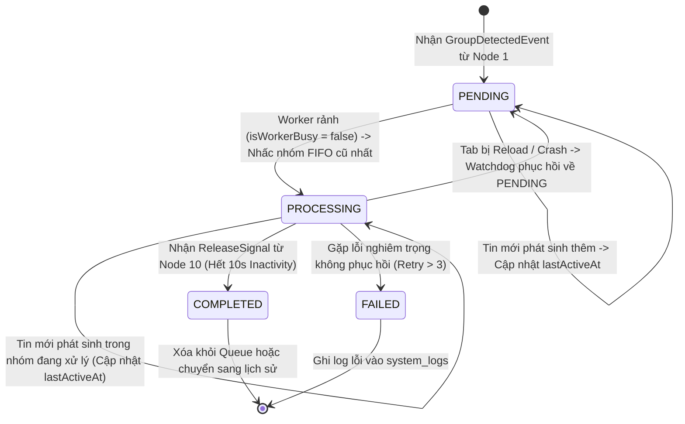
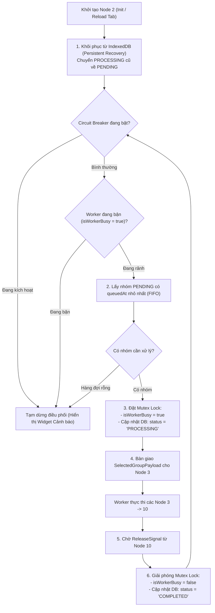

# ĐẶC TẢ CHI TIẾT NODE 02: GROUP QUEUE & CONCURRENCY MANAGER

**Mã định danh Node**: `N02_QUEUE_MANAGER`  
**Tầng kiến trúc**: Tầng 2 — Điều Phối Hàng Chờ Trạng Thái (Queue Orchestration Layer)  
**Ngữ cảnh thực thi**: Content Script (`content-script.ts`) trên Zalo Web (`https://chat.zalo.me/*`)  
**Tài liệu tham chiếu**:
- [business_flow.md](file:///c:/Users/ADMIN/Documents/workspace/Sales/EXTENSIONS/Docs/Init/Diagrams/business_flow.md)
- [tai_lieu_thiet_ke_so_bo_zalo_automation.md](file:///c:/Users/ADMIN/Documents/workspace/Sales/EXTENSIONS/Docs/Init/tai_lieu_thiet_ke_so_bo_zalo_automation.md)
- [he_thong_tu_dong_hoa_zalo_extension_spec.md](file:///c:/Users/ADMIN/Documents/workspace/Sales/EXTENSIONS/Docs/Init/he_thong_tu_dong_hoa_zalo_extension_spec.md)

---

## 1. MỤC TIÊU & PHẠM VI (NODE OBJECTIVE & SCOPE)

### 1.1. Mục tiêu Cốt lõi
- Quản lý hàng đợi vào trước — ra trước (**FIFO Queue**) cho toàn bộ các nhóm nguồn có tin nhắn mới cần được xử lý.
- Điều phối khóa tương hỗ đơn luồng (**Mutex Lock: `isWorkerBusy`**) nhằm bảo đảm tại một thời điểm chỉ có duy nhất 1 nhóm nguồn được Worker mở và thao tác UI.
- Thực thi cơ chế **Phục hồi Bền bỉ (Persistent FIFO Recovery)**: Lưu trữ trạng thái hàng đợi trực tiếp vào bảng `group_dispatch_queue` trong IndexedDB (Dexie.js). Khi trình duyệt bị F5/Reload hoặc máy tính khởi động lại, tự động tái tạo hàng đợi theo đúng thứ tự ưu tiên thời gian.
- Tiếp nhận sự kiện giải phóng nhóm từ Node 10 (`QueueReleaseSignal`) để mở khóa Worker và nhấc nhóm cũ nhất tiếp theo trong hàng đợi bàn giao cho Node 3 (Chat Switcher).

### 1.2. Ranh giới & Không gian Phủ định (In-Scope vs Negative Scope)
- **Trong phạm vi (In-Scope)**:
  - Tiếp nhận sự kiện `GroupDetectedEvent` từ Node 1, thêm mới hoặc cập nhật hàng đợi trong IndexedDB.
  - Quản lý vòng đời trạng thái của phần tử trong hàng đợi: `PENDING` ➔ `PROCESSING` ➔ `COMPLETED` (hoặc `FAILED`).
  - Quản lý cờ khóa Worker (`isWorkerBusy`, `currentGroupId`, `workerStartedAt`).
  - Cung cấp hàm API nội bộ `pickNextPendingGroup()` để phân phối công việc cho luồng thực thi UI.
  - Tự động reset các nhóm bị kẹt trạng thái `PROCESSING` sau khi reload trang (Crash Recovery).
- **Ranh giới cấm (Negative Scope - CẤM TUYỆT ĐỐI)**:
  - **CẤM** cho phép nhiều hơn 1 nhóm ở trạng thái `PROCESSING` cùng một thời điểm (Trình duyệt là đơn luồng UI; việc chạy song song thao tác DOM sẽ gây xung đột cửa sổ chat).
  - **CẤM** xóa bản ghi trong hàng đợi khi chưa nhận được tín hiệu hoàn tất chính thức (`ReleaseSignal`) từ Node 10.
  - **CẤM** bỏ qua thứ tự FIFO trừ khi có can thiệp mức ưu tiên (`priority`) được cấu hình tường minh.

---

## 2. HỢP ĐỒNG KỸ THUẬT & DỮ LIỆU (INPUT/OUTPUT CONTRACTS)

### 2.1. Bản ghi Hàng đợi trong IndexedDB (`GroupDispatchItem`)
Lưu tại bảng `group_dispatch_queue` (Dexie.js):

```typescript
export type QueueItemStatus = 'PENDING' | 'PROCESSING' | 'COMPLETED' | 'FAILED';

export interface GroupDispatchItem {
  groupId: string;          // Khóa chính: ID nhóm nguồn chuẩn hóa
  groupName: string;        // Tên nhóm nguồn
  status: QueueItemStatus;  // Trạng thái xử lý hiện tại
  queuedAt: number;         // Thời điểm được đưa vào hàng chờ (ms)
  lastActiveAt: number;     // Thời điểm tin nhắn mới nhất phát sinh (ms)
  retryCount: number;       // Số lần thử lại nếu gặp sự cố (mặc định: 0, tối đa: 3)
  failReason?: string;      // Lý do thất bại nếu status === 'FAILED'
}
```

### 2.2. Trạng thái Bộ Điều Phối Concurrency (`ConcurrencyState`)
Duy trì trong bộ nhớ RAM của Content Script:

```typescript
export interface ConcurrencyState {
  isWorkerBusy: boolean;              // Worker đang bận thao tác UI hay đang rảnh
  currentGroupId: string | null;      // ID của nhóm đang được xử lý
  currentGroupName: string | null;    // Tên của nhóm đang xử lý
  processingStartedAt: number | null; // Thời điểm bắt đầu xử lý nhóm hiện tại
  isCircuitBreakerActive: boolean;    // Cờ cầu chì bảo vệ tài khoản (ngừng mọi điều phối)
}
```

### 2.3. Lệnh Giao Việc Đầu ra (`SelectedGroupPayload`)
Gửi sang Node 3 (Chat Switcher):

```typescript
export interface SelectedGroupPayload {
  jobId: string;            // UUID phiên xử lý: "JOB_<timestamp>_<groupId>"
  groupId: string;
  groupName: string;
  status: 'PROCESSING';
  queuedAt: number;
  lastActiveAt: number;
  assignedAt: number;
}
```

---

## 3. LUỒNG XỬ LÝ CHI TIẾT & STATE MACHINE (EXECUTION ALGORITHM)

### 3.1. Sơ đồ Máy Trạng Thái Hàng Đợi (Queue State Machine)



### 3.2. Sơ đồ Luồng Điều Phối (Orchestration Flow)



### 3.3. Thuật toán Quản lý Hàng Đợi Chi tiết
1. **Tiếp nhận `enqueueGroup(event: GroupDetectedEvent)`**:
   - Truy vấn `group_dispatch_queue.get(event.groupId)`.
   - Nếu **chưa tồn tại**:
     - Thêm mới bản ghi với `status = 'PENDING'`, `queuedAt = event.detectedAt`, `lastActiveAt = event.detectedAt`, `retryCount = 0`.
   - Nếu **đã tồn tại**:
     - Nếu đang `PENDING`: Cập nhật `lastActiveAt = event.detectedAt`.
     - Nếu đang `PROCESSING`: Cập nhật `lastActiveAt = event.detectedAt` (để cửa sổ Drain 10s tại Node 10 nhận diện tiếp tục xử lý).
     - Nếu đã `COMPLETED`: Tái kích hoạt lại sang `PENDING` với `queuedAt = Date.now()`.
   - Kích hoạt hàm kiểm tra điều phối: `triggerNextDispatch()`.
2. **Cơ chế Phục hồi Sau Reload (Crash Recovery)**:
   - Khi Extension khởi động (Tab reload hoặc mở mới Zalo):
     - Quét toàn bộ các bản ghi trong `group_dispatch_queue`.
     - Bất kỳ bản ghi nào đang có `status === 'PROCESSING'` sẽ được tự động chuyển về `PENDING`, đồng thời tăng `retryCount += 1`.
     - Nếu `retryCount > 3`: Đánh dấu `status = 'FAILED'`, ghi log lỗi `CRASH_LOOP_DETECTED`.
3. **Giải phóng Hàng Đợi (`releaseGroup(groupId: string, status: 'COMPLETED' | 'FAILED')`)**:
   - Nhận tín hiệu từ Node 10.
   - Cập nhật trạng thái bản ghi trong IndexedDB sang `COMPLETED` (hoặc xóa để giải phóng dung lượng).
   - Đặt `isWorkerBusy = false`, `currentGroupId = null`.
   - Lập tức kích hoạt `triggerNextDispatch()` để nhấc nhóm kế tiếp.

---

## 4. XỬ LÝ LỖI, RETRY & EDGE CASES (RESILIENCE MATRIX)

| Mã Ngoại Lệ | Tình Huống Biên (Edge Case) | Phân Tích Kỹ Thuật | Cơ Chế Xử Lý & Phòng Vệ |
| :--- | :--- | :--- | :--- |
| **N02-E01** | **Tab Zalo bị reload đột ngột khi đang xử lý nhóm** | Nhóm đang ở trạng thái `PROCESSING` bị mồ côi (Orphaned Job), không có ai giải phóng khóa. | **Persistent FIFO Recovery**: Khi khởi động lại, Node 2 chuyển các job `PROCESSING` về `PENDING` với thứ tự cũ, đảm bảo nhóm không bị rơi rụng sau khi F5. |
| **N02-E02** | **Nhóm đang xử lý liên tục nhận tin mới không ngớt** | Có nguy cơ Worker bị kẹt vĩnh viễn ở nhóm này, khiến các nhóm khác trong hàng đợi bị đói tài nguyên (Queue Starvation). | Thiết lập trần an toàn (**Max Inactive Drain Cycles = 5**): Nếu một nhóm nhận tin liên tục quá 5 đợt drain liên tiếp, Node 2 bắt buộc hoàn tất lượt hiện tại, đẩy nhóm xuống cuối hàng đợi (`queuedAt = Date.now()`), và nhấc nhóm khác lên xử lý công bằng (Fair Scheduling). |
| **N02-E03** | **Worker bị treo vô hạn (Deadlock / Freeze)** | Thao tác DOM ở các Node tiếp theo bị lỗi không bắt được (Uncaught Error), không bao giờ phát tín hiệu Release. | **Worker Watchdog Timer (Timeout 120s)**: Nếu một nhóm ở trạng thái `PROCESSING` quá 120 giây mà không có hoạt động, Watchdog tự động cưỡng chế giải phóng khóa, đánh dấu nhóm đó là `FAILED_TIMEOUT` và chuyển sang nhóm tiếp theo. |
| **N02-E04** | **Tràn hàng đợi khi hàng chục nhóm đổ tin cùng lúc** | Bộ nhớ RAM và IndexedDB chịu tải đột ngột. | Hàng đợi được index theo `[status+queuedAt]`. Dexie.js xử lý hàng nghìn bản ghi dạng nhẹ (`< 10KB`) trong vài mili-giây, không gây tắc nghẽn luồng chính. |
| **N02-E05** | **Circuit Breaker kích hoạt từ Node 9** | Zalo hiển thị Captcha hoặc hạn chế gửi tin. | Node 2 khóa cứng mọi điều phối (`isCircuitBreakerActive = true`), giữ nguyên danh sách `PENDING` trong IndexedDB, không nhấc thêm nhóm mới cho đến khi người vận hành gỡ cờ khẩn cấp trên Floating Panel. |

---

## 5. PHỤ THUỘC KỸ THUẬT (TECHNICAL DEPENDENCIES)

1. **Cơ sở dữ liệu cục bộ (IndexedDB — Dexie.js)**:
   - Bảng `group_dispatch_queue`: `&groupId, groupName, status, queuedAt, lastActiveAt, retryCount`.
   - Bảng `system_logs`: Ghi nhận các sự kiện chuyển trạng thái hàng đợi và lỗi kẹt worker.
2. **Ngữ cảnh thực thi**:
   - Chạy hoàn toàn trong Content Script của tab Zalo Web (`chat.zalo.me`).
3. **Module tương tác**:
   - Nhận đầu vào: Hàm gọi từ Node 1 (`Sidebar Observer`).
   - Giao việc đầu ra: Gọi trực tiếp hàm khởi chạy của Node 3 (`Chat Switcher`).
   - Nhận tín hiệu kết thúc: Gọi từ Node 10 (`Checkpoint Committer & Releaser`).
   - Nhận tín hiệu ngắt khẩn cấp: Nhận cờ từ Node 9 hoặc nút Emergency Stop trên Floating Widget.

---

## 6. TIÊU CHÍ KIỂM THỬ & NGHIỆM THU (ACCEPTANCE CRITERIA / DoD)

### 6.1. Kịch bản Nghiệm thu Nhị phân (Binary Acceptance Gates)
- **GATE-01 (Tính Độc lập Hàng đợi - Non-blocking FIFO)**:
  - **Given**: Hàng đợi đang rỗng, Worker rảnh (`isWorkerBusy = false`).
  - **When**: Nhóm A được enqueue, ngay sau đó 100ms Nhóm B và Nhóm C được enqueue.
  - **Then**: Nhóm A lập tức chuyển sang `PROCESSING` và bàn giao cho Node 3; Nhóm B và C ở trạng thái `PENDING` theo đúng thứ tự `queuedAt`.
- **GATE-07 (Phục hồi Bền bỉ Sau F5 - Persistent Recovery)**:
  - **Given**: Hàng đợi có Nhóm A đang `PROCESSING`, Nhóm B đang `PENDING`.
  - **When**: Người dùng ấn phím F5 hoặc trình duyệt reload tab Zalo Web.
  - **Then**: Khi trang khởi động lại xong, Node 2 phải phục hồi: Nhóm A chuyển về `PENDING`, Nhóm B tiếp tục `PENDING`. Nhóm A được nhấc lại đầu tiên theo đúng thứ tự thời gian gốc.
- **AC-03 (Bảo toàn Khóa Tương Hỗ - Mutex Lock Invariant)**:
  - **Given**: Nhóm A đang `PROCESSING`.
  - **When**: Node 1 liên tục gửi thêm sự kiện của 5 nhóm khác.
  - **Then**: `isWorkerBusy` luôn giữ giá trị `true`, số lượng nhóm `PROCESSING` trong cơ sở dữ liệu luôn chính xác bằng `1`, không có bất kỳ lệnh gọi mở nhóm nào khác sang Node 3 cho đến khi Nhóm A hoàn tất.

