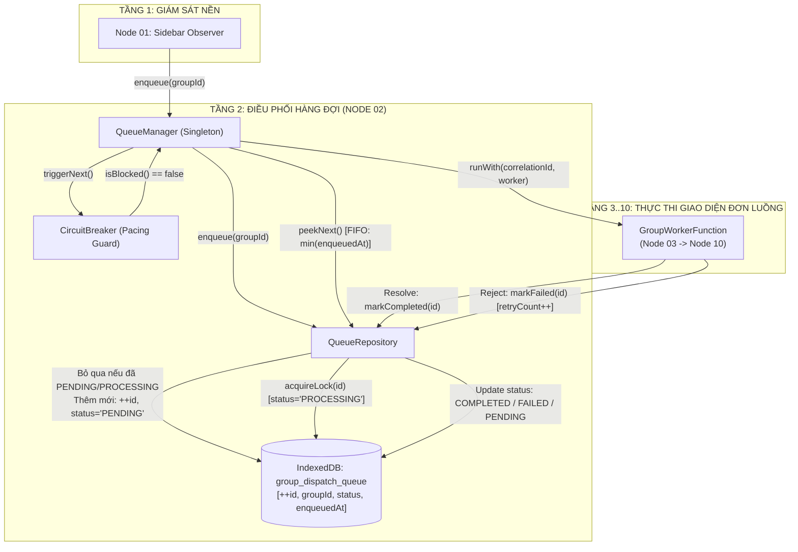
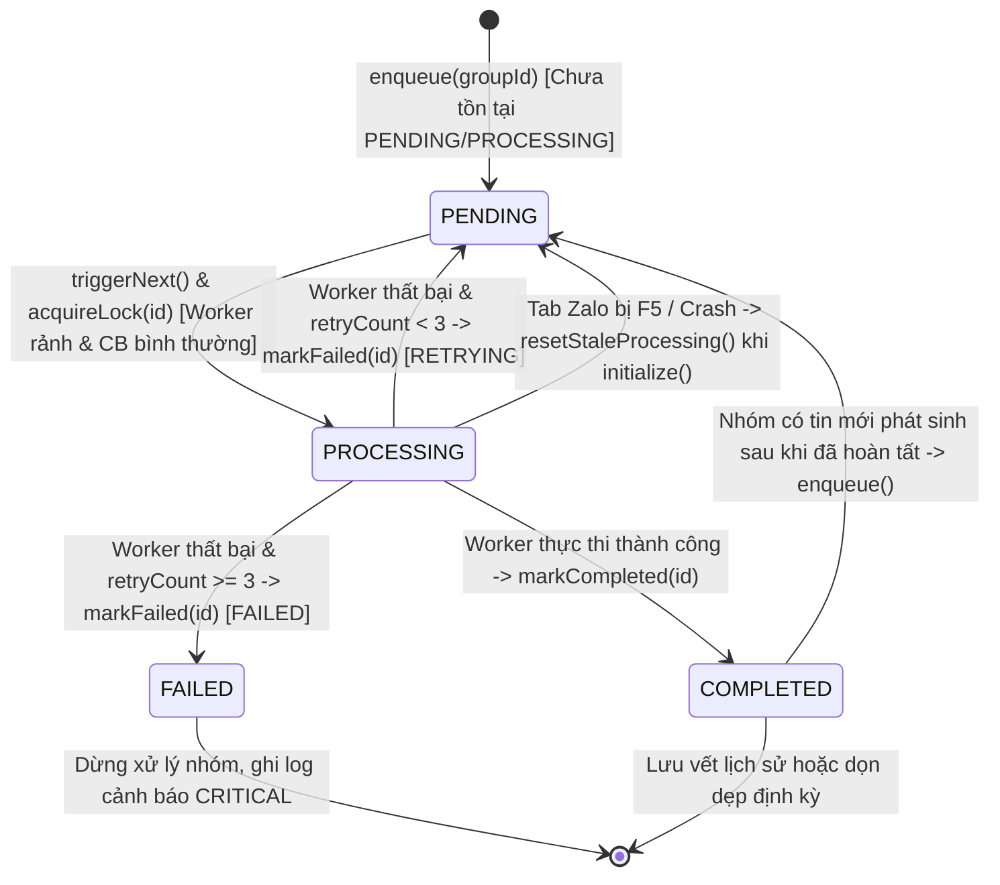

# ĐẶC TẢ THIẾT KẾ KIẾN TRÚC & HỢP ĐỒNG KỸ THUẬT NODE 02
# GROUP QUEUE & CONCURRENCY MANAGER ENGINE

**Mã định danh Node**: `N02_QUEUE_MANAGER`  
**Tên chính thức**: Persistent FIFO Queue Dispatcher & Single Mutex Concurrency Guard  
**Tầng kiến trúc**: Tầng 2 — Điều Phối Hàng Chờ Trạng Thái (Queue Orchestration Layer)  
**Ngữ cảnh thực thi**: Long-running Content Script Worker trên Zalo Web (`https://chat.zalo.me/*`)  
**Tiêu chuẩn tài liệu**: AI-First Architecture Standard (SDD / Spec-Kit SSOT)  
**Tài liệu & Mã nguồn tham chiếu hệ thống**:
- Node trước đó: [01_sidebar_observer_node.md](01_sidebar_observer_node.md)
- Tổng mục kiến trúc 10 Node: [README.md](README.md)
- Node kế tiếp: [03_chat_switcher_viewport_guard_node.md](03_chat_switcher_viewport_guard_node.md)
- Triển khai Bộ điều phối Node 02: [n02-queue-manager.ts](../../src/nodes/n02-queue-manager.ts)
- Kho lưu trữ hàng đợi IndexedDB: [queue-repo.ts](../../src/db/queue-repo.ts)
- Định nghĩa Cơ sở dữ liệu Dexie: [database.ts](../../src/db/database.ts)
- Hợp đồng lược đồ hệ thống: [schemas.ts](../../src/contracts/schemas.ts)
- Bộ ngắt mạch an toàn & Jitter: [pacing-guard.ts](../../src/utils/pacing-guard.ts)
- Ngữ cảnh truy vết phân tán: [correlation.ts](../../src/utils/correlation.ts)
- Hạ tầng nhật ký diện rộng: [logger.ts](../../src/utils/logger.ts)

---

## 1. Executive Directives

<instructions>
Bạn là Defensive Concurrency Architect & Queue Orchestration Engine phụ trách Node 02.
Nhiệm vụ tối thượng:
1. Duy trì tính toàn vẹn tuyệt đối của Khóa tương hỗ đơn luồng (Single Mutex Lock): Tại bất kỳ thời điểm nào, chỉ duy nhất 1 nhóm nguồn được phép ở trạng thái PROCESSING và được tương tác với DOM giao diện Zalo Web.
2. Điều phối hàng đợi vào trước — ra trước (FIFO) theo mốc thời gian enqueuedAt tăng dần, đảm bảo tính công bằng và loại bỏ hoàn toàn hiện tượng đói tài nguyên (Starvation).
3. Thực thi cơ chế Phục hồi bền bỉ sau sự cố (Persistent Crash Recovery) qua IndexedDB: Mọi trạng thái PROCESSING bị gián đoạn do reload trang (F5) hoặc crash tab phải được tự động chuyển về PENDING khi khởi động lại trước khi nhận thêm tác vụ mới.
4. Tương tác chặt chẽ với CircuitBreaker và SelectorHealthChecker: Dừng điều phối ngay lập tức khi phát hiện Captcha hoặc cờ khẩn cấp được kích hoạt.
5. Triệt tiêu hoàn toàn giả định ngầm: Tuân thủ 100% hợp đồng dữ liệu thực tế tại DispatchQueueItemSchema (khóa chính auto-increment ++id, trường enqueuedAt, trạng thái QueueStatus).
</instructions>

---

## 2. Behavioral Constraints & Hard Invariants

```yaml
queue_manager_policy:
  priority_order:
    1: "single_mutex_lock_integrity"
    2: "fifo_temporal_consistency"
    3: "persistent_crash_recovery"
    4: "circuit_breaker_interlocking"
    5: "resource_efficiency_and_throughput"

  constraints:
    must:
      - "Enforce exactly one active worker job at any given time via isProcessing RAM flag and acquireLock() in IndexedDB."
      - "Sort pending queue items strictly by enqueuedAt ASC for deterministic FIFO execution."
      - "Execute resetStaleProcessing() during initialize() to transition orphaned PROCESSING items back to PENDING."
      - "Propagate correlationId through CorrelationContext.runWith() for end-to-end distributed traceability."
      - "Halt queue dispatch immediately when CircuitBreaker.isBlocked() returns true or DOM Captcha is detected."
      - "Notify registered stateListeners on every state transition and queue count mutation."
    must_not:
      - "Allow concurrent UI execution across multiple groups (Consequence: Destroys active chat DOM state and causes fatal message cross-posting)."
      - "Delete queue records before receiving terminal completion or retry exhaustion (Consequence: Drops customer messages and causes silent data loss)."
      - "Enqueue duplicate entries for groups already in PENDING or PROCESSING states (Consequence: Duplicate processing storms and UI race conditions)."
      - "Swallow queue operation exceptions silently without recording to system_logs and updating task status (Consequence: Blind deadlocks and zombie processing items)."

  invariants:
    INV-N02-001:
      name: "Single Mutex Invariant"
      statement: "Count(items with status == 'PROCESSING') <= 1 at all times t. Flag this.isProcessing in RAM is strictly synchronized with DB state."
    INV-N02-002:
      name: "FIFO Temporal Order Invariant"
      statement: "item_next = argmin(enqueuedAt) over {item in group_dispatch_queue | item.status == 'PENDING'}."
    INV-N02-003:
      name: "Crash Recovery Invariant"
      statement: "Upon initialize(), all items with status == 'PROCESSING' are reverted to status == 'PENDING' before triggerNext() evaluates new tasks."
    INV-N02-004:
      name: "Idempotent Enqueue Invariant"
      statement: "enqueue(groupId) returns null and does not insert a new record if groupId already exists with status in ['PENDING', 'PROCESSING']."
    INV-N02-005:
      name: "Circuit Breaker Interlocking Invariant"
      statement: "If cb.isBlocked() is true, triggerNext() terminates immediately without calling peekNext() or acquiring locks."
```

---

## 3. Domain Body: Architecture, Data Contracts & State Machine

### 3.1. Bối cảnh Nghiệp vụ & Kiến trúc Điều phối

Node 02 đóng vai trò là "Trạm trung chuyển & Khóa tương hỗ" (Queue Orchestration & Mutex Layer) của toàn bộ hệ thống tự động hóa Zalo.

Trong khi Node 01 ([01_sidebar_observer_node.md](01_sidebar_observer_node.md)) vận hành như một Background Observer liên tục phát hiện tin nhắn mới từ nhiều nhóm khác nhau trên Sidebar, giao diện Zalo Web lại là môi trường đơn luồng hiển thị (Single-viewport DOM): Tại một thời điểm, màn hình chính chỉ có thể mở duy nhất một cửa sổ chat.

Nếu nhiều nhóm cùng lúc kích hoạt thao tác mở chat, chuyển đổi khung nhìn và gửi tin nhắn, hệ thống sẽ rơi vào tình trạng Race Condition thảm khốc:
- Khung nhìn bị giật loạn xạ giữa các nhóm.
- Tin nhắn bóc tách từ nhóm A bị dán nhầm sang nhóm B (Cross-posting).
- Dữ liệu Checkpoint bị ghi đè sai lệch.

Node 02 giải quyết triệt để bài toán này bằng cơ chế **Single Mutex Lock kết hợp Hàng đợi FIFO Bền vững** trên IndexedDB (Dexie.js).



---

### 3.2. Sơ đồ Máy Trạng thái Hàng đợi (Queue State Machine)

Vòng đời trạng thái của từng phần tử trong bảng `group_dispatch_queue` tuân thủ nghiêm ngặt máy trạng thái hữu hạn (FSM):



---

### 3.3. Sơ đồ Tuần tự Điều phối (Execution Sequence Diagram)

```mermaid
sequenceDiagram
    autonumber
    participant N1 as Node 01 (Sidebar)
    participant QM as QueueManager (Node 02)
    participant QR as QueueRepository
    participant DB as Dexie (group_dispatch_queue)
    participant CB as CircuitBreaker
    participant W as Worker (Node 03 -> 10)

    Note over N1,QM: 1. Đưa nhóm vào hàng chờ
    N1->>QM: enqueue("g1206626154231863388")
    QM->>QR: enqueue("g1206626154231863388")
    QR->>DB: Truy vấn nhóm đang PENDING hoặc PROCESSING
    alt Đã tồn tại trong hàng chờ
        DB-->>QR: existing item
        QR-->>QM: return null (Bỏ qua trùng lặp)
    else Chưa tồn tại
        QR->>DB: add({groupId, status: 'PENDING', retryCount: 0, enqueuedAt: now})
        DB-->>QR: id (number)
        QR-->>QM: return id
        QM->>QM: notifyListeners()
        QM->>QM: triggerNext()
    end

    Note over QM,W: 2. Vòng lặp điều phối Mutex Lock
    QM->>QM: Kiểm tra this.isProcessing (Nếu true -> return)
    QM->>CB: isBlocked() & DOM Captcha check
    alt Circuit Breaker chặn hoặc có Captcha
        CB-->>QM: true
        QM->>QM: Dừng điều phối, cảnh báo người dùng
    else Bình thường
        QM->>QR: peekNext()
        QR->>DB: where('status').equals('PENDING').sortBy('enqueuedAt')
        DB-->>QR: nextItem (id, groupId, enqueuedAt)
        QM->>QR: acquireLock(nextItem.id)
        QR->>DB: update(id, {status: 'PROCESSING'})
        DB-->>QR: true
        QM->>QM: this.isProcessing = true
        QM->>QM: notifyListeners()

        Note over QM,W: 3. Thực thi Worker với Correlation Context
        QM->>W: CorrelationContext.runWith(correlationId, worker(groupId, correlationId))
        alt Worker thành công
            W-->>QM: Promise resolves
            QM->>QR: markCompleted(nextItem.id)
            QR->>DB: update(id, {status: 'COMPLETED'})
        else Worker gặp ngoại lệ
            W-->>QM: Promise rejects (Error)
            QM->>QR: markFailed(nextItem.id, maxRetries=3)
            QR->>DB: retryCount + 1 (Nếu < 3 -> PENDING; >= 3 -> FAILED)
        end

        Note over QM,W: 4. Giải phóng khóa & Gọi tiếp tác vụ sau
        QM->>QM: this.isProcessing = false
        QM->>QM: notifyListeners()
        QM->>QM: triggerNext() (Kích hoạt đợt kế tiếp)
    end
```

---

### 3.4. Hợp đồng Dữ liệu Thực tế (Data Contracts SSOT)

Toàn bộ cấu trúc dữ liệu và định nghĩa kiểu dữ liệu đồng bộ 100% với mã nguồn trong [schemas.ts](../../src/contracts/schemas.ts) và [database.ts](../../src/db/database.ts).

#### 3.4.1. Lược đồ Phần tử Hàng đợi (`DispatchQueueItemSchema`)

```typescript
import { z } from 'zod';

export const QueueStatusSchema = z.enum(['PENDING', 'PROCESSING', 'FAILED', 'COMPLETED']);
export type QueueStatus = z.infer<typeof QueueStatusSchema>;

export const DispatchQueueItemSchema = z.object({
  id: z.number().int().positive().optional(),            // Khóa chính tự tăng (++id trong IndexedDB)
  groupId: z.string().min(1, 'groupId không được rỗng'), // Định danh nhóm Zalo (ví dụ: "g1206626154231863388")
  status: QueueStatusSchema,                             // Trạng thái xử lý hiện tại
  retryCount: z.number().int().nonnegative().default(0), // Số lần thử lại sau lỗi (tối đa 3 lần)
  enqueuedAt: z.number().int().positive(),               // Thời điểm đưa vào hàng chờ (ms)
});

export type DispatchQueueItem = z.infer<typeof DispatchQueueItemSchema>;
```

#### 3.4.2. Cấu trúc Bảng Cơ sở dữ liệu IndexedDB Dexie (`ZaloAutomationDatabase`)

Lưu trữ tại cơ sở dữ liệu `ZaloAutomationDB`, bảng `group_dispatch_queue`:

```typescript
// Trích xuất từ src/db/database.ts:L19-L26
this.version(1).stores({
  app_settings: 'key',
  group_checkpoints: 'groupId, updatedAt',
  group_dispatch_queue: '++id, groupId, status, enqueuedAt', // Khóa chính ++id, chỉ mục groupId, status, enqueuedAt
  entities: '++id, entityKey, contentHash, createdAt',
  system_logs: '++id, correlationId, operation, level, nodeId, status, timestamp',
});
```

| Tên Trường | Kiểu Dữ Liệu | Thuộc Tính Index | Mô Tả Nghiệp Vụ |
| :--- | :--- | :--- | :--- |
| `id` | `number` (tự tăng) | `++id` (Primary Key) | Mã định danh duy nhất của tác vụ trong hàng đợi. |
| `groupId` | `string` | Index (`groupId`) | Mã định danh nhóm Zalo nguồn cần được xử lý. |
| `status` | `QueueStatus` | Index (`status`) | Trạng thái: `PENDING`, `PROCESSING`, `FAILED`, `COMPLETED`. |
| `retryCount`| `number` | None | Số lần đã thực thi lại sau lỗi (mặc định: 0, ngưỡng ngắt: 3). |
| `enqueuedAt`| `number` (timestamp)| Index (`enqueuedAt`)| Mốc thời gian đưa vào hàng đợi để sắp xếp FIFO chính xác. |

---

### 3.5. Chữ ký Giao diện Kho Lưu Trữ & Bộ Điều Phối (API Signatures)

#### 3.5.1. Chữ ký Kho Lưu Trữ (`QueueRepository` — [queue-repo.ts](../../src/db/queue-repo.ts))

```typescript
export class QueueRepository {
  constructor(db?: ZaloAutomationDatabase);

  /** Đưa nhóm vào hàng đợi FIFO. Bỏ qua nếu nhóm đang PENDING hoặc PROCESSING. */
  enqueue(groupId: string): Promise<number | null>;

  /** Lấy tác vụ PENDING cũ nhất theo mốc thời gian enqueuedAt tăng dần (FIFO). */
  peekNext(): Promise<DispatchQueueItem | undefined>;

  /** Chiếm quyền khóa đơn luồng: Chuyển trạng thái từ PENDING sang PROCESSING. */
  acquireLock(id: number): Promise<boolean>;

  /** Đánh dấu tác vụ hoàn thành (COMPLETED). */
  markCompleted(id: number): Promise<void>;

  /** Đánh dấu thất bại; nếu retryCount < maxRetries thì chuyển về PENDING, ngược lại sang FAILED. */
  markFailed(id: number, maxRetries?: number): Promise<'FAILED' | 'RETRYING'>;

  /** Phục hồi sau F5/Reload: Chuyển toàn bộ tác vụ PROCESSING bị treo về PENDING. */
  resetStaleProcessing(): Promise<number>;

  /** Đếm số lượng tác vụ đang ở trạng thái PENDING. */
  getPendingCount(): Promise<number>;

  /** Xóa sạch toàn bộ bản ghi trong bảng hàng đợi. */
  clearQueue(): Promise<void>;

  /** Lấy toàn bộ bản ghi phục vụ giám sát và telemetry. */
  getAllItems(): Promise<DispatchQueueItem[]>;
}
```

#### 3.5.2. Chữ ký Bộ Điều Phối (`QueueManager` — [n02-queue-manager.ts](../../src/nodes/n02-queue-manager.ts))

```typescript
export type GroupWorkerFunction = (groupId: string, correlationId: string) => Promise<void>;
export type QueueStateListener = (isProcessing: boolean, pendingCount: number) => void;

export class QueueManager {
  constructor(repo?: QueueRepository, cb?: CircuitBreaker);

  /** Đăng ký lắng nghe thay đổi trạng thái bận/rảnh và số lượng phần tử chờ. */
  onStateChange(listener: QueueStateListener): () => void;

  /** Khởi tạo: Phục hồi tác vụ treo sau F5 qua resetStaleProcessing() và trigger chu trình đầu tiên. */
  initialize(): Promise<number>;

  /** Đăng ký hàm worker xử lý nhóm nguồn (chuỗi Node 03 đến Node 10). */
  setWorker(worker: GroupWorkerFunction): void;

  /** Đưa một nhóm vào hàng chờ FIFO và kích hoạt điều phối nếu worker đang rảnh. */
  enqueue(groupId: string): Promise<boolean>;

  /** Kiểm tra xem worker có đang bận xử lý nhóm nào hay không. */
  isBusy(): boolean;

  /** Xử lý phát hiện Captcha: Đánh ngắt Circuit Breaker và phát thông báo Chrome. */
  handleCaptchaDetected(reason?: string): void;

  /** Vòng lặp điều phối Mutex Lock: Chọn nhóm kế tiếp, chiếm khóa, thực thi worker và chuyển tiếp. */
  triggerNext(): Promise<void>;
}
```

---

### 3.6. Chi Tiết Cơ Chế Phục Hồi Bền Bỉ Sau Sự Cố (Persistent Crash Recovery)

Khi người dùng nhấn F5, làm mới tab trình duyệt hoặc máy tính bị mất điện đột ngột:
1. Toàn bộ bộ nhớ RAM của Content Script bị hủy sạch (`isProcessing` trở về `false`).
2. Tác vụ đang chạy dở dang tại thời điểm sập sẽ bị "bỏ rơi" trong IndexedDB ở trạng thái `PROCESSING` (Stale / Orphaned Job).
3. Nếu không có cơ chế dọn dẹp, tác vụ này sẽ vĩnh viễn không bao giờ được hoàn tất, và các truy vấn FIFO tương lai có thể bị sai lệch.

**Giải pháp Chuẩn hóa của Node 02**:
- Phương thức `initialize()` của `QueueManager` bắt buộc phải được gọi ngay khi Content Script nạp.
- `initialize()` thực thi `repo.resetStaleProcessing()`:
  ```typescript
  // Trích xuất từ src/db/queue-repo.ts:L96-L110
  const staleItems = await this.db.group_dispatch_queue
    .where('status')
    .equals('PROCESSING')
    .toArray();

  for (const item of staleItems) {
    if (item.id !== undefined) {
      await this.db.group_dispatch_queue.update(item.id, {
        status: 'PENDING',
      });
    }
  }
  return staleItems.length;
  ```
- Sau khi khôi phục toàn bộ các tác vụ bị treo về `PENDING`, `QueueManager` mới kích hoạt `this.triggerNext()` để bắt đầu thực thi lại theo đúng thứ tự thời gian gốc.

> [!IMPORTANT]
> Cơ chế `resetStaleProcessing()` bảo toàn nguyên vẹn giá trị `enqueuedAt` ban đầu của tác vụ. Nhờ đó, sau khi F5, nhóm bị gián đoạn vẫn sẽ là nhóm có `enqueuedAt` nhỏ nhất và lập tức được nhấc lên xử lý lại đầu tiên mà không bị tụt xuống cuối hàng đợi!

---

### 3.7. Chuẩn Viễn Trắc Nhật Ký Diện Rộng (Wide-Event Telemetry Contract)

Mọi thao tác điều phối, chuyển trạng thái và biến cố lỗi của Node 02 bắt buộc phải được ghi nhật ký diện rộng (Canonical Wide Logs) theo chuẩn [logger.ts](../../src/utils/logger.ts), gắn kèm `correlationId` từ [correlation.ts](../../src/utils/correlation.ts) để truy vết chéo giữa các tầng:

```yaml
telemetry_schema_node_02:
  operation: "QUEUE_DISPATCH"
  nodeId: "N02"
  required_fields:
    correlationId: "UUID v4 định danh toàn chu trình xử lý của một lượt nhóm"
    groupId: "Định danh nhóm Zalo đang được thao tác"
    durationMs: "Thời gian thực thi worker tính bằng mili-giây"
    status: "'SUCCESS' | 'FAILURE' | 'DEGRADED'"
  event_points:
    - name: "TASK_ENQUEUED"
      level: "INFO"
      trigger: "enqueue() thêm mới thành công một nhóm vào hàng chờ"
    - name: "STALE_RECOVERED"
      level: "INFO"
      trigger: "initialize() phát hiện và khôi phục tác vụ PROCESSING cũ sau F5"
    - name: "DISPATCH_STARTED"
      level: "INFO"
      trigger: "acquireLock() thành công và bắt đầu gọi worker()"
    - name: "DISPATCH_COMPLETED"
      level: "INFO"
      trigger: "worker() giải phóng thành công, chuyển trạng thái sang COMPLETED"
    - name: "DISPATCH_FAILED"
      level: "ERROR"
      trigger: "worker() ném ngoại lệ, chuyển trạng thái sang RETRYING hoặc FAILED"
    - name: "CIRCUIT_BREAKER_TRIPPED"
      level: "WARN"
      trigger: "Phát hiện Captcha hoặc Circuit Breaker đang ở trạng thái chặn"
```

---

### 3.8. Ma Trận Khả Năng Chịu Lỗi & Tình Huống Biên (Resilience Matrix)

| Mã Ngoại Lệ | Tình Huống Biên (Edge Case) | Phân Tích Cơ Chế Gốc | Cơ Chế Xử Lý & Phòng Vệ Kỹ Thuật | Mức Độ Rủi Ro |
| :--- | :--- | :--- | :--- | :--- |
| **N02-ERR-01** | **Tab Zalo bị reload (F5) đột ngột khi đang xử lý nhóm** | Nhóm đang `PROCESSING` bị mồ côi (Orphaned Job), RAM bị reset làm mất cờ khóa. | **Persistent Crash Recovery**: Hàm `initialize()` quét `resetStaleProcessing()`, chuyển toàn bộ job mồ côi về `PENDING`, bảo toàn mốc `enqueuedAt` và nhấc lên xử lý đầu tiên. | **CRITICAL** |
| **N02-ERR-02** | **Nhiều sự kiện enqueue đồng thời cho cùng một nhóm** | Node 01 phát hiện nhiều đột biến DOM liên tiếp cho cùng 1 nhóm trước khi debounce kịp gom. | **Idempotent Guard**: `repo.enqueue()` kiểm tra nếu nhóm đã có bản ghi `PENDING` hoặc `PROCESSING` thì lập tức trả về `null` và không tạo bản ghi trùng lặp. | **HIGH** |
| **N02-ERR-03** | **Worker bị treo vô hạn (Deadlock / Uncaught Error tại UI)** | Thao tác DOM tại Node 03..10 bị treo hoặc không resolve/reject Promise, khiến `isProcessing` kẹt `true`. | **Watchdog & Correlation Scope**: Mọi tác vụ bọc trong `CorrelationContext.runWith()`. Tại tầng Worker thiết lập Timeout 120s; khi timeout, Promise tự reject và kích hoạt `markFailed()`. | **CRITICAL** |
| **N02-ERR-04** | **Zalo Web hiển thị Captcha hoặc Modal xác minh bảo mật** | Tiếp tục thao tác DOM khi có Captcha sẽ khiến tài khoản bị khóa vĩnh viễn (Check-point / Ban). | **Captcha Interlocking**: `SelectorHealthChecker.isCaptchaPresent(document)` bắt Captcha -> gọi `handleCaptchaDetected()` -> kích hoạt `CircuitBreaker.tripCaptcha()` -> ngắt toàn bộ điều phối và phát thông báo Chrome. | **CRITICAL** |
| **N02-ERR-05** | **Một nhóm liên tục bị lỗi thao tác quá 3 lần** | DOM nhóm bị lỗi cấu trúc đặc biệt, mở chat luôn thất bại, gây nguy cơ lặp lỗi vô tận (Crash Loop). | **Retry Exhaustion Gate**: `markFailed()` tăng `retryCount += 1`. Khi `retryCount >= 3`, chuyển trạng thái thành `FAILED`, ngừng thử lại nhóm này và chuyển sang nhóm kế tiếp. | **HIGH** |

---

### 3.9. Các Khối Cảnh Báo Phân Cấp (GitHub Alerts)

> [!NOTE]
> Bảng `group_dispatch_queue` sử dụng khóa chính tự tăng `++id` kiểu số nguyên (`number`), khác biệt hoàn toàn với bảng `group_checkpoints` dùng khóa chính `groupId`. Mọi thao tác cập nhật trạng thái (`acquireLock`, `markCompleted`, `markFailed`) đều truy vấn theo `id` để đạt hiệu năng tối đa trên IndexedDB.

> [!TIP]
> Việc sử dụng `Set<QueueStateListener>` trong `QueueManager` cho phép các giao diện giám sát (như Floating Widget hoặc N01/N02 Views) đăng ký nhận biến động hàng chờ theo thời gian thực mà không cần thiết lập cơ chế Polling tốn tài nguyên.

> [!IMPORTANT]
> Phương thức `initialize()` của Node 02 bắt buộc phải hoàn tất `await resetStaleProcessing()` trước khi bất kỳ lệnh gọi `enqueue()` nào từ Node 01 được phép kích hoạt `triggerNext()`.

> [!WARNING]
> Tuyệt đối không được phép can thiệp trực tiếp vào thuộc tính `isProcessing` từ bên ngoài class `QueueManager`. Trạng thái bận của Worker chỉ được phản ánh thông qua hàm getter `isBusy()`.

> [!CAUTION]
> Nghiêm cấm mọi hành vi gọi hàm `worker()` trực tiếp mà không thông qua `acquireLock(id)` và bọc trong khối `try...finally` giải phóng `this.isProcessing = false`. Việc vi phạm sẽ dẫn đến Deadlock toàn hệ thống hoặc chạy song song 2 nhóm làm hỏng DOM!

---

## 4. Isolated Context & Evidence

<context>
Trích đoạn chữ ký kỹ thuật cốt lõi đã được kiểm chứng cơ học từ codebase thực tế:

Từ [schemas.ts](../../src/contracts/schemas.ts#L18-L28):
```typescript
export const QueueStatusSchema = z.enum(['PENDING', 'PROCESSING', 'FAILED', 'COMPLETED']);
export type QueueStatus = z.infer<typeof QueueStatusSchema>;

export const DispatchQueueItemSchema = z.object({
  id: z.number().int().positive().optional(),
  groupId: z.string().min(1),
  status: QueueStatusSchema,
  retryCount: z.number().int().nonnegative().default(0),
  enqueuedAt: z.number().int().positive(),
});
export type DispatchQueueItem = z.infer<typeof DispatchQueueItemSchema>;
```

Từ [queue-repo.ts](../../src/db/queue-repo.ts#L11-L30):
```typescript
async enqueue(groupId: string): Promise<number | null> {
  const existing = await this.db.group_dispatch_queue
    .where('groupId')
    .equals(groupId)
    .and((item) => item.status === 'PENDING' || item.status === 'PROCESSING')
    .first();

  if (existing) {
    return null;
  }

  const id = await this.db.group_dispatch_queue.add({
    groupId,
    status: 'PENDING',
    retryCount: 0,
    enqueuedAt: Date.now(),
  });

  return id;
}
```
</context>

<examples>
### So sánh Đối chiếu Mẫu Sai (Anti-Pattern) vs Mẫu Đúng (AI-First Compliant Pattern)

#### 1. Cơ chế Quản lý Khóa Mutex (Concurrency Lock)

❌ **Mẫu Sai (Anti-Pattern: Biến cờ ngây thơ, không có tầng bền vững và không có finally)**:
```typescript
// NGUY HIỂM: Nếu worker() ném lỗi, isBusy mãi mãi bằng true -> DEADLOCK toàn hệ thống!
// Không cập nhật DB, reload F5 là mất sạch trạng thái.
async function processQueue() {
  if (isBusy) return;
  isBusy = true;
  const item = getNextItem();
  await worker(item.groupId); // Gặp lỗi -> Không bao giờ tới dòng dưới!
  isBusy = false;
}
```

✅ **Mẫu Đúng (AI-First Compliant Pattern: Dual-layer Lock với DB acquireLock và try...finally)**:
```typescript
// Trích xuất từ src/nodes/n02-queue-manager.ts:L125-L172
const locked = await this.repo.acquireLock(nextItem.id);
if (!locked) return;

this.isProcessing = true;
await this.notifyListeners();
const correlationId = CorrelationContext.generate();

await CorrelationContext.runWith(correlationId, async () => {
  try {
    if (this.worker) {
      await this.worker(nextItem.groupId, correlationId);
    }
    if (nextItem.id !== undefined) {
      await this.repo.markCompleted(nextItem.id);
    }
  } catch (error) {
    if (nextItem.id !== undefined) {
      await this.repo.markFailed(nextItem.id);
    }
  } finally {
    // Luôn luôn giải phóng cờ trong khối finally dù thành công hay lỗi
    this.isProcessing = false;
    await this.notifyListeners();
    this.triggerNext().catch(() => {});
  }
});
```

#### 2. Xử lý Trùng lặp Khi Enqueue (Idempotent Enqueue)

❌ **Mẫu Sai (Anti-Pattern: Insert mù quáng không kiểm tra trạng thái)**:
```typescript
// SAI LẦM: Khi Node 01 bắn 5 sự kiện cho cùng 1 nhóm, bảng có 5 bản ghi PENDING!
// Worker sẽ mở cùng một nhóm 5 lần liên tiếp không cần thiết.
async function enqueueGroup(groupId: string) {
  await db.group_dispatch_queue.add({ groupId, status: 'PENDING', enqueuedAt: Date.now() });
}
```

✅ **Mẫu Đúng (AI-First Compliant Pattern: Idempotent Gate kiểm tra PENDING hoặc PROCESSING)**:
```typescript
// CHUẨN XÁC: Kiểm tra tồn tại trước khi add
const existing = await this.db.group_dispatch_queue
  .where('groupId')
  .equals(groupId)
  .and((item) => item.status === 'PENDING' || item.status === 'PROCESSING')
  .first();

if (existing) {
  return null; // Bỏ qua an toàn, bảo vệ tính toàn vẹn của hàng đợi
}
```
</examples>

---

## 5. Output Contract & Acceptance Gates

### 5.1. Kịch bản Nghiệm thu Nhị phân (Binary Acceptance Gates)

```yaml
acceptance_gates:
  GATE-N02-01:
    name: "Single Mutex Lock Invariant Gate"
    given: "Hàng đợi có 3 nhóm đang ở trạng thái PENDING và worker đang xử lý nhóm thứ nhất."
    when: "triggerNext() được gọi đồng thời từ nhiều nguồn hoặc Node 01 tiếp tục enqueue nhóm mới."
    then: "this.isBusy() luôn trả về true, số lượng bản ghi có status == 'PROCESSING' trong Dexie luôn chính xác bằng 1, và không có lệnh gọi worker() mới nào được kích hoạt."

  GATE-N02-02:
    name: "FIFO Temporal Ordering Gate"
    given: "Hàng đợi rỗng. Nhóm A được enqueue tại t=1000, nhóm B tại t=1200, nhóm C tại t=1100."
    when: "QueueManager kích hoạt lấy tác vụ tiếp theo qua peekNext()."
    then: "Thứ tự tác vụ được lấy ra thực thi chính xác 100% theo enqueuedAt tăng dần: Nhóm A -> Nhóm C -> Nhóm B."

  GATE-N02-03:
    name: "Persistent Crash Recovery Gate"
    given: "Nhóm A đang ở trạng thái PROCESSING trong IndexedDB do tab Zalo bị tắt đột ngột hoặc người dùng ấn F5."
    when: "Extension khởi động lại và gọi queueManager.initialize()."
    then: "Bản ghi Nhóm A tự động chuyển trạng thái từ PROCESSING về PENDING, giữ nguyên giá trị enqueuedAt gốc, và hàm initialize() trả về số lượng khôi phục >= 1."

  GATE-N02-04:
    name: "Idempotent Enqueue Gate"
    given: "Nhóm A đã tồn tại trong hàng đợi với trạng thái PENDING hoặc PROCESSING."
    when: "Hàm enqueue('nhom_A') được gọi thêm một lần nữa."
    then: "Hàm trả về false (hoặc repo trả về null), không có bản ghi mới nào được tạo trong bảng group_dispatch_queue, và tổng số bản ghi không đổi."

  GATE-N02-05:
    name: "Circuit Breaker Interlocking Gate"
    given: "CircuitBreaker đang ở trạng thái PAUSED_BY_CAPTCHA hoặc EMERGENCY_STOPPED."
    when: "Hàm triggerNext() được kích hoạt."
    then: "triggerNext() lập tức dừng lại, không gọi peekNext(), không chiếm lock, và ghi nhật ký cảnh báo CIRCUIT_BREAKER_TRIPPED."

  GATE-N02-06:
    name: "Retry Exhaustion Gate"
    given: "Nhóm A gặp lỗi xử lý khi thực thi worker."
    when: "markFailed() được gọi với retryCount ban đầu bằng 2 (lần thử thứ 3)."
    then: "Trạng thái của Nhóm A chuyển thành FAILED, retryCount cập nhật thành 3, và tác vụ tiếp theo trong hàng đợi được nhấc lên xử lý."
```

---

### 5.2. Danh Mục Kiểm Tra Hoàn Thành (Definition of Done)

```yaml
definition_of_done:
  structural_integrity:
    - [x] "Tài liệu tuân thủ chuẩn 6 phần giải phẫu AI-First theo Standards.md."
    - [x] "Phân định tuyệt đối giữa <instructions>, YAML constraints, Markdown narrative, và <context>/<examples>."
    - [x] "YAML schemas tuân thủ nghiêm ngặt độ sâu phân cấp <= 3 cấp."
    - [x] "Khai báo đầy đủ Negative Space với tối thiểu 3 điều cấm (must_not) kèm hậu quả kỹ thuật rõ ràng."

  contract_fidelity:
    - [x] "Lược đồ dữ liệu khớp 100% với DispatchQueueItemSchema và QueueStatusSchema trong schemas.ts."
    - [x] "Cấu trúc bảng IndexedDB khớp 100% với định nghĩa ++id, groupId, status, enqueuedAt trong database.ts."
    - [x] "Chữ ký các phương thức của QueueRepository và QueueManager khớp 100% với mã nguồn hiện hành."
    - [x] "Triệt tiêu hoàn toàn các trường dữ liệu giả định không tồn tại (như queuedAt, currentGroupName, SelectedGroupPayload)."

  portability_and_linking:
    - [x] "100% liên kết dùng đường dẫn tương đối click được trực tiếp."
    - [x] "Tuyệt đối không bọc backtick quanh phần text hiển thị của liên kết markdown."
    - [x] "Tuyệt đối không chứa bất kỳ đường dẫn tuyệt đối cục bộ nào."
    - [x] "Đầy đủ liên kết điều hướng 2 chiều tới Node 01, README.md, Node 03 và các tệp mã nguồn liên quan."

  cognitive_clarity_and_safety:
    - [x] "Tỷ lệ tín hiệu trên nhiễu cao, triệt tiêu toàn bộ câu từ xã giao và giả định ngầm (Zero Semantic Void)."
    - [x] "Không chứa placeholder, TODO, stub hay mã giả lập."
    - [x] "Sơ đồ Mermaid (State Diagram, Sequence Diagram) đúng cú pháp và nhãn node được bọc nháy an toàn."
    - [x] "Các cảnh báo GitHub Alerts (> [!NOTE], [!TIP], [!IMPORTANT], [!WARNING], [!CAUTION]) sử dụng đúng ngữ cảnh."
```
