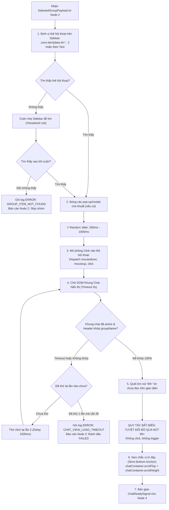

# ĐẶC TẢ CHI TIẾT NODE 03: CHAT SWITCHER & VIEWPORT GUARD

**Mã định danh Node**: `N03_CHAT_SWITCHER`  
**Tầng kiến trúc**: Tầng 3 — Truy Cập & Xác Định Điểm Nối (Navigation & Stitching Layer)  
**Ngữ cảnh thực thi**: Content Script (`content-script.ts`) trên Zalo Web (`https://chat.zalo.me/*`)  
**Tài liệu tham chiếu**:
- [business_flow.md](file:///c:/Users/ADMIN/Documents/workspace/Sales/EXTENSIONS/Docs/Init/Diagrams/business_flow.md)
- [tai_lieu_thiet_ke_so_bo_zalo_automation.md](file:///c:/Users/ADMIN/Documents/workspace/Sales/EXTENSIONS/Docs/Init/tai_lieu_thiet_ke_so_bo_zalo_automation.md)
- [he_thong_tu_dong_hoa_zalo_extension_spec.md](file:///c:/Users/ADMIN/Documents/workspace/Sales/EXTENSIONS/Docs/Init/he_thong_tu_dong_hoa_zalo_extension_spec.md)

---

## 1. MỤC TIÊU & PHẠM VI (NODE OBJECTIVE & SCOPE)

### 1.1. Mục tiêu Cốt lõi
- Tiếp nhận lệnh thực thi nhóm nguồn được chỉ định từ Node 2 (`SelectedGroupPayload`).
- Định vị chính xác phần tử cuộc hội thoại trên thanh Sidebar Zalo và mô phỏng thao tác click chuột để mở khung chat.
- Xác thực khung chat đã tải thành công: Tiêu đề cuộc hội thoại (Active Chat Header) khớp với tên nhóm và vùng chứa tin nhắn (`#chatView` / `.chat-message-list`) đã được gắn vào DOM.
- **Thực thi Nguyên tắc Bất biến Neo Đáy Khung Nhìn (Strict Bottom Anchor)**: Đảm bảo khung nhìn luôn ở vị trí đáy mới nhất của cuộc hội thoại. **TUYỆT ĐỐI BỎ QUA nút "99+" tin chưa đọc** ở góc màn hình, ngăn chặn hoàn toàn nguy cơ cuộn ngược về quá khứ gây lag DOM ảo hóa và gửi trùng tin nhắn cũ.
- Tự động đóng các modal/pop-up che khuất và bàn giao trạng thái sẵn sàng (`ChatReadySignal`) cho Node 4 (Delta Stitcher).

### 1.2. Ranh giới & Không gian Phủ định (In-Scope vs Negative Scope)
- **Trong phạm vi (In-Scope)**:
  - Tìm kiếm và kích hoạt click vào thẻ hội thoại nhóm nguồn trên Sidebar.
  - Chờ đợi đồng bộ (Polling/Mutation) cho đến khi khung chat của nhóm hiển thị trọn vẹn (Timeout 5 giây).
  - Kiểm tra và giữ vị trí cuộn ở đáy của vùng tin nhắn (`scrollTop = scrollHeight`).
  - Đóng các hộp thoại quảng cáo hoặc thông báo pop-up của Zalo nếu xuất hiện chắn màn hình.
- **Ranh giới cấm (Negative Scope - CẤM TUYỆT ĐỐI)**:
  - **CẤM TUYỆT ĐỐI click vào nút "99+" tin chưa đọc** hoặc bất kỳ nút "Xem tin nhắn chưa đọc / Nhảy lên tin mới nhất" nào của Zalo Web. Thao tác này sẽ tải hàng trăm node DOM cũ, gây nghẽn RAM và làm sai lệch mốc Checkpoint.
  - **CẤM** cuộn ngược trang lên trên (`scrollTop = 0` hoặc scroll ngược lịch sử).
  - **CẤM** can thiệp bóc tách tin nhắn hay gom cụm dữ liệu tại Node này (đây là trách nhiệm của Node 4 và Node 5).

---

## 2. HỢP ĐỒNG KỸ THUẬT & DỮ LIỆU (INPUT/OUTPUT CONTRACTS)

### 2.1. Lệnh Đầu vào (`SelectedGroupPayload`)
Tiếp nhận từ Node 2 (Queue Manager):

```typescript
export interface SelectedGroupPayload {
  jobId: string;            // UUID phiên xử lý: "JOB_<timestamp>_<groupId>"
  groupId: string;          // ID chuẩn hóa của nhóm nguồn cần mở
  groupName: string;        // Tên nhóm hiển thị
  status: 'PROCESSING';
  queuedAt: number;
  lastActiveAt: number;
  assignedAt: number;
}
```

### 2.2. Tín hiệu Sẵn sàng Đầu ra (`ChatReadySignal`)
Bàn giao cho Node 4 (Checkpoint Resolver & Delta Stitcher):

```typescript
export interface ChatReadySignal {
  jobId: string;
  groupId: string;
  groupName: string;
  chatContainer: HTMLElement;       // Tham chiếu tới phần tử DOM chứa danh sách tin nhắn
  activeHeaderTitle: string;        // Tiêu đề thực tế đọc được trên Header khung chat
  isAtBottom: boolean;              // Xác nhận vị trí cuộn đang ở đáy màn hình (100% true)
  switchedAt: number;               // Timestamp lúc khung chat sẵn sàng (ms)
  messageDomNodesCount: number;     // Số lượng node tin nhắn hiện diện trên DOM ảo hóa
}
```

---

## 3. LUỒNG XỬ LÝ CHI TIẾT & STATE MACHINE (EXECUTION ALGORITHM)

### 3.1. Sơ đồ Luồng Thao tác Mở Nhóm & Neo Đáy (Flowchart)



### 3.2. Thuật toán Thao tác DOM Chi tiết
1. **Định vị phần tử hội thoại trên Sidebar**:
   - Selector ưu tiên: `.conv-item[data-id="${groupId}"]`.
   - Selector dự phòng: Duyệt qua tất cả `.conv-item` và so khớp `textContent` của `.conv-item-title` với `groupName`.
   - Nếu phần tử nằm ngoài khung nhìn: Gọi `element.scrollIntoView({ block: 'nearest', behavior: 'smooth' })`.
2. **Mô phỏng Click người thật**:
   - Sử dụng chuỗi sự kiện chuột hoàn chỉnh thay vì chỉ gọi `element.click()`:
     ```typescript
     element.dispatchEvent(new MouseEvent('mousedown', { bubbles: true, cancelable: true }));
     element.dispatchEvent(new MouseEvent('mouseup', { bubbles: true, cancelable: true }));
     element.dispatchEvent(new MouseEvent('click', { bubbles: true, cancelable: true }));
     ```
3. **Giám sát tải khung chat (Polling Timeout 5s)**:
   - Kiểm tra định kỳ mỗi 200ms:
     - Header tiêu đề: `document.querySelector('#chatViewHeader .header-title, .chat-title')?.textContent?.trim()`.
     - Vùng chứa tin nhắn: `document.querySelector('#chatView, .chat-message-list, [data-id="chat-history"]')`.
   - Điều kiện hoàn tất: Header khớp `groupName` và vùng chứa tin nhắn có ít nhất 1 node con.
4. **Bảo vệ Neo Đáy (Strict Bottom Anchor)**:
   - Kiểm tra và phát hiện nếu có nút `99+`:
     - Selector nút 99+: `.btn-unread-badge, .jump-to-unread, [data-translate-inner="STR_UNREAD_MESSAGES"]`.
     - **Hành vi**: Ghi nhận log debug nhưng **tuyệt đối không can thiệp click**.
   - Cưỡng chế vị trí cuộn:
     ```typescript
     const chatBox = document.querySelector('#chatView .chat-message-list') as HTMLElement;
     if (chatBox) {
       chatBox.scrollTop = chatBox.scrollHeight;
     }
     ```

---

## 4. XỬ LÝ LỖI, RETRY & EDGE CASES (RESILIENCE MATRIX)

| Mã Ngoại Lệ | Tình Huống Biên (Edge Case) | Phân Tích Kỹ Thuật | Cơ Chế Xử Lý & Phòng Vệ |
| :--- | :--- | :--- | :--- |
| **N03-E01** | **Khung chat không tải sau khi click (Mạng đơ/Zalo lag)** | Sau 5 giây, header vẫn là nhóm cũ hoặc màn hình trắng không hiển thị tin nhắn. | Thử lại đúng 1 lần: Click lại vào thẻ hội thoại trên Sidebar và chờ thêm 3 giây. Nếu vẫn không tải được ➔ Ghi log `ERROR: CHAT_LOAD_FAILED`, thông báo Node 2 chuyển trạng thái nhóm thành `FAILED` và nhấc nhóm kế tiếp. |
| **N03-E02** | **Nút '99+' tin chưa đọc dồn ứ ở góc phải màn hình** | Tin nhắn chưa đọc trong nhóm quá nhiều (vài chục đến hàng trăm tin), Zalo hiển thị nút nổi màu xanh/đỏ "99+". | **Quy tắc Bất biến**: Tuyệt đối không click vào nút này. Giữ vững vị trí đáy màn hình hiện tại. Việc bỏ qua nút 99+ giúp ngăn trình duyệt tải ngược lịch sử cũ, triệt tiêu nguy cơ gửi trùng các tin đã cũ từ ngày hôm trước. |
| **N03-E03** | **Pop-up cuộc gọi hoặc modal thông báo Zalo che khuất** | Xuất hiện modal "Cập nhật phiên bản" hoặc "Cuộc gọi nhỡ" đè lên khung chat. | Quét tìm các modal nổi (`.z-modal, .vng-dialog, .popover`) và tự động kích hoạt nút Đóng (`.btn-close, [data-icon="close"]`) trước khi xác nhận chuyển chat. |
| **N03-E04** | **Thẻ hội thoại bị trôi khỏi tầm nhìn của Sidebar** | Sidebar có hàng trăm nhóm, nhóm nguồn bị trôi tít xuống dưới danh sách ảo. | Sử dụng thanh cuộn của container Sidebar (`#conversationList`), cuộn nhẹ từng đoạn 300px để trigger render các phần tử ảo cho đến khi tìm thấy thẻ cần mở. |
| **N03-E05** | **Nhóm đã bị xóa hoặc tài khoản bị kích khỏi nhóm** | Click vào xuất hiện thông báo "Bạn không còn là thành viên của nhóm này". | Bắt thông báo cảnh báo của Zalo, ghi log `CRITICAL: REMOVED_FROM_GROUP`, gửi thông báo về Node 2 loại nhóm này khỏi hàng đợi và tắt trạng thái `isActive` của nhóm trong Whitelist. |

---

## 5. PHỤ THUỘC KỸ THUẬT (TECHNICAL DEPENDENCIES)

1. **DOM Selectors (Zalo Web Baseline)**:
   - Thẻ hội thoại Sidebar: `.conv-item`, `[data-id="${groupId}"]`, `.conv-item-title`.
   - Vùng chứa danh sách chat: `#chatView`, `.chat-message-list`, `.chat-scroll-view`.
   - Tiêu đề khung chat: `#chatViewHeader .header-title`, `.chat-title`, `.header-name`.
   - Nút 99+ chưa đọc: `.jump-to-unread`, `.btn-unread-badge`, `[data-id="unread-badge-btn"]`.
   - Nút đóng modal: `.z-modal .btn-close`, `.vng-dialog-close`.
2. **Web APIs**:
   - `MouseEvent` (`mousedown`, `mouseup`, `click`): Kích hoạt chuyển hội thoại chuẩn React SPA.
   - `HTMLElement.scrollIntoView()`, `HTMLElement.scrollTop`.
3. **Cơ sở dữ liệu cục bộ**:
   - `system_logs`: Ghi nhận lỗi chuyển chat và cảnh báo bất thường.

---

## 6. TIÊU CHÍ KIỂM THỬ & NGHIỆM THU (ACCEPTANCE CRITERIA / DoD)

### 6.1. Kịch bản Nghiệm thu Nhị phân (Binary Acceptance Gates)
- **GATE-02 (Bỏ Qua Nút 99+ & Neo Đáy - Strict Bottom Anchor)**:
  - **Given**: Nhóm nguồn được chỉ định mở có hơn 100 tin nhắn chưa đọc, trên giao diện Zalo xuất hiện rõ nút `99+` hoặc "Có tin nhắn mới".
  - **When**: Node 3 thực hiện mở nhóm nguồn đó.
  - **Then**:
    1. Vị trí cuộn của khung chat phải nằm chính xác tại đáy (`isAtBottom === true`).
    2. Nút `99+` tuyệt đối **KHÔNG** bị click.
    3. Trình duyệt không bị giật lag, số lượng DOM tin nhắn trong container chỉ giới hạn ở nhóm tin mới nhất tại đáy.
- **AC-02 (Xác thực Khớp Header Hoàn Hảo)**:
  - **Given**: Lệnh mở Nhóm có tên "KHO NGUỒN TỔNG HÀ NỘI".
  - **When**: Node 3 click vào sidebar item.
  - **Then**: Node 3 chỉ phát `ChatReadySignal` khi và chỉ khi text trên `#chatViewHeader` chứa chuỗi "KHO NGUỒN TỔNG HÀ NỘI". Nếu không khớp trong 5s, bắt buộc kích hoạt retry hoặc báo lỗi.
- **AC-03 (Chống Kẹt Treo Khi Lỗi Mạng)**:
  - **Given**: Đường truyền mạng bị ngắt làm Zalo không hiển thị được khung chat.
  - **When**: Hết thời gian chờ tối đa 5s + 1 lần retry.
  - **Then**: Node 3 không được phép treo vĩnh viễn; bắt buộc phải kết thúc tiến trình, trả về mã lỗi và giải phóng để Worker không bị deadlock.

