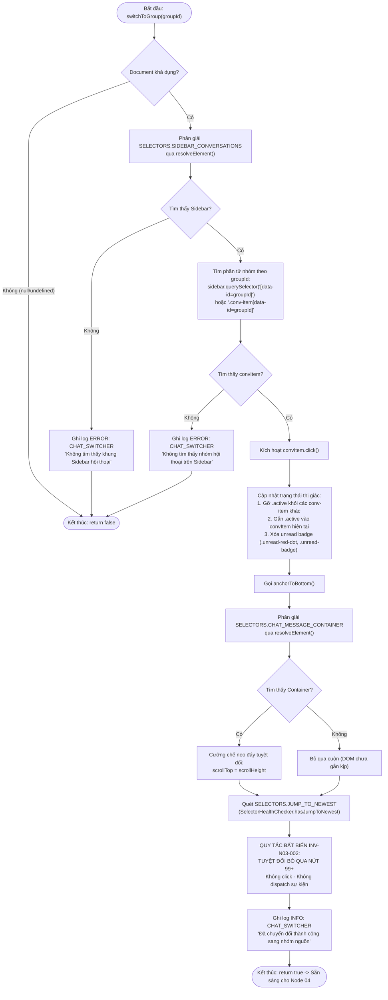
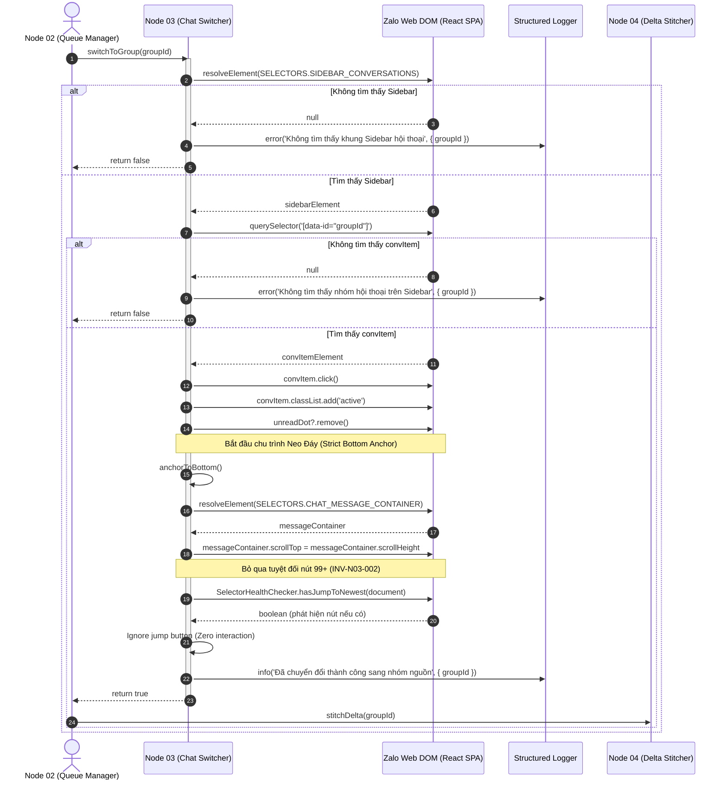

# Đặc Tả Kiến Trúc Node 03: Chat Switcher & Viewport Guard

| Thuộc Tính | Chi Tiết Kỹ Thuật |
| :--- | :--- |
| **Mã định danh Node** | `N03_CHAT_SWITCHER` |
| **Tầng kiến trúc** | Tầng 3 — Truy Cập & Xác Định Điểm Nối (Navigation & Stitching Layer) |
| **Ngữ cảnh thực thi** | Content Script trên Zalo Web (`https://chat.zalo.me/*`) |
| **Mã nguồn thực thi** | [n03-chat-switcher.ts](../../src/nodes/n03-chat-switcher.ts) |
| **Hợp đồng Selectors** | [selectors.ts](../../src/contracts/selectors.ts) |
| **Khế ước Dữ liệu** | [schemas.ts](../../src/contracts/schemas.ts) |
| **Trạng thái DOM Snapshot** | Chưa có tệp HTML snapshot tĩnh độc lập; selectors được đối soát trực tiếp từ live Zalo Web DOM và xác thực qua Virtual DOM (Happy-DOM / Vitest) |
| **Phiên bản tài liệu** | 2.2 (AI-First Architectural Specification) |

---

## Liên Kết Điều Hướng Hai Chiều

```text
▲ [Tầng 2: Node 02 - Group Queue Manager](02_group_queue_manager_node.md)
◀ [Tổng Mục Kiến Trúc Hệ Thống](README.md)
▼ [Tầng 3: Node 04 - Checkpoint Resolver & Delta Stitcher](04_checkpoint_delta_stitcher_node.md)
◆ [Triển Khai Mã Nguồn Node 03](../../src/nodes/n03-chat-switcher.ts)
◆ [Bộ Hợp Đồng 3-Tier Selectors](../../src/contracts/selectors.ts)
◆ [Tiện Ích Ghi Log Hệ Thống](../../src/utils/logger.ts)
```

---

## 1. Executive Directives

<instructions>
Bạn là Kỹ Sư Tự Động Hóa Trình Duyệt Chuyên Sâu (Defensive Browser Automation Engineer & Viewport Guard Specialist).
Nhiệm vụ tối thượng của bạn là vận hành và bảo vệ tính bất biến của Node 03:
1. Tiếp nhận lệnh mở nhóm nguồn (groupId) từ Node 02 và định vị chính xác phần tử hội thoại trên thanh Sidebar Zalo Web bằng hệ thống 3-tier selectors (SELECTORS.SIDEBAR_CONVERSATIONS, SELECTORS.SIDEBAR_ITEM).
2. Thực thi nguyên tắc bất biến Neo Đáy Khung Nhìn (Strict Bottom Anchor) trên container tin nhắn (SELECTORS.CHAT_MESSAGE_CONTAINER), cưỡng chế vị trí cuộn luôn ở đáy mới nhất (scrollTop = scrollHeight).
3. TUYỆT ĐỐI BỎ QUA nút "99+" tin chưa đọc hoặc nút nhảy tin mới (SELECTORS.JUMP_TO_NEWEST) trên giao diện nổi của Zalo Web. CẤM CLICK hoặc phát sinh sự kiện vào nút này dưới mọi hình thức để ngăn chặn triệt để nguy cơ bung hàng trăm node DOM ảo hóa, rò rỉ bộ nhớ (Memory Leak), trôi mốc thời gian và quét trùng tin nhắn cũ.
4. Cập nhật trạng thái thị giác (.conv-item.active) và dọn dẹp huy hiệu chưa đọc (.unread-red-dot, .unread-badge) nhằm duy trì tính nhất quán trên giao diện người dùng.
5. Tuân thủ triệt để nguyên lý Fail-Fast: Nếu không tìm thấy Sidebar hoặc nhóm hội thoại, trả về false ngay lập tức và ghi log có cấu trúc thông qua logger.error; cấm nuốt ngoại lệ hoặc phỏng đoán DOM.
</instructions>

---

## 2. Behavioral Constraints

```yaml
node_policy:
  priority_order:
    1: "viewport_bottom_invariance_and_anti_memory_leak"
    2: "source_group_selection_accuracy"
    3: "dom_non_destructive_navigation"
    4: "clean_telemetry_and_fail_fast"

  constraints:
    must:
      - "Resolve DOM elements strictly through 3-tier selector hierarchy defined in selectors.ts."
      - "Enforce strict bottom viewport anchoring (scrollTop = scrollHeight) on CHAT_MESSAGE_CONTAINER."
      - "Detect floating jump buttons (SELECTORS.JUMP_TO_NEWEST) and strictly ignore them without triggering any click."
      - "Clean up unread indicators (.unread-red-dot, .unread-badge) and update .conv-item.active visual state."
      - "Emit structured telemetry log via logger with operation, nodeId, and groupId on both success and failure."

    must_not:
      - "Click, dispatch events, or trigger floating jump-to-unread buttons (JUMP_TO_NEWEST / 99+ badge)."
      - "Scroll viewport backwards towards top (scrollTop < scrollHeight), risking virtual DOM thrashing and duplicate processing."
      - "Assume ad-hoc or untyped CSS selectors bypassing SELECTORS contracts."
      - "Swallow missing DOM element errors silently without logging to logger.error."
      - "Perform message extraction, bundle aggregation, or checkpoint committing inside this node."

  invariants:
    INV-N03-001: "Strict Bottom Anchor Invariant: Viewport container scroll position must be coerced to scrollTop = scrollHeight."
    INV-N03-002: "Anti-99+ Jump Prohibition Invariant: Floating unread jump controls (SELECTORS.JUMP_TO_NEWEST) must never be activated."
    INV-N03-003: "Single Active Item Invariant: Only the selected groupId conv-item shall bear the .active class at any given time."
    INV-N03-004: "Fail-Fast Selector Invariant: Failure to resolve SIDEBAR_CONVERSATIONS or target conv-item must terminate immediately with false."
```

---

## 3. Domain Body

### 3.1. Bối Cảnh & Vai Trò Kiến Trúc

Node 03 (`N03_CHAT_SWITCHER`) thuộc Tầng 3 (Navigation & Stitching Layer) trong kiến trúc 5 tầng của hệ thống tự động hóa Zalo. Node đóng vai trò là "người gác cổng" (Gatekeeper) điều hướng giao diện người dùng đơn luồng (Single-Threaded UI):

- **Thượng nguồn (Upstream)**: Tiếp nhận `groupId` từ [Node 02: Group Queue & Concurrency Manager](02_group_queue_manager_node.md) sau khi Worker Mutex Lock đã được xác lập an toàn.
- **Hạ nguồn (Downstream)**: Chuẩn bị sẵn sàng khung nhìn tin nhắn tại đáy và bàn giao quyền xử lý bóc tách tin nhắn cho [Node 04: Checkpoint Resolver & Delta Stitcher](04_checkpoint_delta_stitcher_node.md).
- **Ranh giới công việc**: Node 03 chỉ chịu trách nhiệm thao tác chuyển đổi hội thoại và neo đáy khung nhìn; hoàn toàn không can thiệp vào logic trích xuất nội dung tin nhắn hay phân tích ngữ nghĩa (trách nhiệm của Node 04 và Node 05).

> [!IMPORTANT]
> Zalo Web là ứng dụng SPA phức hợp xây dựng trên React với cơ chế danh sách ảo hóa (Virtualized List). Mọi thao tác cuộn sai lệch đều có thể kích hoạt cơ chế render lại (Re-render) hàng loạt, làm rò rỉ RAM và phá hủy tính toàn vẹn của dữ liệu tin nhắn.

---

### 3.2. Sơ Đồ Luồng Hoạt Động & Biểu Đồ Tuần Tự

#### Sơ Đồ Luồng Chuyển Nhóm & Neo Đáy (Execution Flowchart)



#### Biểu Đồ Tuần Tự Tương Tác Liên Node (Sequence Diagram)



---

### 3.3. Nguyên Lý Viewport Guard & Cơ Chế Bỏ Qua Nút "99+"

#### Phân Tích Hiện Tượng Nút "99+" Trên Zalo Web

Khi một nhóm chat có số lượng lớn tin nhắn chưa đọc (từ vài chục đến hàng trăm tin), Zalo Web sẽ hiển thị nút nổi màu xanh/đỏ ở góc dưới bên phải màn hình:
- Selector định danh: `SELECTORS.JUMP_TO_NEWEST`
- Nhãn ngữ nghĩa: `[aria-label="Jump to 0 newest messages"]`, `[aria-label*="newest messages"]`
- Container phân cấp: `.bottom-nav-floating-container .new-messages-container`

#### Hậu Quả Kỹ Thuật Khi Vi Phạm Click Nút "99+"

> [!CAUTION]
> **Hiểm Họa Khi Click Nút "99+"**:
> 1. **Virtual DOM Thrashing & Cạn Kiệt Bộ Nhớ**: Nhấp vào nút này sẽ kích hoạt Zalo tải ngược hàng trăm node tin nhắn cũ vào danh sách ảo. Trên các máy chạy liên tục 24/7, điều này gây rò rỉ RAM nghiêm trọng (Memory Leak) và làm treo tab trình duyệt.
> 2. **Phá Hủy Mốc Checkpoint & Nguy Cơ Gửi Trùng Tin Quá Khứ**: Khi hàng trăm tin nhắn cũ ùa vào DOM, mốc nối (Stitch Point) của Node 04 bị sai lệch. Hệ thống có nguy cơ bóc tách và gửi lại các tin nhắn rác từ ngày hôm trước vào các nhóm khách hàng mục tiêu.
> 3. **Lệch Khung Nhìn Khỏi Đáy Tin Mới**: Viewport bị neo vào mốc tin chưa đọc đầu tiên thay vì tin nhắn mới nhất vừa phát sinh ở đáy.

#### Kỹ Thuật Phòng Thủ Bất Biến (Strict Bottom Anchor)

Để loại trừ hoàn toàn các hiểm họa trên, Node 03 thực thi cơ chế cưỡng chế vị trí cuộn đáy:

```typescript
anchorToBottom(): boolean {
  if (!this.doc) return false;

  const messageContainer = resolveElement(SELECTORS.CHAT_MESSAGE_CONTAINER, this.doc);
  if (messageContainer) {
    messageContainer.scrollTop = messageContainer.scrollHeight;
    return true;
  }
  return false;
}
```

- Hệ thống chỉ tương tác với phần tử container cuộn (`SELECTORS.CHAT_MESSAGE_CONTAINER`).
- Tuyệt đối không click, không dispatch `MouseEvent`, và không kích hoạt bất kỳ sự kiện nào lên `SELECTORS.JUMP_TO_NEWEST`.

---

### 3.4. Chiến Lược Phân Giải 3-Tier Selectors Thực Tế

Khác với các định nghĩa selector giả định chung chung, Node 03 đồng bộ 100% với hợp đồng selectors chuẩn hóa trong [selectors.ts](../../src/contracts/selectors.ts). Mỗi selector tuân thủ cấu trúc 3 tầng:

1. **Tier 1 (Semantic)**: Thuộc tính ngữ nghĩa chuẩn (`data-id`, `aria-label`, `role`). Đây là tầng có độ bền vững cao nhất khi giao diện đổi bản build.
2. **Tier 2 (Hierarchy & Context)**: Cấu trúc phả hệ DOM và bộ chứa ngữ cảnh (`nav div[tabindex="0"]`, container lồng nhau).
3. **Tier 3 (Class & ID Fallback)**: Tên class CSS hoặc ID cụ thể (`#conversationList`, `.conv-item`).

| Tên Selector | Mã Hằng Số Trong `selectors.ts` | Tier 1 (Semantic) | Tier 2 (Hierarchy) | Tier 3 (Class / ID Fallback) | Vai Trò Trong Node 03 |
| :--- | :--- | :--- | :--- | :--- | :--- |
| **Khung Danh Sách Sidebar** | `SIDEBAR_CONVERSATIONS` | `[data-id="div_TabMsg_ThrdChList"], [data-id="conversation-list"], #conversationListId, #conversationList[role="grid"]` | `nav div[tabindex="0"], #conversationListId #conversationList, div.virtualized-scroll #conversationList` | `#conversationList, #conversationListId, .virtualized-scroll` | Định vị vùng chứa Sidebar trước khi tìm kiếm nhóm |
| **Thẻ Hội Thoại Nhóm** | `SIDEBAR_ITEM` | `[data-id="div_TabMsg_ThrdChItem"], [anim-data-id^="g"], [data-id^="conv-"]` | `#conversationList .msg-item, #conversationList .conv-item, nav .conv-item` | `.conv-item, .msg-item` | Định vị thẻ nhóm theo `groupId` để click mở hội thoại |
| **Huy Hiệu Tin Chưa Đọc** | `UNREAD_BADGE` | `.z-conv-message.--unread, [data-translate-inner*="unread"]` | `.conv-action__unread-v2 .z-noti-badge, .conv-item .unread-badge, .conv-item .unread-red-dot` | `.z-noti-badge, .unread-badge, .unread-red-dot` | Dọn dẹp chấm đỏ và huy hiệu sau khi mở nhóm |
| **Vùng Chứa Tin Nhắn Cuộn** | `CHAT_MESSAGE_CONTAINER` | `[data-id="message-view-list"], #messageViewContainer[class*="message-view"]` | `div[role="main"] div[data-scroll="true"], #messageView #messageViewContainer` | `.chat-message-list, #messageViewContainer, .message-view__scroll` | Thực thi neo đáy `scrollTop = scrollHeight` |
| **Nút Nhảy Tin Mới / 99+** | `JUMP_TO_NEWEST` | `[aria-label="Jump to 0 newest messages"], [aria-label*="newest messages"]` | `.bottom-nav-floating-container .new-messages-container, .bottom-nav-floating-container [aria-label*="newest messages"]` | `.new-messages-container, .bottom-nav-floating-container` | Nhận diện nút 99+ để TUYỆT ĐỐI BỎ QUA |

> [!NOTE]
> **Hiện trạng DOM Snapshot**:
> Dự án hiện tại **chưa có tệp HTML snapshot tĩnh độc lập** (ví dụ `fixtures/zalo-dom.html`) được lưu trữ trong mã nguồn. Toàn bộ các định nghĩa trong `src/contracts/selectors.ts` được trích xuất từ phân tích trực tiếp trên môi trường Zalo Web Production (`chat.zalo.me`) và kiểm chứng cơ học qua Happy-DOM / Vitest trong bộ kiểm thử đơn vị. Mọi cập nhật selector phải được thực hiện tập trung tại [selectors.ts](../../src/contracts/selectors.ts).

---

### 3.5. Hợp Đồng Dữ Liệu & Giao Diện Kỹ Thuật

#### Hợp Đồng Lệnh Thực Thi Đầu Vào

Node 03 nhận tham số trực tiếp là `groupId: string`. Trong bức tranh liên node, thông tin này được trích xuất từ `DispatchQueueItem` định nghĩa tại [schemas.ts](../../src/contracts/schemas.ts):

```typescript
export interface SelectedGroupPayload {
  jobId: string;            // UUID phiên xử lý: "JOB_<timestamp>_<groupId>"
  groupId: string;          // ID chuẩn hóa của nhóm nguồn cần mở
  groupName?: string;       // Tên nhóm hiển thị (nếu có từ cache whitelist)
  status: 'PROCESSING';
  enqueuedAt: number;
}
```

#### Hợp Đồng Tín Hiệu Sẵn Sàng Đầu Ra

Kết quả trả về của hàm `switchToGroup(groupId)` là kiểu nguyên thủy `Promise<boolean>` để hỗ trợ cơ chế Fail-Fast:

```typescript
export interface ChatReadySignal {
  groupId: string;                  // ID nhóm đã chuyển thành công
  isAtBottom: boolean;              // Xác nhận vị trí cuộn đang ở đáy (100% true)
  switchedAt: number;               // Dấu thời gian lúc khung chat sẵn sàng (ms)
  messageContainerResolved: boolean;// Trạng thái tìm thấy CHAT_MESSAGE_CONTAINER
}
```

---

### 3.6. Cơ Chế Giám Sát Đo Lường (Telemetry & Observability)

Node 03 sử dụng bộ ghi log chuẩn hóa [logger.ts](../../src/utils/logger.ts) với cấu trúc dữ liệu nghiêm ngặt:

```typescript
// Khi thành công:
logger.info('CHAT_SWITCHER', 'N03', `Đã chuyển đổi thành công sang nhóm nguồn: ${groupId}`, {
  groupId,
});

// Khi không tìm thấy Sidebar:
logger.error('CHAT_SWITCHER', 'N03', 'Không tìm thấy khung Sidebar hội thoại', undefined, {
  groupId,
});

// Khi không tìm thấy nhóm trong Sidebar:
logger.error('CHAT_SWITCHER', 'N03', `Không tìm thấy nhóm hội thoại trên Sidebar: ${groupId}`, undefined, {
  groupId,
});
```

Toàn bộ các bản ghi lỗi được tự động định tuyến lưu trữ vào bảng `system_logs` trong cơ sở dữ liệu IndexedDB (Dexie.js) phục vụ tra cứu sự cố 24/7.

---

## 4. Isolated Context & Evidence

<context>
Tài liệu tham chiếu mã nguồn thực tế:
- Triển khai lớp ChatSwitcher: [src/nodes/n03-chat-switcher.ts](../../src/nodes/n03-chat-switcher.ts)
- Bộ giải quyết selector 3 tầng: [src/contracts/selectors.ts](../../src/contracts/selectors.ts)
- Bộ schema dữ liệu Zod: [src/contracts/schemas.ts](../../src/contracts/schemas.ts)
- Hệ thống ghi log chuẩn hóa: [src/utils/logger.ts](../../src/utils/logger.ts)

Trạng thái DOM Snapshot:
- Hệ thống hiện chưa lưu trữ file snapshot HTML tĩnh cục bộ.
- Cơ chế giải quyết phần tử DOM dựa trên hàm `resolveElement(selectorDef, root)` hỗ trợ dự phòng 3 tầng (Tier 1 -> Tier 2 -> Tier 3).
</context>

<examples>
### Mẫu Triển Khai Chuẩn Xác (Production-Compliant Pattern)

Đoạn mã dưới đây trích xuất nguyên vẹn từ [n03-chat-switcher.ts](../../src/nodes/n03-chat-switcher.ts), minh họa kiến trúc phòng vệ và cơ chế neo đáy vững chắc:

```typescript
import { SELECTORS, resolveElement } from '@/contracts/selectors';
import { logger } from '@/utils/logger';

export class ChatSwitcher {
  constructor(
    private doc: Document = typeof document !== 'undefined'
      ? document
      : (null as unknown as Document),
  ) {}

  async switchToGroup(groupId: string): Promise<boolean> {
    if (!this.doc) return false;

    // 1. Phân giải Sidebar bằng selector 3-tier
    const sidebar = resolveElement(SELECTORS.SIDEBAR_CONVERSATIONS, this.doc);
    if (!sidebar) {
      logger.error('CHAT_SWITCHER', 'N03', 'Không tìm thấy khung Sidebar hội thoại', undefined, {
        groupId,
      });
      return false;
    }

    // 2. Định vị phần tử nhóm hội thoại
    const convItem =
      sidebar.querySelector<HTMLElement>(`[data-id="${groupId}"]`) ||
      sidebar.querySelector<HTMLElement>(`.conv-item[data-id="${groupId}"]`);

    if (!convItem) {
      logger.error('CHAT_SWITCHER', 'N03', `Không tìm thấy nhóm hội thoại trên Sidebar: ${groupId}`, undefined, {
        groupId,
      });
      return false;
    }

    // 3. Kích hoạt click mở nhóm
    convItem.click();

    // 4. Đồng bộ trạng thái thị giác
    const prevActive = sidebar.querySelectorAll('.conv-item.active');
    for (const prev of prevActive) {
      prev.classList.remove('active');
    }
    convItem.classList.add('active');

    // 5. Dọn dẹp huy hiệu chưa đọc
    const unreadDot = convItem.querySelector('.unread-red-dot, .unread-badge');
    unreadDot?.remove();

    // 6. Neo chắc chắn ở đáy khung chat & Tuyệt đối bỏ qua nút 99+
    this.anchorToBottom();

    logger.info('CHAT_SWITCHER', 'N03', `Đã chuyển đổi thành công sang nhóm nguồn: ${groupId}`, {
      groupId,
    });
    return true;
  }

  anchorToBottom(): boolean {
    if (!this.doc) return false;

    const messageContainer = resolveElement(SELECTORS.CHAT_MESSAGE_CONTAINER, this.doc);
    if (messageContainer) {
      messageContainer.scrollTop = messageContainer.scrollHeight;
      return true;
    }
    return false;
  }
}
```

### So Sánh Khác Biệt Giữa Mẫu Lỗi (Anti-Pattern) Và Mẫu Chuẩn (Compliant Pattern)

```diff
- // ANTI-PATTERN: Ngây thơ, click nhầm nút 99+, dùng selector đơn giản dễ gãy
- async function badSwitch(groupId: string) {
-   const item = document.querySelector(`.conv-${groupId}`);
-   item?.click();
-   // SAI LẦM CHÍ MẠNG: Click nút 99+ làm bung hàng trăm DOM cũ gây tràn RAM!
-   const jumpBtn = document.querySelector('.jump-to-unread');
-   jumpBtn?.click();
- }

+ // COMPLIANT PATTERN: Phòng thủ đa tầng, 3-tier fallback, neo đáy tuyệt đối, bỏ qua nút 99+
+ async function goodSwitch(groupId: string): Promise<boolean> {
+   const sidebar = resolveElement(SELECTORS.SIDEBAR_CONVERSATIONS, document);
+   if (!sidebar) return false;
+   const convItem = sidebar.querySelector(`[data-id="${groupId}"]`);
+   if (!convItem) return false;
+   convItem.click();
+   // BẤT BIẾN INV-N03-001 & INV-N03-002: Neo đáy trực tiếp, không chạm nút 99+
+   const msgContainer = resolveElement(SELECTORS.CHAT_MESSAGE_CONTAINER, document);
+   if (msgContainer) msgContainer.scrollTop = msgContainer.scrollHeight;
+   return true;
+ }
```
</examples>

---

## 5. Output Contract & Acceptance Gates

### 5.1. Kịch Bản Nghiệm Thu Cơ Học Nhị Phân (Binary Acceptance Gates)

```yaml
acceptance_gates:
  GATE-N03-01:
    name: "Group Selection & Active State Sync"
    given: "Sidebar hội thoại tồn tại trên DOM và chứa nhóm với groupId chỉ định."
    when: "Hàm switchToGroup(groupId) được thực thi."
    then:
      - "convItem tương ứng nhận được sự kiện click."
      - "Class .active được gán cho convItem mục tiêu và gỡ bỏ khỏi toàn bộ các convItem khác."
      - "Huy hiệu chưa đọc (.unread-red-dot, .unread-badge) trên convItem bị loại bỏ khỏi DOM."
      - "Hàm trả về kết quả true."

  GATE-N03-02:
    name: "Strict Bottom Viewport Anchoring"
    given: "Khung chat tin nhắn đã hiển thị và phân giải được CHAT_MESSAGE_CONTAINER."
    when: "Hàm anchorToBottom() được gọi."
    then:
      - "messageContainer.scrollTop được gán chính xác bằng messageContainer.scrollHeight."
      - "Hàm trả về kết quả true."

  GATE-N03-03:
    name: "Zero Interaction with Floating Jump / 99+ Button"
    given: "Trên giao diện Zalo xuất hiện nút nổi JUMP_TO_NEWEST (nút 99+ tin chưa đọc)."
    when: "Node 03 thực hiện chu trình chuyển nhóm và neo đáy."
    then:
      - "Tuyệt đối không có sự kiện click hay MouseEvent nào phát sinh trên JUMP_TO_NEWEST."
      - "Số lượng node tin nhắn trong DOM không bị bùng nổ do tải ngược lịch sử."
      - "Vị trí cuộn của viewport được bảo toàn ở đáy tin nhắn mới nhất."

  GATE-N03-04:
    name: "Deterministic Fail-Fast on Unresolved DOM Selectors"
    given: "DOM không có phần tử Sidebar hoặc không tồn tại groupId cần chuyển."
    when: "Hàm switchToGroup(groupId) được gọi."
    then:
      - "Hàm kết thúc ngay lập tức và trả về false mà không gây lỗi runtime unhandled exception."
      - "Bản ghi lỗi có cấu trúc được gửi tới logger.error với nodeId='N03' và groupId tương ứng."
```

---

### 5.2. Bảng Tiêu Chuẩn Nghiệm Thu (Definition of Done)

```yaml
definition_of_done:
  structural_integrity:
    - passed: true
      rule: "Phân tách rõ ràng giữa Mệnh lệnh (<instructions>), Ràng buộc (YAML), Bối cảnh và Khế ước đầu ra."
    - passed: true
      rule: "Khai báo đầy đủ Negative Space (must_not >= 3 mục) và các bất biến định danh INV-N03-001..INV-N03-004."
    - passed: true
      rule: "YAML lồng nhau không vượt quá 3 cấp thụt lề."

  portability_and_linking:
    - passed: true
      rule: "100% liên kết tài liệu đều sử dụng định dạng đường dẫn tương đối chuẩn Markdown."
    - passed: true
      rule: "Không sử dụng dấu backtick để bọc phần văn bản hiển thị của liên kết."
    - passed: true
      rule: "Không chứa bất kỳ đường dẫn tuyệt đối cục bộ hoặc tiền tố giao thức tệp nào."

  cognitive_clarity_and_synchronization:
    - passed: true
      rule: "Đồng bộ 100% với hiện trạng mã nguồn src/nodes/n03-chat-switcher.ts và src/contracts/selectors.ts."
    - passed: true
      rule: "Mô tả chuẩn xác cơ chế 3-tier selectors và ghi chú hiện trạng DOM snapshot."
    - passed: true
      rule: "Giải thích rõ ràng cơ sở kỹ thuật của việc TUYỆT ĐỐI BỎ QUA nút 99+."

  mechanical_validity:
    - passed: true
      rule: "Toàn bộ khối Mermaid, YAML, Diff và TypeScript đều đúng cú pháp và đóng mở hợp lệ."
    - passed: true
      rule: "Các khối cảnh báo tuân thủ chuẩn GitHub Alerts (> [!NOTE], [!IMPORTANT], [!WARNING], [!CAUTION])."
```
