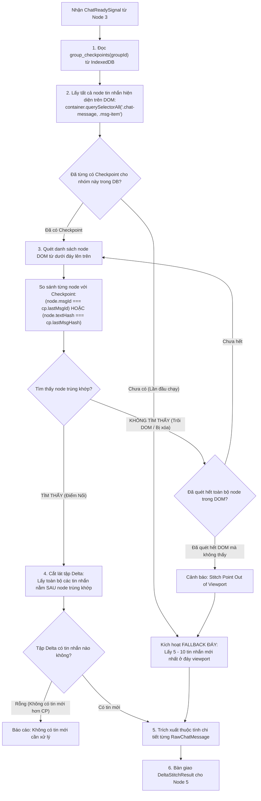

# ĐẶC TẢ CHI TIẾT NODE 04: CHECKPOINT RESOLVER & DELTA STITCHER

**Mã định danh Node**: `N04_DELTA_STITCHER`  
**Tầng kiến trúc**: Tầng 3 — Truy Cập & Xác Định Điểm Nối (Navigation & Stitching Layer)  
**Ngữ cảnh thực thi**: Content Script (`content-script.ts`) trên Zalo Web (`https://chat.zalo.me/*`)  
**Tài liệu tham chiếu**:
- [business_flow.md](file:///c:/Users/ADMIN/Documents/workspace/Sales/EXTENSIONS/Docs/Init/Diagrams/business_flow.md)
- [tai_lieu_thiet_ke_so_bo_zalo_automation.md](file:///c:/Users/ADMIN/Documents/workspace/Sales/EXTENSIONS/Docs/Init/tai_lieu_thiet_ke_so_bo_zalo_automation.md)
- [he_thong_tu_dong_hoa_zalo_extension_spec.md](file:///c:/Users/ADMIN/Documents/workspace/Sales/EXTENSIONS/Docs/Init/he_thong_tu_dong_hoa_zalo_extension_spec.md)

---

## 1. MỤC TIÊU & PHẠM VI (NODE OBJECTIVE & SCOPE)

### 1.1. Mục tiêu Cốt lõi
- Đối chiếu mốc lưu trữ ngắn hạn đã xử lý gần nhất của nhóm nguồn từ bảng `group_checkpoints` trong IndexedDB (`lastMsgId`, `lastMsgHash`).
- Quét các thẻ DOM tin nhắn trong khung chat đang mở từ dưới đáy lên trên để tìm **Điểm Nối (Stitch Point)**.
- Phân tách và trích xuất chính xác dải các tin nhắn mới phát sinh nằm sau Điểm Nối thành tập hợp **Delta Messages**.
- **Thực thi Cơ chế Fallback Đáy An toàn (Bottom Fallback Anchor)**: Nếu không tìm thấy Điểm Nối (do lần đầu khởi chạy hệ thống, tin cũ bị người gửi xóa/thu hồi, hoặc tin nhắn mới dồn về quá nhiều khiến điểm nối cũ bị cuộn mất khỏi Virtualized DOM), hệ thống **tuyệt đối không cuộn ngược lên trên**. Thay vào đó, tự động bóc tách tối đa **5 đến 10 tin nhắn mới nhất tại đáy viewport** để xử lý an toàn.
- Chuẩn hóa các thẻ DOM thô thành danh sách đối tượng `RawChatMessage` và bàn giao cho Node 5 (Bundle Aggregator).

### 1.2. Ranh giới & Không gian Phủ định (In-Scope vs Negative Scope)
- **Trong phạm vi (In-Scope)**:
  - Đọc và phân giải checkpoint từ IndexedDB (Dexie.js).
  - Quét và so khớp ID/Nội dung tin nhắn trên DOM ảo hóa Zalo Web.
  - Bóc tách mảng Delta Messages hoặc kích hoạt Fallback 5–10 tin đáy.
  - Trích xuất định danh người gửi (`senderId`, `senderName`), loại tin nhắn (Text, Image, Video, Grid Album) và thời gian gửi.
- **Ranh giới cấm (Negative Scope - CẤM TUYỆT ĐỐI)**:
  - **CẤM TUYỆT ĐỐI cuộn ngược trang lên trên** khi không tìm thấy điểm nối. Việc cuộn ngược sẽ tải hàng loạt DOM cũ, gây vỡ bố cục và dẫn đến rủi ro nghiêm trọng là gửi lại các tin nhắn cũ từ quá khứ.
  - **CẤM** ghi đè Checkpoint tại Node này. Việc cam kết Checkpoint mới là đặc quyền duy nhất của Node 10 sau khi hoàn tất toàn bộ chu trình gửi tin.

---

## 2. HỢP ĐỒNG KỸ THUẬT & DỮ LIỆU (INPUT/OUTPUT CONTRACTS)

### 2.1. Bản ghi Checkpoint Lưu trữ (`GroupCheckpoint`)
Đọc từ bảng `group_checkpoints` trong IndexedDB:

```typescript
export interface GroupCheckpoint {
  groupId: string;             // Khóa chính: ID nhóm nguồn
  groupName: string;           // Tên nhóm nguồn
  lastMsgId: string;           // ID của tin nhắn cuối cùng đã xử lý thành công
  lastMsgHash: string;         // SHA-256 chuỗi văn bản của tin nhắn cuối
  lastMsgTimestamp: number;    // Thời gian của tin nhắn cuối (ms)
  updatedAt: number;           // Thời điểm cập nhật checkpoint vào DB (ms)
}
```

### 2.2. Đối tượng Tin Nhắn Thô Trích Xuất (`RawChatMessage`)
```typescript
export type MessageType = 'TEXT' | 'IMAGE' | 'VIDEO' | 'ALBUM_GRID' | 'SYSTEM_NOTIFICATION' | 'UNKNOWN';

export interface RawChatMessage {
  msgId: string;               // ID tin nhắn trích xuất từ DOM (ví dụ: data-msg-id, id attribute)
  senderId: string;            // ID người gửi trích xuất từ avatar hoặc attribute của bubble
  senderName: string;          // Tên hiển thị của người gửi
  type: MessageType;           // Phân loại nội dung thẻ tin nhắn
  rawText: string;             // Nội dung chữ nếu có
  textHash: string;            // SHA-256 của chuỗi rawText đã chuẩn hóa
  mediaElements: {
    domElement: HTMLElement;   // Tham chiếu DOM để Node 8 kích hoạt nút Chia sẻ
    mediaType: 'IMAGE' | 'VIDEO';
    previewUrl?: string;
  }[];
  isPendingUpload: boolean;    // Cờ phát hiện ảnh/video đang trong quá trình tải lên (chưa gửi xong)
  domElement: HTMLElement;     // Node container của toàn bộ message item
  timestamp: number;           // Thời điểm hiển thị trên bubble (hoặc Date.now() nếu Zalo không hiện ms)
}
```

### 2.3. Kết Quả Bóc Tách Đầu Ra (`DeltaStitchResult`)
Bàn giao cho Node 5 (Bundle Aggregator):

```typescript
export interface DeltaStitchResult {
  jobId: string;
  groupId: string;
  groupName: string;
  stitchFound: boolean;        // True nếu tìm thấy Điểm Nối cũ; False nếu phải dùng Fallback đáy
  fallbackApplied: boolean;    // True nếu kích hoạt cơ chế Fallback 5-10 tin đáy
  totalScannedInDom: number;   // Tổng số node tin nhắn có trong DOM lúc quét
  deltaCount: number;          // Số lượng tin nhắn mới nằm trong tập Delta
  deltaMessages: RawChatMessage[]; // Danh sách các tin nhắn mới cần được gom cụm
  anchorCheckpoint?: GroupCheckpoint; // Mốc checkpoint cũ được dùng để so khớp
}
```

---

## 3. LUỒNG XỬ LÝ CHI TIẾT & STATE MACHINE (EXECUTION ALGORITHM)

### 3.1. Sơ đồ Luồng Nối Điểm Checkpoint (Stitching Algorithm Flow)



### 3.2. Thuật toán Quét & Fallback Đáy Chi tiết (Step-by-Step)
1. **Lấy danh sách phần tử DOM tin nhắn**:
   - Selector: `const messageNodes = Array.from(chatContainer.querySelectorAll('.chat-item, [data-id^="msg-"], .msg-item'));`.
   - Nếu `messageNodes.length === 0`: Đợi 500ms để DOM ổn định và quét lại 1 lần.
2. **So khớp Điểm Nối (Stitch Point Matcher)**:
   - Duyệt mảng `messageNodes` từ chỉ số `length - 1` lùi dần về `0` (Bottom-up scanning).
   - Với mỗi node, trích xuất ID (`node.getAttribute('data-id')`) và trích xuất text content để băm nhanh SHA-256.
   - Nếu khớp với `lastMsgId` hoặc `lastMsgHash`:
     - Điểm nối tại index `K`.
     - Tập hợp tin mới: `deltaNodes = messageNodes.slice(K + 1)`.
     - `stitchFound = true`, `fallbackApplied = false`.
3. **Cơ chế Fallback Đáy An toàn (Bottom Fallback)**:
   - Kích hoạt khi: Không có checkpoint trong DB HOẶC đã duyệt hết toàn bộ DOM mà không tìm thấy index `K`.
   - Logic:
     ```typescript
     const FALLBACK_COUNT = 8; // Mặc định lấy 8 tin mới nhất ở đáy (trong khoảng 5-10)
     const deltaNodes = messageNodes.slice(-Math.min(messageNodes.length, FALLBACK_COUNT));
     const stitchFound = false;
     const fallbackApplied = true;
     ```
4. **Phân tích thuộc tính từng thẻ tin nhắn (`RawChatMessage`)**:
   - Nhận diện `senderId`: Trích xuất từ avatar `img.avatar` (src hoặc title) hoặc thẻ cha `sender-info`.
   - Nhận diện `type`:
     - Nếu có `.grid-photo, .album-container`: `ALBUM_GRID`.
     - Nếu có `img.chat-image, video`: `IMAGE` hoặc `VIDEO`.
     - Nếu chỉ có text: `TEXT`.
     - Nếu là tin thông báo hệ thống (như "X đã vào nhóm", "Thông báo đổi tên"): `SYSTEM_NOTIFICATION`.
   - Phát hiện trạng thái đang tải lên: Kiểm tra xem có spinner quay, thanh tiến trình upload (`.progress-bar, .uploading-indicator`) ➔ Đặt cờ `isPendingUpload = true`.

---

## 4. XỬ LÝ LỖI, RETRY & EDGE CASES (RESILIENCE MATRIX)

| Mã Ngoại Lệ | Tình Huống Biên (Edge Case) | Phân Tích Kỹ Thuật | Cơ Chế Xử Lý & Phòng Vệ |
| :--- | :--- | :--- | :--- |
| **N04-E01** | **Không tìm thấy Điểm Nối do tin nhắn đổ về quá ồ ạt** | Trong khoảng thời gian Worker bận, nhóm đổ về 200 tin mới. Virtualized DOM của Zalo chỉ giữ lại 30 tin gần nhất ở đáy, khiến tin nhắn Checkpoint cũ bị unmount khỏi DOM. | **Quyết định thiết kế (Đã chốt)**: Áp dụng **Bottom Fallback Anchor**: Lấy đúng 8 tin mới nhất ở đáy màn hình. Tuyệt đối không cuộn ngược lên trên. Tránh hoàn toàn việc nghẽn máy và ngăn ngừa gửi nhầm hàng chục bài cũ. |
| **N04-E02** | **Tin nhắn Điểm Nối cũ bị người gửi thu hồi hoặc xóa** | Bản ghi `lastMsgId` trong IndexedDB không còn tồn tại trên DOM Zalo do người đăng đã xóa tin. | Bộ so khớp 2 lớp: Nếu không khớp `lastMsgId`, thử khớp `lastMsgHash`. Nếu cả 2 đều không khớp sau khi quét hết DOM ➔ Chuyển sang cơ chế Fallback đáy. |
| **N04-E03** | **Lần đầu tiên khởi chạy hệ thống (Bản ghi Checkpoint rỗng)** | Nhóm nguồn mới được thêm vào Whitelist lần đầu, chưa từng có bản ghi trong `group_checkpoints`. | Tự động kích hoạt Fallback đáy: Bóc tách 5–10 tin mới nhất ở đáy để xử lý lượt đầu tiên và thiết lập Checkpoint nền tảng. |
| **N04-E04** | **Tin nhắn hệ thống / Thông báo ghim bài chen vào danh sách tin** | Xuất hiện thẻ "Tin nhắn đã được ghim" hoặc "A đã đổi ảnh nhóm" trong tập Delta. | Nhận diện thẻ `SYSTEM_NOTIFICATION` và chủ động loại bỏ ngay từ tập Delta trước khi bàn giao cho Node 5. |
| **N04-E05** | **Ảnh hoặc video đang trong trạng thái gửi dở (Uploading)** | Người đăng đang tải cụm ảnh lên mạng chậm, một số ảnh chưa load xong thumbnail hoặc đang có icon spinner. | Gắn cờ `isPendingUpload = true`. Khi Node 5 tiếp nhận sẽ kích hoạt cửa sổ Micro-debounce (2-3s) để chờ ảnh tải lên hoàn tất trước khi gom cụm. |

---

## 5. PHỤ THUỘC KỸ THUẬT (TECHNICAL DEPENDENCIES)

1. **Cơ sở dữ liệu cục bộ (IndexedDB — Dexie.js)**:
   - Đọc bảng `group_checkpoints`: `groupId, lastMsgId, lastMsgHash, lastMsgTimestamp`.
   - Ghi log vào `system_logs` khi kích hoạt Fallback đáy.
2. **DOM Selectors (Zalo Web Baseline)**:
   - Danh sách tin nhắn: `#chatView .chat-message-list, [data-id="chat-history"]`.
   - Từng thẻ tin nhắn: `.chat-item, [data-id^="msg-"], .msg-item`.
   - Thẻ Media & Album: `.grid-photo, .album-container, img.chat-image, video.chat-video`.
   - Trạng thái Uploading: `.uploading-spinner, .progress-bar, .upload-mask`.
   - Thông báo hệ thống: `.chat-system-notify, .quote-banner, .pin-message-banner`.
3. **Web Crypto API**:
   - `crypto.subtle.digest('SHA-256', ...)`: Tạo mã băm chuỗi văn bản phục vụ so khớp checkpoint an toàn.

---

## 6. TIÊU CHÍ KIỂM THỬ & NGHIỆM THU (ACCEPTANCE CRITERIA / DoD)

### 6.1. Kịch bản Nghiệm thu Nhị phân (Binary Acceptance Gates)
- **GATE-02 & EX-03 (Fallback Đáy An Toàn Khi Trôi Điểm Nối)**:
  - **Given**: Khung chat đang mở, Checkpoint trong DB là `msg_001` nhưng `msg_001` đã bị trôi mất khỏi DOM (chỉ có `msg_050` đến `msg_080`).
  - **When**: Node 4 thực thi quét tìm điểm nối.
  - **Then**:
    1. Node 4 xác nhận `stitchFound === false` và `fallbackApplied === true`.
    2. Tuyệt đối **KHÔNG** kích hoạt bất kỳ hành vi cuộn ngược trang lên trên.
    3. `deltaMessages` chứa chính xác từ 5 đến 10 tin nhắn mới nhất tại đáy viewport.
- **AC-02 (Bóc Tách Delta Chuẩn Xác Khi Thấy Điểm Nối)**:
  - **Given**: Khung chat có 20 tin nhắn, trong đó tin nhắn thứ 15 trùng khớp với `lastMsgId` trong Checkpoint.
  - **When**: Node 4 thực thi quét.
  - **Then**:
    1. `stitchFound === true`.
    2. `deltaMessages` chứa chính xác 5 tin nhắn (từ tin 16 đến tin 20) theo đúng thứ tự thời gian.
- **AC-03 (Phát Hiện Cờ Pending Upload)**:
  - **Given**: Tin nhắn mới nhất là một ảnh đang có vòng quay loading spinner của Zalo.
  - **When**: Node 4 phân tích thẻ tin nhắn.
  - **Then**: `RawChatMessage` tương ứng phải có cờ `isPendingUpload === true` để Node 5 kích hoạt bộ đệm chờ.

