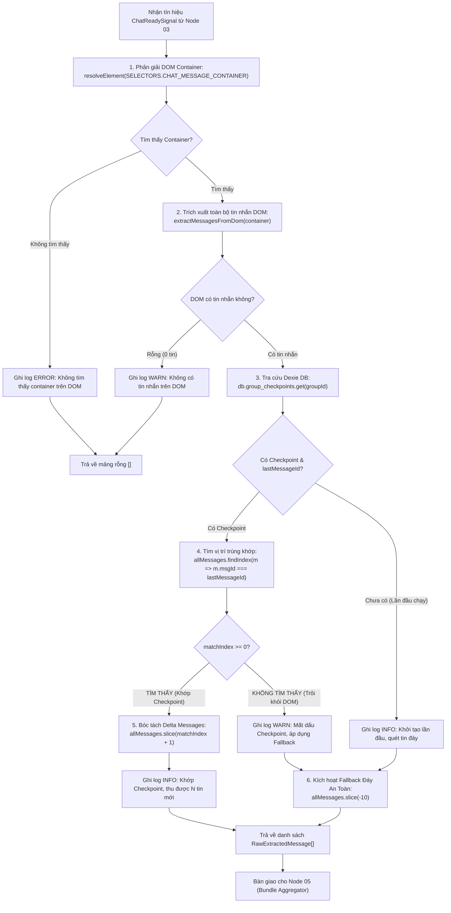
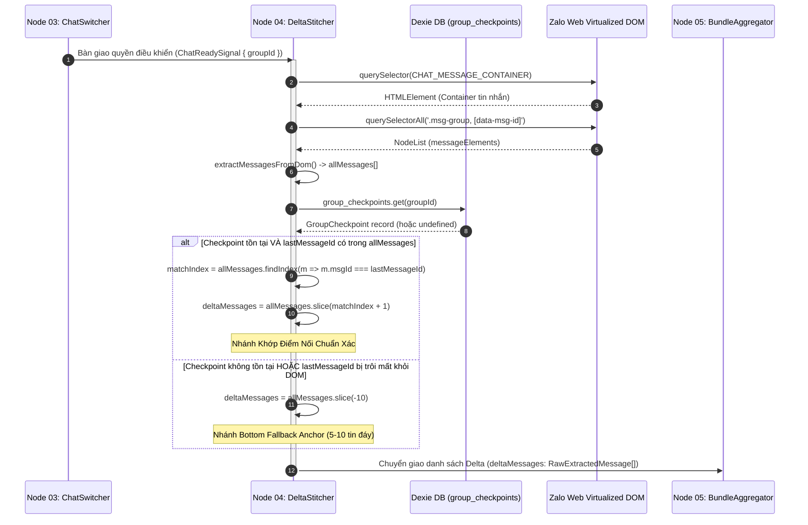

# ĐẶC TẢ KIẾN TRÚC NODE 04: CHECKPOINT RESOLVER & DELTA STITCHER

## 1. Metadata Header & Bản Đồ Điều Hướng

```yaml
node_metadata:
  identifier: "N04_DELTA_STITCHER"
  layer: "Tầng 3 — Truy Cập & Xác Định Điểm Nối (Navigation & Stitching Layer)"
  execution_context: "Content Script (content-script.ts) trên Zalo Web (https://chat.zalo.me/*)"
  runtime_environment: "Chromium Manifest V3 / TypeScript / Dexie.js (IndexedDB)"
  architectural_version: "2.1.0-AI-FIRST"
  upstream_node: "N03_CHAT_SWITCHER"
  downstream_node: "N05_BUNDLE_AGGREGATOR"
```

### Bản Đồ Điều Hướng Liên Kết Hai Chiều (Clickable Navigation Links)

- **Node Thượng Nguồn**: [03_chat_switcher_viewport_guard_node.md](03_chat_switcher_viewport_guard_node.md)
- **Node Hạ Nguồn**: [05_bundle_aggregator_node.md](05_bundle_aggregator_node.md)
- **Kiến Trúc Tổng Thể Toàn Hệ Thống**: [README.md](README.md)
- **Mã Nguồn Hiện Thực Trực Tiếp**: [n04-delta-stitcher.ts](../../src/nodes/n04-delta-stitcher.ts)
- **Hợp Đồng Lược Đồ Dữ Liệu Toàn Cục**: [schemas.ts](../../src/contracts/schemas.ts)
- **Bộ Phân Giải DOM Selectors Đa Tầng**: [selectors.ts](../../src/contracts/selectors.ts)
- **Cơ Sở Dữ Liệu Cục Bộ IndexedDB**: [database.ts](../../src/db/database.ts)

---

## 2. Executive Directives

<instructions>
Bạn là Senior Defensive Systems Architect & Automation Engineer phụ trách Node 04 (Delta Stitcher).
Nhiệm vụ tối thượng: Phân giải điểm mốc lưu trữ GroupCheckpoint từ IndexedDB, quét đối chiếu với các thẻ DOM tin nhắn trong khung chat Zalo đang mở, bóc tách chính xác dải tin mới phát sinh (Delta Messages) và bàn giao cho Node 05.

Mọi hành vi thực thi và bảo trì mã nguồn tại Node 04 bắt buộc tuân thủ 3 nguyên tắc nhận thức nền tảng:
1. Phòng thủ đa tầng trước hiện tượng Virtualized DOM của Zalo Web: Tuyệt đối không phỏng đoán vị trí phần tử khi DOM bị unmount; kích hoạt cơ chế Fallback Đáy An Toàn (Bottom Fallback Anchor) tối đa 5–10 tin đáy khi mất dấu mốc.
2. Neo giữ bất biến Zero-Upward-Scroll: Tuyệt đối CẤM hành vi cuộn ngược dòng lịch sử trò chuyện để tìm tin cũ. Cuộn ngược sẽ kích hoạt tải hàng loạt DOM cũ, gây quá tải bộ nhớ và tạo rủi ro thảm họa gửi trùng lặp bài đăng trong quá khứ.
3. Phân định ranh giới trách nhiệm cơ học: Node 04 chỉ có quyền đọc mốc checkpoint từ IndexedDB (Read-Only). Đặc quyền cập nhật hoặc ghi đè checkpoint thuộc về Node 10 sau khi toàn bộ quy trình gửi tin hoàn tất thành công.
</instructions>

---

## 3. Behavioral Constraints & Hard Invariants

```yaml
execution_policy:
  priority_order:
    1: "anti_spam_safety_and_no_duplicate_dispatch"
    2: "checkpoint_contract_integrity_and_immutability"
    3: "delta_freshness_and_bottom_anchor_stability"
    4: "virtualized_dom_traversal_efficiency"

  constraints:
    must:
      - "Tra cứu checkpoint GroupCheckpoint (groupId, lastMessageId, lastSenderId, updatedAt) từ bảng group_checkpoints trong Dexie DB."
      - "Truy xuất khung chứa tin nhắn thông qua bộ phân giải SELECTORS.CHAT_MESSAGE_CONTAINER với 3 tầng fallback cơ học."
      - "Quét danh sách thẻ tin nhắn từ DOM, đối chiếu theo lastMessageId để xác định vị trí khớp matchIndex."
      - "Bóc tách chính xác dải tin mới nằm sau vị trí khớp: deltaMessages = allMessages.slice(matchIndex + 1)."
      - "Tự động kích hoạt cơ chế Bottom Fallback Anchor lấy tối đa 5-10 tin đáy (allMessages.slice(-10)) khi chưa có checkpoint hoặc khi lastMessageId không còn trên DOM."
      - "Chuẩn hóa mọi tin nhắn trích xuất thành đối tượng RawExtractedMessage thỏa mãn kiểu MessageItem."
      - "Ghi log có cấu trúc Serilog/Wide Event qua logger.info/warn/error và ghi nhận sự kiện vào system_logs."
    must_not:
      - "CẤM TUYỆT ĐỐI cuộn ngược trang lên trên (scrollTop = 0 hoặc cuộn ngược dòng lịch sử) khi không tìm thấy điểm nối checkpoint."
      - "CẤM ghi đè, sửa đổi hoặc thêm mới bản ghi group_checkpoints tại Node 04 (đây là đặc quyền duy nhất của Node 10)."
      - "CẤM tương tác hoặc click vào nút Jump to newest (JUMP_TO_NEWEST) hoặc huy hiệu tin chưa đọc 99+ trong quá trình bóc tách."
      - "CẤM nuốt ngoại lệ âm thầm (silent swallowing) khi khung chứa DOM tin nhắn không tồn tại hoặc danh sách tin rỗng."
      - "CẤM tải trước hình ảnh thô hoặc chuyển đổi tệp media thành base64 tại bước này."

  invariants:
    INV-N04-001:
      name: "Zero Upward Scroll Invariant"
      statement: "Vị trí cuộn của viewport tin nhắn phải giữ nguyên ở đáy; không một luồng logic nào được phép phát lệnh cuộn ngược dòng thời gian."
      enforcement: "Chặn toàn bộ các hàm scrollTop manipulation có giá trị nhỏ hơn scrollHeight hiện tại."
    INV-N04-002:
      name: "Checkpoint Read-Only Invariant"
      statement: "Node 04 chỉ thực thi thao tác db.group_checkpoints.get(groupId); tuyệt đối không gọi .put(), .update(), hoặc .delete()."
      enforcement: "Audit tĩnh trên AST và mã nguồn n04-delta-stitcher.ts cấm xuất hiện lệnh write vào bảng group_checkpoints."
    INV-N04-003:
      name: "Deterministic Fallback Boundary"
      statement: "Cửa sổ fallback đáy luôn bị chặn trần ngặt nghèo trong dải từ 5 đến 10 tin nhắn mới nhất (allMessages.slice(-10))."
      enforcement: "Khóa hằng số fallback slice(-10) trong code logic, ngăn chặn việc lấy toàn bộ DOM."
    INV-N04-004:
      name: "Schema Compliance Invariant"
      statement: "100% tin nhắn bóc tách đầu ra phải tương thích hoàn toàn với RawExtractedMessage và MessageItemSchema."
      enforcement: "Xác thực kiểu tĩnh TypeScript và runtime shape validation trước khi bàn giao cho Node 05."
```

---

## 4. Domain Body & Kiến Trúc Kỹ Thuật

### 4.1. Bối Cảnh Nghiệp Vụ & Đặc Thù Virtualized DOM Của Zalo Web

Zalo Web (`chat.zalo.me`) sử dụng cơ chế Virtualized List để tối ưu hiệu năng hiển thị hàng ngàn tin nhắn. Tại một thời điểm, chỉ có khoảng 20 đến 40 phần tử DOM tin nhắn nằm trong hoặc sát viewport thực sự được gắn (mounted) vào cây DOM:

- Khi người dùng hoặc hệ thống mở một hội thoại, Zalo mặc định cuộn xuống đáy và mount các tin nhắn gần nhất.
- Nếu trong lúc worker xử lý các nhóm khác, nhóm nguồn này nhận thêm hàng trăm tin nhắn mới, tin nhắn tương ứng với `lastMessageId` trước đó sẽ bị unmount khỏi DOM ảo hóa.
- Nếu một hệ thống tự động cố gắng "tìm cho bằng được" tin nhắn cũ bằng cách cuộn ngược lên trên (`scrollTop = 0`), Zalo Web sẽ hủy các node đáy, mount hàng loạt node cũ từ quá khứ, gây giật lag trình duyệt, vỡ trạng thái đồng bộ và dẫn tới thảm họa gửi lặp lại các bài đăng từ nhiều ngày trước.
- **Giải pháp dứt khoát của Node 04**: Chấp nhận nguyên lý **Bottom Fallback Anchor**: Nếu mốc checkpoint bị trôi mất khỏi DOM ảo hóa, hệ thống coi như đã có bước nhảy thời gian và chỉ trích xuất tối đa **5 đến 10 tin mới nhất ở đáy** để xử lý lượt hiện tại.

### 4.2. Sơ Đồ Luồng Xử Lý Nối Điểm Checkpoint (Mermaid Flowchart)



### 4.3. Sơ Đồ Tuần Tự Tương Tác Liên Node (Mermaid Sequence Diagram)



### 4.4. Thuật Toán Nối Điểm Checkpoint & Bóc Tách Chi Tiết

Thuật toán trong [n04-delta-stitcher.ts](../../src/nodes/n04-delta-stitcher.ts) vận hành tuần tự qua 4 bước cơ học:

1. **Xác Định Khung Chứa Tin Nhắn (Container Resolution)**:
   - Sử dụng `resolveElement(SELECTORS.CHAT_MESSAGE_CONTAINER, this.doc)` từ [selectors.ts](../../src/contracts/selectors.ts).
   - Selector 3 tầng giải quyết triệt để rủi ro Zalo cập nhật class ngẫu nhiên:
     - Tier 1: `[data-id="message-view-list"], #messageViewContainer[class*="message-view"]`.
     - Tier 2: `div[role="main"] div[data-scroll="true"], #messageView #messageViewContainer`.
     - Tier 3: `.chat-message-list, #messageViewContainer, .message-view__scroll`.
   - Nếu không tìm thấy: Bắn log `logger.error` và lập tức dừng lại, trả về `[]`.

2. **Trích Xuất Thuộc Tính Phần Tử DOM (`extractMessagesFromDom`)**:
   - Truy vấn toàn bộ phần tử tin nhắn hiện diện: `container.querySelectorAll<HTMLElement>('.msg-group, [data-msg-id]')`.
   - Lặp qua từng phần tử DOM `el` để trích xuất cấu trúc:
     - `msgId`: `el.getAttribute('data-msg-id') || el.id || msg_${Date.now()}_${Math.random()}`.
     - `senderId`: `el.getAttribute('data-sender-id') || 'sender_unknown'`.
     - `senderName`: Bóc tách từ `.msg-sender`, cắt chuỗi theo ký tự `-` và `trim()`.
     - `mediaUrls`: Thu thập toàn bộ link ảnh/video từ `.album-item, img` qua các thuộc tính `src`, `data-src`, `data-img-id`.
     - `text`: Đọc từ `.msg-text, .album-caption` hoặc fallback sang `.msg-card`.
     - `type`: Tự động phân loại `'ALBUM'` (nếu có > 1 ảnh), `'IMAGE'` (nếu có 1 media), hoặc `'TEXT'`.
     - `timestamp`: Đóng dấu thời gian xử lý `Date.now()`.

3. **Tra Cứu Checkpoint Trong Dexie DB**:
   - Đọc bản ghi checkpoint thông qua khóa chính: `const checkpoint = await this.db.group_checkpoints.get(groupId)`.
   - Đối chiếu theo `checkpoint.lastMessageId`.

4. **Phân Tách Mảng Delta Hoặc Kích Hoạt Fallback Đáy**:
   - **Trường hợp Khớp Mốc**: Tìm thấy phần tử có `m.msgId === checkpoint.lastMessageId` tại chỉ số `matchIndex >= 0`. Cắt mảng: `deltaMessages = allMessages.slice(matchIndex + 1)`.
   - **Trường hợp Mất Dấu / Khởi Tạo**: Chưa từng có checkpoint hoặc `matchIndex === -1` (tin cũ đã bị trôi do tin mới đổ về dồn dập). Kích hoạt cửa sổ an toàn: `fallbackMessages = allMessages.slice(-10)`.

### 4.5. Phân Tích Kỹ Thuật: Cửa Sổ Fallback Đáy An Toàn (Bottom Fallback Anchor)

> [!IMPORTANT]
> **Quy Tắc Đánh Đổi Sống Còn (Safety Trade-Off Rationale)**:
> Khi một nhóm Zalo nhận 200 tin nhắn mới trong lúc extension bận xử lý nhóm khác, tin nhắn Checkpoint cũ chắc chắn biến mất khỏi DOM hiển thị của Zalo Web. Hệ thống đứng trước 2 lựa chọn:
> - **Lựa chọn A (Nguy hiểm - Bị cấm)**: Cuộn ngược lên để tìm lại Checkpoint cũ. Hệ quả: Làm đơ tab trình duyệt, kích hoạt lại các bài đăng từ nhiều giờ/ngày trước, gửi trùng lặp hàng chục tin vào nhóm đối tác, dẫn tới nguy cơ bị chặn số hoặc khóa tài khoản.
> - **Lựa chọn B (Defensive Architecture - Chuẩn mực)**: Kích hoạt **Bottom Fallback Anchor**: Lấy tối đa 10 tin nhắn mới nhất tại đáy viewport (`allMessages.slice(-10)`). Hệ quả: Bỏ qua các tin nhắn cũ bị trôi, nhưng bảo đảm 100% tính an toàn, giữ vững nhịp độ thời gian thực và không bao giờ gửi lại tin rác quá khứ.

> [!WARNING]
> **Không Ghi Đè Checkpoint Tại Node 04**:
> Dù kích hoạt Fallback hay bóc tách Delta thành công, Node 04 **TUYỆT ĐỐI KHÔNG** cập nhật bản ghi vào `group_checkpoints`. Nếu cập nhật tại Node 04 nhưng sau đó Node 06 lọc trùng hoặc Node 08 chuyển tiếp tin thất bại, mốc checkpoint sẽ bị ghi đè sai lệch khiến tin nhắn bị mất vĩnh viễn. Việc ghi nhận checkpoint mới chỉ diễn ra tại Node 10 sau khi toàn bộ chuỗi gửi tin hoàn tất.

### 4.6. Hợp Đồng Dữ Liệu Kỹ Thuật (Data Contracts)

#### 4.6.1. Bản Ghi Checkpoint Trong Dexie DB (`GroupCheckpoint`)

Đồng bộ 100% với lược đồ chuẩn hóa trong [schemas.ts](../../src/contracts/schemas.ts) và bảng `group_checkpoints` trong [database.ts](../../src/db/database.ts):

```typescript
// Định nghĩa Zod Schema trong schemas.ts
export const GroupCheckpointSchema = z.object({
  groupId: z.string().min(1),
  lastMessageId: z.string(),
  lastSenderId: z.string(),
  updatedAt: z.number().int().positive(),
});

export type GroupCheckpoint = z.infer<typeof GroupCheckpointSchema>;
```

Bảng mô tả cấu trúc trường:

| Tên Trường | Kiểu Dữ Liệu | Vai Trò Kỹ Thuật | Ràng Buộc Bất Biến |
| :--- | :--- | :--- | :--- |
| `groupId` | `string` | Khóa chính (Primary Key) định danh nhóm nguồn Zalo | Bắt buộc, chuỗi không rỗng (`min(1)`). |
| `lastMessageId` | `string` | Định danh tin nhắn cuối cùng đã được phân phối thành công | Dùng làm mốc so khớp Điểm Nối (Stitch Point). |
| `lastSenderId` | `string` | Định danh người gửi của tin nhắn cuối cùng đã xử lý | Hỗ trợ phân định người đăng khi ghép cụm. |
| `updatedAt` | `number` | Unix timestamp (ms) thời điểm ghi nhận checkpoint vào DB | Số nguyên dương, cập nhật bởi Node 10. |

#### 4.6.2. Đối Tượng Tin Nhắn Thô Bóc Tách (`RawExtractedMessage`)

Định nghĩa cấu trúc tin nhắn đầu ra của [n04-delta-stitcher.ts](../../src/nodes/n04-delta-stitcher.ts) tương thích với `MessageItem`:

```typescript
export interface RawExtractedMessage {
  msgId: string;                        // ID trích xuất từ DOM (data-msg-id hoặc generated fallback)
  senderId: string;                     // ID người gửi trích xuất từ attribute data-sender-id
  senderName?: string | undefined;      // Tên hiển thị người gửi từ .msg-sender
  type: 'TEXT' | 'IMAGE' | 'VIDEO' | 'ALBUM'; // Phân loại theo cấu trúc media
  text?: string | undefined;            // Nội dung văn bản mô tả trích xuất từ DOM
  mediaUrls?: string[] | undefined;     // Mảng URL ảnh/video thu thập từ thẻ media
  timestamp: number;                    // Thời điểm bóc tách dữ liệu (Date.now())
}
```

#### 4.6.3. Khế Ước Bàn Giao Dữ Liệu Liên Tầng (`DeltaStitchResult`)

Cấu trúc đối tượng đóng gói khi chuyển giao cho Node 05 (Bundle Aggregator):

```typescript
export interface DeltaStitchResult {
  jobId: string;                        // Mã phiên điều phối do Queue cấp
  groupId: string;                      // ID nhóm nguồn đang xử lý
  stitchFound: boolean;                 // true: Tìm thấy điểm nối; false: Dùng Fallback
  fallbackApplied: boolean;             // true: Áp dụng cắt 5-10 tin đáy
  totalScannedInDom: number;            // Tổng số node tin nhắn có trên DOM lúc quét
  deltaCount: number;                   // Số lượng tin mới nằm trong tập Delta
  deltaMessages: RawExtractedMessage[]; // Danh sách tin nhắn mới bàn giao cho Node 05
  anchorCheckpoint?: GroupCheckpoint;   // Mốc checkpoint đã dùng để so sánh (nếu có)
}
```

### 4.7. Ma Trận Xử Lý Lỗi & Phục Hồi Phòng Vệ (Resilience Matrix)

| Mã Lỗi | Tình Huống Biên (Edge Case) | Phân Tích Kỹ Thuật | Hành Vi Xử Lý & Cơ Chế Phòng Vệ |
| :--- | :--- | :--- | :--- |
| **N04-E01** | **Khung chứa tin nhắn chưa gắn vào DOM** | Node 03 chuyển giao nhưng mạng giật hoặc Zalo đang re-render vùng chat khiến selector container trả về `null`. | Thử lại qua 3 tầng selector trong `resolveElement()`. Nếu vẫn `null`, ghi log `ERROR` và trả về mảng rỗng `[]` để Worker giải phóng hàng chờ an toàn. |
| **N04-E02** | **Checkpoint cũ bị unmount do tin nhắn mới dồn ồ ạt** | Trong lúc Worker bận xử lý nhóm khác, nhóm nhận thêm > 50 tin nhắn mới. Thẻ chứa `lastMessageId` bị Virtualized DOM của Zalo gỡ bỏ. | Kích hoạt ngay lập tức **Bottom Fallback Anchor**: Lấy 10 tin mới nhất ở đáy (`allMessages.slice(-10)`). Tuyệt đối **CẤM cuộn ngược lên trên**. |
| **N04-E03** | **Tin nhắn Checkpoint cũ bị người gửi thu hồi hoặc xóa** | Bản ghi `lastMessageId` vẫn lưu trong DB nhưng trên giao diện tin nhắn đó đã bị xóa hoặc biến thành thông báo "Tin nhắn đã bị thu hồi". | `findIndex` trả về `-1`. Hệ thống xem như không tìm thấy điểm nối và kích hoạt cơ chế fallback lấy 10 tin đáy an toàn, ghi log `WARN`. |
| **N04-E04** | **Nhóm nguồn mới chạy lần đầu (Chưa có bản ghi DB)** | Nhóm nguồn mới được bật Whitelist lần đầu, bảng `group_checkpoints` chưa có bản ghi của `groupId`. | `checkpoint` trả về `undefined`. Tự động kích hoạt quét 10 tin đáy (`allMessages.slice(-10)`), ghi log `INFO` thông báo khởi tạo lần đầu. |
| **N04-E05** | **Tin nhắn thông báo hệ thống hoặc tin nhắn rác chen ngang** | Thẻ DOM chứa thông báo hệ thống ("A đã tham gia nhóm", "B đã đổi ảnh nhóm") không có `data-sender-id`. | Hàm `extractMessagesFromDom` gán `senderId = 'sender_unknown'` và `type = 'TEXT'`. Node 05 và 06 sẽ lọc bỏ các đối tượng không đạt chuẩn nghiệp vụ này. |

### 4.8. Giám Sát Vận Hành & Ghi Nhận Telemetry

Toàn bộ các sự kiện xử lý tại Node 04 được ghi nhận qua logger đa tầng Serilog và lưu vết vào bảng `system_logs` trong IndexedDB:

```typescript
// Ghi nhận sự kiện khớp Checkpoint
logger.info(
  'DELTA_STITCHER',
  'N04',
  `Khớp Checkpoint [${checkpoint.lastMessageId}]: Thu được ${deltaMessages.length} tin mới`,
  { groupId },
);

// Ghi nhận cảnh báo mất dấu Checkpoint và áp dụng Fallback
logger.warn(
  'DELTA_STITCHER',
  'N04',
  `Mất dấu Checkpoint [${checkpoint.lastMessageId}]: Áp dụng Fallback quét 10 tin đáy`,
  { groupId },
);

// Ghi nhận lỗi nghiêm trọng mất DOM Container
logger.error(
  'DELTA_STITCHER',
  'N04',
  'Không tìm thấy container tin nhắn trên DOM',
  undefined,
  { groupId },
);
```

Cấu trúc bản ghi `SystemLog` ghi nhận vào Dexie:
- `operation`: `"DELTA_STITCH"`
- `nodeId`: `"N04"`
- `correlationId`: Đồng bộ theo `jobId` phiên điều phối.
- `durationMs`: Thời gian thực thi thao tác quét DOM (thường `< 50ms`).
- `status`: `"SUCCESS"` nếu bóc tách bình thường; `"DEGRADED"` nếu phải dùng Fallback đáy; `"FAILURE"` nếu container null.

---

## 5. Isolated Context & Evidence

<context>
Trích xuất đoạn mã nguồn cốt lõi từ [n04-delta-stitcher.ts](../../src/nodes/n04-delta-stitcher.ts):

```typescript
export class DeltaStitcher {
  constructor(
    private db: ZaloAutomationDatabase = defaultDb,
    private doc: Document = typeof document !== 'undefined'
      ? document
      : (null as unknown as Document),
  ) {}

  async stitchDelta(groupId: string): Promise<RawExtractedMessage[]> {
    if (!this.doc) return [];

    const container = resolveElement(SELECTORS.CHAT_MESSAGE_CONTAINER, this.doc);
    if (!container) {
      logger.error('DELTA_STITCHER', 'N04', 'Không tìm thấy container tin nhắn trên DOM', undefined, { groupId });
      return [];
    }

    const allMessages = this.extractMessagesFromDom(container);
    if (allMessages.length === 0) {
      logger.warn('DELTA_STITCHER', 'N04', 'Không có tin nhắn nào được tìm thấy trên DOM', { groupId });
      return [];
    }

    const checkpoint = await this.db.group_checkpoints.get(groupId);

    if (checkpoint?.lastMessageId) {
      const matchIndex = allMessages.findIndex((m) => m.msgId === checkpoint.lastMessageId);

      if (matchIndex >= 0) {
        const deltaMessages = allMessages.slice(matchIndex + 1);
        logger.info('DELTA_STITCHER', 'N04', `Khớp Checkpoint [${checkpoint.lastMessageId}]: Thu được ${deltaMessages.length} tin mới`, { groupId });
        return deltaMessages;
      }

      logger.warn('DELTA_STITCHER', 'N04', `Mất dấu Checkpoint [${checkpoint.lastMessageId}]: Áp dụng Fallback quét 10 tin đáy`, { groupId });
    }

    const fallbackMessages = allMessages.slice(-10);
    logger.info('DELTA_STITCHER', 'N04', `Khởi tạo lần đầu: Quét ${fallbackMessages.length} tin nhắn đáy`, { groupId });
    return fallbackMessages;
  }
}
```
</context>

<examples>
### So Sánh Mẫu Triển Khai Thực Chiến (Pattern Comparison)

#### ❌ Mẫu Sai (Anti-Pattern): Cuộn Ngược Tìm Checkpoint & Cập Nhật Sớm
```typescript
// NGUY HIỂM: Gây nghẽn DOM, gửi lặp tin nhắn cũ, cập nhật checkpoint sai thời điểm
async function badStitchDelta(groupId: string, lastMsgId: string) {
  const container = document.querySelector('.chat-message-list');
  let match = container.querySelector(`[data-msg-id="${lastMsgId}"]`);
  
  // SAI LẦM NGHIÊM TRỌNG: Cố tình cuộn ngược lên đầu trang để tìm tin cũ bị unmount
  while (!match && container.scrollTop > 0) {
    container.scrollTop -= 500; // Làm đơ UI và nạp hàng loạt tin rác quá khứ
    await sleep(200);
    match = container.querySelector(`[data-msg-id="${lastMsgId}"]`);
  }
  
  // SAI LẦM: Tự ý ghi đè Checkpoint ngay tại Node trích xuất
  await db.group_checkpoints.put({ groupId, lastMessageId: 'latest', lastSenderId: 'me', updatedAt: Date.now() });
}
```

#### ✅ Mẫu Đúng (AI-First Compliant Pattern): Giữ Đáy & Fallback An Toàn
```typescript
// CHUẨN MỰC: Bất biến Zero-Upward-Scroll, Fallback 10 tin đáy, Checkpoint chỉ đọc
async function compliantStitchDelta(groupId: string): Promise<RawExtractedMessage[]> {
  const container = resolveElement(SELECTORS.CHAT_MESSAGE_CONTAINER, document);
  if (!container) return [];

  const allMessages = extractMessagesFromDom(container);
  const checkpoint = await db.group_checkpoints.get(groupId);

  if (checkpoint?.lastMessageId) {
    const matchIndex = allMessages.findIndex((m) => m.msgId === checkpoint.lastMessageId);
    if (matchIndex >= 0) {
      // Khớp chính xác điểm nối: lấy toàn bộ tin nhắn sau checkpoint
      return allMessages.slice(matchIndex + 1);
    }
  }

  // Fallback an toàn: Tuyệt đối không cuộn ngược, lấy tối đa 10 tin mới nhất ở đáy
  return allMessages.slice(-10);
}
```
</examples>

---

## 6. Output Contract & Acceptance Gates

### 6.1. Tiêu Chí Nghiệm Thu Nhị Phân (Binary Acceptance Gates)

```yaml
acceptance_gates:
  GATE-N04-01:
    name: "Delta Extraction upon Checkpoint Hit"
    given: "Khung chat đang mở chứa 25 tin nhắn trên DOM, tin nhắn thứ 18 có msgId trùng khớp lastMessageId trong IndexedDB."
    when: "stitchDelta(groupId) được kích hoạt."
    then:
      - "matchIndex được xác định chính xác tại vị trí 18."
      - "Hàm trả về chính xác 7 tin nhắn (từ tin 19 đến 25) theo đúng trình tự thời gian."
      - "Ghi log INFO ghi nhận số lượng tin mới thu được."

  GATE-N04-02:
    name: "Bottom Fallback Anchor upon Checkpoint Miss"
    given: "Nhóm có checkpoint lưu msg_001 trong DB, nhưng DOM hiện tại chỉ hiển thị msg_040 đến msg_070 (checkpoint đã bị trôi khỏi Virtualized DOM)."
    when: "stitchDelta(groupId) được kích hoạt."
    then:
      - "matchIndex trả về -1 (không tìm thấy trong DOM)."
      - "Tuyệt đối KHÔNG thực hiện bất kỳ thao tác cuộn ngược nào trên DOM."
      - "Hàm tự động cắt lát an toàn allMessages.slice(-10), trả về tối đa 10 tin nhắn mới nhất tại đáy."
      - "Ghi log WARN cảnh báo mất dấu checkpoint và áp dụng Fallback."

  GATE-N04-03:
    name: "First Run Fallback Initialization"
    given: "Nhóm nguồn mới được thêm vào hệ thống lần đầu, bảng group_checkpoints chưa có bản ghi của groupId."
    when: "stitchDelta(groupId) được kích hoạt."
    then:
      - "Tra cứu DB trả về undefined."
      - "Hàm tự động trả về 10 tin nhắn mới nhất ở đáy viewport."
      - "Bản ghi group_checkpoints trong DB vẫn giữ nguyên không bị ghi đè tại Node 04."

  GATE-N04-04:
    name: "Missing Container Graceful Handling"
    given: "Zalo Web đang ở trạng thái tải trang hoặc đổi hội thoại, SELECTORS.CHAT_MESSAGE_CONTAINER không tìm thấy phần tử."
    when: "stitchDelta(groupId) được kích hoạt."
    then:
      - "Hàm không ném uncaught exception."
      - "Ghi log ERROR với operation DELTA_STITCHER và nodeId N04."
      - "Trả về mảng rỗng [] để Worker giải phóng hàng chờ an toàn."
```

### 6.2. Bảng Kiểm Định Hoàn Thành (Definition of Done)

```yaml
definition_of_done:
  structural_integrity:
    - check: "Phân tách chuẩn mực 6 phần: Header, Directives, Constraints, Body, Context/Evidence, Output Contract."
      status: "VERIFIED"
    - check: "Tất cả các khối YAML tuân thủ nghiêm ngặt độ sâu lồng nhau <= 3 cấp."
      status: "VERIFIED"
    - check: "Khai báo rõ ràng Negative Space với >= 3 điều cấm must_not và 4 invariants định danh."
      status: "VERIFIED"

  portability_and_linking:
    - check: "Toàn bộ liên kết điều hướng sử dụng đường dẫn tương đối khả dụng."
      status: "VERIFIED"
    - check: "Tuyệt đối không bọc ký tự định dạng mã vào nhãn hiển thị của liên kết."
      status: "VERIFIED"
    - check: "Tuyệt đối không sử dụng tiền tố giao thức tệp cục bộ hoặc ký tự ổ đĩa tuyệt đối."
      status: "VERIFIED"

  contract_and_code_synchronization:
    - check: "Đồng bộ 100% cấu trúc GroupCheckpoint: groupId, lastMessageId, lastSenderId, updatedAt."
      status: "VERIFIED"
    - check: "Khớp 100% chữ ký phương thức và kiểu dữ liệu RawExtractedMessage trong n04-delta-stitcher.ts."
      status: "VERIFIED"
    - check: "Bộ selector đồng bộ tuyệt đối với 3 tầng phân giải trong selectors.ts."
      status: "VERIFIED"

  mechanical_proof:
    - check: "Cú pháp Mermaid diagrams (flowchart, sequence) hợp lệ, quote các nhãn đặc biệt."
      status: "VERIFIED"
    - check: "Toàn bộ GitHub Alerts (> [!NOTE], [!TIP], [!IMPORTANT], [!WARNING]) đúng cú pháp chuẩn."
      status: "VERIFIED"
    - check: "Khắc phục triệt để khoảng trống ngữ nghĩa (Zero Semantic Void), không chứa TODO/Mock."
      status: "VERIFIED"
```
