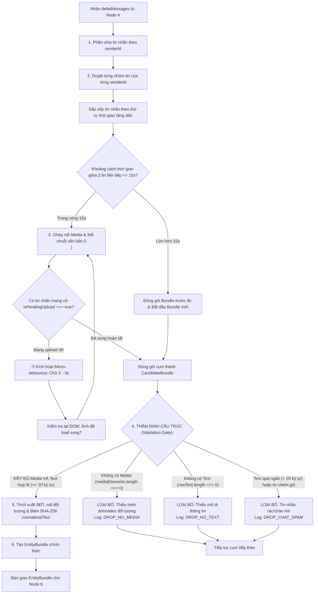

# ĐẶC TẢ CHI TIẾT NODE 05: BUNDLE AGGREGATOR & DEBOUNCE BUFFER

**Mã định danh Node**: `N05_BUNDLE_AGGREGATOR`  
**Tầng kiến trúc**: Tầng 4 — Gom Cụm & Xử Lý Nội Dung (Aggregation & Processing Layer)  
**Ngữ cảnh thực thi**: Content Script (`content-script.ts`) trên Zalo Web (`https://chat.zalo.me/*`)  
**Tài liệu tham chiếu**:
- [business_flow.md](file:///c:/Users/ADMIN/Documents/workspace/Sales/EXTENSIONS/Docs/Init/Diagrams/business_flow.md)
- [tai_lieu_thiet_ke_so_bo_zalo_automation.md](file:///c:/Users/ADMIN/Documents/workspace/Sales/EXTENSIONS/Docs/Init/tai_lieu_thiet_ke_so_bo_zalo_automation.md)
- [he_thong_tu_dong_hoa_zalo_extension_spec.md](file:///c:/Users/ADMIN/Documents/workspace/Sales/EXTENSIONS/Docs/Init/he_thong_tu_dong_hoa_zalo_extension_spec.md)

---

## 1. MỤC TIÊU & PHẠM VI (NODE OBJECTIVE & SCOPE)

### 1.1. Mục tiêu Cốt lõi
- Tiếp nhận tập hợp các tin nhắn thô (`RawChatMessage[]`) trong mảng Delta từ Node 4.
- Triển khai **Thuật toán Gom cụm Đa phương tiện theo Người gửi & Cửa sổ Thời gian 15s**: Tự động ghép nối các tin nhắn rời rạc (Ảnh lẻ, Album ảnh Grid, Video, Văn bản mô tả) của cùng một người gửi diễn ra trong khoảng cách `<= 15 giây` thành một thực thể nghiệp vụ duy nhất mang tên **`EntityBundle`**.
- Xử lý trường hợp người gửi chia nhỏ văn bản thành nhiều đoạn chat nối tiếp bằng cách ghép chuỗi (`\n`).
- Cơ chế **Micro-debounce Buffer (2–3 giây)**: Nếu phát hiện tin nhắn đa phương tiện gần nhất đang trong trạng thái tải lên dở dang (`isPendingUpload === true`), tạm dừng chờ 2–3s để ảnh/video hiển thị trọn vẹn trước khi đóng gói.
- **Cổng Thẩm định Cấu trúc Ban đầu (Structural Validation Gate)**: Lọc bỏ ngay lập tức các cụm tin nhắn không đạt chuẩn đối tượng kinh doanh (chỉ có text không có ảnh, chỉ có ảnh không có mô tả, hoặc tin nhắn chào hỏi/rác ngắn `< 20 ký tự`).
- Bàn giao danh sách các `EntityBundle` hoàn chỉnh, hợp lệ cho Node 6 (Deduplication Gate).

### 1.2. Ranh giới & Không gian Phủ định (In-Scope vs Negative Scope)
- **Trong phạm vi (In-Scope)**:
  - Phân loại tin nhắn theo `senderId` để cô lập các cuộc hội thoại xen ngang của người thứ 3.
  - Tính toán khoảng cách thời gian `abs(time_n - time_{n-1}) <= 15000ms`.
  - Nhận diện thẻ bao Album ảnh Grid (`.grid-photo`) của Zalo.
  - Chuẩn hóa text sơ bộ và phát hiện các biến thể số điện thoại (chữ O thay số 0, dấu chấm, dấu cách).
  - Lọc điều kiện bắt buộc: Phải có ít nhất 1 phần tử Media VÀ có đoạn text mô tả `>= 20 ký tự`.
- **Ranh giới cấm (Negative Scope - CẤM TUYỆT ĐỐI)**:
  - **CẤM** kiểm tra trùng lặp với cơ sở dữ liệu IndexedDB tại Node này (đây là nhiệm vụ chuyên trách của Node 6).
  - **CẤM** tải file ảnh/video về máy hoặc chuyển đổi sang base64 (chỉ lưu giữ DOM Selector / Element reference để forward trực tiếp qua modal gốc của Zalo).
  - **CẤM** sửa đổi nội dung văn bản gốc tại bước này (nội dung gốc `rawText` phải được bảo toàn nguyên vẹn 100%).

---

## 2. HỢP ĐỒNG KỸ THUẬT & DỮ LIỆU (INPUT/OUTPUT CONTRACTS)

### 2.1. Đầu vào: Kết Quả Bóc Tách Tin Nhắn Mới (`DeltaStitchResult`)
Tiếp nhận từ Node 4:

```typescript
export interface DeltaStitchResult {
  jobId: string;
  groupId: string;
  groupName: string;
  stitchFound: boolean;
  fallbackApplied: boolean;
  deltaMessages: RawChatMessage[];
}
```

### 2.2. Đầu ra: Đối Tượng Thực Thể Đóng Gói (`EntityBundle`)
Bàn giao cho Node 6 (Validation & Deduplication Gate):

```typescript
export interface BundleMediaItem {
  type: 'IMAGE' | 'VIDEO' | 'ALBUM_GRID';
  domElement: HTMLElement;      // Tham chiếu node DOM trên Zalo để kích hoạt nút Chia sẻ
  previewUrl?: string;          // Blob hoặc URL ảnh thu nhỏ để hiển thị xem trước
  isAlbumGrid: boolean;         // True nếu là cụm album nhiều ảnh Zalo tự gộp
}

export interface ExtractedKeys {
  phoneNumbers: string[];       // Danh sách số điện thoại 10 số đã chuẩn hóa
  itemCodes: string[];          // Mã căn, mã phòng, mã sản phẩm (nếu có)
  primaryKey: string;           // Khóa chính nghiệp vụ: SĐT đầu tiên + Mã căn (ví dụ: "0901234567_P302")
}

export interface EntityBundle {
  bundleId: string;             // UUID: "BUNDLE_<timestamp>_<senderId>_<random>"
  jobId: string;                // ID phiên xử lý của nhóm
  sourceGroupId: string;        // ID của Nhóm Nguồn
  sourceGroupName: string;      // Tên Nhóm Nguồn
  senderId: string;             // ID người đăng gốc
  senderName: string;           // Tên người đăng
  mediaElements: BundleMediaItem[]; // Mảng các thành phần media (ảnh/video)
  rawText: string;              // Toàn bộ text gốc ghép nối từ các bubble liên tiếp
  normalizedText: string;       // Text sau khi lowercase, bỏ khoảng trắng thừa, normalize Unicode
  contentHash: string;          // SHA-256 của chuỗi normalizedText
  extractedKeys: ExtractedKeys; // Khóa định danh trích xuất được
  createdAt: number;            // Timestamp tạo bundle (ms)
}
```

---

## 3. LUỒNG XỬ LÝ CHI TIẾT & STATE MACHINE (EXECUTION ALGORITHM)

### 3.1. Sơ đồ Luồng Thuật toán Gom cụm & Lọc Cấu trúc (Flowchart)



### 3.2. Thuật toán Chi tiết Từng Bước
1. **Phân vùng theo Người gửi (`senderId`)**:
   - Tách mảng `deltaMessages` thành các mảng con theo từng `senderId`.
   - Giúp triệt tiêu rủi ro người thứ 3 nhắn chen ngang làm đứt gãy hoặc ô nhiễm nội dung của người đăng bài.
2. **Cửa sổ trượt 15 giây (15-Second Sliding Window)**:
   - Khởi tạo `currentBundle = { media: [], texts: [], lastTimestamp: 0 }`.
   - Với mỗi tin nhắn `msg`:
     - Nếu `currentBundle.lastTimestamp === 0` hoặc `msg.timestamp - currentBundle.lastTimestamp <= 15000`:
       - Đẩy `msg.mediaElements` vào `currentBundle.media`.
       - Nếu có `msg.rawText`: Nối vào `currentBundle.texts` (dùng ký tự xuống dòng `\n`).
       - Cập nhật `currentBundle.lastTimestamp = msg.timestamp`.
     - Nếu khoảng cách `> 15000ms`:
       - Chốt `currentBundle` cũ, đưa vào danh sách ứng viên kiểm duyệt.
       - Khởi tạo `currentBundle` mới với `msg` hiện tại.
3. **Cơ chế Micro-debounce Chờ Tải (2–3 giây)**:
   - Nếu phần tử media cuối cùng có cờ `isPendingUpload === true`:
     - Tạm dừng thực thi 2000ms bằng `await new Promise(r => setTimeout(r, 2000))`.
     - Quét lại DOM của node media đó xem thumbnail hoặc nút Chia sẻ đã xuất hiện chưa.
4. **Trích xuất Khóa Nghiệp vụ (`ExtractedKeys`)**:
   - **Số điện thoại**:
     - Thay thế chữ `O/o` thành `0` trong các chuỗi có định dạng số.
     - Loại bỏ khoảng trắng, dấu chấm, gạch ngang: `090.123.4567` ➔ `0901234567`.
     - Regex nhận diện: `/(03|05|07|08|09|01[2|6|8|9])+([0-9]{8})\b/g`.
   - **Mã căn / Mã đối tượng**:
     - Regex: `/(phòng|p\.|p|căn|căn\shộ|mã)\s*([A-Za-z0-9_-]{2,10})/gi`.
   - **Primary Key**: `phoneNumbers[0] ? (phoneNumbers[0] + (itemCodes[0] ? '_' + itemCodes[0] : '')) : ''`.

---

## 4. XỬ LÝ LỖI, RETRY & EDGE CASES (RESILIENCE MATRIX)

| Mã Ngoại Lệ | Tình Huống Biên (Edge Case) | Phân Tích Kỹ Thuật | Cơ Chế Xử Lý & Phòng Vệ |
| :--- | :--- | :--- | :--- |
| **L4-01** | **Zalo gom ảnh thành Grid Album** | Zalo Web tự động gom 4 ảnh trở lên thành một ô lưới (Grid photo). Khung DOM chỉ có 1 nút "Chia sẻ" chung cho toàn bộ album. | Nhận diện thẻ bao `.grid-photo, .album-container`. Đánh dấu `isAlbumGrid = true`. Lưu phần tử bao làm `domElement`. Khi Node 8 click nút Chia sẻ của thẻ bao này, Zalo sẽ tự động đính kèm toàn bộ album ảnh vào modal. |
| **L4-02** | **Người gửi chia 2 tin nhắn văn bản liên tiếp** | Tin 1: "Cho thuê phòng 30m2 khép kín...", Tin 2: "Giá 3.5tr LH 0901234567". | Thuật toán cửa sổ 15s tự động ghép nối hai đoạn văn bản bằng ký tự `\n`, bảo đảm không bị sót giá hoặc số điện thoại nằm ở tin nhắn thứ hai. |
| **L4-03** | **Người thứ 3 nhắn tin xen ngang (Spam / Hỏi giá)** | Giữa 4 ảnh của Người A và đoạn mô tả của Người A, có Người B nhắn "còn phòng ko ad". | Phân loại theo `senderId`. Tin của B được gom vào bundle riêng của B. Khi qua Cổng Thẩm định Cấu trúc, bundle của B bị loại bỏ 100% do thiếu media. Bundle của A vẫn được gom trọn vẹn. |
| **L4-04** | **Số điện thoại bị cố tình viết cách hoặc mã hóa** | Bài đăng ghi: `O9O.123.4567`, `090 123 4567`, `LH: 09 01 23 45 67`. | Bộ tiền xử lý (Pre-normalizer): Thay thế chữ O/o đứng cạnh số thành 0, xóa bỏ toàn bộ dấu chấm, dấu gạch nối và khoảng trắng giữa các chữ số trước khi chạy Regex. |
| **L4-05** | **Cụm bài đăng chỉ toàn ảnh quảng cáo không có chữ mô tả** | Người đăng gửi 3 ảnh sản phẩm nhưng không ghi bất kỳ chữ nào kèm theo. | Cổng thẩm định loại bỏ ngay (`DROP_NO_TEXT`). Không tiến hành forward những bài thiếu thông tin mô tả chi tiết để tránh làm loãng nhóm con. |

---

## 5. PHỤ THUỘC KỸ THUẬT (TECHNICAL DEPENDENCIES)

1. **DOM Selectors (Zalo Web Baseline)**:
   - Thẻ bao Album Grid: `.grid-photo, .album-container, [data-id="album-grid"]`.
   - Nút chia sẻ trên Media: `.btn-forward, [data-translate-inner="STR_SHARE"], .chat-action-share`.
   - Thẻ text message: `.chat-message-text, .msg-text, .text-content`.
2. **Web Crypto API**:
   - `crypto.subtle.digest('SHA-256', ...)`: Tính toán `contentHash` của chuỗi văn bản đã chuẩn hóa.
3. **Module tương tác**:
   - Nhận đầu vào: `DeltaStitchResult` từ Node 4.
   - Giao việc đầu ra: Gọi `deduplicationGate.evaluateBundle(bundle)` của Node 6.

---

## 6. TIÊU CHÍ KIỂM THỬ & NGHIỆM THU (ACCEPTANCE CRITERIA / DoD)

### 6.1. Kịch bản Nghiệm thu Nhị phân (Binary Acceptance Gates)
- **AC-01 (Thẩm Định Cấu Trúc Bắt Buộc: Cả Media VÀ Text)**:
  - **Given**: Người dùng A chỉ gửi 1 tin nhắn văn bản thuần túy "Cần thuê nhà gấp LH 0901234567".
  - **When**: Node 5 thực hiện thẩm định cấu trúc.
  - **Then**: Cụm này bị loại bỏ 100% với lý do `DROP_NO_MEDIA`, không phát sinh `EntityBundle`.
- **AC-02 (Gom Cụm Liên Tiếp Trong 15s)**:
  - **Given**: Người gửi A gửi 1 Album ảnh vào thời điểm T, và gửi đoạn mô tả 50 ký tự vào thời điểm T + 7 giây.
  - **When**: Node 5 xử lý.
  - **Then**: Cả 2 tin nhắn được gộp chung thành **1 duy nhất** `EntityBundle` chứa đầy đủ ảnh và đoạn mô tả đó.
- **AC-03 (Bóc Tách Số Điện Thoại Mã Hóa Chữ O)**:
  - **Given**: Văn bản chứa chuỗi "LH chính chủ O9O.123.4567 ngay".
  - **When**: Node 5 trích xuất khóa.
  - **Then**: `extractedKeys.phoneNumbers` phải chứa chuỗi chuẩn hóa `"0901234567"`.
- **AC-04 (Xử Lý Album Grid Ảnh)**:
  - **Given**: Người gửi tải lên 6 ảnh, Zalo hiển thị dạng Grid photo với 1 thẻ bao.
  - **When**: Node 5 phân tích.
  - **Then**: `mediaElements[0].isAlbumGrid === true` và `domElement` trỏ đúng vào thẻ cha có thể kích hoạt nút Chia sẻ của Zalo.

