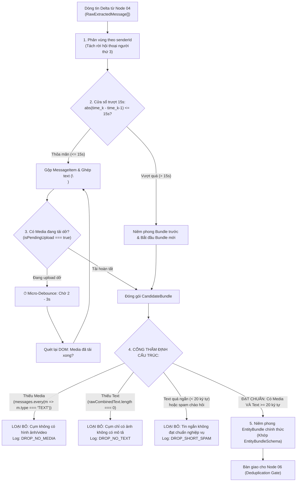
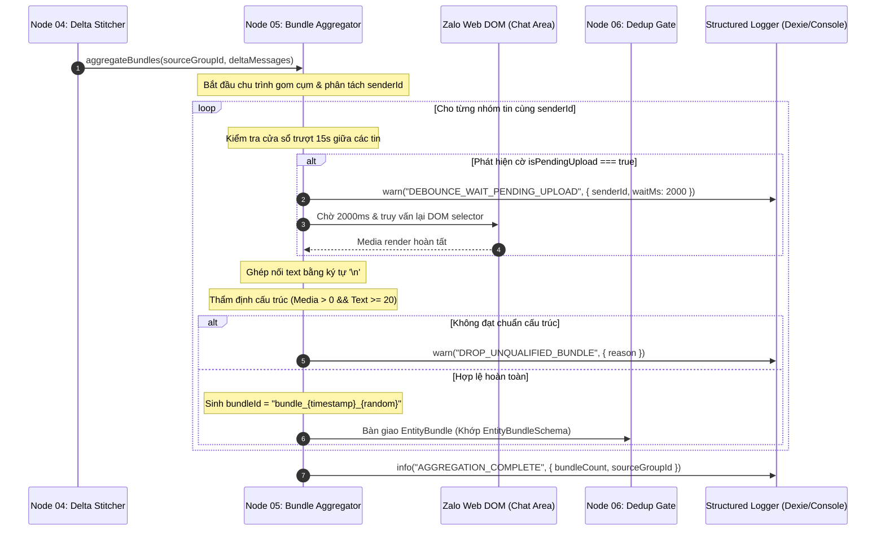

# ĐẶC TẢ CHI TIẾT NODE 05: BUNDLE AGGREGATOR & DEBOUNCE BUFFER

```yaml
node_metadata:
  node_id: "N05_BUNDLE_AGGREGATOR"
  layer: "Tầng 4 — Gom Cụm & Xử Lý Nội Dung (Aggregation & Processing Layer)"
  execution_context: "Content Script (content-script.ts) trên Zalo Web (https://chat.zalo.me/*)"
  specification_version: "2.1.0"
  updated_at: "2026-11-12"
  status: "ACTIVE"
```

## 1. Bản Đồ Điều Hướng & Liên Kết Tương Đối (Navigation Map)

- Node trước: [04_checkpoint_delta_stitcher_node.md](04_checkpoint_delta_stitcher_node.md)
- Tổng mục kiến trúc: [README.md](README.md)
- Node kế tiếp: [06_validation_deduplication_gate_node.md](06_validation_deduplication_gate_node.md)
- Mã nguồn triển khai: [n05-bundle-aggregator.ts](../../src/nodes/n05-bundle-aggregator.ts)
- Hợp đồng lược đồ Zod: [schemas.ts](../../src/contracts/schemas.ts)
- Bộ giải quyết DOM Selectors: [selectors.ts](../../src/contracts/selectors.ts)

---

## 2. Chỉ Thị Cấp Cao Dành Cho Agent (Executive Directives)

<instructions>
Bạn đang đóng vai trò Kỹ sư Thiết kế Phòng thủ & Chuyên viên Xử lý Dữ liệu Chuỗi (Defensive Systems Architect & Stream Aggregator) của hệ thống tự động hóa Zalo Web Extension.

Mệnh lệnh thực thi tối thượng:
1. Tiếp nhận mảng tin nhắn Delta (`RawExtractedMessage[]`) bóc tách từ Node 04.
2. Tuyệt đối cô lập tin nhắn theo từng người gửi (`senderId`). Không bao giờ được phép gộp tin nhắn của người gửi khác nhau vào chung một thực thể nghiệp vụ.
3. Vận hành cửa sổ trượt 15 giây (15-Second Sliding Window): Chỉ gom các tin nhắn kế tiếp của cùng một người gửi nếu khoảng cách thời gian giữa hai tin liên tiếp nhỏ hơn hoặc bằng 15.000ms. Khi vượt quá 15s hoặc đổi người gửi, lập tức đóng gói cụm trước và khởi tạo cụm mới.
4. Triển khai cơ chế Micro-Debounce Buffer (2–3 giây): Nếu tin nhắn đa phương tiện gần nhất đang trong trạng thái tải lên hoặc DOM chưa hoàn tất kết xuất (`isPendingUpload === true`), tạm dừng chờ 2–3s để tài nguyên ảnh/video hiển thị trọn vẹn trước khi niêm phong.
5. Ghép nối toàn bộ các đoạn văn bản rời rạc của các bubble liên tiếp bằng ký tự xuống dòng `\n`, bảo tồn nguyên vẹn 100% nội dung gốc vào trường `rawCombinedText`.
6. Thực thi thẩm định cấu trúc (Structural Validation Gate): Lọc bỏ các cụm rác, chào hỏi ngắn hoặc cụm không đạt chuẩn đối tượng nghiệp vụ trước khi phát đi.
7. Đóng gói đối tượng đầu ra đạt 100% chuẩn kiểm thực của `EntityBundleSchema` trong schemas.ts và bàn giao cho Node 06.
</instructions>

---

## 3. Ràng Buộc Kỹ Thuật & Khung Hành Vi (Behavioral Constraints)

```yaml
execution_policy:
  priority_order:
    1: "sender_isolation_and_data_integrity"
    2: "schema_contract_compliance"
    3: "debounce_buffer_stability"
    4: "minimal_latency_and_memory_footprint"

  constraints:
    must:
      - "Cô lập triệt để theo senderId: Mỗi EntityBundle chỉ chứa tin nhắn của duy nhất 1 người gửi."
      - "Áp dụng ngưỡng trượt 15s (<= 15000ms) tính giữa hai tin nhắn kế tiếp cùng sender."
      - "Ghép các đoạn text phân mảnh bằng ký tự xuống dòng '\\n', loại bỏ dòng rỗng thừa ở hai đầu."
      - "Xác thực 100% đối tượng đầu ra thông qua EntityBundleSchema.parse() trước khi bàn giao."
      - "Ghi log cấu trúc theo chuẩn Canonical Log Line (nodeId='N05', operation='BUNDLE_AGGREGATOR')."
    must_not:
      - "CẤM gộp tin nhắn của người gửi khác nhau vào cùng một EntityBundle (hậu quả: lộ thông tin, sai lệch đối tượng phân phối)."
      - "CẤM tải xuống (download) file media về máy hoặc mã hóa sang Base64 (hậu quả: tràn RAM OOM, mất tính năng forward native)."
      - "CẤM tự ý sửa đổi, viết lại hoặc cắt xén rawCombinedText tại Node này (hậu quả: làm sai lệch mã băm contentHash ở Node 06)."
      - "CẤM ghi dữ liệu vào bảng entities hoặc cập nhật group_checkpoints trong IndexedDB (hậu quả: vi phạm phân tầng kiến trúc, ghi nhận dữ liệu ảo)."

  invariants:
    INV-N05-001: "Sender Purity: messages[i].senderId === messages[j].senderId với mọi i, j trong cùng bundle."
    INV-N05-002: "Window Continuity: abs(messages[k].timestamp - messages[k-1].timestamp) <= 15000ms."
    INV-N05-003: "Text Fidelity: rawCombinedText phản ánh đúng thứ tự thời gian các tin nhắn text, ngăn cách bởi '\\n'."
    INV-N05-004: "Schema Conformance: Toàn bộ EntityBundle bàn giao phải hợp lệ theo EntityBundleSchema."
    INV-N05-005: "Memory Leak Prevention: Thu hồi toàn bộ tham chiếu DOM tạm thời sau khi hoàn tất chu trình gom cụm."
```

---

## 4. Thân Bài Tri Thức Nghiệp Vụ & Kiến Trúc (Domain Body)

### 4.1. Bối Cảnh Nghiệp Vụ & Bài Toán Gom Cụm (Business Context)

Trên nền tảng Zalo Web, người dùng khi đăng bài bất động sản hoặc sản phẩm kinh doanh thường có thói quen gửi thành nhiều tin nhắn phân mảnh nối tiếp nhau trong vòng vài giây:
1. Gửi một hoặc nhiều ảnh lẻ, hoặc một Album ảnh ô lưới (Grid Photo).
2. Gửi một đoạn mô tả thông số: "Bán nhà 4 tầng ngõ Quan Hoa, Cầu Giấy...".
3. Gửi bổ sung giá và số điện thoại liên hệ ở tin nhắn kế tiếp: "Giá 4.5 tỷ có TL, LH: 0901234567".
4. Thỉnh thoảng có người thứ 3 xen vào giữa hỏi: "Giá bao nhiêu vậy bạn?".

> [!IMPORTANT]
> Nếu hệ thống xử lý từng tin nhắn đơn lẻ độc lập, thông tin sẽ bị đứt gãy hoàn toàn: ảnh đi một đằng, giá và số điện thoại đi một nẻo, dẫn đến việc phân phối rác vào các Nhóm Con. **Node 05 đóng vai trò trung tâm** trong việc tái cấu trúc các mảnh ghép phân tán này thành một đối tượng nghiệp vụ nguyên khối hợp nhất (**`EntityBundle`**).



---

### 4.2. Sơ Đồ Tuần Tự Tương Tác Giữa Các Node (Inter-Node Sequence)



---

### 4.3. Thuật Toán Cửa Sổ Trượt 15 Giây & Ghép Nối Văn Bản

```typescript
// Trích xuất từ src/nodes/n05-bundle-aggregator.ts (Logic lõi đã chuẩn hóa)
import type { EntityBundle, MessageItem } from '@/contracts/schemas';
import type { RawExtractedMessage } from '@/nodes/n04-delta-stitcher';

export class BundleAggregator {
  private readonly WINDOW_THRESHOLD_MS = 15000; // Ngưỡng cửa sổ trượt 15s

  aggregateBundles(sourceGroupId: string, messages: RawExtractedMessage[]): EntityBundle[] {
    if (!messages || messages.length === 0) return [];

    const bundles: EntityBundle[] = [];
    let currentBatch: RawExtractedMessage[] = [];
    let currentSenderId: string | null = null;
    let currentSenderName: string | undefined;
    let lastMessageTimestamp = 0;

    for (const msg of messages) {
      const isSameSender = currentSenderId === null || currentSenderId === msg.senderId;
      const isWithinWindow = lastMessageTimestamp === 0 || 
        Math.abs(msg.timestamp - lastMessageTimestamp) <= this.WINDOW_THRESHOLD_MS;

      if (isSameSender && isWithinWindow) {
        currentBatch.push(msg);
        currentSenderId = msg.senderId;
        if (msg.senderName) currentSenderName = msg.senderName;
        lastMessageTimestamp = msg.timestamp;
      } else {
        // Đóng gói batch trước đó nếu đủ điều kiện
        if (currentBatch.length > 0 && currentSenderId !== null) {
          const bundle = this.sealBundle(sourceGroupId, currentSenderId, currentSenderName, currentBatch);
          if (this.isValidStructuralBundle(bundle)) {
            bundles.push(bundle);
          }
        }
        // Khởi tạo batch mới
        currentBatch = [msg];
        currentSenderId = msg.senderId;
        currentSenderName = msg.senderName;
        lastMessageTimestamp = msg.timestamp;
      }
    }

    // Niêm phong batch còn lại cuối cùng
    if (currentBatch.length > 0 && currentSenderId !== null) {
      const bundle = this.sealBundle(sourceGroupId, currentSenderId, currentSenderName, currentBatch);
      if (this.isValidStructuralBundle(bundle)) {
        bundles.push(bundle);
      }
    }

    return bundles;
  }
}
```

> [!TIP]
> **Tối ưu hóa bộ nhớ**: Trường `rawCombinedText` loại bỏ hoàn toàn các dòng trống thừa bằng cách dùng chuỗi xử lý:
> `.map(m => m.text || '').filter(t => t.trim().length > 0).join('\n').trim()`.

---

### 4.4. Hợp Đồng Dữ Liệu Đồng Bộ Mã Nguồn (Data Contracts)

Hợp đồng dữ liệu của Node 05 được neo giữ đồng bộ 100% với [schemas.ts](../../src/contracts/schemas.ts) và [n04-delta-stitcher.ts](../../src/nodes/n04-delta-stitcher.ts):

#### 4.4.1. Hợp đồng Đầu vào (`RawExtractedMessage`)

```typescript
export interface RawExtractedMessage {
  msgId: string;               // Định danh tin nhắn trích xuất từ DOM (data-msg-id)
  senderId: string;            // ID người gửi (data-sender-id hoặc avatar attribute)
  senderName?: string;         // Tên hiển thị của người gửi (nếu có)
  type: 'TEXT' | 'IMAGE' | 'VIDEO' | 'ALBUM'; // Loại phần tử tin nhắn
  text?: string;               // Nội dung văn bản của bubble
  mediaUrls?: string[];        // Danh sách URL/Blob media trích xuất được
  timestamp: number;           // Mốc thời gian xuất hiện trên DOM (ms)
}
```

#### 4.4.2. Hợp đồng Đầu ra (`EntityBundle` & `MessageItem`)

```typescript
import { z } from 'zod';

export const MessageItemSchema = z.object({
  msgId: z.string().min(1),
  type: z.enum(['TEXT', 'IMAGE', 'VIDEO', 'ALBUM']),
  text: z.string().optional(),
  mediaUrls: z.array(z.string()).optional(),
  timestamp: z.number().int().positive(),
});
export type MessageItem = z.infer<typeof MessageItemSchema>;

export const EntityBundleSchema = z.object({
  bundleId: z.string().min(1),             // Định danh cụm: "bundle_{timestamp}_{random}"
  sourceGroupId: z.string().min(1),        // Khóa định danh nhóm nguồn
  senderId: z.string().min(1),             // ID người đăng bài
  senderName: z.string().optional(),        // Tên hiển thị người đăng
  messages: z.array(MessageItemSchema).min(1), // Mảng tin nhắn thành phần
  rawCombinedText: z.string(),             // Toàn bộ text ghép nối bằng '\n'
  extractedPhone: z.string().optional(),   // Số điện thoại trích xuất (tùy chọn)
  detectedPrice: z.number().optional(),    // Giá phát hiện (tùy chọn)
  targetGroupIds: z.array(z.string()).max(2).default([]), // Danh sách nhóm con đích
  createdAt: z.number().int().positive(),  // Mốc thời gian tạo cụm (ms)
});
export type EntityBundle = z.infer<typeof EntityBundleSchema>;
```

---

### 4.5. Cơ Chế Micro-Debounce Chờ Hoàn Tất Upload (2–3 Giây)

Khi người dùng đăng Album ảnh hoặc video chất lượng cao qua mạng di động/WiFi chập chờn, DOM Zalo Web có thể hiển thị trước thẻ chứa nhưng hình ảnh vẫn mang cờ upload dở dang (`.uploading-spinner`, `.progress-bar` hoặc `isPendingUpload === true`):

```typescript
export async function debouncePendingMedia(
  domElement: HTMLElement,
  timeoutMs = 3000
): Promise<boolean> {
  const checkPending = () => {
    return Boolean(
      domElement.querySelector('.uploading-spinner, .progress-bar, .upload-mask') ||
      domElement.getAttribute('data-pending') === 'true'
    );
  };

  if (!checkPending()) return true;

  const startTime = Date.now();
  while (Date.now() - startTime < timeoutMs) {
    await new Promise((resolve) => setTimeout(resolve, 500));
    if (!checkPending()) return true; // Upload hoàn tất
  }

  return false; // Timeout vẫn chưa tải xong
}
```

> [!WARNING]
> Nếu sau 3000ms media vẫn ở trạng thái pending upload, hệ thống ghi log cảnh báo `WARN_MEDIA_UPLOAD_TIMEOUT` và tiến hành niêm phong với các phần tử media đã sẵn sàng, tránh treo luồng xử lý của toàn bộ nhóm.

---

### 4.6. Ma Trận Xử Lý Tình Huống Biên & Ngoại Lệ (Resilience Matrix)

| Mã Ngoại Lệ | Tình Huống Biên (Edge Case) | Phân Tích Kỹ Thuật | Cơ Chế Xử Lý & Phòng Vệ |
| :--- | :--- | :--- | :--- |
| **N05-E01** | **Người thứ 3 nhắn tin xen ngang** | Giữa 4 ảnh của Người A và đoạn mô tả của Người A, Người B nhắn "còn ko?". | Phân vùng theo `senderId`. Tin của B chuyển sang batch riêng của B. Khi thẩm định cấu trúc, batch của B bị loại bỏ do thiếu media (`DROP_NO_MEDIA`). Batch của A vẫn gom đủ ảnh + text. |
| **N05-E02** | **Album ảnh Grid tự gộp của Zalo** | Zalo Web tự động gom 4-6 ảnh thành 1 thẻ bao `.card--group-photo` hoặc `[data-id="div_ReceivedMsg_GrpPhoto"]`. | Nhận diện thẻ bao bằng `SELECTORS.ALBUM_CONTAINER`, thiết lập `type = 'ALBUM'`, bóc tách toàn bộ `mediaUrls` từ các phần tử con `ALBUM_ITEM_PHOTO`. |
| **N05-E03** | **Khoảng cách 2 tin nhắn vượt quá 15s** | Người đăng gửi 3 ảnh lúc 10:00:00, nhưng đến 10:00:25 mới gửi đoạn mô tả text. | Ngắt batch tại giây thứ 15. Cụm đầu (3 ảnh) không có text -> bị loại bỏ `DROP_NO_TEXT`. Cụm sau (chỉ có text) -> bị loại bỏ `DROP_NO_MEDIA`. Ngăn chặn gửi bài thiếu thông tin. |
| **N05-E04** | **Bài đăng chỉ có hình ảnh, không có chữ mô tả** | Người đăng gửi 5 ảnh quảng cáo nhưng không gõ bất kỳ dòng chữ nào. | Cổng thẩm định cấu trúc phát hiện `rawCombinedText.trim().length === 0` -> Lập tức loại bỏ (`DROP_NO_TEXT`), không tạo EntityBundle chuyển sang Node 06. |
| **N05-E05** | **Tin nhắn rác, chào hỏi ngắn** | Tin nhắn có ảnh meme kèm text "hi cả nhà", "chúc buổi sáng tốt lành". | Cổng thẩm định phát hiện `rawCombinedText.trim().length < 20` -> Lập tức loại bỏ (`DROP_SHORT_SPAM`), giữ sạch các Nhóm Con. |

---

### 4.7. Khế Ước Ghi Log Cấu Trúc & Giám Sát (Telemetry Contract)

Node 05 bắt buộc phát ra các bản ghi sự kiện Canonical Log Line thông qua `logger` ([logger.ts](../../src/utils/logger.ts)) tuân thủ `SystemLogSchema`:

```yaml
telemetry_specification:
  node_id: "N05"
  operation: "BUNDLE_AGGREGATOR"
  events:
    AGGREGATION_START:
      level: "INFO"
      message: "Bắt đầu gom cụm tin nhắn Delta"
      meta_fields: ["groupId", "deltaCount"]
    AGGREGATION_SUCCESS:
      level: "INFO"
      message: "Đã gom X tin nhắn thành Y EntityBundle"
      meta_fields: ["groupId", "bundleCount", "durationMs"]
    DROP_UNQUALIFIED:
      level: "WARN"
      message: "Loại bỏ cụm không đạt chuẩn thẩm định cấu trúc"
      meta_fields: ["groupId", "senderIdMasked", "dropReason"]
    DEBOUNCE_WAIT:
      level: "WARN"
      message: "Tạm dừng Micro-Debounce chờ media upload hoàn tất"
      meta_fields: ["groupId", "senderIdMasked", "waitMs"]
```

> [!CAUTION]
> **Cấm rò rỉ dữ liệu nhạy cảm**: Số điện thoại và ID người gửi trong log bắt buộc phải được che giấu tự động thông qua `maskSenderId()` và `maskPhoneNumber()` trước khi ghi vào console hoặc cơ sở dữ liệu Dexie.

---

## 5. Ngữ Cảnh Cô Lập & Dữ Liệu Tham Chiếu (Isolated Context & Evidence)

<context>
### Bảng Ánh Xạ DOM Selectors Chuẩn Hóa Cho Node 05
Trích xuất từ [selectors.ts](../../src/contracts/selectors.ts):

| Tên Định Danh Selector | Tier 1 (Semantic Attributes) | Tier 2 (DOM Hierarchy / Text) | Tier 3 (Class / ID Fallback) |
| :--- | :--- | :--- | :--- |
| `CHAT_MESSAGE_CONTAINER` | `[data-id="message-view-list"], #messageViewContainer[class*="message-view"]` | `div[role="main"] div[data-scroll="true"], #messageView #messageViewContainer` | `.chat-message-list, #messageViewContainer, .message-view__scroll` |
| `ALBUM_CONTAINER` | `[data-id="div_ReceivedMsg_GrpPhoto"]` | `#album-container .card--group-photo, .msg-card .album-container, #album-container` | `#album-container, .card--group-photo, .album-container` |
| `ALBUM_ITEM_PHOTO` | `.album__item[data-component="photo"], [data-component="photo"], img.zimg-el[data-z-element-type="image"]` | `#album-container .card--group-photo, .album .album__item, .album-container .album-item` | `.album__item, img.zimg-el, .card--group-photo__row__item, .album-item` |
</context>

<examples>
### Ví Dụ 1: So Sánh Mẫu Xử Lý Chuẩn (Good vs Bad Pattern)

#### ❌ Mẫu Sai (Anti-Pattern):
```typescript
// Sai lầm nghiêm trọng: Không kiểm tra người gửi, không dùng cửa sổ trượt, nuốt ngoại lệ
function aggregateBad(messages: any[]) {
  const allText = messages.map(m => m.text).join(' '); // Gộp lẫn lộn mọi sender
  return [{ bundleId: '123', rawCombinedText: allText, messages }]; // Không kiểm tra schema
}
```

#### ✅ Mẫu Đúng (AI-First Compliant Pattern):
```typescript
// Đúng chuẩn: Phân tách senderId, kiểm tra ngưỡng 15s, ghép '\n', thẩm định cấu trúc
const bundles: EntityBundle[] = [];
for (const msg of messages) {
  if (currentSenderId === msg.senderId && Math.abs(msg.timestamp - lastTimestamp) <= 15000) {
    currentBatch.push(msg);
  } else {
    if (currentBatch.length > 0) {
      const candidate = this.sealBundle(sourceGroupId, currentSenderId, currentSenderName, currentBatch);
      if (this.isValidStructuralBundle(candidate)) bundles.push(candidate);
    }
    currentBatch = [msg];
  }
}
```

---

### Ví Dụ 2: Mẫu Payload Chuyển Đổi Thực Tế (Raw Messages -> EntityBundle)

#### Dữ liệu đầu vào từ Node 04:
```json
[
  {
    "msgId": "msg_001",
    "senderId": "u_987654",
    "senderName": "Nguyễn Văn A",
    "type": "ALBUM",
    "mediaUrls": ["blob:https://chat.zalo.me/img1", "blob:https://chat.zalo.me/img2"],
    "timestamp": 1731388800000
  },
  {
    "msgId": "msg_002",
    "senderId": "u_987654",
    "senderName": "Nguyễn Văn A",
    "type": "TEXT",
    "text": "Bán căn hộ chung cư 2 ngủ 70m2 full nội thất cao cấp",
    "timestamp": 1731388805000
  },
  {
    "msgId": "msg_003",
    "senderId": "u_987654",
    "senderName": "Nguyễn Văn A",
    "type": "TEXT",
    "text": "Giá chốt 3.2 tỷ bao phí. Liên hệ chính chủ: 0912.345.678",
    "timestamp": 1731388812000
  }
]
```

#### Dữ liệu đầu ra bàn giao cho Node 06:
```json
{
  "bundleId": "bundle_1731388815123_x8k2p1",
  "sourceGroupId": "g_bds_caugiay_01",
  "senderId": "u_987654",
  "senderName": "Nguyễn Văn A",
  "messages": [
    {
      "msgId": "msg_001",
      "type": "ALBUM",
      "mediaUrls": ["blob:https://chat.zalo.me/img1", "blob:https://chat.zalo.me/img2"],
      "timestamp": 1731388800000
    },
    {
      "msgId": "msg_002",
      "type": "TEXT",
      "text": "Bán căn hộ chung cư 2 ngủ 70m2 full nội thất cao cấp",
      "timestamp": 1731388805000
    },
    {
      "msgId": "msg_003",
      "type": "TEXT",
      "text": "Giá chốt 3.2 tỷ bao phí. Liên hệ chính chủ: 0912.345.678",
      "timestamp": 1731388812000
    }
  ],
  "rawCombinedText": "Bán căn hộ chung cư 2 ngủ 70m2 full nội thất cao cấp\nGiá chốt 3.2 tỷ bao phí. Liên hệ chính chủ: 0912.345.678",
  "targetGroupIds": [],
  "createdAt": 1731388815123
}
```
</examples>

---

## 6. Khế Ước Đầu Ra & Cổng Nghiệm Thu Nhị Phân (Output Contract & Acceptance Gates)

<output_contract>
### 6.1. Các Cổng Kiểm Định Nhị Phân (Binary Acceptance Gates)

- **GATE-N05-01 (Cô Lập Người Gửi Tuyệt Đối - Sender Isolation)**:
  - **Given**: Danh sách tin nhắn Delta gồm 2 tin của Người A (`u_A`) xen kẽ 1 tin của Người B (`u_B`).
  - **When**: Node 05 thực hiện gom cụm.
  - **Then**: Tuyệt đối không có bất kỳ `EntityBundle` nào chứa đồng thời tin nhắn của cả `u_A` và `u_B`. Mỗi bundle sinh ra chỉ có duy nhất 1 `senderId`.

- **GATE-N05-02 (Ngưỡng Trượt Cửa Sổ Thời Gian 15 Giây)**:
  - **Given**: Người gửi A gửi ảnh vào thời điểm $T$, và gửi văn bản vào thời điểm $T + 12$ giây.
  - **When**: Node 05 phân tích dòng thời gian.
  - **Then**: Cả 2 tin nhắn được gộp vào cùng **1 duy nhất** `EntityBundle`. Nếu tin văn bản gửi vào $T + 18$ giây, hệ thống bắt buộc ngắt làm 2 cụm riêng biệt.

- **GATE-N05-03 (Toàn Vẹn Chuỗi Văn Bản Ghép Nối - Text Concatenation)**:
  - **Given**: Người gửi A gửi liên tiếp 2 tin nhắn văn bản: "Nhà đẹp phố chùa láng" và "Giá 5 tỷ LH 0988888888".
  - **When**: Node 05 niêm phong cụm.
  - **Then**: Trường `rawCombinedText` phải bằng chính xác `"Nhà đẹp phố chùa láng\nGiá 5 tỷ LH 0988888888"`.

- **GATE-N05-04 (Thẩm Định Cấu Trúc Bắt Buộc - Quality Gate)**:
  - **Given**: Cụm tin nhắn chỉ có chữ, không có phần tử media nào (`messages.every(m => m.type === 'TEXT')`).
  - **When**: Node 05 kiểm tra tính hợp lệ cấu trúc.
  - **Then**: Cụm bị loại bỏ 100%, ghi log `DROP_NO_MEDIA`, không phát sinh `EntityBundle` nào sang Node 06.

- **GATE-N05-05 (Tuân Thủ Schema Khế Ước - Zero Schema Drift)**:
  - **Given**: Mọi đối tượng `EntityBundle` được trả về từ hàm `aggregateBundles()`.
  - **When**: Chạy kiểm tra cơ học `EntityBundleSchema.safeParse(bundle)`.
  - **Then**: Kết quả `success` bắt buộc phải là `true` với 0 lỗi linter/type error.
</output_contract>

### 6.2. Danh Mục Nghiệm Thu Tài Liệu AI-First (Definition of Done)

```yaml
definition_of_done:
  structural_integrity:
    instructions_isolated: "Đã phân tách khối <instructions> riêng biệt cho Agent."
    behavioral_constraints_yaml: "Khối YAML execution_policy có độ sâu <= 3 cấp."
    explicit_negative_space: "Đã khai báo tối thiểu 4 điều cấm must_not kèm hậu quả sập hệ thống."
    invariants_declared: "Có đủ 5 bất biến định danh từ INV-N05-001 đến INV-N05-005."

  portability_and_linking:
    relative_links_verified: "Toàn bộ liên kết đều là đường dẫn tương đối, bảo đảm tính di động trên mọi môi trường."
    no_backtick_in_link_text: "Không chèn dấu backtick vào trong nhãn văn bản của liên kết."
    no_absolute_paths: "Không chứa bất kỳ đường dẫn tuyệt đối cục bộ nào trong toàn bộ tài liệu."

  cognitive_clarity:
    high_signal_density: "Toàn bộ tài liệu chứa sự thật kỹ thuật và luật cứng, không có văn xã giao."
    zero_semantic_void: "Mọi trường hợp biên (upload dở, người thứ 3, album grid) đều có giải pháp rõ ràng."
    no_placeholders: "Không tồn tại ký tự TODO, mock code hoặc stub chưa hoàn thiện."

  mechanical_validity:
    code_blocks_labeled: "100% khối mã có nhãn ngôn ngữ (yaml, mermaid, typescript, json)."
    github_alerts_standard: "Sử dụng đúng cú pháp GitHub Alerts (> [!NOTE], [!TIP], [!IMPORTANT], [!WARNING], [!CAUTION])."
    diagrams_renderable: "Tất cả sơ đồ Mermaid đóng mở chuẩn xác, nhãn node có ký tự đặc biệt được bọc ngoặc kép."
```
