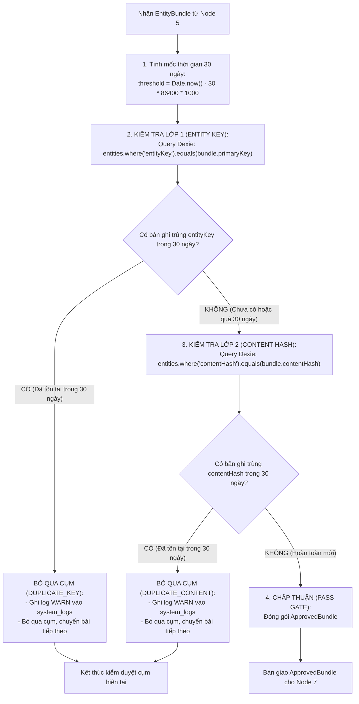

# ĐẶC TẢ CHI TIẾT NODE 06: VALIDATION & TWO-TIER DEDUPLICATION GATE

**Mã định danh Node**: `N06_DEDUPLICATION_GATE`  
**Tầng kiến trúc**: Tầng 4 — Gom Cụm & Xử Lý Nội Dung (Aggregation & Processing Layer)  
**Ngữ cảnh thực thi**: Content Script (`content-script.ts`) trên Zalo Web (`https://chat.zalo.me/*`)  
**Tài liệu tham chiếu**:
- [business_flow.md](file:///c:/Users/ADMIN/Documents/workspace/Sales/EXTENSIONS/Docs/Init/Diagrams/business_flow.md)
- [tai_lieu_thiet_ke_so_bo_zalo_automation.md](file:///c:/Users/ADMIN/Documents/workspace/Sales/EXTENSIONS/Docs/Init/tai_lieu_thiet_ke_so_bo_zalo_automation.md)
- [he_thong_tu_dong_hoa_zalo_extension_spec.md](file:///c:/Users/ADMIN/Documents/workspace/Sales/EXTENSIONS/Docs/Init/he_thong_tu_dong_hoa_zalo_extension_spec.md)

---

## 1. MỤC TIÊU & PHẠM VI (NODE OBJECTIVE & SCOPE)

### 1.1. Mục tiêu Cốt lõi
- Tiếp nhận các đối tượng `EntityBundle` hợp lệ từ Node 5 (Bundle Aggregator).
- Thực thi cơ chế **Khử trùng lặp 2 lớp độc lập (Two-Tier Deduplication)** trong **Cửa sổ Trượt 30 Ngày Gần Nhất (Rolling 30-Day Window)** đối chiếu trực tiếp với bảng `entities` trong cơ sở dữ liệu IndexedDB (Dexie.js):
  - **Lớp 1 (Entity Key Gate)**: Kiểm tra số điện thoại chính chủ hoặc mã định danh đối tượng (`primaryKey`). Nếu số điện thoại này đã từng được phân phối trong vòng 30 ngày ➔ **BỎ QUA** với trạng thái `SKIPPED_DUPLICATE_KEY`.
  - **Lớp 2 (Content Hash Gate)**: Kiểm tra mã băm SHA-256 của văn bản mô tả đã chuẩn hóa (`contentHash`). Nếu cùng một nội dung bài đăng được gửi lại (dù đổi số điện thoại hoặc dùng nick ảo khác) trong vòng 30 ngày ➔ **BỎ QUA** với trạng thái `SKIPPED_DUPLICATE_CONTENT`.
- Đảm bảo tốc độ truy vấn chỉ mục cực nhanh (`< 2ms`) nhờ các Compound Index của Dexie.js.
- Bàn giao các cụm đạt chuẩn chấp thuận (**`ApprovedBundle`**) sang Node 7 (Text Transformer & Target Router).

### 1.2. Ranh giới & Không gian Phủ định (In-Scope vs Negative Scope)
- **Trong phạm vi (In-Scope)**:
  - Truy vấn bảng `entities` qua index `entityKey` và `contentHash`.
  - Tính toán phạm vi thời gian trượt: `windowThreshold = Date.now() - (30 * 24 * 60 * 60 * 1000)`.
  - Ghi log chi tiết lý do bỏ qua vào `system_logs` để người vận hành kiểm tra báo cáo.
  - Định kỳ dọn dẹp (Garbage Collection) các bản ghi quá hạn 30 ngày trong bảng `entities`.
- **Ranh giới cấm (Negative Scope - CẤM TUYỆT ĐỐI)**:
  - **CẤM** ghi bản ghi mới vào bảng `entities` tại Node này. Bản ghi chỉ được chính thức lưu trữ sau khi Node 9 xác nhận đã phân phối thành công sang các Nhóm Con (đảm bảo tính Idempotency và tránh ghi nhận dữ liệu ảo).
  - **CẤM** chặn hoặc dừng luồng xử lý của toàn bộ nhóm khi phát hiện 1 cụm bị trùng (chỉ bỏ qua cụm đó và tiếp tục xử lý cụm tiếp theo trong mảng Delta).

---

## 2. HỢP ĐỒNG KỸ THUẬT & DỮ LIỆU (INPUT/OUTPUT CONTRACTS)

### 2.1. Cấu Trúc Bảng Dữ Liệu Chống Trùng (`entities` - Dexie.js)
```typescript
export interface EntityRecord {
  id?: number;                 // Auto-increment primary key
  entityKey: string;           // Chỉ mục: "0901234567" hoặc "0901234567_P302"
  contentHash: string;         // Chỉ mục: SHA-256 của văn bản chuẩn hóa
  sourceGroupId: string;       // ID nhóm nguồn phát sinh bài
  sourceGroupName: string;     // Tên nhóm nguồn
  primaryPhone?: string;       // Số điện thoại chính
  priceNumber?: number;        // Giá trị số của mức giá (VNĐ)
  rawText: string;             // Văn bản gốc
  editedText: string;          // Văn bản đã biên tập gửi đi
  targetGroupNames: string[];  // Danh sách các nhóm con đã nhận bài (tối đa 2 nhóm)
  createdAt: number;           // Chỉ mục: Timestamp (ms) lưu trữ (phục vụ lọc 30 ngày)
}
```

### 2.2. Đầu Ra: Đối Tượng Chấp Thuận (`ApprovedBundle`)
Bàn giao cho Node 7 (Text Transformer & Target Router):

```typescript
export interface ApprovedBundle {
  bundle: EntityBundle;        // Đối tượng bundle nguyên vẹn từ Node 5
  dedupCheckPassedAt: number;  // Thời điểm vượt qua cổng kiểm tra (ms)
  matchType: 'CLEAN_NEW_ENTRY'; // Xác nhận là bài đăng mới hoàn toàn
}

export interface DedupRejectResult {
  bundleId: string;
  rejectedReason: 'SKIPPED_DUPLICATE_KEY' | 'SKIPPED_DUPLICATE_CONTENT';
  matchedEntityId?: number;
  matchedCreatedAt?: number;
  matchedKeyOrHash: string;
}
```

---

## 3. LUỒNG XỬ LÝ CHI TIẾT & STATE MACHINE (EXECUTION ALGORITHM)

### 3.1. Sơ đồ Luồng Khử Trùng 2 Lớp (Two-Tier Deduplication Flowchart)



### 3.2. Thuật toán Kiểm Tra Trùng Lặp Chi tiết
```typescript
export async function evaluateBundleDeduplication(
  bundle: EntityBundle,
  db: ZaloAutomationDatabase
): Promise<ApprovedBundle | DedupRejectResult> {
  const ROLLING_WINDOW_MS = 30 * 24 * 60 * 60 * 1000; // 30 ngày
  const timeThreshold = Date.now() - ROLLING_WINDOW_MS;

  const primaryKey = bundle.extractedKeys.primaryKey;
  const contentHash = bundle.contentHash;

  // LỚP 1: Kiểm tra theo Entity Key (Số điện thoại / Mã căn)
  if (primaryKey && primaryKey.trim().length > 0) {
    const existingByKey = await db.entities
      .where('entityKey')
      .equals(primaryKey)
      .and(record => record.createdAt >= timeThreshold)
      .first();

    if (existingByKey) {
      await db.system_logs.add({
        level: 'WARN',
        eventType: 'SKIPPED_DUPLICATE_KEY',
        details: `Cụm ${bundle.bundleId} trùng SĐT/Key [${primaryKey}] đã gửi vào ${new Date(existingByKey.createdAt).toLocaleString()}`,
        timestamp: Date.now()
      });

      return {
        bundleId: bundle.bundleId,
        rejectedReason: 'SKIPPED_DUPLICATE_KEY',
        matchedEntityId: existingByKey.id,
        matchedCreatedAt: existingByKey.createdAt,
        matchedKeyOrHash: primaryKey
      };
    }
  }

  // LỚP 2: Kiểm tra theo Content Hash (Nội dung văn bản chuẩn hóa)
  const existingByHash = await db.entities
    .where('contentHash')
    .equals(contentHash)
    .and(record => record.createdAt >= timeThreshold)
    .first();

  if (existingByHash) {
    await db.system_logs.add({
      level: 'WARN',
      eventType: 'SKIPPED_DUPLICATE_CONTENT',
      details: `Cụm ${bundle.bundleId} trùng nội dung văn bản (Hash: ${contentHash.substring(0, 8)}...) đã gửi vào ${new Date(existingByHash.createdAt).toLocaleString()}`,
      timestamp: Date.now()
    });

    return {
      bundleId: bundle.bundleId,
      rejectedReason: 'SKIPPED_DUPLICATE_CONTENT',
      matchedEntityId: existingByHash.id,
      matchedCreatedAt: existingByHash.createdAt,
      matchedKeyOrHash: contentHash
    };
  }

  // CHẤP THUẬN: Vượt qua cả 2 lớp
  return {
    bundle,
    dedupCheckPassedAt: Date.now(),
    matchType: 'CLEAN_NEW_ENTRY'
  };
}
```

### 3.3. Cơ chế Tự Dọn Dẹp Bản Ghi Quá Hạn (Garbage Collection Routine)
- Định kỳ mỗi khi khởi động Extension hoặc mỗi 24 giờ một lần:
  ```typescript
  export async function purgeExpiredEntities(db: ZaloAutomationDatabase): Promise<number> {
    const expiredThreshold = Date.now() - (30 * 24 * 60 * 60 * 1000);
    const deletedCount = await db.entities
      .where('createdAt')
      .below(expiredThreshold)
      .delete();
    
    if (deletedCount > 0) {
      await db.system_logs.add({
        level: 'INFO',
        eventType: 'PURGE_EXPIRED_ENTITIES',
        details: `Đã tự động dọn dẹp ${deletedCount} bản ghi cũ hơn 30 ngày để tối ưu IndexedDB.`,
        timestamp: Date.now()
      });
    }
    return deletedCount;
  }
  ```

---

## 4. XỬ LÝ LỖI, RETRY & EDGE CASES (RESILIENCE MATRIX)

| Mã Ngoại Lệ | Tình Huống Biên (Edge Case) | Phân Tích Kỹ Thuật | Cơ Chế Xử Lý & Phòng Vệ |
| :--- | :--- | :--- | :--- |
| **N06-E01** | **Bài viết không trích xuất được số điện thoại (Chỉ có text mô tả chung)** | `extractedKeys.primaryKey` rỗng, không thể kiểm tra Lớp 1. | Tự động hạ cấp sang kiểm tra Lớp 2 (`contentHash`). Nếu Lớp 2 chưa có trong 30 ngày ➔ Vẫn chấp thuận để tránh bỏ sót bài đăng không ghi số điện thoại. |
| **N06-E02** | **Cùng 1 người đăng lại bài cũ nhưng sửa 1 vài từ chào hỏi** | Mã băm `contentHash` bị thay đổi do text khác một vài ký tự. | **Phòng thủ nhờ Lớp 1 (Entity Key)**: Do số điện thoại chính chủ không đổi, Lớp 1 sẽ bắt được ngay và chặn đứng bài trùng lặp, ngăn ngừa hoàn toàn việc lọt bài đăng lại. |
| **N06-E03** | **Hai người khác nhau rao bán cùng 1 căn hộ/sản phẩm** | Hai nick khác nhau, số điện thoại có thể khác (môi giới khác nhau) nhưng nội dung bài đăng sao chép nguyên văn. | **Phòng thủ nhờ Lớp 2 (Content Hash)**: Dù Lớp 1 khác SĐT, Lớp 2 phát hiện trùng mã băm nội dung và lập tức loại bỏ. |
| **N06-E04** | **Bài đăng đã gửi cách đây 31 ngày (Vừa quá hạn 30 ngày)** | Bài đăng đã trôi qua ngoài phạm vi 30 ngày của cửa sổ trượt. | Theo đúng luật nghiệp vụ Rolling 30-Day Window: Bài đăng được xem như tin mới và được phép chấp thuận phân phối lại. |
| **N06-E05** | **Cơ sở dữ liệu IndexedDB bị khóa hoặc lỗi IO đột ngột** | Quá nhiều tiến trình truy cập Dexie.js đồng thời dẫn đến DatabaseLockedError. | Sử dụng try/catch có retry 2 lần với khoảng giãn cách 200ms. Nếu vẫn lỗi, ghi log `CRITICAL_IDB_ERROR` và tạm dừng cụm hiện tại, không để Worker bị treo. |

---

## 5. PHỤ THUỘC KỸ THUẬT (TECHNICAL DEPENDENCIES)

1. **Cơ sở dữ liệu cục bộ (IndexedDB — Dexie.js)**:
   - Bảng `entities`: Cần các chỉ mục `&entityKey, contentHash, createdAt`.
   - Bảng `system_logs`: Ghi nhận nhật ký loại bỏ trùng lặp và tiến trình dọn dẹp bộ nhớ.
2. **Module tương tác**:
   - Nhận đầu vào: `EntityBundle` từ Node 5.
   - Giao việc đầu ra: `ApprovedBundle` cho Node 7 (`Text Transformer & Target Router`).

---

## 6. TIÊU CHÍ KIỂM THỬ & NGHIỆM THU (ACCEPTANCE CRITERIA / DoD)

### 6.1. Kịch bản Nghiệm thu Nhị phân (Binary Acceptance Gates)
- **GATE-03 (Khử Trùng Lặp 30 Ngày Tuyệt Đối)**:
  - **Given**: Trong bảng `entities` đã có một bản ghi chứa SĐT `"0901234567"` được tạo cách đây 12 ngày.
  - **When**: Nhận được `EntityBundle` mới từ nhóm khác nhưng cũng chứa SĐT `"0901234567"`.
  - **Then**: Node 6 phải chặn 100%, trả về `SKIPPED_DUPLICATE_KEY`, ghi log cảnh báo và không chuyển cụm này sang Node 7.
- **AC-02 (Khử Trùng Nội Dung Văn Bản - Lớp 2)**:
  - **Given**: Người gửi B dùng nick mới, không ghi SĐT, nhưng sao chép nguyên văn đoạn text mô tả đã gửi cách đây 5 ngày (`contentHash` trùng khớp).
  - **When**: Node 6 thực hiện kiểm duyệt.
  - **Then**: Bị chặn ở Lớp 2 với kết quả `SKIPPED_DUPLICATE_CONTENT`.
- **AC-03 (Chấp Thuận Cho Tin Nhắn Mới Sau 31 Ngày)**:
  - **Given**: Bản ghi cũ trong DB có `createdAt = Date.now() - (31 * 86400 * 1000)`.
  - **When**: Tin nhắn có cùng nội dung hoặc cùng SĐT xuất hiện lại.
  - **Then**: Node 6 xác nhận `CLEAN_NEW_ENTRY`, cho phép bài đăng đi tiếp sang Node 7.

