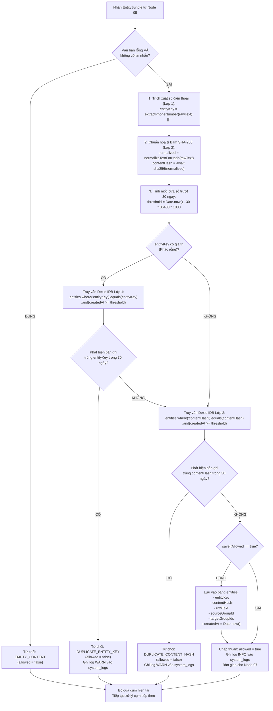
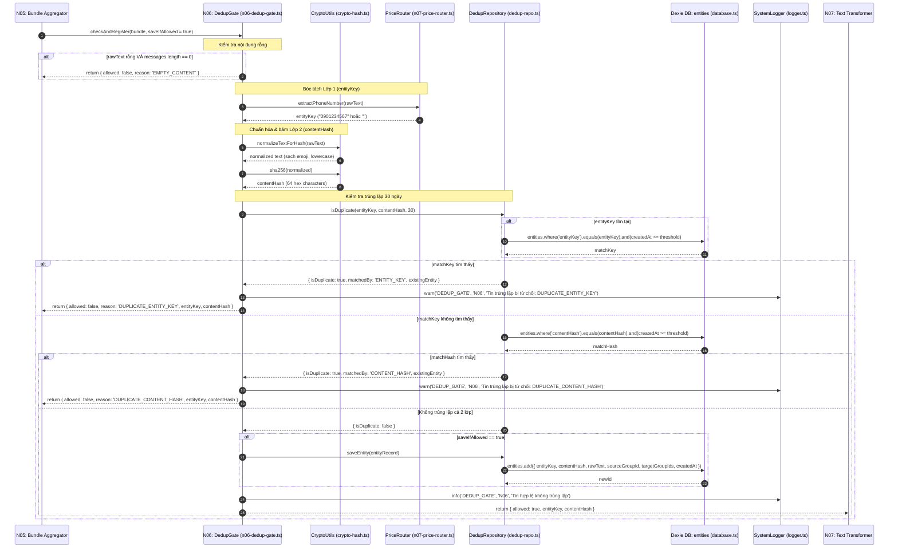

# ĐẶC TẢ THIẾT KẾ KIẾN TRÚC & HỢP ĐỒNG KỸ THUẬT NODE 06
# VALIDATION & TWO-TIER DEDUPLICATION GATE ENGINE

**Mã định danh Node**: `N06_DEDUPLICATION_GATE`  
**Tên chính thức**: Two-Tier Deduplication & Structural Validation Gate Engine  
**Tầng kiến trúc**: Tầng 4 — Gom Cụm & Xử Lý Nội Dung (Aggregation & Processing Layer)  
**Ngữ cảnh thực thi**: Content Script Worker (`content-script.ts`) trên Zalo Web (`https://chat.zalo.me/*`)  
**Tiêu chuẩn tài liệu**: Software Design Document (SDD) / AI-First Specification Standard ([Standards.md](../../../../Steves/Docs/AI-LLM/Knowleages/Standards.md))  

## Bản Đồ Điều Hướng Động Hai Chiều (Bidirectional Knowledge Map)

| Hướng Điều Hướng | Thực Thể Đích | Loại Tài Nguyên | Đường Dẫn Tương Đối |
| :--- | :--- | :--- | :--- |
| **Node Liền Trước** | Node 05: Bundle Aggregator & Debounce Buffer | Đặc tả kỹ thuật | [05_bundle_aggregator_node.md](05_bundle_aggregator_node.md) |
| **Chỉ Mục Hệ Thống** | Tổng Mục Đặc Tả Kiến Trúc 10 Nodes | Bản đồ tổng thể | [README.md](README.md) |
| **Node Liền Sau** | Node 07: Text Transformer & Target Router | Đặc tả kỹ thuật | [07_text_transformer_target_router_node.md](07_text_transformer_target_router_node.md) |
| **Thực Thi Cốt Lõi** | DedupGate Service Class | Mã nguồn TypeScript | [n06-dedup-gate.ts](../../src/nodes/n06-dedup-gate.ts) |
| **Tầng Dữ Liệu** | DedupRepository Data Access Layer | Mã nguồn TypeScript | [dedup-repo.ts](../../src/db/dedup-repo.ts) |
| **Thuật Toán Băm** | Text Normalizer & SHA-256 Web Crypto | Mã nguồn TypeScript | [crypto-hash.ts](../../src/utils/crypto-hash.ts) |
| **Hợp Đồng Dữ Liệu** | MessageEntitySchema & EntityBundleSchema | Mã nguồn Zod Schemas | [schemas.ts](../../src/contracts/schemas.ts) |
| **Cơ Sở Dữ Liệu** | ZaloAutomationDatabase (Dexie.js IDB) | Mã nguồn TypeScript | [database.ts](../../src/db/database.ts) |
| **Nhật Ký Viễn Trắc** | System Logger & Observability | Mã nguồn TypeScript | [logger.ts](../../src/utils/logger.ts) |
| **Bóc Tách SĐT** | Phone Extraction & Anti-Evasion Decoder | Mã nguồn TypeScript | [n07-price-router.ts](../../src/nodes/n07-price-router.ts) |
| **Luồng Nghiệp Vụ** | Sơ đồ Luồng Nghiệp Vụ Hệ Thống | Tài liệu thiết kế | [business_flow.md](../Init/Diagrams/business_flow.md) |
| **Đặc Tả Nền Tảng** | Đặc Tả Kỹ Thuật Zalo Extension | Tài liệu nền tảng | [he_thong_tu_dong_hoa_zalo_extension_spec.md](../Init/he_thong_tu_dong_hoa_zalo_extension_spec.md) |

---

## 2. Executive Directives

<instructions>
Bạn đang vận hành với tư cách Senior Defensive Requirements Analyst & Deduplication Engine Architect của hệ thống tự động hóa Zalo.
Nhiệm vụ cốt lõi của Node 06 là đảm bảo vai trò chốt chặn nhị phân (Binary Gatekeeper) phòng thủ đa tầng cho toàn bộ dữ liệu đi vào Tầng 4:
1. Tiếp nhận thực thể EntityBundle từ Node 05, kiểm định tính toàn vẹn cấu trúc nội dung văn bản và đa phương tiện.
2. Thực thi thuật toán Khử trùng lặp 2 lớp độc lập (Two-Tier Deduplication) trong Cửa sổ Trượt 30 Ngày Gần Nhất (Rolling 30-Day TTL) đối chiếu trực tiếp với bảng entities trong cơ sở dữ liệu IndexedDB (Dexie.js).
3. Lớp 1 (Entity Key Gate): Nhận diện số điện thoại chính chủ đã giải mã lách luật (entityKey) qua extractPhoneNumber.
4. Lớp 2 (Content Hash Gate): Chuẩn hóa văn bản qua normalizeTextForHash (loại bỏ emoji, khoảng trắng thừa, ký tự điều khiển, chuyển chữ thường) và tạo chuỗi băm mật mã SHA-256 (64 ký tự hex) qua sha256 (Web Crypto API).
5. Đồng bộ 100% với MessageEntitySchema trong schemas.ts, loại bỏ triệt để schema drift EntityRecord cũ.
6. Tuân thủ tuyệt đối Tiên đề Zero-Assumption Discipline: Không suy đoán dữ liệu, không tự ý chấp thuận tin nhắn rỗng, ghi nhật ký viễn trắc có cấu trúc vào system_logs và đảm bảo không bao giờ chặn đứng chu trình làm việc của nhóm nguồn khi từ chối một tin nhắn đơn lẻ.
</instructions>

---

## 3. Behavioral Constraints

```yaml
execution_policy:
  priority_order:
    1: "system_data_integrity_and_deduplication_accuracy"
    2: "source_code_contract_stability_and_zero_schema_drift"
    3: "non_blocking_pipeline_resilience"
    4: "deterministic_audit_telemetry"

  constraints:
    must:
      - "Chuẩn hóa chuỗi văn bản bằng normalizeTextForHash trước khi tính toán mã băm SHA-256."
      - "Thực hiện kiểm tra Lớp 1 (entityKey) trước; chỉ tiếp tục kiểm tra Lớp 2 (contentHash) khi Lớp 1 không trùng hoặc rỗng."
      - "Giới hạn phạm vi kiểm tra trùng lặp trong đúng cửa sổ trượt 30 ngày: threshold = Date.now() - 30 * 86400 * 1000."
      - "Đồng bộ cấu trúc bản ghi lưu trữ khớp 100% với MessageEntitySchema (entityKey, contentHash, rawText, sourceGroupId, targetGroupIds, createdAt)."
      - "Ghi nhật ký viễn trắc có cấu trúc vào system_logs cho mọi sự kiện chấp thuận hoặc từ chối gói tin."
    must_not:
      - "CẤM lưu bản ghi vào bảng entities nếu gói tin bị từ chối (allowed = false) hoặc khi cờ saveIfAllowed = false."
      - "CẤM làm gián đoạn, treo hoặc dừng luồng điều phối của nhóm nguồn khi phát hiện một gói tin bị trùng lặp."
      - "CẤM sử dụng hoặc duy trì cấu trúc EntityRecord cũ (chứa sourceGroupName, primaryPhone, priceNumber, editedText, targetGroupNames) gây lỗi schema drift."
      - "CẤM nuốt ngoại lệ (silent swallow) khi thao tác IndexedDB; bắt buộc bọc try/catch và ghi log WARN/CRITICAL có correlationId."
      - "CẤM sử dụng thuật toán băm yếu (MD5, SHA-1) hoặc băm trực tiếp văn bản thô chưa qua chuẩn hóa normalizeTextForHash."

  invariants:
    INV-N06-001: "Idempotency Invariant: Cùng một EntityBundle được thẩm định nhiều lần trong cửa sổ 30 ngày bắt buộc cho cùng một kết quả từ chối (allowed = false)."
    INV-N06-002: "Two-Tier Fallback Invariant: Khi entityKey rỗng, hệ thống bắt buộc kiểm tra Lớp 2 (contentHash); tuyệt đối không tự ý chấp thuận hoặc loại bỏ vô cớ."
    INV-N06-003: "Rolling TTL Invariant: Mọi bản ghi có createdAt < (Date.now() - 30 * 86400 * 1000) đều được xem là hết hạn và không được dùng làm căn cứ từ chối tin mới."
    INV-N06-004: "Zero Schema Drift Invariant: Bảng entities chỉ chấp nhận và lưu trữ đúng các trường được quy định trong MessageEntitySchema."
```

---

## 4. Domain Body

### 4.1. Bối Cảnh Nghiệp Vụ & Vị Trí Kiến Trúc

Trong chuỗi xử lý 10 Nodes tự động hóa Zalo, **Node 06: Validation & Two-Tier Deduplication Gate** giữ vai trò "Cổng Kiểm Duyệt Chất Lượng & Chống Trùng" (Quality & Anti-Spam Gatekeeper) tại Tầng 4. Sau khi Node 05 (Bundle Aggregator) gom các tin nhắn đơn lẻ thành một thực thể nghiệp vụ hoàn chỉnh (`EntityBundle`), dữ liệu phải được thẩm định nghiêm ngặt trước khi chuyển sang Node 07 (Text Transformer & Target Router) để bóc tách giá tiền và phân phối về các Nhóm Con.

Nếu không có chốt chặn này, hệ thống sẽ gặp các rủi ro nghiêm trọng:
1. **Spam lặp bài sang Nhóm Con**: Cùng một người gửi hoặc các nick môi giới khác nhau liên tục đăng lại một căn hộ/sản phẩm gây loãng nhóm con và vi phạm chính sách của quản trị viên.
2. **Khóa tài khoản Zalo cá nhân**: Tần suất gửi bài trùng lặp quá cao kích hoạt thuật toán chống spam tự động của Zalo Web.
3. **Lãng phí tài nguyên xử lý**: Tốn thời gian chuyển đổi ngữ cảnh chat, mở modal forward native và chèn văn bản ở Tầng 5 cho những nội dung đã được xử lý gần đây.

Node 06 giải quyết triệt để bài toán này bằng thuật toán **Khử trùng lặp 2 lớp độc lập (Two-Tier Deduplication)** trong **Cửa sổ trượt 30 ngày (Rolling 30-Day Window)** đối chiếu trực tiếp với bảng `entities` trong IndexedDB (`ZaloAutomationDB`).

---

### 4.2. Sơ Đồ Luồng Thẩm Định Khử Trùng 2 Lớp (Two-Tier Flowchart)



---

### 4.3. Sơ Đồ Tuần Tự Tương Tác Dữ Liệu (Sequence Diagram)



---

### 4.4. Cơ Chế Khử Trùng 2 Lớp Độc Lập (Two-Tier Deduplication Mechanics)

#### 4.4.1. Lớp 1: Entity Key Gate (Số Điện Thoại Chính Chủ & Chống Lách Luật)
- **Mục tiêu**: Chặn đứng mọi bài đăng từ cùng một chủ nhà / môi giới trong vòng 30 ngày, bất kể họ viết lại nội dung, thay đổi tiêu đề hay đổi ảnh minh họa.
- **Thuật toán bóc tách**: Sử dụng hàm `extractPhoneNumber` từ [n07-price-router.ts](../../src/nodes/n07-price-router.ts).
  - Tự động chuyển đổi các ký tự cố tình lách luật: `'O'`, `'o'` ➔ `'0'`; `'I'`, `'l'` ➔ `'1'`.
  - Loại bỏ các dấu phân cách nhân tạo: dấu chấm (`.`), gạch ngang (`-`), dấu gạch chéo (`/`), khoảng trắng giữa các chữ số.
  - Nhận diện các đầu số di động Việt Nam hợp lệ: `03`, `05`, `07`, `08`, `09` hoặc tiền tố quốc tế `+84`.
  - Trả về chuỗi 10 chữ số chuẩn hóa dạng `0901234567`.
- **Hành vi kiểm tra**: Nếu `entityKey` khớp với bất kỳ bản ghi nào trong bảng `entities` có `createdAt >= Date.now() - 30 * 86400 * 1000`, hệ thống lập tức từ chối với lý do `DUPLICATE_ENTITY_KEY` mà không cần kiểm tra tiếp Lớp 2.

#### 4.4.2. Lớp 2: Content Hash Gate (Chuẩn Hóa Văn Bản & Băm Mật Mã SHA-256)
- **Mục tiêu**: Bắt trọn các trường hợp người đăng không để lại số điện thoại (chỉ kêu gọi "inbox", "nhắn tin riêng") hoặc các tài khoản phụ/môi giới khác sao chép nguyên văn bài đăng của người khác.
- **Quy trình chuẩn hóa 4 bước (`normalizeTextForHash`)**:
  1. Loại bỏ toàn bộ biểu tượng cảm xúc Emoji sử dụng Unicode regex: `\p{Extended_Pictographic}`.
  2. Quy đổi các ký tự xuống dòng và tab (`[\r\n\t]+`) thành một dấu cách đơn (`' '`).
  3. Rút gọn toàn bộ khoảng trắng kép (`\s+`) thành một khoảng trắng đơn.
  4. Cắt tỉa hai đầu (`.trim()`) và chuyển đổi toàn bộ về chữ thường (`.toLowerCase()`).
- **Thuật toán băm mật mã (`sha256`)**:
  - Mã hóa chuỗi UTF-8 sang `Uint8Array` qua `TextEncoder`.
  - Gọi chuẩn Web Crypto API: `crypto.subtle.digest('SHA-256', data)`.
  - Cơ chế Fallback an toàn: Tự động kích hoạt module `node:crypto` nếu chạy trong môi trường kiểm thử Unit Test không có sẵn `crypto.subtle`.
  - Chuyển đổi mảng byte sang chuỗi Hexadecimal 64 ký tự (chữ thường, pad `0` cho byte < 16).

---

### 4.5. Cơ Chế Cửa Sổ Trượt 30 Ngày & Tự Dọn Dẹp Bản Ghi Quá Hạn

#### 4.5.1. Định Nghĩa Cửa Sổ Trượt (Rolling 30-Day TTL)
- Ngưỡng thời gian thẩm định được tính toán động tại thời điểm kiểm tra:
  $$\text{threshold} = \text{Date.now}() - (30 \times 24 \times 60 \times 60 \times 1000)\text{ ms}$$
- **Nguyên lý Tự Nhiên Hóa Vòng Đời Tin Đăng**:
  - Một bất động sản hoặc sản phẩm rao bán sau 30 ngày vẫn chưa giao dịch được xem là cần đăng lại.
  - Khi một bản ghi trong cơ sở dữ liệu có `createdAt < threshold`, bản ghi đó tự động mất hiệu lực chặn tin (lọc qua mệnh đề `.and(item => item.createdAt >= threshold)`).
  - Tin đăng cùng SĐT hoặc cùng nội dung sau 31 ngày sẽ được xem là tin mới hợp lệ (`allowed = true`).

#### 4.5.2. Thủ Tục Dọn Dẹp Bản Ghi Quá Hạn (Garbage Collection Routine)
Để ngăn ngừa bảng `entities` phình to vô hạn làm giảm hiệu năng của IndexedDB trên trình duyệt, tầng [dedup-repo.ts](../../src/db/dedup-repo.ts) cung cấp phương thức dọn dẹp chuyên trách:

```typescript
async cleanExpiredEntities(ttlDays = DEFAULT_TTL_DAYS): Promise<number> {
  const threshold = Date.now() - ttlDays * MS_PER_DAY;
  return await this.db.entities.where('createdAt').below(threshold).delete();
}
```

Thủ tục này được kích hoạt định kỳ khi khởi động Extension hoặc sau mỗi chu trình quét dọn lớn, tận dụng chỉ mục `createdAt` để xóa dứt điểm các bản ghi cũ mà không khóa cơ sở dữ liệu.

---

### 4.6. Hợp Đồng Kỹ Thuật & Khắc Phục Triệt Để Schema Drift

> [!IMPORTANT]
> **Khắc Phục Triệt Để Schema Drift (Schema Synchronization)**:
> Trong các phiên bản tài liệu phác thảo ban đầu, bảng `entities` từng bị mô tả sai lệch dưới tên `EntityRecord` chứa các trường rác không tồn tại trong thiết kế sản phẩm thực tế (`sourceGroupName`, `primaryPhone`, `priceNumber`, `editedText`, `targetGroupNames`).
> Kể từ phiên bản này, đặc tả đồng bộ tuyệt đối 100% với **`MessageEntitySchema`** được định nghĩa tại [schemas.ts](../../src/contracts/schemas.ts) và khởi tạo tại [database.ts](../../src/db/database.ts).

#### 4.6.1. Hợp Đồng Dữ Liệu Lưu Trữ Trong IndexedDB (`MessageEntitySchema`)
```typescript
import { z } from 'zod';

export const MessageEntitySchema = z.object({
  id: z.number().int().positive().optional(), // Khóa chính tự tăng trong Dexie (++)
  entityKey: z.string().min(1),               // SĐT chuẩn hóa (10 số) hoặc khóa thực thể
  contentHash: z.string().min(1),             // Chuỗi băm SHA-256 64 ký tự hex của văn bản chuẩn hóa
  rawText: z.string(),                        // Toàn bộ văn bản gốc ghép từ các tin nhắn của bundle
  sourceGroupId: z.string().min(1),           // ID của Nhóm Nguồn phát sinh tin nhắn
  targetGroupIds: z.array(z.string()),        // Danh sách ID các Nhóm Con đích (tối đa 2 nhóm)
  createdAt: z.number().int().positive(),     // Timestamp Unix (ms) lưu trữ phục vụ lọc cửa sổ trượt 30 ngày
});

export type MessageEntity = z.infer<typeof MessageEntitySchema>;
```

#### 4.6.2. Cấu Trúc Chỉ Mục Dexie.js (Chỉ Mục Hợp Nhất)
Được định nghĩa tại [database.ts](../../src/db/database.ts):
```typescript
this.version(1).stores({
  entities: '++id, entityKey, contentHash, createdAt',
  // Các bảng khác: app_settings, group_checkpoints, group_dispatch_queue, system_logs
});
```

- `++id`: Khóa chính tự tăng nguyên tử.
- `entityKey`: Chỉ mục đơn phục vụ tra cứu Lớp 1 với độ phức tạp $O(\log N)$ ($< 2\text{ms}$).
- `contentHash`: Chỉ mục đơn phục vụ tra cứu Lớp 2 với độ phức tạp $O(\log N)$ ($< 2\text{ms}$).
- `createdAt`: Chỉ mục đơn phục vụ quét phạm vi (Range Query) cho cửa sổ trượt 30 ngày và xóa rác TTL.

#### 4.6.3. Khế Ước Kết Quả Thẩm Định (`DedupCheckResult`)
Được trả về từ phương thức `checkAndRegister` tại [n06-dedup-gate.ts](../../src/nodes/n06-dedup-gate.ts):
```typescript
export interface DedupCheckResult {
  allowed: boolean;
  reason?: 'DUPLICATE_ENTITY_KEY' | 'DUPLICATE_CONTENT_HASH' | 'EMPTY_CONTENT';
  entityKey: string;
  contentHash: string;
}
```

#### 4.6.4. Khế Ước Kết Quả Tra Cứu Repository (`DuplicateCheckResult`)
Được trả về từ `isDuplicate` tại [dedup-repo.ts](../../src/db/dedup-repo.ts):
```typescript
export interface DuplicateCheckResult {
  isDuplicate: boolean;
  matchedBy?: 'ENTITY_KEY' | 'CONTENT_HASH';
  existingEntity?: MessageEntity;
}
```

---

### 4.7. Hệ Thống Viễn Trắc & Nhật Ký Kiểm Toán (Telemetry & Observability)

Toàn bộ hoạt động thẩm định tại Node 06 bắt buộc phát sinh nhật ký viễn trắc có cấu trúc theo chuẩn `SystemLogSchema` thông qua [logger.ts](../../src/utils/logger.ts) ghi trực tiếp vào bảng `system_logs` của IndexedDB.

| Cấp Độ Log | Tình Huống Phát Sinh | Nội Dung Thông Điệp Mẫu | Dữ Liệu Metadata Bổ Sung |
| :--- | :--- | :--- | :--- |
| `INFO` | Tin nhắn vượt qua cả 2 lớp kiểm duyệt (`allowed = true`) | `Tin hợp lệ không trùng lặp: SĐT=0901234567, Hash=a1b2c3d4...` | `{ groupId: bundle.sourceGroupId, phone: "0901234567" }` |
| `WARN` | Phát hiện trùng lặp Lớp 1 hoặc Lớp 2 | `Tin trùng lặp bị từ chối (DUPLICATE_ENTITY_KEY): SĐT=0901234567, Hash=...` | `{ groupId: bundle.sourceGroupId, phone: "0901234567" }` |
| `WARN` | Gói tin không chứa nội dung (`EMPTY_CONTENT`) | `Gói tin rỗng không thể kiểm định khử trùng: BundleId=...` | `{ groupId: bundle.sourceGroupId }` |
| `INFO` | Dọn dẹp bản ghi quá hạn 30 ngày | `Đã tự động dọn dẹp N bản ghi cũ hơn 30 ngày trong bảng entities.` | `{ deletedCount: N, threshold: timestamp }` |
| `CRITICAL` | Lỗi truy vấn cơ sở dữ liệu IndexedDB bị khóa hoặc crash IO | `Không thể truy vấn bảng entities do IndexedDB bị khóa hoặc lỗi hệ thống.` | `{ error: error.message, stack: error.stack }` |

---

### 4.8. Khối Cảnh Báo Trọng Tâm (GitHub-style Alerts)

> [!NOTE]
> Ngưỡng 30 ngày được tính toán động theo thời gian thực (`Date.now() - 30 * 86400 * 1000`). Bất kỳ bản ghi nào có mốc thời gian trước ngưỡng này sẽ không kích hoạt chặn tin, cho phép các bất động sản chưa bán được quyền đăng lại tự nhiên.

> [!TIP]
> Việc chuẩn hóa chuỗi qua `normalizeTextForHash` trước khi băm SHA-256 là bước tối quan trọng. Bằng cách loại bỏ hoàn toàn Emoji và rút gọn khoảng trắng, hệ thống ngăn chặn triệt để các thủ thuật spam bằng cách thêm bớt icon mặt cười, chèn dòng trống vô nghĩa nhằm làm sai lệch mã băm.

> [!IMPORTANT]
> Tuyệt đối không tái sinh cấu trúc `EntityRecord` cũ. Mọi thao tác lưu trữ tại Node 06 bắt buộc sử dụng đối tượng tuân thủ chặt chẽ `MessageEntitySchema` (`entityKey`, `contentHash`, `rawText`, `sourceGroupId`, `targetGroupIds`, `createdAt`).

> [!WARNING]
> Khi gói tin không thể bóc tách được số điện thoại (`entityKey` rỗng), hệ thống không được phép đánh rớt gói tin ngay mà bắt buộc phải chuyển sang kiểm duyệt Lớp 2 (`contentHash`). Chỉ từ chối tin nếu cả hai lớp đều không thỏa mãn hoặc vi phạm trùng lặp nội dung.

> [!CAUTION]
> Cờ `saveIfAllowed` mặc định là `true` trong luồng vận hành tiêu chuẩn, nhưng có thể được đặt là `false` khi chạy chế độ Dry-Run hoặc kiểm thử. Khi `saveIfAllowed = false`, bản ghi kiểm tra sẽ không được ghi vào cơ sở dữ liệu.

---

### 4.9. Ma Trận Phòng Vệ & Xử Lý Tình Huống Biên (Resilience & Edge Cases Matrix)

| Mã Ngoại Lệ | Tình Huống Biên (Edge Case) | Phân Tích Kỹ Thuật | Cơ Chế Xử Lý & Phòng Vệ Cơ Học |
| :--- | :--- | :--- | :--- |
| **N06-E01** | **Bài viết không có số điện thoại** (Chỉ có text mô tả chung, liên hệ qua inbox) | `extractPhoneNumber` trả về `null` ➔ `entityKey = ''`. Không thể kiểm tra Lớp 1. | Tự động bỏ qua Lớp 1, thực thi kiểm tra Lớp 2 (`contentHash`). Nếu mã băm chưa tồn tại trong 30 ngày ➔ **Chấp thuận** để không làm rơi tin của khách. |
| **N06-E02** | **Người gửi cố tình lách số điện thoại** (Dùng chữ `O` thay `0`, dấu chấm, gạch ngang) | Ví dụ: `O9O1.234.567` hoặc `090 123 4567`. | `extractPhoneNumber` tự động thay thế `O/o` thành `0`, `I/l` thành `1`, xóa ký tự đặc biệt, chuẩn hóa về `0901234567` ➔ Chặn đứng ngay tại Lớp 1. |
| **N06-E03** | **Hai môi giới rao cùng 1 căn hộ** (SĐT khác nhau nhưng sao chép nguyên văn mô tả) | `entityKey` không trùng (SĐT người đăng khác nhau), nhưng đoạn văn bản mô tả trùng khớp 100%. | Lớp 1 bỏ qua, nhưng Lớp 2 phát hiện `contentHash` trùng khớp với tin đã đăng trong 30 ngày ➔ **Từ chối** với lý do `DUPLICATE_CONTENT_HASH`. |
| **N06-E04** | **Bài đăng xuất hiện lại vào ngày thứ 31** (Quá hạn 30 ngày) | Bản ghi cũ trong DB có `createdAt < threshold`. | Lệnh truy vấn `.and(item => item.createdAt >= threshold)` tự động loại trừ bản ghi cũ ➔ Hệ thống xem như tin mới, cấp quyền `allowed = true` và lưu bản ghi mới. |
| **N06-E05** | **Cơ sở dữ liệu IndexedDB bị khóa đột ngột** (DatabaseLockedError / QuotaExceeded) | Xảy ra khi nhiều tab trình duyệt mở Zalo Web hoặc ổ đĩa đầy. | Khối bọc try/catch bắt ngoại lệ, ghi log `CRITICAL`, trả về trạng thái lỗi an toàn, không làm crash luồng Worker của toàn bộ Extension. |

---

## 5. Isolated Context & Evidence

<context>
Trích đoạn các hợp đồng giao diện và chữ ký hàm thực tế từ mã nguồn hệ thống:

1. Chữ ký lớp DedupGate từ [n06-dedup-gate.ts](../../src/nodes/n06-dedup-gate.ts):
```typescript
export interface DedupCheckResult {
  allowed: boolean;
  reason?: 'DUPLICATE_ENTITY_KEY' | 'DUPLICATE_CONTENT_HASH' | 'EMPTY_CONTENT';
  entityKey: string;
  contentHash: string;
}

export class DedupGate {
  constructor(private repo: DedupRepository = defaultDedupRepo) {}
  async checkAndRegister(bundle: EntityBundle, saveIfAllowed = true): Promise<DedupCheckResult>;
}
```

2. Chữ ký lớp DedupRepository từ [dedup-repo.ts](../../src/db/dedup-repo.ts):
```typescript
export interface DuplicateCheckResult {
  isDuplicate: boolean;
  matchedBy?: 'ENTITY_KEY' | 'CONTENT_HASH';
  existingEntity?: MessageEntity;
}

export class DedupRepository {
  constructor(private db: ZaloAutomationDatabase = defaultDb) {}
  async saveEntity(entity: Omit<MessageEntity, 'id'>): Promise<number>;
  async isDuplicate(entityKey: string, contentHash: string, ttlDays = 30): Promise<DuplicateCheckResult>;
  async cleanExpiredEntities(ttlDays = 30): Promise<number>;
  async count(): Promise<number>;
}
```

3. Tiện ích băm và chuẩn hóa từ [crypto-hash.ts](../../src/utils/crypto-hash.ts):
```typescript
export function normalizeTextForHash(text: string): string;
export async function sha256(text: string): Promise<string>;
```

4. Hợp đồng MessageEntitySchema từ [schemas.ts](../../src/contracts/schemas.ts):
```typescript
export const MessageEntitySchema = z.object({
  id: z.number().int().positive().optional(),
  entityKey: z.string().min(1),
  contentHash: z.string().min(1),
  rawText: z.string(),
  sourceGroupId: z.string().min(1),
  targetGroupIds: z.array(z.string()),
  createdAt: z.number().int().positive(),
});
```
</context>

<examples>
### Ví dụ 1: Tin Mới Hợp Lệ (Pass Hoàn Toàn 2 Lớp)
- **Đầu vào**:
  ```typescript
  const bundle: EntityBundle = {
    bundleId: "BUNDLE_1731300000_USER1_ABC",
    sourceGroupId: "g-source-101",
    senderId: "u-sender-888",
    messages: [{ msgId: "m1", type: "TEXT", text: "Bán căn 2PN Vinhomes Smart City, giá 3.2 tỷ, LH 0912345678", timestamp: 1731300000000 }],
    rawCombinedText: "Bán căn 2PN Vinhomes Smart City, giá 3.2 tỷ, LH 0912345678",
    targetGroupIds: [],
    createdAt: 1731300000000,
  };
  ```
- **Kết quả xử lý**:
  - `entityKey`: `"0912345678"` (Chưa có trong 30 ngày)
  - `contentHash`: `"e3b0c44298fc1c149afbf4c8996fb92427ae41e4649b934ca495991b7852b855"` (Chưa có trong 30 ngày)
  - **Kết quả trả về**:
    ```json
    {
      "allowed": true,
      "entityKey": "0912345678",
      "contentHash": "e3b0c44298fc1c149afbf4c8996fb92427ae41e4649b934ca495991b7852b855"
    }
    ```
  - **Hành động cơ sở dữ liệu**: Lưu thành công một bản ghi mới vào bảng `entities`.

---

### Ví dụ 2: Trùng Số Điện Thoại Lách Luật (Bị Chặn Tại Lớp 1)
- **Đầu vào**: Người gửi viết lại text khác nhưng giữ nguyên số điện thoại lách chữ O:
  ```typescript
  const bundle: EntityBundle = {
    bundleId: "BUNDLE_1731300500_USER2_XYZ",
    sourceGroupId: "g-source-102",
    senderId: "u-sender-999",
    messages: [{ msgId: "m2", type: "TEXT", text: "Cần tiền bán gấp căn hộ Smart City giá siêu mềm! Gọi O912.345.678 xem nhà ngay", timestamp: 1731300500000 }],
    rawCombinedText: "Cần tiền bán gấp căn hộ Smart City giá siêu mềm! Gọi O912.345.678 xem nhà ngay",
    targetGroupIds: [],
    createdAt: 1731300500000,
  };
  ```
- **Kết quả xử lý**:
  - `entityKey`: Chuẩn hóa `"O912.345.678"` ➔ `"0912345678"`.
  - Kiểm tra Lớp 1 phát hiện SĐT `"0912345678"` đã tồn tại cách đây 10 ngày trong bảng `entities`.
  - **Kết quả trả về**:
    ```json
    {
      "allowed": false,
      "reason": "DUPLICATE_ENTITY_KEY",
      "entityKey": "0912345678",
      "contentHash": "f4d5e6..."
    }
    ```
  - **Hành động cơ sở dữ liệu**: Không lưu bản ghi mới, ghi log cảnh báo `WARN` vào `system_logs`.

---

### Ví dụ 3: Đổi Nick / Không Có SĐT Nhưng Trùng Nội Dung (Bị Chặn Tại Lớp 2)
- **Đầu vào**: Môi giới sao chép nguyên văn mô tả của tin đã đăng cách đây 5 ngày, chỉ bỏ số điện thoại và kêu gọi inbox:
  ```typescript
  const bundle: EntityBundle = {
    bundleId: "BUNDLE_1731301000_USER3_KLM",
    sourceGroupId: "g-source-103",
    senderId: "u-sender-777",
    messages: [{ msgId: "m3", type: "TEXT", text: "Bán gấp căn studio 35m2 full đồ đẹp lung linh giá 1.4 tỷ inbox ngay", timestamp: 1731301000000 }],
    rawCombinedText: "Bán gấp căn studio 35m2 full đồ đẹp lung linh giá 1.4 tỷ inbox ngay",
    targetGroupIds: [],
    createdAt: 1731301000000,
  };
  ```
- **Kết quả xử lý**:
  - `entityKey`: `""` (Không tìm thấy số điện thoại ➔ Lớp 1 không kích hoạt).
  - Chuẩn hóa: `"bán gấp căn studio 35m2 full đồ đẹp lung linh giá 1.4 tỷ inbox ngay"`.
  - Băm SHA-256: Khớp chính xác `contentHash` đã lưu cách đây 5 ngày.
  - **Kết quả trả về**:
    ```json
    {
      "allowed": false,
      "reason": "DUPLICATE_CONTENT_HASH",
      "entityKey": "",
      "contentHash": "8c6976e5b5410415bde908bd4dee15dfb167a9c873fc4bb8a81f6f2ab448a918"
    }
    ```

---

### Ví dụ 4: Khắc Phục Triệt Để Schema Drift (Semantic Diff)
Dưới đây là so sánh trực quan giữa cấu trúc giả định sai lệch cũ và hợp đồng dữ liệu chuẩn hóa mới:

```diff
- // CẤU TRÚC CŨ BỊ LOẠI BỎ (SCHEMA DRIFT - EntityRecord)
- export interface EntityRecord {
-   id?: number;
-   entityKey: string;
-   contentHash: string;
-   sourceGroupId: string;
-   sourceGroupName: string;    // Lỗi: Không có trong DB, gây phình dữ liệu
-   primaryPhone?: string;      // Lỗi: Trùng lặp với entityKey
-   priceNumber?: number;       // Lỗi: Việc bóc tách giá thuộc Node 07
-   rawText: string;
-   editedText: string;         // Lỗi: Việc biên tập text thuộc Node 07
-   targetGroupNames: string[]; // Lỗi: Thay thế bằng targetGroupIds
-   createdAt: number;
- }

+ // HỢP ĐỒNG MỚI ĐỒNG BỘ 100% VỚI CODEBASE (MessageEntitySchema)
+ export const MessageEntitySchema = z.object({
+   id: z.number().int().positive().optional(),
+   entityKey: z.string().min(1),
+   contentHash: z.string().min(1),
+   rawText: z.string(),
+   sourceGroupId: z.string().min(1),
+   targetGroupIds: z.array(z.string()),
+   createdAt: z.number().int().positive(),
+ });
+ export type MessageEntity = z.infer<typeof MessageEntitySchema>;
```
</examples>

---

## 6. Output Contract & Acceptance Gates

### 6.1. Cổng Kiểm Định Nhị Phân (Binary Acceptance Gates)

```markdown
- GATE-N06-01 (Khử Trùng Lớp 1 Tuyệt Đối Theo entityKey):
  - GIVEN: Trong bảng `entities` đã tồn tại bản ghi với `entityKey = "0901234567"` có `createdAt` cách đây 15 ngày.
  - WHEN: Node 06 nhận một `EntityBundle` mới có văn bản chứa SĐT `"0901234567"` (hoặc biến thể `"O9O1.234.567"`).
  - THEN: Phương thức `checkAndRegister` phải trả về `{ allowed: false, reason: 'DUPLICATE_ENTITY_KEY' }`, ghi nhận log cấp `WARN` và không lưu thêm bản ghi vào bảng `entities`.

- GATE-N06-02 (Khử Trùng Lớp 2 Tuyệt Đối Theo contentHash):
  - GIVEN: Người đăng dùng nick mới, không để SĐT, nhưng văn bản sau khi chuẩn hóa qua `normalizeTextForHash` có mã băm SHA-256 trùng khớp với một bản ghi đã lưu cách đây 7 ngày.
  - WHEN: Node 06 thẩm định gói tin.
  - THEN: Phương thức `checkAndRegister` phải trả về `{ allowed: false, reason: 'DUPLICATE_CONTENT_HASH' }` và từ chối gói tin.

- GATE-N06-03 (Tự Động Tái Kích Hoạt Sau Cửa Sổ 30 Ngày):
  - GIVEN: Bản ghi cũ trong DB có `createdAt = Date.now() - (31 * 86400 * 1000)` (đã quá hạn 30 ngày).
  - WHEN: Một gói tin mới có cùng số điện thoại hoặc cùng nội dung xuất hiện lại.
  - THEN: Node 06 phải chấp thuận (`allowed: true`), ghi nhận bản ghi mới vào bảng `entities` với mốc `createdAt` hiện tại.

- GATE-N06-04 (Đồng Bộ Tuyệt Đối 100% MessageEntitySchema):
  - GIVEN: Một `EntityBundle` hợp lệ vượt qua cả 2 lớp kiểm duyệt với `saveIfAllowed = true`.
  - WHEN: Dữ liệu được chuyển xuống tầng `DedupRepository.saveEntity`.
  - THEN: Bản ghi được thêm vào bảng `entities` chỉ bao gồm đúng các trường của `MessageEntitySchema` (`entityKey`, `contentHash`, `rawText`, `sourceGroupId`, `targetGroupIds`, `createdAt`); không có bất kỳ thuộc tính ngoại lai nào của `EntityRecord` cũ.

- GATE-N06-05 (Khả Năng Chống Chịu & An Toàn Pipeline):
  - GIVEN: Một `EntityBundle` hoàn toàn rỗng văn bản và mảng `messages` rỗng, hoặc kết nối IndexedDB bị lỗi.
  - WHEN: Node 06 thực hiện kiểm duyệt.
  - THEN: Hệ thống trả về `{ allowed: false, reason: 'EMPTY_CONTENT' }` hoặc bắt lỗi ngoại lệ ghi log `CRITICAL`, tuyệt đối không làm dừng vòng lặp điều phối của nhóm nguồn tại Tầng 2.
```

### 6.2. Danh Mục Nghiệm Thu Kỹ Thuật (Definition of Done)

```yaml
definition_of_done:
  structural_integrity:
    - "Phân tách cơ học 6 phần chuẩn mực: Metadata Header, Directives, Constraints, Body, Evidence, Gates."
    - "Tuyên ngôn rõ ràng Negative Space với 5 điều cấm (must_not) tại Behavioral Constraints."
    - "Toàn bộ khối YAML tuân thủ nghiêm ngặt độ sâu lồng nhau <= 3 cấp."
  portability_and_linking:
    - "100% đường dẫn tệp là dạng tương đối click được không dùng backtick quanh link text."
    - "Không chứa bất kỳ đường dẫn cục bộ tuyệt đối hoặc tiền tố giao thức cục bộ."
    - "Khởi tạo đầy đủ liên kết 2 chiều với Node 05, Node 07, README và 6 tệp mã nguồn liên quan."
  schema_alignment:
    - "Loại bỏ hoàn toàn interface EntityRecord cũ; đồng bộ 100% với MessageEntitySchema."
    - "Khớp chính xác các trường: entityKey, contentHash, rawText, sourceGroupId, targetGroupIds, createdAt."
    - "Xác nhận bảng entities trong Dexie.js chỉ mục: ++id, entityKey, contentHash, createdAt."
  mechanical_verification:
    - "Toàn bộ khối code TypeScript, YAML, diff và Mermaid diagrams có cú pháp chuẩn xác."
    - "5/5 Cổng kiểm định GATE-N06-01..05 đều được định nghĩa cơ học dạng Given-When-Then."
    - "Tuân thủ bộ GitHub-style Alerts chuẩn mực (NOTE, TIP, IMPORTANT, WARNING, CAUTION)."
```
