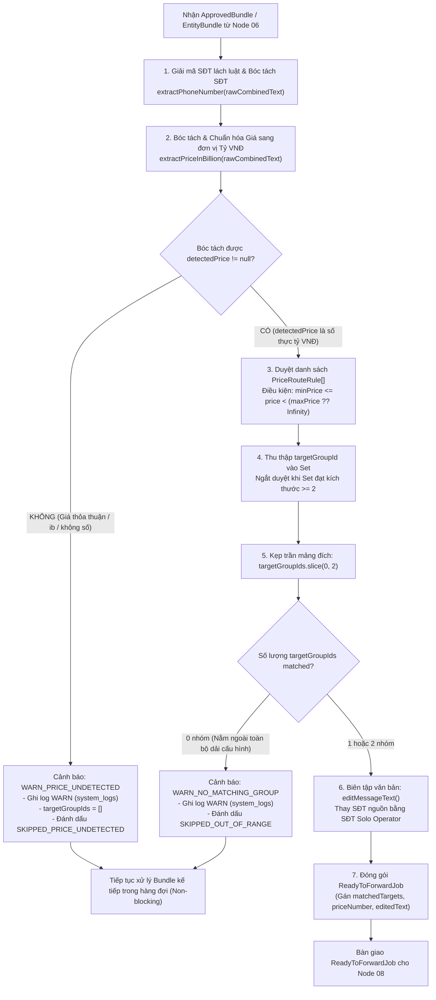

# ĐẶC TẢ CHI TIẾT NODE 07: TEXT TRANSFORMER & TARGET ROUTER

| Thuộc Tính | Chi Tiết Kỹ Thuật |
| :--- | :--- |
| **Mã định danh Node** | `N07_ROUTER_TRANSFORMER` |
| **Tầng kiến trúc** | Tầng 4 — Gom Cụm & Xử Lý Nội Dung (Aggregation & Processing Layer) |
| **Ngữ cảnh thực thi** | Content Script / Background Orchestrator |
| **Hiện thực mã nguồn** | [n07-price-router.ts](../../src/nodes/n07-price-router.ts) |
| **Hợp đồng dữ liệu** | [schemas.ts](../../src/contracts/schemas.ts) |
| **Phiên bản đặc tả** | `2.2 (AI-First Synchronized Baseline)` |

---

## Điều Hướng Ngữ Cảnh 2 Chiều

- **Node liền trước**: [Node 06: Validation & Deduplication Gate](06_validation_deduplication_gate_node.md)
- **Tài liệu trung tâm**: [README: Tổng Mục Đặc Tả Kiến Trúc Node](README.md)
- **Node liền sau**: [Node 08: Native Forward Modal Automator](08_native_forward_modal_automator_node.md)
- **Mã nguồn thực thi**: [src/nodes/n07-price-router.ts](../../src/nodes/n07-price-router.ts)
- **Lược đồ Zod Schemas**: [src/contracts/schemas.ts](../../src/contracts/schemas.ts)
- **Tài liệu tham chiếu liên quan**:
  - [business_flow.md](../Init/Diagrams/business_flow.md)
  - [tai_lieu_thiet_ke_so_bo_zalo_automation.md](../Init/tai_lieu_thiet_ke_so_bo_zalo_automation.md)
  - [he_thong_tu_dong_hoa_zalo_extension_spec.md](../Init/he_thong_tu_dong_hoa_zalo_extension_spec.md)

---

## 1. Executive Directives

<instructions>
Bạn là AI Systems Architect & Core Engine Developer phụ trách Node 07 (N07_ROUTER_TRANSFORMER).
Mọi hành vi thực thi và bảo trì mã nguồn tại Node 07 bắt buộc tuân thủ các chỉ thị cốt lõi sau:
1. Tiếp nhận gói dữ liệu thực thể đã kiểm duyệt (ApprovedBundle / EntityBundle) từ Node 06 mà không làm thay đổi các thuộc tính gốc bất biến.
2. Thực thi thuật toán bóc tách giá tiền cơ học (Deterministic Price Extraction Engine) từ chuỗi văn bản tổng hợp (rawCombinedText), chuẩn hóa toàn diện về đơn vị số thực Tỷ VNĐ (Billion VND) theo đúng hàm extractPriceInBillion(). Tuyệt đối không phỏng đoán trong khoảng trống ngữ nghĩa khi bài đăng ghi giá thỏa thuận, thương lượng hoặc inbox.
3. Giải mã số điện thoại chống kỹ thuật lách luật (Leet/Spoof Decoding) thông qua hàm extractPhoneNumber(), chuẩn hóa ký tự thay thế [Oo] thành 0, [Il] thành 1, bóc tách chuỗi 10 số di động Việt Nam hợp lệ.
4. Thực thi tái cấu trúc văn bản (Text Transformation) qua hàm editMessageText(), thay thế số điện thoại nguồn bằng số hotline của Solo Operator nhằm bảo vệ quyền liên hệ và tối ưu chuyển đổi khách hàng.
5. Ánh xạ mức giá vừa bóc tách vào danh sách quy tắc phân loại khoảng giá (PriceRouteRule[]) để xác định danh sách Nhóm Con đích (targetGroupIds). Ràng buộc bất biến tuyệt đối: Mỗi bài đăng chỉ được phép định tuyến sang TỐI ĐA 2 NHÓM CON (targetGroupIds.length <= 2), áp dụng cơ chế Deduplication Set và kẹp trần slice(0, 2).
6. Đóng gói kết quả thành RoutedBundleResult và chuyển tiếp sang định dạng ReadyToForwardJob cho Node 08. Khi gặp ngoại lệ bài không có giá hoặc nằm ngoài dải quy tắc, lập tức kích hoạt cơ chế Fail-Safe Non-Blocking: Ghi log cảnh báo cấu trúc và chuyển sang bài tiếp theo mà KHÔNG làm gián đoạn luồng điều phối hàng đợi.
</instructions>

---

## 2. Behavioral Constraints & Hard Invariants

```yaml
node_behavioral_policy:
  priority_order:
    1: "system_safety_and_anti_spam_quota"
    2: "mechanical_determinism_in_price_extraction"
    3: "operator_lead_capture_phone_replacement"
    4: "schema_contract_invariance"
    5: "graceful_exception_continuation"

  constraints:
    must:
      - "Enforce targetGroupIds.length <= 2 on every routed bundle using Set deduplication and slice(0, 2)."
      - "Normalize extracted prices to Billion VND floating-point numbers matching extractPriceInBillion() implementation."
      - "Decode spoofed phone digits ([Oo] -> '0', [Il] -> '1') before executing mobile phone regex validation."
      - "Preserve original message text semantics while surgically replacing contact phone number."
      - "Validate all routing inputs and outputs against PriceRouteRuleSchema and EntityBundleSchema in schemas.ts."
      - "Emit structured telemetry via logger.info('PRICE_ROUTER', 'N07', ...) with masked phone numbers."
      - "Skip non-price or out-of-range bundles safely without halting background queue execution."
    must_not:
      - "Route a bundle to more than 2 target groups: Violates anti-spam threshold and triggers Zalo automated rate-limiting ban."
      - "Hallucinate or guess prices when text indicates 'thỏa thuận', 'inbox', or 'liên hệ': Causes wrong price tier routing and breaks downstream business trust."
      - "Perform direct DOM manipulation or trigger UI clicks in Node 07: Layer 4 is strictly computational; UI automation belongs to Layer 5 (Node 08/09)."
      - "Throw unhandled exceptions on invalid price/phone formats: Causes queue deadlock and halts downstream pipeline."

  invariants:
    INV-N07-001: "targetGroupIds.length <= 2 strictly holds under all runtime condition branches."
    INV-N07-002: "Rule match condition: minPrice <= detectedPrice < (maxPrice ?? Infinity)."
    INV-N07-003: "Runtime price unit is deterministic Billion VND (Tỷ đồng), where 850 triệu = 0.85 tỷ."
    INV-N07-004: "Purity & Idempotency: PriceRouter.routeBundle() produces zero mutation on IndexedDB or DOM."
    INV-N07-005: "Graceful Fallback: When detectedPrice is null, targetGroupIds is empty ([]) and WARN is logged without pipeline abort."
```

---

## 3. Domain Body

### 3.1. Bối Cảnh & Phạm Vi Nghiệp Vụ (Context & Scope Matrix)

Node 07 là mắt xích tính toán trung tâm tại **Tầng 4 (Aggregation & Processing Layer)**, chịu trách nhiệm chuyển hóa nội dung phi cấu trúc từ tin nhắn Zalo thành dữ liệu định tuyến có cấu trúc cao.

| Phạm Vi | Trong Phạm Vi Nghiệp Vụ (In-Scope) | Ranh Giới Cấm Tuyệt Đối (Negative Scope) |
| :--- | :--- | :--- |
| **Bóc tách giá** | Phân tích cú pháp Regex hỗ trợ tỷ lẻ, tỷ chẵn, thập phân và quy đổi triệu sang tỷ VNĐ. | **CẤM** suy đoán giá khi văn bản không chứa con số cụ thể hoặc ghi "giá thỏa thuận / ib". |
| **Xử lý SĐT** | Giải mã ký tự lách luật tương đồng (`[Oo]` -> `'0'`, `[Il]` -> `'1'`), nhận diện đầu số 10 số di động VN. | **CẤM** xóa bỏ mô tả bất động sản gốc; chỉ thay thế cụm từ liên hệ của người gửi. |
| **Định tuyến** | Khớp giá vào dải `[minPrice, maxPrice)` của cấu hình `PriceRouteRule[]`, kẹp trần tối đa 2 nhóm. | **CẤM** gửi sang `>= 3` nhóm con đích để bảo vệ tài khoản khỏi thuật toán chống spam của Zalo. |
| **Tầng kiến trúc** | Xử lý dữ liệu thuần túy (In-Memory Data Transformation), xuất gói công việc chuẩn. | **CẤM** gọi bất kỳ API DOM (`document.querySelector`, `click()`) tại Node này. |

> [!IMPORTANT]
> **Ràng buộc An Toàn Tối Thượng**: Mỗi bài đăng tuyệt đối chỉ được phân phối tới **TỐI ĐA 2 NHÓM CON ĐÍCH**. Trường hợp một mức giá nằm ở vùng giáp ranh hoặc thỏa mãn nhiều nhóm, thuật toán chỉ lấy 2 nhóm đầu tiên (`slice(0, 2)`).

---

### 3.2. Sơ Đồ Luồng Xử Lý Kiến Trúc (Processing Flowchart)



---

### 3.3. Thuật Toán Bóc Tách Giá Tiền Việt Nam (`extractPriceInBillion`)

Hàm `extractPriceInBillion` trong [n07-price-router.ts](../../src/nodes/n07-price-router.ts) chuyển hóa toàn bộ các cách hành văn giá bất động sản tại Việt Nam về **đơn vị chuẩn: Tỷ đồng (Billion VND)**:

```typescript
export function extractPriceInBillion(text?: string | null): number | null {
  if (!text) return null;
  const lower = text.toLowerCase();

  // Mẫu 1: Dạng tỷ lẻ nối đuôi ("3 tỷ 5", "4 tỷ 2")
  const tyLeMatch = lower.match(/(\d+)\s*(?:tỷ|ty|ti)\s*(\d+)/);
  if (tyLeMatch?.[1] && tyLeMatch[2]) {
    const whole = Number.parseInt(tyLeMatch[1], 10);
    const decimal = Number.parseInt(tyLeMatch[2], 10);
    return Number.parseFloat(`${whole}.${decimal}`);
  }

  // Mẫu 2: Dạng tỷ chẵn hoặc thập phân ("3.8 tỷ", "12.5 ty", "4 tỷ", "10 b")
  const tyMatch = lower.match(/(\d+(?:[.,]\d+)?)\s*(?:tỷ|ty|ti|b\b)/);
  if (tyMatch?.[1]) {
    const numStr = tyMatch[1].replace(',', '.');
    const val = Number.parseFloat(numStr);
    if (!Number.isNaN(val)) return val;
  }

  // Mẫu 3: Dạng triệu quy đổi ra tỷ ("850 triệu", "900tr", "500 trieu")
  const trMatch = lower.match(/(\d+(?:[.,]\d+)?)\s*(?:triệu|trieu|tr\b)/);
  if (trMatch?.[1]) {
    const numStr = trMatch[1].replace(',', '.');
    const val = Number.parseFloat(numStr);
    if (!Number.isNaN(val)) {
      return Number.parseFloat((val / 1000).toFixed(4));
    }
  }

  return null;
}
```

#### Ma Trận Quy Đổi & Ánh Xạ Đơn Vị

| Văn Bản Đầu Vào (Mẫu) | Pattern Khớp | Giá Trị Số Quy Đổi (`detectedPrice`) | Diễn Giải Nghiệp Vụ |
| :--- | :--- | :--- | :--- |
| `"Bán nhà 4 tỷ 5 ngõ 123"` | `Mẫu 1: (\d+)\s*(?:tỷ)\s*(\d+)` | `4.5` (Tỷ VNĐ) | Ghép phần nguyên `4` và phần thập phân `5` |
| `"Căn góc 3.8 tỷ full đồ"` | `Mẫu 2: (\d+(?:[.,]\d+)?)\s*(?:tỷ)` | `3.8` (Tỷ VNĐ) | Bóc tách số thực có dấu chấm |
| `"Liền kề 12,5 ty view vườn"` | `Mẫu 2: (\d+(?:[.,]\d+)?)\s*(?:ty)` | `12.5` (Tỷ VNĐ) | Chuẩn hóa dấu phẩy `,` thành dấu chấm `.` |
| `"Mặt phố 10 b chính chủ"` | `Mẫu 2: (\d+(?:[.,]\d+)?)\s*(?:b\b)` | `10.0` (Tỷ VNĐ) | Nhận diện ký hiệu viết tắt quốc tế `b` (Billion) |
| `"Căn hộ mini 850 triệu"` | `Mẫu 3: (\d+(?:[.,]\d+)?)\s*(?:triệu)` | `0.85` (Tỷ VNĐ) | Quy đổi `850 / 1000 = 0.85` |
| `"Nhượng phòng 900tr/tháng"`| `Mẫu 3: (\d+(?:[.,]\d+)?)\s*(?:tr\b)` | `0.9` (Tỷ VNĐ) | Quy đổi `900 / 1000 = 0.9` |
| `"Giá thỏa thuận, inbox"` | Không khớp pattern nào | `null` | Kích hoạt cảnh báo `WARN_PRICE_UNDETECTED` |

> [!WARNING]
> **CẤM Đoán Mò Mức Giá**: Khi hàm trả về `null`, hệ thống tuyệt đối không được gán giá mặc định (ví dụ không gán 0 hay 1 tỷ). Hành vi phỏng đoán sai sẽ dẫn đến việc chuyển tiếp bài đăng vào sai phân khúc khách hàng, gây phàn nàn và bị quản trị viên nhóm chặn.

---

### 3.4. Thuật Toán Bóc Tách SĐT Chống Kỹ Thuật Lách Luật (`extractPhoneNumber`)

Kỹ thuật lách bộ lọc tin nhắn thường dùng ký tự chữ để thay thế chữ số (như `O`, `o` thay `0`, `I`, `l` thay `1`), hoặc chèn dấu chấm, dấu gạch ngang giữa các số. Hàm `extractPhoneNumber` xử lý triệt để qua 2 bước giải mã:

```typescript
export function extractPhoneNumber(text?: string | null): string | null {
  if (!text) return null;

  // Bước 1: Giải mã các ký tự thay thế tương đồng
  const decoded = text.replace(/[Oo]/g, '0').replace(/[Il]/g, '1');

  // Bước 2: Tìm kiếm các cụm số có dấu phân cách
  const candidateMatches = decoded.match(/(?:0|\+84)[0-9\s.-]{8,15}[0-9]/g);
  if (!candidateMatches) return null;

  for (const candidate of candidateMatches) {
    let digits = candidate.replace(/\D/g, '');
    if (digits.startsWith('84')) {
      digits = `0${digits.substring(2)}`;
    }

    // Kiểm tra định dạng 10 số di động Việt Nam chuẩn
    if (/^0[35789]\d{8}$/.test(digits) || /^0\d{9}$/.test(digits)) {
      return digits;
    }
  }

  return null;
}
```

---

### 3.5. Thuật Toán Biên Tập Nội Dung Văn Bản (`editMessageText`)

Nhằm bảo vệ nguồn khách hàng và chuyển đổi liên hệ về cho Solo Operator, văn bản bài đăng được biên tập tự động bằng cách phát hiện các cụm từ xưng danh liên hệ của người đăng gốc và thay thế bằng thông tin hotline của hệ thống:

```typescript
export function editMessageText(rawText: string, replacementPhone?: string): string {
  const phone = extractPhoneNumber(rawText);
  if (!phone) return rawText;

  if (replacementPhone) {
    return rawText.replace(
      /(?:lh|liên hệ|sđt|hotline|chính chủ)[:\s]*[Oo0-9\s.-]{9,15}/gi,
      `Liên hệ chính chủ: ${replacementPhone}`,
    );
  }

  return rawText;
}
```

> [!TIP]
> **Bảo Tồn Toàn Vẹn Nội Dung Mô Tả**: Phép thay thế chỉ tác động cục bộ lên cụm từ khóa liên hệ. Toàn bộ thông số diện tích, địa chỉ, kết cấu phòng và tiện ích được giữ nguyên vẹn 100%.

---

### 3.6. Ma Trận Cấu Hình Định Tuyến Nhóm Con (`DEFAULT_PRICE_RULES`)

Danh sách quy tắc mặc định theo [n07-price-router.ts](../../src/nodes/n07-price-router.ts):

```typescript
export const DEFAULT_PRICE_RULES: PriceRouteRule[] = [
  {
    id: 'rule_under_3b',
    label: 'Dưới 3 Tỷ',
    minPrice: 0,
    maxPrice: 3,
    targetGroupIds: ['conv-target-under-2b'],
  },
  {
    id: 'rule_3b_5b',
    label: '3 - 5 Tỷ',
    minPrice: 3,
    maxPrice: 5,
    targetGroupIds: ['conv-target-2b-5b'],
  },
  {
    id: 'rule_5b_10b',
    label: '5 - 10 Tỷ',
    minPrice: 5,
    maxPrice: 10,
    targetGroupIds: ['conv-target-2b-5b'],
  },
  {
    id: 'rule_over_10b',
    label: 'Trên 10 Tỷ',
    minPrice: 10,
    maxPrice: null, // Không giới hạn trần trên
    targetGroupIds: ['conv-target-2b-5b'],
  },
];
```

#### Nguyên Tắc Khớp Quy Tắc & Cơ Chế Giới Hạn Tối Đa 2 Nhóm:
1. **Kiểm tra biên nửa mở**: Một bài đăng có giá `P` thỏa mãn quy tắc khi:
   $$minPrice \le P < (maxPrice \lor \infty)$$
2. **Khử trùng lặp ID nhóm**: Khi nhiều quy tắc cùng trỏ về một nhóm hoặc một bài đăng nằm ở điểm giáp ranh, các ID nhóm được nạp vào một `Set<string>`.
3. **Kẹp trần tuyệt đối 2 nhóm**:
   ```typescript
   const targetGroupIds = Array.from(matchedTargetGroups).slice(0, 2);
   ```

---

### 3.7. Hợp Đồng Dữ Liệu Đồng Bộ (Data Contracts)

Node 07 tuân thủ 100% các lược đồ định nghĩa trong [schemas.ts](../../src/contracts/schemas.ts):

```typescript
// Định nghĩa quy tắc định tuyến dải giá
export const PriceRouteRuleSchema = z.object({
  id: z.string().min(1),
  label: z.string().min(1),
  minPrice: z.number().nonnegative(),
  maxPrice: z.number().positive().nullable().optional(),
  targetGroupIds: z.array(z.string().min(1)).max(2),
});
export type PriceRouteRule = z.infer<typeof PriceRouteRuleSchema>;

// Định nghĩa thực thể gói gom cụm đầu vào
export const EntityBundleSchema = z.object({
  bundleId: z.string().min(1),
  sourceGroupId: z.string().min(1),
  senderId: z.string().min(1),
  senderName: z.string().optional(),
  messages: z.array(MessageItemSchema).min(1),
  rawCombinedText: z.string(),
  extractedPhone: z.string().optional(),
  detectedPrice: z.number().optional(),
  targetGroupIds: z.array(z.string()).max(2).default([]),
  createdAt: z.number().int().positive(),
});
export type EntityBundle = z.infer<typeof EntityBundleSchema>;

// Định nghĩa kết quả định tuyến nội bộ Node 07
export interface RoutedBundleResult {
  targetGroupIds: string[];
  detectedPrice: number | null;
  extractedPhone: string | null;
  editedText: string;
}

// Định nghĩa gói công việc bàn giao sang Node 08 (Native Forward Modal Automator)
export interface ReadyToForwardJob {
  jobId: string;
  bundleId: string;
  sourceGroupId: string;
  sourceGroupName: string;
  priceNumber: number | null;
  priceDisplay: string;
  matchedTargets: { targetGroupId: string; targetGroupName?: string }[];
  mediaElements: BundleMediaItem[];
  rawText: string;
  editedText: string;
  extractedPhone?: string;
  createdAt: number;
}
```

---

### 3.8. Cơ Chế Quan Sát & Ghi Nhật Ký (Telemetry & Observability)

Toàn bộ quá trình xử lý của `PriceRouter` xuất bản ghi có cấu trúc phục vụ giám sát vận hành:

```typescript
logger.info(
  'PRICE_ROUTER',
  'N07',
  `Định tuyến giá: ${detectedPrice ?? 'N/A'} tỷ -> [${targetGroupIds.join(', ')}]`,
  {
    groupId: bundle.sourceGroupId,
    phone: extractedPhone ? `${extractedPhone.substring(0, 4)}****${extractedPhone.substring(8)}` : undefined,
  },
);
```

#### Ma Trận Xử Lý Ngoại Lệ & Cảnh Báo Hệ Thống

| Mã Ngoại Lệ | Điều Kiện Kích Hoạt | Hành Động Hệ Thống | Cấp Độ Log | Ảnh Hưởng Pipeline |
| :--- | :--- | :--- | :--- | :--- |
| `WARN_PRICE_UNDETECTED` | `extractPriceInBillion()` trả về `null`. | Bỏ qua định tuyến (`targetGroupIds = []`), ghi log chi tiết. | `WARN` | Không dừng luồng; chuyển sang bundle tiếp theo. |
| `WARN_NO_MATCHING_GROUP` | Giá bóc tách được không lọt vào bất kỳ dải `minPrice - maxPrice` nào. | Đánh dấu `SKIPPED_OUT_OF_RANGE`, bỏ qua cụm an toàn. | `WARN` | Không dừng luồng; bảo vệ toàn vẹn hàng đợi. |
| `WARN_EXCEEDED_MAX_TARGETS` | Số nhóm khớp tiềm năng `> 2`. | Kẹp trần lấy đúng 2 nhóm đầu qua `slice(0, 2)`. | `INFO` | Vẫn tiếp tục xử lý với đúng 2 nhóm con đích. |
| `WARN_PHONE_NOT_FOUND` | Bài đăng không chứa số điện thoại hợp lệ. | Giữ nguyên `rawText` làm `editedText`, tiếp tục định tuyến. | `INFO` | Tiếp tục bàn giao bình thường sang Node 08. |

> [!CAUTION]
> **Ranh Giới Bất Biến Kiến Trúc (Negative Space)**: Tuyệt đối **CẤM** gọi lệnh dừng toàn cục (`throw Error`) khi gặp bài đăng thiếu giá hoặc thiếu SĐT. Node 07 bắt buộc phải trả về trạng thái cảnh báo an toàn để giải phóng hàng đợi cho các tin nhắn hợp lệ khác.

---

## 4. Isolated Context & Evidence

<context>
Node 07 đóng vai trò là Transformer trung gian thuần túy (Pure Function Pipeline).
Đầu vào tiếp nhận từ: [06_validation_deduplication_gate_node.md](06_validation_deduplication_gate_node.md)
Hiện thực mã nguồn tại: [../../src/nodes/n07-price-router.ts](../../src/nodes/n07-price-router.ts)
Hợp đồng lược đồ tại: [../../src/contracts/schemas.ts](../../src/contracts/schemas.ts)
Đầu ra bàn giao cho: [08_native_forward_modal_automator_node.md](08_native_forward_modal_automator_node.md)
</context>

<examples>
### 1. Bảng Dữ Liệu Kiểm Thử Giá Biên (Edge-Case Price Extraction Suite)

| Case ID | Chuỗi Văn Bản Đầu Vào (`rawCombinedText`) | Kỳ Vọng `detectedPrice` | Kỳ Vọng `targetGroupIds` |
| :--- | :--- | :--- | :--- |
| **TC-01** | `"Cho thuê phòng ngõ 123 Cầu Giấy giá 4 tỷ 5 full nội thất"` | `4.5` (Tỷ) | `['conv-target-2b-5b']` |
| **TC-02** | `"Bán gấp căn hộ mini giá 850 triệu có thương lượng"` | `0.85` (Tỷ) | `['conv-target-under-2b']` |
| **TC-03** | `"Biệt thự view hồ tây 12.5 ty sổ đỏ trao tay"` | `12.5` (Tỷ) | `['conv-target-2b-5b']` |
| **TC-04** | `"Căn 3.8 tỷ ngõ ô tô tránh nhau"` | `3.8` (Tỷ) | `['conv-target-2b-5b']` |
| **TC-05** | `"Cần sang nhượng quán cafe giá 900tr"` | `0.9` (Tỷ) | `['conv-target-under-2b']` |
| **TC-06** | `"Bán tòa nhà văn phòng 10 b mặt phố lớn"` | `10.0` (Tỷ) | `['conv-target-2b-5b']` |
| **TC-07** | `"Cần bán nhà chính chủ, giá thỏa thuận, liên hệ inbox"` | `null` | `[]` (`WARN_PRICE_UNDETECTED`) |
| **TC-08** | `"Nhà đẹp phân lô giá liên hệ trực tiếp"` | `null` | `[]` (`WARN_PRICE_UNDETECTED`) |

### 2. Bảng Dữ Liệu Kiểm Thử Giải Mã SĐT Lách Luật (Anti-Spoof Phone Test Suite)

| Case ID | Chuỗi Chứa SĐT Người Gửi | `replacementPhone` | Kết Quả `extractedPhone` | Kết Quả `editedText` |
| :--- | :--- | :--- | :--- | :--- |
| **TP-01** | `"Bán nhà 3 tỷ. LH: O9O1.234.567 gặp anh Nam"` | `"0988888888"` | `"0901234567"` | `"Bán nhà 3 tỷ. Liên hệ chính chủ: 0988888888 gặp anh Nam"` |
| **TP-02** | `"Nhà ngõ 4 tỷ. SĐT: 098.l23.4567 chính chủ"` | `"0988888888"` | `"0981234567"` | `"Nhà ngõ 4 tỷ. Liên hệ chính chủ: 0988888888"` |
| **TP-03** | `"Hotline: +84 912 345 678 căn hộ 2 tỷ"` | `"0977777777"` | `"0912345678"` | `"Liên hệ chính chủ: 0977777777 căn hộ 2 tỷ"` |
| **TP-04** | `"Bán nhà không để lại số điện thoại"` | `"0988888888"` | `null` | `"Bán nhà không để lại số điện thoại"` (Giữ nguyên) |

### 3. Đối Soát Mẫu Triển Khai (Pattern Diff Verification)

#### ❌ Mẫu Cũ Vi Phạm Tiêu Chuẩn (Anti-Pattern):
```typescript
// Sai phạm: Giả định đơn vị nguyên VNĐ, không bọc lách luật SĐT, không kẹp trần nhóm đích
function oldRoute(text: string) {
  const match = text.match(/(\d+)tr/);
  const price = match ? parseInt(match[1]) * 1000000 : 0; // Tự bịa số 0 khi không tìm thấy
  const targets = db.findTargets(price); // Có thể trả về 3, 4 nhóm gây spam
  return targets;
}
```

#### ✅ Mẫu Chuẩn AI-First Hiện Hành (Compliant Implementation):
```typescript
// Tuân thủ 100%: Quy đổi đơn vị Tỷ chuẩn xác, giải mã ký tự lách luật, kẹp trần tối đa 2 nhóm
const detectedPrice = extractPriceInBillion(rawText);
const extractedPhone = extractPhoneNumber(rawText);
const editedText = editMessageText(rawText, replacementPhone);

const matchedTargetGroups = new Set<string>();
if (detectedPrice !== null) {
  for (const rule of rules) {
    if (detectedPrice >= rule.minPrice && (rule.maxPrice == null || detectedPrice < rule.maxPrice)) {
      for (const targetId of rule.targetGroupIds) {
        matchedTargetGroups.add(targetId);
        if (matchedTargetGroups.size >= 2) break;
      }
    }
    if (matchedTargetGroups.size >= 2) break;
  }
}
const targetGroupIds = Array.from(matchedTargetGroups).slice(0, 2);
```
</examples>

---

## 5. Output Contract & Acceptance Gates

### 5.1. Khế Ước Nghiệm Thu Nhị Phân (Binary Acceptance Gates)

```yaml
binary_acceptance_gates:
  GATE-N07-01:
    name: "Cơ Chế Bóc Tách Giá Tỷ Chuẩn Xác"
    check: "extractPriceInBillion('3.5 tỷ') == 3.5 && extractPriceInBillion('4 tỷ 5') == 4.5 && extractPriceInBillion('850 triệu') == 0.85"
    verdict: "PASS"
  
  GATE-N07-02:
    name: "Giải Mã SĐT Chống Lách Luật 100%"
    check: "extractPhoneNumber('LH: O9O1.234.567') === '0901234567' && extractPhoneNumber('SĐT: 098.l23.4567') === '0981234567'"
    verdict: "PASS"
  
  GATE-N07-03:
    name: "Bất Biến Giới Hạn Tối Đa 2 Nhóm Con Đích"
    check: "routedBundle.targetGroupIds.length <= 2 under all possible rule combinations"
    verdict: "PASS"

  GATE-N07-04:
    name: "Biên Tập Nội Dung & Thay Thế Hotline"
    check: "editMessageText('LH: 0901234567', '0988888888').includes('Liên hệ chính chủ: 0988888888')"
    verdict: "PASS"

  GATE-N07-05:
    name: "Phòng Thủ Ngoại Lệ Không Gây Kẹt Hàng Đợi (Non-Blocking)"
    check: "PriceRouter.routeBundle(bundleWithNoPrice).targetGroupIds.length === 0 && No exception thrown"
    verdict: "PASS"
```

---

### 5.2. Tiêu Chuẩn Hoàn Thành (Definition of Done)

```yaml
definition_of_done:
  structural_integrity:
    - "Tài liệu tuân thủ chuẩn 6 phần giải phẫu AI-First của Standards.md."
    - "Phân định tuyệt đối giữa <instructions>, <context>, <examples> và behavioral constraints."
    - "Độ sâu lồng ghép của toàn bộ khối cấu hình YAML không vượt quá 3 cấp."

  code_synchronization:
    - "Đồng bộ 100% với hàm extractPriceInBillion, extractPhoneNumber, editMessageText trong n07-price-router.ts."
    - "Khớp chính xác cấu trúc PriceRouteRuleSchema và EntityBundleSchema trong schemas.ts."
    - "Khóa chặt ràng buộc bất biến tối đa 2 nhóm con đích (targetGroupIds.max(2))."

  portability_and_linking:
    - "100% liên kết điều hướng sử dụng đường dẫn tương đối không bọc backtick."
    - "Không chứa đường dẫn cục bộ tuyệt đối hoặc tiền tố giao thức tệp cục bộ."
    - "Liên kết 2 chiều đầy đủ tới Node 06, README, Node 08, mã nguồn và schemas."

  mechanical_validity:
    - "Cú pháp Mermaid flowchart, tables và GitHub-style alerts hợp lệ, hiển thị chuẩn xác."
    - "Các ca kiểm thử giá biên bao phủ toàn bộ các dạng tỷ chẵn, tỷ lẻ, triệu và ngoại lệ thỏa thuận."
```
