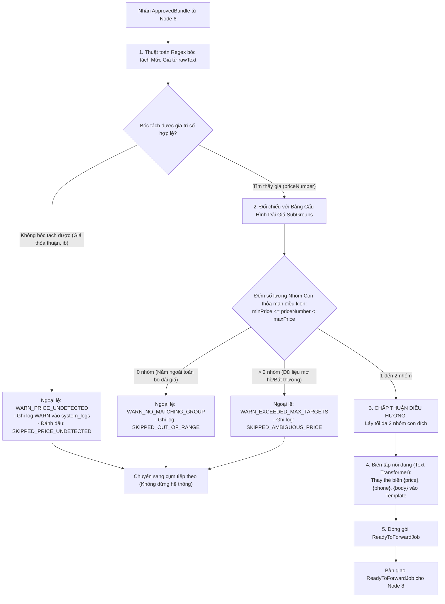

# ĐẶC TẢ CHI TIẾT NODE 07: TEXT TRANSFORMER & TARGET ROUTER

**Mã định danh Node**: `N07_ROUTER_TRANSFORMER`  
**Tầng kiến trúc**: Tầng 4 — Gom Cụm & Xử Lý Nội Dung (Aggregation & Processing Layer)  
**Ngữ cảnh thực thi**: Content Script (`content-script.ts`) trên Zalo Web (`https://chat.zalo.me/*`)  
**Tài liệu tham chiếu**:
- [business_flow.md](file:///c:/Users/ADMIN/Documents/workspace/Sales/EXTENSIONS/Docs/Init/Diagrams/business_flow.md)
- [tai_lieu_thiet_ke_so_bo_zalo_automation.md](file:///c:/Users/ADMIN/Documents/workspace/Sales/EXTENSIONS/Docs/Init/tai_lieu_thiet_ke_so_bo_zalo_automation.md)
- [he_thong_tu_dong_hoa_zalo_extension_spec.md](file:///c:/Users/ADMIN/Documents/workspace/Sales/EXTENSIONS/Docs/Init/he_thong_tu_dong_hoa_zalo_extension_spec.md)

---

## 1. MỤC TIÊU & PHẠM VI (NODE OBJECTIVE & SCOPE)

### 1.1. Mục tiêu Cốt lõi
- Tiếp nhận các cụm đối tượng đã được phê duyệt (`ApprovedBundle`) từ Node 6.
- Thực thi **Thuật toán Bóc tách Giá Tiền Tự động (Price Extraction Engine)**: Nhận diện và quy đổi các cách biểu thị giá trong thị trường Việt Nam (ví dụ: "3.5tr", "3 triệu 500", "4tr/tháng", "1 tỷ 250", "800k") sang giá trị số nguyên chuẩn hóa tính bằng VNĐ (`priceNumber`).
- **Phân loại & Định tuyến Nhóm Con Đích (Target Group Routing)**: Ánh xạ mức giá vừa bóc tách vào Bảng cấu hình khoảng giá phân loại nhóm con (`priceMapping`).
- **Ràng buộc An toàn Số lượng Đích Đến**: Mỗi bài đăng chỉ được phép khớp với **TỐI ĐA 2 NHÓM CON (Target Sub-groups)** (trường hợp nằm ở vùng giao thoa dải giá liền kề).
- **Xử lý Ngoại lệ Định tuyến Chống Treo**: Khi phát hiện bài không có giá ("giá ib", "thỏa thuận"), giá nằm ngoài dải, hoặc khớp quá 2 nhóm ➔ Ghi nhận cảnh báo vàng (`WARN`), đánh dấu bỏ qua và **không làm dừng hệ thống** (lập tức xử lý bài tiếp theo).
- **Biên tập Văn bản Tự động (Text Transformer)**: Tái cấu trúc văn bản mô tả gốc thành định dạng chuẩn hóa chuyên nghiệp (`editedText`) dựa trên mẫu template cấu hình.
- Đóng gói dữ liệu bàn giao cho Node 8 (`ReadyToForwardJob`).

### 1.2. Ranh giới & Không gian Phủ định (In-Scope vs Negative Scope)
- **Trong phạm vi (In-Scope)**:
  - Phân tích cú pháp Regex bóc tách số tiền trong ngữ cảnh tiếng Việt.
  - Ánh xạ logic: `minPrice <= priceNumber < maxPrice`.
  - Cắt gọt text, thay thế link/số liên hệ theo cấu hình người vận hành.
  - Xử lý các mã ngoại lệ: `WARN_PRICE_UNDETECTED`, `WARN_NO_MATCHING_GROUP`, `WARN_EXCEEDED_MAX_TARGETS`.
- **Ranh giới cấm (Negative Scope - CẤM TUYỆT ĐỐI)**:
  - **CẤM** gửi bài đăng sang nhiều hơn 2 nhóm con cho 1 lượt đăng (tránh spam và giảm thiểu tối đa nguy cơ bị Zalo quét tần suất).
  - **CẤM** cố tình phỏng đoán mức giá khi văn bản ghi "thỏa thuận", "inbox", "liên hệ để biết giá".
  - **CẤM** thao tác bất kỳ giao diện DOM nào tại Node này (mọi thao tác UI thuộc Tầng 5).

---

## 2. HỢP ĐỒNG KỸ THUẬT & DỮ LIỆU (INPUT/OUTPUT CONTRACTS)

### 2.1. Cấu hình Bảng Định Tuyến Giá (`PriceMappingConfig`)
Đọc từ bảng `app_settings` (key: `price_mapping_config`):

```typescript
export interface SubGroupTarget {
  targetGroupId: string;       // ID của Nhóm Con đích (dùng để tìm kiếm trên Zalo)
  targetGroupName: string;     // Tên chính xác của Nhóm Con hiển thị trên Zalo
  minPriceVnd: number;         // Ngưỡng giá tối thiểu (VNĐ), ví dụ: 3_000_000
  maxPriceVnd: number;         // Ngưỡng giá tối đa (VNĐ), ví dụ: 5_000_000
  isActive: boolean;
}

export interface RouterSettingsPayload {
  subGroups: SubGroupTarget[];
  maxTargetsPerPost: number;   // Bất biến: 2
  textTemplate: string;        // Mẫu biên tập nội dung, ví dụ: "📌 [PHÒNG GIÁ TỐT: {price}]\n{description}\n📞 LH: {phone}"
}
```

### 2.2. Gói Công Việc Chuyển Tiếp Đầu Ra (`ReadyToForwardJob`)
Bàn giao cho Node 8 (Native Forward Modal Automator):

```typescript
export interface TargetGroupMatch {
  targetGroupId: string;
  targetGroupName: string;
}

export interface ReadyToForwardJob {
  jobId: string;
  bundleId: string;
  sourceGroupId: string;
  sourceGroupName: string;
  priceNumber: number;                     // Giá trích xuất dạng số (VNĐ)
  priceDisplay: string;                    // Chuỗi hiển thị thân thiện: "3.5 triệu/tháng"
  matchedTargets: TargetGroupMatch[];      // Danh sách từ 1 đến 2 Nhóm Con đích
  mediaElements: BundleMediaItem[];        // Danh sách tham chiếu Media gốc từ Node 5
  rawText: string;                         // Văn bản gốc
  editedText: string;                      // Văn bản đã qua biên tập theo template
  primaryPhone?: string;                   // Số điện thoại liên hệ
  createdAt: number;
}
```

---

## 3. LUỒNG XỬ LÝ CHI TIẾT & STATE MACHINE (EXECUTION ALGORITHM)

### 3.1. Sơ đồ Luồng Bóc Tách Giá & Điều Hướng (Routing Flowchart)



### 3.2. Thuật toán Bóc Tách Giá Tiền Việt Nam (Regex Engine)
```typescript
export function extractPriceVnd(text: string): { priceNumber: number; priceDisplay: string } | null {
  // Chuẩn hóa văn bản: Chuyển thường, thay dấu phẩy bằng chấm trong số
  const normalized = text.toLowerCase().replace(/,/g, '.');

  // Pattern 1: Nhận diện đơn vị TỶ (ví dụ: 1.25 tỷ, 2 tỷ 300, 3 tỷ)
  const tyRegex = /(\d+(?:\.\d+)?)\s*(?:tỷ|ty)\s*(\d+)?/i;
  const tyMatch = normalized.match(tyRegex);
  if (tyMatch) {
    let base = parseFloat(tyMatch[1]) * 1_000_000_000;
    if (tyMatch[2]) {
      const sub = parseFloat(tyMatch[2]);
      base += sub < 10 ? sub * 100_000_000 : (sub < 100 ? sub * 10_000_000 : sub * 1_000_000);
    }
    return { priceNumber: Math.round(base), priceDisplay: `${tyMatch[0].trim()} VNĐ` };
  }

  // Pattern 2: Nhận diện đơn vị TRIỆU / TR (ví dụ: 3.5tr, 3 triệu 500, 4.2 triệu/tháng)
  const trieuRegex = /(\d+(?:\.\d+)?)\s*(?:triệu|trieu|tr|tr\/tháng|tr\/th)\s*(\d+)?/i;
  const trieuMatch = normalized.match(trieuRegex);
  if (trieuMatch) {
    let base = parseFloat(trieuMatch[1]) * 1_000_000;
    if (trieuMatch[2]) {
      const sub = parseFloat(trieuMatch[2]);
      base += sub < 10 ? sub * 100_000 : (sub < 100 ? sub * 10_000 : sub * 1_000);
    }
    return { priceNumber: Math.round(base), priceDisplay: `${trieuMatch[0].trim()}` };
  }

  // Pattern 3: Nhận diện đơn vị K (ví dụ: 800k, 900k/tháng)
  const kRegex = /(\d+)\s*(?:k|k\/tháng|k\/th)\b/i;
  const kMatch = normalized.match(kRegex);
  if (kMatch) {
    const val = parseInt(kMatch[1]) * 1_000;
    return { priceNumber: val, priceDisplay: `${kMatch[0].trim()}` };
  }

  return null; // Không phát hiện giá cụ thể
}
```

### 3.3. Thuật toán Biên Tập Nội Dung Văn Bản (`transformEditedText`)
- Mẫu template cho phép người dùng tùy biến giao diện bài đăng phân phối:
  ```typescript
  export function transformEditedText(
    rawText: string,
    template: string,
    priceDisplay: string,
    primaryPhone: string = ''
  ): string {
    let result = template;
    result = result.replace(/{price}/g, priceDisplay);
    result = result.replace(/{phone}/g, primaryPhone || 'Xem mô tả');
    result = result.replace(/{description}/g, rawText.trim());
    return result.trim();
  }
  ```

---

## 4. XỬ LÝ LỖI, RETRY & EDGE CASES (RESILIENCE MATRIX)

| Mã Cảnh Báo | Tình Huống Ngoại Lệ | Phân Tích Kỹ Thuật | Phương Án Xử Lý & Phòng Vệ | Trạng Thái Nhật Ký |
| :--- | :--- | :--- | :--- | :--- |
| `WARN_PRICE_UNDETECTED` | Bài đăng không ghi mức giá rõ ràng ("giá thỏa thuận", "giá ib", "giá rẻ bất ngờ"). | Không đủ căn cứ cơ học để phân loại nhóm con đích. Nếu đoán bừa sẽ gửi nhầm phân khúc giá. | Ghi log `WARN` vào `system_logs`. Bỏ qua cụm này và lập tức tiếp tục cụm kế tiếp trong mảng Delta (không dừng luồng). | `SKIPPED_PRICE_UNDETECTED` |
| `WARN_NO_MATCHING_GROUP` | Giá bóc tách được nằm ngoài toàn bộ các dải giá đã cấu hình trong `subGroups` (ví dụ: giá 15 tỷ trong khi cấu hình chỉ tới 10 tỷ). | Không có Nhóm Con nào đăng ký nhận phân khúc này. | Ghi log cảnh báo; bỏ qua cụm đối tượng này an toàn. | `SKIPPED_OUT_OF_RANGE` |
| `WARN_EXCEEDED_MAX_TARGETS` | Bài đăng bóc tách khớp với `>= 3 nhóm con` (ví dụ: bài môi giới tổng hợp nhiều căn hộ từ 2tr, 4tr, đến 8tr). | Dữ liệu đa phân khúc, việc gửi vào quá nhiều nhóm sẽ gây spam và vi phạm quy định tối đa 2 nhóm. | Ghi log bất thường; bỏ qua cụm để người vận hành kiểm tra thủ công. | `SKIPPED_AMBIGUOUS_PRICE` |
| `N07-E04` | **Khuôn mẫu biên tập (Template) bị cấu hình sai cú pháp** | Người dùng cấu hình template rỗng hoặc chứa ký tự đặc biệt gây lỗi replace. | Nếu template lỗi hoặc rỗng, tự động fallback về định dạng mặc định: `[THÔNG TIN CHI TIẾT]\n- Giá: {price}\n- Mô tả: {rawText}`. |
| `N07-E05` | **Tên Nhóm Con trong cấu hình bị đổi tên trên Zalo** | Tên nhóm cấu hình trong `subGroups` không khớp với tên hiển thị thực tế trên Zalo. | Ở Node 7, chuẩn hóa tên nhóm (trim space, lowercase). Nếu Node 8 tìm không ra tên này thì Node 8 sẽ ghi nhận lỗi và hạ cấp gửi nhóm còn lại. |

---

## 5. PHỤ THUỘC KỸ THUẬT (TECHNICAL DEPENDENCIES)

1. **Cơ sở dữ liệu cục bộ (IndexedDB — Dexie.js)**:
   - Đọc cấu hình từ `app_settings` (`price_mapping_config`, `text_template_config`).
   - Ghi nhật ký vào `system_logs` cho các trường hợp ngoại lệ định tuyến.
2. **Module tương tác**:
   - Nhận đầu vào: `ApprovedBundle` từ Node 6.
   - Giao việc đầu ra: `ReadyToForwardJob` cho Node 8 (`Native Forward Modal Automator`).

---

## 6. TIÊU CHÍ KIỂM THỬ & NGHIỆM THU (ACCEPTANCE CRITERIA / DoD)

### 6.1. Kịch bản Nghiệm thu Nhị phân (Binary Acceptance Gates)
- **AC-01 (Bóc Tách Giá Tiền Chuẩn Xác)**:
  - **Given**: Văn bản chứa chuỗi "Cho thuê phòng ngõ 123 Cầu Giấy giá 3.5tr/th full đồ".
  - **When**: Node 7 phân tích giá.
  - **Then**: `priceNumber` phải bằng chính xác `3500000` (VNĐ).
- **AC-02 (Giới Hạn Tối Đa 2 Nhóm Con Đích)**:
  - **Given**: Mức giá bóc tách được là 4 triệu. Có 2 nhóm con đăng ký dải [3-4.5tr] và [4-5tr].
  - **When**: Node 7 định tuyến.
  - **Then**: `matchedTargets.length` chính xác bằng `2`. Tuyệt đối không bao giờ vượt quá 2 nhóm.
- **AC-03 (Xử Lý Bài Giá Thỏa Thuận Chống Treo Hệ Thống)**:
  - **Given**: Văn bản chỉ ghi "Cần bán nhà gấp giá thương lượng trực tiếp ib".
  - **When**: Node 7 xử lý.
  - **Then**:
    1. Node 7 đánh dấu ngoại lệ `WARN_PRICE_UNDETECTED`.
    2. Ghi bản ghi cảnh báo vào `system_logs`.
    3. Không phát sinh `ReadyToForwardJob`.
    4. Hệ thống **không dừng lại**, lập tức chuyển sang bài tiếp theo trong hàng đợi.
- **AC-04 (Biên Tập Text Đúng Khuôn Mẫu)**:
  - **Given**: Template có dạng `📌 {price} - {description}`.
  - **When**: Node 7 sinh `editedText`.
  - **Then**: Chuỗi đầu ra bắt đầu bằng biểu tượng `📌`, chứa mức giá hiển thị và đoạn mô tả gốc.

