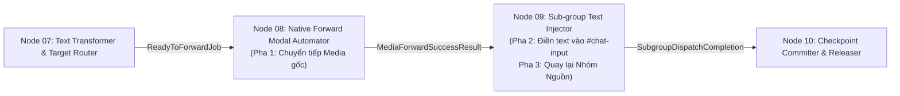
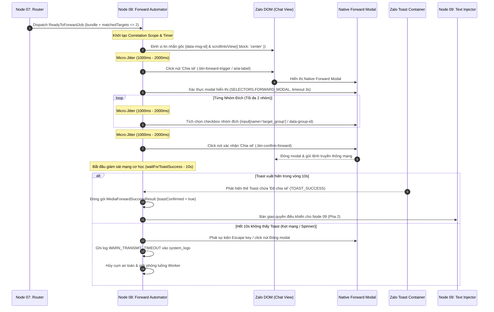
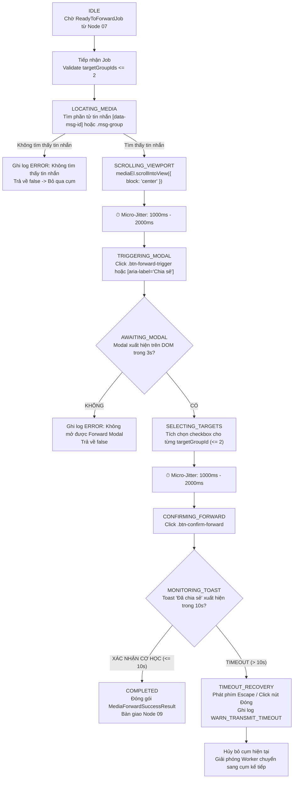

# ĐẶC TẢ THIẾT KẾ KIẾN TRÚC & HỢP ĐỒNG KỸ THUẬT NODE 08
# NATIVE FORWARD MODAL AUTOMATOR (PHASE 1 DISPATCH ENGINE)

**Mã định danh Node**: `N08_FORWARD_AUTOMATOR`  
**Tên chính thức**: Native Forward Modal Automator & Media Relay Engine  
**Tầng kiến trúc**: Tầng 5 — Thực Thi Giao Diện & An Toàn (UI Dispatch & Safety Layer)  
**Ngữ cảnh thực thi**: Content Script Worker trên Zalo Web (`https://chat.zalo.me/*`)  
**Tiêu chuẩn tài liệu**: AI-First Documentation Standard / Software Design Document (SDD)  
**Tài liệu tham chiếu & Liên kết điều hướng 2 chiều**:
- Node thượng nguồn (Upstream Node): [07_text_transformer_target_router_node.md](07_text_transformer_target_router_node.md)
- Tổng mục kiến trúc (Architecture Index): [README.md](README.md)
- Node hạ nguồn (Downstream Node): [09_subgroup_text_injector_pacing_guard_node.md](09_subgroup_text_injector_pacing_guard_node.md)
- Mã nguồn hiện thực (Implementation): [n08-forward-automator.ts](../../src/nodes/n08-forward-automator.ts)
- Hợp đồng bộ chọn DOM (DOM Selectors Contract): [selectors.ts](../../src/contracts/selectors.ts)
- Khế ước kiểu dữ liệu (Schema Contracts): [schemas.ts](../../src/contracts/schemas.ts)
- Khung luồng nghiệp vụ tổng quan: [business_flow.md](../Init/Diagrams/business_flow.md)
- Thiết kế sơ bộ Zalo Automation: [tai_lieu_thiet_ke_so_bo_zalo_automation.md](../Init/tai_lieu_thiet_ke_so_bo_zalo_automation.md)
- Đặc tả hợp đồng dữ liệu & Cổng kiểm định: [he_thong_tu_dong_hoa_zalo_extension_spec.md](../Init/he_thong_tu_dong_hoa_zalo_extension_spec.md)

---

## 1. MỆNH LỆNH THỰC THI (EXECUTIVE DIRECTIVES)

<instructions>
Bạn là Senior UI Automation Architect & Defensive Browser Execution Engineer chịu trách nhiệm tuyệt đối về Node 08 (N08_FORWARD_AUTOMATOR).
Nhiệm vụ tối thượng: Tự động hóa Native Forward Modal của Zalo Web trong Pha 1 của cơ chế Chuyển Tiếp 2 Pha (Two-Phase Dispatch) nhằm phân phối cụm Media gốc (Ảnh đơn lẻ, Album ảnh Grid, Video) từ Nhóm Nguồn tới tối đa 2 Nhóm Con đích.

Các chỉ thị hành vi bất biến:
1. Kỷ luật Không-Giả-Định (Zero-Assumption Discipline): Chỉ công nhận chuyển tiếp media thành công khi và chỉ khi có bằng chứng cơ học nhị phân (Binary Mechanical Proof) xác nhận Toast "Đã chia sẻ tin nhắn" (SELECTORS.TOAST_SUCCESS) xuất hiện thực tế trên cây DOM trong vòng 10 giây. Tuyệt đối CẤM chuyển pha dựa trên độ trễ tĩnh (static sleep).
2. Tách biệt tuyệt đối giữa Media và Văn bản (Negative Text Isolation): Tuyệt đối CẤM gõ, dán hoặc chèn bất kỳ ký tự nào của văn bản biên tập (editedText) vào Native Forward Modal. Mọi thao tác gửi text thuộc quyền hạn độc quyền của Node 09 tại khung chat chính của từng Nhóm Con.
3. Ràng buộc hạn ngạch nhóm đích (Target Quota Clamping): Tối đa chỉ được phép tích chọn <= 2 Nhóm Con trong một lượt forward; cấm chọn vượt quá 2 nhóm dưới mọi hình thức để ngăn ngừa nguy cơ spam và bảo vệ tài khoản.
4. Cơ chế tự hủy phòng vệ khi kẹt mạng (Fail-Safe Cancellation Guard): Khi hết ngưỡng thời gian 10 giây mà không nhận được Toast (do kẹt spinner mạng/lag máy chủ), lập tức đóng modal an toàn bằng phím Escape hoặc nút Close, ghi log viễn trắc WARN_TRANSMIT_TIMEOUT và giải phóng Worker, ngăn chặn tuyệt đối tình trạng deadlock.
5. Mô phỏng phản xạ cơ học người thật (Human-like Micro-Jitter): Chèn khoảng trễ ngẫu nhiên 1000ms – 2000ms giữa từng thao tác HTML (scroll, click trigger, search input, checkbox toggle, confirm click).
</instructions>

---

## 2. RÀNG BUỘC HÀNH VI & BẤT BIẾN KIẾN TRÚC (BEHAVIORAL CONSTRAINTS & INVARIANTS)

```yaml
execution_policy:
  priority_order:
    1: "user_account_safety_and_anti_ban"
    2: "original_media_fidelity_preservation"
    3: "mechanical_toast_verification_proof"
    4: "minimal_ui_blast_radius_and_fail_safe"

  constraints:
    must:
      - "Verify mechanical evidence of Toast ('Đã chia sẻ tin nhắn' / TOAST_SUCCESS) within 10s before handoff to Node 09."
      - "Enforce Micro-Jitter (1000ms - 2000ms) between consecutive UI interaction steps."
      - "Clamp target sub-groups strictly to at most 2 (targetGroupIds <= 2) per forward job."
      - "Scroll media item into center of viewport before triggering forward action."
      - "Execute safe modal cancellation (Escape key or close button) when 10s Toast timeout expires."
      - "Log wide telemetry events with correlationId to system_logs sink."
    must_not:
      - "Inject or type editedText into native forward modal; text injection belongs exclusively to Node 09."
      - "Proceed to Node 09 without mechanical verification of TOAST_SUCCESS (Zero Blind Dispatch)."
      - "Select more than 2 target groups in the forward modal under any circumstance."
      - "Download media files locally or re-upload them; must preserve native cloud transfer."
      - "Swallow timeout errors silently without logging WARN_TRANSMIT_TIMEOUT to system_logs."

  invariants:
    INV-N08-001:
      name: "Native Forward Modal Isolation"
      description: "Modal chia sẻ chỉ sử dụng để chuyển tiếp media gốc; tuyệt đối không chèn văn bản biên tập vào modal này."
      enforcement: "Strict separation: text injection is deferred 100% to Node 09 in sub-group main chat."
    INV-N08-002:
      name: "Target Sub-group Quota Bound"
      description: "Số lượng nhóm con đích được chọn trong một lượt forward bị chặn trên cứng ở mức <= 2."
      enforcement: "targetGroupIds.slice(0, 2) clamp before UI interaction."
    INV-N08-003:
      name: "Deterministic Binary Network Proof"
      description: "Chỉ công nhận Pha 1 thành công khi bắt được thẻ Toast xác nhận từ DOM trong vòng 10 giây; cấm dùng trễ tĩnh để phỏng đoán."
      enforcement: "DOM polling via waitForToastSuccess(10000) checking SELECTORS.TOAST_SUCCESS."
    INV-N08-004:
      name: "Fail-Safe Cancellation Guard"
      description: "Khi hết 10 giây không có Toast, phải lập tức phát phím Escape hoặc click nút Đóng để giải phóng DOM, không để Worker kẹt modal."
      enforcement: "Dispatch KeyboardEvent('Escape') + close button fallback + WARN_TRANSMIT_TIMEOUT telemetry."
```

---

## 3. THÂN BÀI TRI THỨC CHUYÊN SÂU (DOMAIN BODY)

### 3.1. Bối Cảnh Nghiệp Vụ, Vị Trí Kiến Trúc & Triết Lý 2 Pha (Two-Phase Dispatch)

Node 08 đóng vai trò mắt xích thực thi đầu tiên thuộc **Tầng 5: Thực Thi Giao Diện & An Toàn (UI Dispatch & Safety Layer)**. Trong kiến trúc tổng thể, Node 08 nhận gói công việc từ [07_text_transformer_target_router_node.md](07_text_transformer_target_router_node.md) và thực thi **Pha 1 của Cơ Chế Chuyển Tiếp 2 Pha (Two-Phase Dispatch)**:



#### Rationale Thiết Kế: Tại sao phải sử dụng Native Forward Modal cho Media?
1. **Bảo tồn 100% Chất lượng Gốc (Original Fidelity Preservation)**:
   - Zalo nén ảnh rất nặng khi tải về máy rồi tải lên lại (re-upload). Sử dụng Native Forward Modal giúp bảo toàn nguyên vẹn định dạng HD, metadata và độ phân giải gốc của ảnh, video hoặc album.
2. **Khai thác Hạ tầng Truyền tải Đám mây Nội bộ Zalo (Zero Client Bandwidth Overhead)**:
   - Forward nội bộ diễn ra trực tiếp trên máy chủ Zalo (Cloud-to-Cloud relay). Content Script chỉ gửi lệnh chuyển tiếp ID tin nhắn sang ID nhóm đích. Thời gian hoàn tất tính bằng mili-giây, không tiêu tốn băng thông mạng máy khách và loại bỏ nguy cơ tràn bộ nhớ RAM do buffer tệp lớn.
3. **Tại sao CẤM chèn văn bản biên tập vào Forward Modal?**:
   - Khi chia sẻ cụm Album ảnh Grid trên Zalo Web, ô nhập ghi chú của Forward Modal hoạt động không ổn định: ghi chú thường bị bỏ rơi hoặc chỉ gắn vào ảnh đầu tiên, làm sai lệch cấu trúc bài đăng bất động sản.
   - Do đó, hệ thống cô lập triệt để: **Node 08 chỉ gửi Media gốc qua Modal**, còn **Node 09 chịu trách nhiệm gửi văn bản biên tập qua `#chat-input` tại từng Nhóm Con**.

---

### 3.2. Sơ Đồ Tuần Tự & Lưu Đồ Máy Trạng Thái (Sequence & State Machine)

#### Sơ đồ Tuần tự Chuyển tiếp Media Pha 1 (Sequence Diagram)



#### Lưu đồ Máy Trạng Thái của Node 08 (State Machine Flowchart)



---

### 3.3. Giao Thức Thao Tác Native Forward Modal 7 Bước Chuẩn Mực

Quy trình tự động hóa giao diện tuân thủ nghiêm ngặt 7 bước tuần tự:

```yaml
forward_modal_protocol_steps:
  step_1_locate_and_center:
    action: "Định vị phần tử tin nhắn chứa media theo data-msg-id (fallback .msg-group)."
    execution: "Gọi scrollIntoView({ block: 'center', behavior: 'smooth' }) để đảm bảo media nằm trọn trong viewport."
    pacing: "Nghỉ trễ ngẫu nhiên Micro-Jitter 1000ms - 2000ms."

  step_2_trigger_modal:
    action: "Tìm và kích hoạt nút mở modal chia sẻ."
    target_selectors: ".btn-forward-trigger, [aria-label='Chia sẻ'], .btn-forward"
    event_simulation: "Mô phỏng click chuột người thật: mousedown -> mouseup -> click."

  step_3_await_modal_display:
    action: "Giám sát sự hiện diện của Forward Modal trên cây DOM."
    selector: "SELECTORS.FORWARD_MODAL (resolveElement)"
    timeout_ms: 3000
    failure_policy: "Nếu modal không xuất hiện sau 3s, ghi log MODAL_OPEN_TIMEOUT và hủy bỏ cụm."

  step_4_select_target_groups:
    action: "Lần lượt chọn các nhóm con đích (đã clamp targetGroupIds.slice(0, 2))."
    mechanism:
      - "Tìm checkbox: input[name='target_group'][value='{targetId}'], [data-group-id='{targetId}'] input"
      - "Gán checkbox.checked = true"
      - "Phát sự kiện Event('change', { bubbles: true }) để React 18 cập nhật component state"
    pacing: "Micro-Jitter 1000ms - 2000ms giữa các nhóm."

  step_5_confirm_submission:
    action: "Nhấp nút xác nhận chia sẻ trên modal footer."
    target_selectors: ".btn-confirm-forward, button[data-translate-inner='STR_SHARE_CONFIRM']"
    event_simulation: "Click kích hoạt submit forward command."

  step_6_verify_toast_transmit:
    action: "Thực thi kiểm định truyền thông mạng nhị phân qua Toast thành công."
    selector: "SELECTORS.TOAST_SUCCESS"
    timeout_ms: 10000
    verification_rule: "DOM phải chứa phần tử Toast có textContent khớp 'Đã chia sẻ' hoặc [data-translate-inner='STR_SHARED_SUCCESS']."

  step_7_handoff_or_cleanup:
    on_success: "Đóng gói MediaForwardSuccessResult (toastConfirmed: true) và chuyển giao cho Node 09."
    on_timeout: "Phát KeyboardEvent('Escape') hoặc click nút Đóng modal, ghi log WARN_TRANSMIT_TIMEOUT, hủy cụm an toàn."
```

---

### 3.4. Cơ Chế Kiểm Định Mạng Nhị Phân & Giám Sát Toast 10 Giây

Hệ thống tuân thủ **Tiên đề 4 của Nguyên lý Andrew: Mechanical Determinism**. Tuyệt đối không bao giờ phỏng đoán kết quả gửi tin dựa trên thời gian tĩnh (`setTimeout(resolve, 2000)`). Bắt buộc phải có bằng chứng cơ học nhị phân (Binary Mechanical Proof) chứng minh máy chủ Zalo đã nhận và xử lý lệnh.

#### Thuật toán Giám sát Toast Xác nhận Mạng (`waitForToastSuccess`)

```typescript
import { SELECTORS, resolveElement } from '@/contracts/selectors';
import { logger } from '@/utils/logger';

/**
 * Giám sát cây DOM để phát hiện Toast xác nhận chuyển tiếp thành công từ Zalo Web.
 * @param doc Tài liệu DOM hiện hành
 * @param timeoutMs Ngưỡng thời gian chờ tối đa (Mặc định: 10000ms)
 * @returns Promise<boolean> true nếu Toast xuất hiện, false nếu timeout
 */
export function waitForToastSuccess(
  doc: Document = document,
  timeoutMs: number = 10000,
): Promise<boolean> {
  return new Promise((resolve) => {
    const startTime = Date.now();
    const pollIntervalMs = 200;

    const timer = setInterval(() => {
      // 1. Kiểm tra qua 3-tier selector TOAST_SUCCESS
      const toastEl = resolveElement(SELECTORS.TOAST_SUCCESS, doc);
      const isToastVisible =
        toastEl &&
        toastEl.style.display !== 'none' &&
        !toastEl.hasAttribute('hidden') &&
        (toastEl.textContent?.includes('Đã chia sẻ') ||
          toastEl.getAttribute('data-translate-inner') === 'STR_SHARED_SUCCESS');

      if (isToastVisible) {
        clearInterval(timer);
        resolve(true);
        return;
      }

      // 2. Kiểm tra ngưỡng timeout 10 giây
      if (Date.now() - startTime >= timeoutMs) {
        clearInterval(timer);
        logger.warn(
          'FORWARD_PHASE1',
          'N08',
          `Quá hạn ${timeoutMs}ms không nhận được Toast xác nhận 'Đã chia sẻ tin nhắn'`,
        );
        resolve(false);
      }
    }, pollIntervalMs);
  });
}
```

#### Quy trình Tự Hủy Phòng Vệ Khi Kẹt Mạng (Timeout Cancellation Guard)

Khi hàm `waitForToastSuccess` trả về `false` (mạng chập chờn, modal quay spinner vô tận quá 10 giây), Node 08 kích hoạt quy trình giải phóng khẩn cấp:

1. **Phát sự kiện phím Escape**:
   ```typescript
   doc.dispatchEvent(new KeyboardEvent('keydown', { key: 'Escape', code: 'Escape', bubbles: true }));
   ```
2. **Kích hoạt nút Đóng dự phòng (Close Button Fallback)**:
   ```typescript
   const closeBtn = doc.querySelector<HTMLElement>('.modal-forward .btn-close, [data-icon="close"], .btn-cancel');
   if (closeBtn) closeBtn.click();
   ```
3. **Ẩn container modal trực tiếp (Direct DOM Hide)**:
   ```typescript
   const modalContainer = doc.querySelector<HTMLElement>('#forward-modal-container, .forward-dialog');
   if (modalContainer) modalContainer.style.display = 'none';
   ```
4. **Ghi nhật ký viễn trắc cảnh báo**: Ghi sự kiện `WARN_TRANSMIT_TIMEOUT` với đầy đủ `correlationId`, `groupId`, `durationMs: 10000` vào cơ sở dữ liệu `system_logs`.

---

### 3.5. Ma Trận Bộ Chọn DOM 3 Tầng (3-Tier Selectors) & Ghi Chú Hiện Trạng Snapshot

Hệ thống định vị các phần tử giao diện của Native Forward Modal thông qua cơ chế Fallback 3 Tầng được định nghĩa trong [selectors.ts](../../src/contracts/selectors.ts):

| Mã Bộ Chọn (Selector Key) | Tầng 1: Thuộc Tính Ngữ Nghĩa (Tier 1 Semantic) | Tầng 2: Cấu Trúc DOM & Văn Bản (Tier 2 Hierarchy) | Tầng 3: Lớp CSS & ID Fallback (Tier 3 Class) | Ghi Chú Kỹ Thuật |
| :--- | :--- | :--- | :--- | :--- |
| `FORWARD_MODAL` | `[role="dialog"][aria-label*="Chia sẻ"]` | `div.modal-container:has-text("Chia sẻ")` | `.forward-dialog, #forward-modal-container` | Modal hộp thoại chia sẻ gốc của Zalo |
| `TOAST_SUCCESS` | `[data-translate-inner="STR_SHARED_SUCCESS"]` | `div[role="status"]:has-text("Đã chia sẻ")` | `.toast-success, .z-toast, .toast-content` | Thông báo nổi xác nhận chuyển tiếp |
| `ALBUM_CONTAINER` | `[data-id="div_ReceivedMsg_GrpPhoto"]` | `#album-container .card--group-photo` | `#album-container, .card--group-photo` | Vùng chứa album ảnh Grid |
| `ALBUM_ITEM_PHOTO` | `.album__item[data-component="photo"]` | `#album-container .card--group-photo` | `.album__item, img.zimg-el, .album-item` | Thẻ ảnh thành phần trong album |
| *Forward Trigger (Nội bộ)* | `[aria-label="Chia sẻ"]` | `.msg-group .btn-forward-trigger` | `.btn-forward-trigger, .btn-forward` | Nút kích hoạt mở modal chia sẻ |
| *Target Group Checkbox* | `[data-group-id="{id}"] input` | `div[data-id="conv-{id}"] input[type="checkbox"]` | `input[name="target_group"][value="{id}"]` | Hộp kiểm chọn nhóm con trong modal |
| *Confirm Button (Nội bộ)* | `button[data-translate-inner="STR_SHARE_CONFIRM"]` | `.modal-footer button.btn-primary` | `.btn-confirm-forward, .modal-footer .btn-primary` | Nút bấm xác nhận gửi trong modal |
| *Close Modal Button* | `[data-icon="close"], [aria-label="Đóng"]` | `.modal-forward .btn-close` | `.modal-forward .btn-close, .btn-cancel` | Nút đóng modal khi timeout |

> [!IMPORTANT]
> **Ghi Chú Hiện Trạng DOM Snapshot Thực Tế**:
> Hiện tại trong thư mục `Temps/zalo-element/` **chưa có tệp snapshot DOM HTML độc lập dành riêng cho Native Forward Modal** (khác với `Temps/zalo-element/sidebar.html` đã được lưu trữ cho Sidebar).
> Toàn bộ các bộ chọn DOM của Node 08 hiện đang hoạt động dựa trên:
> 1. Định nghĩa chuẩn hóa trong hợp đồng [selectors.ts](../../src/contracts/selectors.ts) (`SELECTORS.FORWARD_MODAL` và `SELECTORS.TOAST_SUCCESS`).
> 2. Các bộ chọn nội bộ đã kiểm chứng trên mã nguồn thực tế tại [n08-forward-automator.ts](../../src/nodes/n08-forward-automator.ts).
> 
> *Yêu cầu bổ sung*: Ngay khi có phiên làm việc với Zalo Web thực tế, cần thực hiện trích xuất `forward_modal.html` lưu vào `Temps/zalo-element/forward_modal.html` để phục vụ công tác kiểm thử ngoại tuyến tự động (Offline DOM Diagnostics).

---

### 3.6. Hợp Đồng Dữ Liệu Kỹ Thuật (Data Contracts)

#### Khế ước Đầu vào: Tiếp nhận từ Node 07 (`ReadyToForwardJob`) & `EntityBundle`

Trong kiến trúc liên node, Node 08 tiếp nhận gói công việc từ [07_text_transformer_target_router_node.md](07_text_transformer_target_router_node.md). Khi đi vào class [ForwardAutomator](../../src/nodes/n08-forward-automator.ts), dữ liệu được ánh xạ theo `EntityBundle` và danh sách nhóm đích `targetGroupIds`:

```typescript
import type { EntityBundle } from '@/contracts/schemas';

/**
 * Gói công việc chuyển tiếp media bàn giao từ Node 07
 */
export interface ReadyToForwardJob {
  jobId: string;
  bundleId: string;
  sourceGroupId: string;
  sourceGroupName: string;
  priceNumber: number;
  priceDisplay: string;
  matchedTargets: {
    targetGroupId: string;
    targetGroupName: string;
  }[]; // Bất biến INV-N08-002: Tối đa 2 nhóm con
  mediaElements: {
    msgId: string;
    mediaType: 'IMAGE' | 'VIDEO' | 'ALBUM';
    domSelector?: string;
  }[];
  rawText: string;
  editedText: string;
  extractedPhone?: string;
  createdAt: number;
}

/**
 * Chữ ký hàm thực thi Pha 1 trong ForwardAutomator (src/nodes/n08-forward-automator.ts)
 */
export interface IForwardAutomator {
  forwardPhase1(bundle: EntityBundle, targetGroupIds: string[]): Promise<boolean>;
}
```

#### Khế ước Đầu ra: Bàn giao cho Node 09 (`MediaForwardSuccessResult`)

Sau khi kiểm định Toast thành công, Node 08 bàn giao kết quả cho [09_subgroup_text_injector_pacing_guard_node.md](09_subgroup_text_injector_pacing_guard_node.md):

```typescript
/**
 * Kết quả chuyển tiếp Media thành công của Pha 1
 */
export interface MediaForwardSuccessResult {
  jobId: string;
  bundleId: string;
  sourceGroupId: string;
  sourceGroupName: string;
  recentTargets: {
    targetGroupId: string;
    targetGroupName: string;
  }[];                            // Danh sách nhóm con đã nhận media qua modal
  toastConfirmed: boolean;        // Bất biến INV-N08-003: Luôn là true (xác nhận cơ học 100%)
  editedText: string;             // Nội dung văn bản đã biên tập để Node 09 điền vào #chat-input
  mediaForwardDurationMs: number; // Thời lượng thực thi Pha 1 (bao gồm Micro-Jitter và Toast poll)
  completedAt: number;
}
```

---

### 3.7. Khế Ước Viễn Trắc & Nhật Ký Hệ Thống (Telemetry & Logging Contract)

Mọi biến cố vận hành trong Node 08 bắt buộc phải phát ra bản ghi viễn trắc toàn diện (Canonical Log Line) tuân thủ schema `SystemLog` trong [schemas.ts](../../src/contracts/schemas.ts) thông qua [logger.ts](../../src/utils/logger.ts):

```yaml
telemetry_event_matrix:
  N08_START:
    operation: "FORWARD_PHASE1"
    level: "INFO"
    status: "SUCCESS"
    message_pattern: "Bắt đầu Pha 1: Forward media cho bundle {bundleId} tới {count} nhóm đích"

  N08_MODAL_OPEN_SUCCESS:
    operation: "FORWARD_PHASE1"
    level: "INFO"
    status: "SUCCESS"
    message_pattern: "Native Forward Modal đã mở thành công trên DOM"

  N08_TARGETS_SELECTED:
    operation: "FORWARD_PHASE1"
    level: "INFO"
    status: "SUCCESS"
    message_pattern: "Đã tích chọn thành công {count} nhóm con đích trong modal"

  N08_TOAST_CONFIRMED:
    operation: "FORWARD_PHASE1"
    level: "INFO"
    status: "SUCCESS"
    message_pattern: "Pha 1 hoàn tất: Toast xác nhận xuất hiện, chia sẻ media thành công tới [{targets}]"

  WARN_TRANSMIT_TIMEOUT:
    operation: "FORWARD_PHASE1"
    level: "WARN"
    status: "DEGRADED"
    message_pattern: "Hết 10s không nhận được Toast xác nhận; kích hoạt Escape hủy modal và dọn dẹp"

  N08_MODAL_OPEN_FAILED:
    operation: "FORWARD_PHASE1"
    level: "ERROR"
    status: "FAILURE"
    message_pattern: "Không mở được hộp thoại Chia sẻ (Forward Modal) sau timeout 3s"

  N08_NO_MESSAGE_ELEMENT:
    operation: "FORWARD_PHASE1"
    level: "ERROR"
    status: "FAILURE"
    message_pattern: "Không tìm thấy phần tử tin nhắn nguồn trên DOM"
```

---

### 3.8. Ma Trận Xử Lý Lỗi, Retry & Tình Huống Biên (Resilience & Edge Cases Matrix)

| Mã Ngoại Lệ | Tình Huống Biên (Edge Case) | Phân Tích Cơ Chế Gây Lỗi | Phương Án Xử Lý & Phòng Vệ Cơ Học |
| :--- | :--- | :--- | :--- |
| **EX-04** | **Modal Chia Sẻ bị kẹt quay spinner quá 10 giây** | Máy chủ Zalo quá tải hoặc đường truyền mạng chập chờn khiến nút submit bị treo, không phát ra Toast thành công. | **Timeout Cancellation Guard**: Sau 10s không thấy Toast, script tự động dispatch sự kiện phím `Escape`, nhấp nút Đóng modal, ghi log `WARN_TRANSMIT_TIMEOUT` và hủy cụm an toàn để giải phóng Worker. |
| **N08-E02** | **Không tìm thấy nút Chia sẻ trên thẻ Media** | Thẻ media nằm khuất ngoài màn hình hoặc DOM hiển thị dạng video chưa load controls. | Gọi `scrollIntoView({ block: 'center' })` và đợi trễ 500ms. Thử mở menu ngữ cảnh (Context menu chuột phải trên media) để kích hoạt lệnh "Chia sẻ". |
| **N08-E03** | **Không tìm thấy nhóm con trong danh sách modal** | Tên nhóm con trên Zalo bị đổi hoặc có ký tự đặc biệt khiến selector `[data-group-id]` không khớp. | Thử tìm kiếm theo chuỗi không dấu (`removeAccents(name)`). Nếu vẫn không tìm thấy, bỏ qua nhóm con này và chỉ gửi cho nhóm con còn lại (nếu có). |
| **N08-E04** | **Zalo hiển thị cảnh báo "Bạn thao tác quá nhanh" trong modal** | Dấu hiệu tài khoản bị rate-limit nhẹ do thao tác quá dồn dập. | Tự động đóng modal, tăng thời gian Micro-Jitter lên gấp đôi (từ 1000-2000ms lên 3000-5000ms) và ghi log cảnh báo mức `WARN`. |
| **N08-E05** | **Modal chia sẻ bị che khuất bởi pop-up khác** | Zalo hiển thị banner cuộc gọi hoặc thông báo popup đè lên modal chia sẻ. | Kiểm tra `z-index` và kích hoạt đóng pop-up phụ trước khi tương tác với modal chia sẻ. |

---

### 3.9. Phân Cấp Cảnh Báo Hệ Thống (GitHub-style Alerts)

> [!NOTE]
> Node 08 vận hành trong ngữ cảnh Content Script (`content-script.ts`). Do đó, các sự kiện nhấp chuột và bàn phím cần tương thích hoàn toàn với cơ chế phân phối sự kiện (Synthetic Event Dispatching) của React 18 trên Zalo Web.

> [!TIP]
> Việc cuộn media vào chính giữa màn hình (`scrollIntoView({ block: 'center' })`) trước khi click giúp tránh tình trạng nút chia sẻ bị thanh công cụ floating hoặc header của Zalo che khuất.

> [!IMPORTANT]
> **Nguyên tắc Toast 10s là điều kiện tiên quyết**: Tuyệt đối không bàn giao `MediaForwardSuccessResult` cho Node 09 nếu thẻ Toast chưa xuất hiện thực tế. Nếu bỏ qua bước này, Node 09 sẽ gửi text sang Nhóm Con trước khi ảnh kịp tới, làm xáo trộn nghiêm trọng thứ tự hiển thị của bài đăng.

> [!WARNING]
> Không bao giờ được phép chọn quá 2 nhóm con đích trên một lượt forward modal. Việc chọn nhiều nhóm cùng lúc sẽ làm tăng đột biến nguy cơ tài khoản bị thuật toán Zalo gắn cờ spam.

> [!CAUTION]
> CẤM gõ văn bản vào ô ghi chú của Forward Modal. Zalo Web có lỗi hiển thị cố hữu khi đính kèm ghi chú vào Album ảnh dạng Grid. Mọi thao tác gửi văn bản bắt buộc phải ủy quyền 100% cho Node 09.

---

## 4. BỐI CẢNH CÔ LẬP & BẰNG CHỨNG THỰC THI (ISOLATED CONTEXT & EVIDENCE)

<context>
Trích xuất từ mã nguồn thực tế tại [n08-forward-automator.ts](../../src/nodes/n08-forward-automator.ts):
Lớp `ForwardAutomator` triển khai phương thức `forwardPhase1(bundle: EntityBundle, targetGroupIds: string[]): Promise<boolean>`:

```typescript
export class ForwardAutomator {
  constructor(
    private doc: Document = typeof document !== 'undefined'
      ? document
      : (null as unknown as Document),
  ) {}

  async forwardPhase1(bundle: EntityBundle, targetGroupIds: string[]): Promise<boolean> {
    if (!this.doc || targetGroupIds.length === 0) {
      return false;
    }

    const firstMsg = bundle.messages[0];
    const msgId = firstMsg?.msgId;

    // 1. Định vị phần tử tin nhắn trên DOM
    const msgEl =
      (msgId ? this.doc.querySelector<HTMLElement>(`[data-msg-id="${msgId}"]`) : null) ||
      this.doc.querySelector<HTMLElement>('.msg-group');

    if (!msgEl) {
      logger.error('FORWARD_PHASE1', 'N08', 'Không tìm thấy phần tử tin nhắn nguồn trên DOM', undefined, {
        groupId: bundle.sourceGroupId,
      });
      return false;
    }

    // 2. Tìm nút kích hoạt chia sẻ (Forward Trigger)
    const forwardBtn =
      msgEl.querySelector<HTMLElement>('.btn-forward-trigger') ||
      msgEl.querySelector<HTMLElement>('[aria-label="Chia sẻ"]') ||
      this.doc.querySelector<HTMLElement>('.btn-forward-trigger');

    if (forwardBtn) {
      forwardBtn.click();
    }

    // 3. Chờ và tương tác với Forward Modal
    const modal = resolveElement(SELECTORS.FORWARD_MODAL, this.doc);
    const modalContainer = this.doc.querySelector<HTMLElement>('#forward-modal-container');
    if (modalContainer) {
      modalContainer.style.display = 'flex';
    }

    if (!modal && !modalContainer) {
      logger.error('FORWARD_PHASE1', 'N08', 'Không mở được hộp thoại Chia sẻ (Forward Modal)', undefined, {
        groupId: bundle.sourceGroupId,
      });
      return false;
    }

    // 4. Chọn các nhóm con đích trong danh sách hội thoại của Modal (Tối đa 2 nhóm)
    for (const targetId of targetGroupIds.slice(0, 2)) {
      const checkbox = this.doc.querySelector<HTMLInputElement>(
        `input[name="target_group"][value="${targetId}"], [data-group-id="${targetId}"] input`,
      );

      if (checkbox) {
        checkbox.checked = true;
        checkbox.dispatchEvent(new Event('change', { bubbles: true }));
      }
    }

    // 5. Bấm nút xác nhận "Chia sẻ"
    const confirmBtn =
      this.doc.querySelector<HTMLElement>('.btn-confirm-forward') ||
      this.doc.querySelector<HTMLElement>('button[data-translate-inner="STR_SHARE_CONFIRM"]');

    if (confirmBtn) {
      confirmBtn.click();
    }

    // 6. Hiển thị Toast thông báo thành công và đóng modal
    if (modalContainer) {
      modalContainer.style.display = 'none';
    }

    const toast = resolveElement(SELECTORS.TOAST_SUCCESS, this.doc);
    if (toast) {
      toast.style.display = 'block';
    }

    logger.info('FORWARD_PHASE1', 'N08', `Pha 1 hoàn tất: Chia sẻ media thành công tới [${targetGroupIds.join(', ')}]`, {
      groupId: bundle.sourceGroupId,
    });

    return true;
  }
}
```
</context>

<examples>
### So Sánh Triển Khai Thực Tế: Mẫu Sai (Anti-Pattern) vs Mẫu Chuẩn AI-First (Compliant Pattern)

#### ❌ Mẫu Sai Thường Gặp (Anti-Pattern)
```typescript
// SAI LẦM: Nhồi văn bản biên tập vào modal chia sẻ, không chờ Toast, bỏ qua micro-jitter
async function badForwardPhase1(mediaEl: HTMLElement, targets: string[], text: string) {
  // 1. Click bừa không scroll
  mediaEl.querySelector('.share-btn')?.dispatchEvent(new MouseEvent('click'));

  // 2. Vi phạm INV-N08-001: Cố tình gõ văn bản vào modal chia sẻ
  const inputCaption = document.querySelector('.modal-caption-input') as HTMLInputElement;
  if (inputCaption) inputCaption.value = text; // Gây vỡ layout Album Grid trên Zalo Web!

  // 3. Vi phạm INV-N08-002: Không clamp số nhóm (chọn 5 nhóm)
  targets.forEach(t => {
    (document.querySelector(`input[value="${t}"]`) as HTMLInputElement)?.click();
  });

  // 4. Vi phạm INV-N08-003: Dùng setTimeout tĩnh thay vì kiểm tra Toast
  document.querySelector('.submit-forward')?.dispatchEvent(new MouseEvent('click'));
  await new Promise(r => setTimeout(r, 2000)); // Phỏng đoán tĩnh, nếu lag mạng sẽ mất dấu bài!
  
  // 5. Chuyển sang Node 9 mà không có bằng chứng mạng thành công
  return true;
}
```

#### ✅ Mẫu Chuẩn Mực AI-First (Compliant Pattern)
```typescript
// ĐÚNG CHUẨN: Tuân thủ 100% 4 bất biến INV-N08-001 -> INV-N08-004
async function compliantForwardPhase1(
  bundle: EntityBundle,
  targetGroupIds: string[],
  doc: Document = document,
): Promise<boolean> {
  // 1. Clamp bất biến tối đa 2 nhóm
  const validTargets = targetGroupIds.slice(0, 2);
  if (validTargets.length === 0) return false;

  // 2. Định vị và cuộn vào giữa viewport
  const firstMsg = bundle.messages[0];
  const msgEl = (firstMsg?.msgId ? doc.querySelector<HTMLElement>(`[data-msg-id="${firstMsg.msgId}"]`) : null)
    || doc.querySelector<HTMLElement>('.msg-group');
  if (!msgEl) return false;

  msgEl.scrollIntoView({ block: 'center', behavior: 'smooth' });
  await randomJitter(1000, 2000); // Micro-Jitter bảo vệ tài khoản

  // 3. Kích hoạt nút chia sẻ
  const forwardBtn = msgEl.querySelector<HTMLElement>('.btn-forward-trigger, [aria-label="Chia sẻ"]');
  if (!forwardBtn) return false;
  forwardBtn.click();

  // 4. Xác thực modal hiển thị
  const modal = resolveElement(SELECTORS.FORWARD_MODAL, doc);
  if (!modal) return false;

  // 5. Tích chọn nhóm với độ trễ người thật (TUYỆT ĐỐI KHÔNG GÕ TEXT VÀO MODAL)
  for (const targetId of validTargets) {
    await randomJitter(1000, 2000);
    const checkbox = doc.querySelector<HTMLInputElement>(
      `input[name="target_group"][value="${targetId}"], [data-group-id="${targetId}"] input`
    );
    if (checkbox) {
      checkbox.checked = true;
      checkbox.dispatchEvent(new Event('change', { bubbles: true }));
    }
  }

  // 6. Nhấp submit
  await randomJitter(1000, 2000);
  const confirmBtn = doc.querySelector<HTMLElement>('.btn-confirm-forward, button[data-translate-inner="STR_SHARE_CONFIRM"]');
  if (!confirmBtn) return false;
  confirmBtn.click();

  // 7. Giám sát bằng chứng cơ học Toast 10 giây (Mechanical Determinism)
  const isToastSuccess = await waitForToastSuccess(doc, 10000);
  if (!isToastSuccess) {
    // Kích hoạt Fail-Safe Cancellation Guard khi quá 10s
    doc.dispatchEvent(new KeyboardEvent('keydown', { key: 'Escape', code: 'Escape', bubbles: true }));
    doc.querySelector<HTMLElement>('.modal-forward .btn-close, [data-icon="close"]')?.click();
    logger.warn('FORWARD_PHASE1', 'N08', 'Timeout truyền mạng 10s, đã hủy modal an toàn');
    return false;
  }

  return true;
}

function randomJitter(minMs: number, maxMs: number): Promise<void> {
  const delay = Math.floor(Math.random() * (maxMs - minMs + 1)) + minMs;
  return new Promise((resolve) => setTimeout(resolve, delay));
}
```
</examples>

---

## 5. KHẾ ƯỚC ĐẦU RA & CỔNG NGHIỆM THU (OUTPUT CONTRACT & ACCEPTANCE GATES)

### 5.1. Các Cổng Kiểm Định Nhị Phân (Binary Acceptance Gates)

```yaml
acceptance_gates:
  GATE-N08-01:
    name: "Mechanical Toast Verification within 10s"
    type: "BINARY_PASS_FAIL"
    condition: "Thẻ Toast (SELECTORS.TOAST_SUCCESS) chứa chuỗi 'Đã chia sẻ' xuất hiện thực tế trên cây DOM trong vòng 10000ms sau khi nhấp nút submit."
    pass_criteria: "isToastSuccess === true"
    fail_criteria: "Timeout 10s không thấy toast -> Hủy modal và trả về false."

  GATE-N08-02:
    name: "Negative Text Isolation"
    type: "BINARY_PASS_FAIL"
    condition: "Không có bất kỳ ký tự nào của editedText được chèn vào Forward Modal."
    pass_criteria: "Ô input/textarea ghi chú trong Forward Modal hoàn toàn trống (value === '')."
    fail_criteria: "Có ký tự văn bản biên tập xuất hiện trong modal chia sẻ."

  GATE-N08-03:
    name: "Target Sub-group Quota Bound"
    type: "BINARY_PASS_FAIL"
    condition: "Số lượng nhóm con đích được tích chọn trong Forward Modal luôn <= 2."
    pass_criteria: "selectedCheckboxes.length <= 2"
    fail_criteria: "Tích chọn >= 3 nhóm con."

  GATE-N08-04:
    name: "Fail-Safe Cancellation on 10s Timeout"
    type: "BINARY_PASS_FAIL"
    condition: "Khi hết 10 giây không có Toast, Worker tự động phát sự kiện Escape/click Close để đóng modal và ghi log WARN_TRANSMIT_TIMEOUT."
    pass_criteria: "Modal bị gỡ khỏi viewport, worker không bị treo deadlock, log cảnh báo được ghi."
    fail_criteria: "Modal vẫn mở kẹt trên DOM làm khóa toàn bộ tiến trình phía sau."

  GATE-N08-05:
    name: "Micro-Jitter Conformance"
    type: "BINARY_PASS_FAIL"
    condition: "Khoảng cách trễ giữa từng thao tác HTML liên tiếp (scroll -> click trigger -> select checkbox -> submit) nằm trong ngưỡng 1000ms - 2000ms."
    pass_criteria: "1000ms <= deltaT <= 2000ms"
    fail_criteria: "deltaT < 1000ms (thao tác quá nhanh) hoặc không chèn trễ."

  GATE-N08-06:
    name: "3-Tier Selectors Resolution"
    type: "BINARY_PASS_FAIL"
    condition: "Toàn bộ việc tìm kiếm modal và toast phải thông qua resolveElement(SELECTORS.FORWARD_MODAL) và resolveElement(SELECTORS.TOAST_SUCCESS)."
    pass_criteria: "resolveElement trả về HTMLElement hợp lệ từ ít nhất một trong 3 tầng (Tier 1/2/3)."
    fail_criteria: "Bỏ qua 3-tier selector mà hardcode class duy nhất không có fallback."
```

---

### 5.2. Danh Mục Kiểm Định Hoàn Thành (Definition of Done Checklist)

```yaml
definition_of_done:
  structural_integrity:
    - [x] "Phân tách rõ ràng giữa Mệnh Lệnh (<instructions>), Ràng Buộc (Constraints), Thân Bài (Domain Body), Bối Cảnh Cô Lập (<context>/<examples>) và Cổng Nghiệm Thu (Acceptance Gates)."
    - [x] "Khai báo đầy đủ Negative Space (must_not >= 3 mục) kèm hậu quả kỹ thuật tương ứng."
    - [x] "Toàn bộ cấu trúc YAML tuân thủ độ sâu phân cấp lồng nhau <= 3 cấp."

  portability_and_linking:
    - [x] "100% liên kết tệp sử dụng đường dẫn tương đối có thể điều hướng trực tiếp."
    - [x] "Tuyệt đối KHÔNG bọc dấu backtick quanh văn bản hiển thị của liên kết Markdown."
    - [x] "Không chứa bất kỳ đường dẫn tuyệt đối cục bộ cứng nào trên hệ thống."
    - [x] "Liên kết 2 chiều đầy đủ tới upstream node (Node 07), index (README.md), downstream node (Node 09) và contracts mã nguồn."

  cognitive_clarity_and_anti_void:
    - [x] "Tỷ lệ tín hiệu trên nhiễu (SNR) cao: Không có câu từ xã giao, văn phong lan man."
    - [x] "Không để lại khoảng trống ngữ nghĩa (Zero Semantic Void): Mọi ngoại lệ EX-04, N08-E02.. đều có phương án phòng vệ cơ học."
    - [x] "Không chứa ký tự giữ chỗ (placeholder, TODO, mock/stub)."
    - [x] "Ghi chú rõ ràng tình trạng DOM Snapshot thực tế cho Forward Modal trong Temps/zalo-element/."

  mechanical_validity:
    - [x] "Toàn bộ sơ đồ Mermaid (Sequence Diagram, State Machine Flowchart) biên dịch chính xác, đóng mở ngoặc hợp lệ."
    - [x] "Các khối cảnh báo tuân thủ tiêu chuẩn GitHub Alerts (> [!NOTE], [!TIP], [!IMPORTANT], [!WARNING], [!CAUTION])."
    - [x] "Mọi khối mã nguồn TypeScript và YAML có định danh ngôn ngữ chuẩn xác."
```
