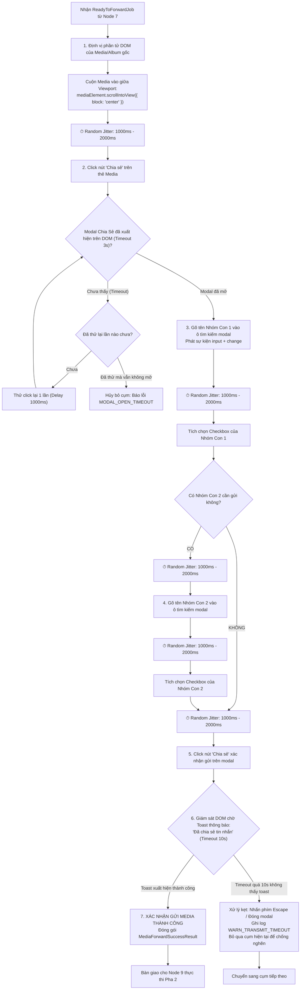

# ĐẶC TẢ CHI TIẾT NODE 08: NATIVE FORWARD MODAL AUTOMATOR (PHASE 1)

**Mã định danh Node**: `N08_FORWARD_AUTOMATOR`  
**Tầng kiến trúc**: Tầng 5 — Thực Thi Giao Diện & An Toàn (UI Dispatch & Safety Layer)  
**Ngữ cảnh thực thi**: Content Script (`content-script.ts`) trên Zalo Web (`https://chat.zalo.me/*`)  
**Tài liệu tham chiếu**:
- [business_flow.md](file:///c:/Users/ADMIN/Documents/workspace/Sales/EXTENSIONS/Docs/Init/Diagrams/business_flow.md)
- [tai_lieu_thiet_ke_so_bo_zalo_automation.md](file:///c:/Users/ADMIN/Documents/workspace/Sales/EXTENSIONS/Docs/Init/tai_lieu_thiet_ke_so_bo_zalo_automation.md)
- [he_thong_tu_dong_hoa_zalo_extension_spec.md](file:///c:/Users/ADMIN/Documents/workspace/Sales/EXTENSIONS/Docs/Init/he_thong_tu_dong_hoa_zalo_extension_spec.md)

---

## 1. MỤC TIÊU & PHẠM VI (NODE OBJECTIVE & SCOPE)

### 1.1. Mục tiêu Cốt lõi
- Tiếp nhận gói công việc phân phối (`ReadyToForwardJob`) từ Node 7.
- Thực thi **Pha 1 của Cơ chế Chuyển tiếp 2 Pha (Two-Phase Dispatch)**: Tự động hóa hộp thoại chia sẻ gốc của Zalo (**Native Forward Modal**) để chuyển tiếp cụm Media gốc (Ảnh đơn lẻ, Album ảnh Grid, hoặc Video) sang tối đa 2 Nhóm Con đích.
- Bảo tồn nguyên vẹn 100% chất lượng HD của hình ảnh/video và tận dụng hạ tầng truyền tải mạng siêu tốc nội bộ của Zalo (không cần tải file về máy rồi upload lại).
- Chèn độ trễ ngẫu nhiên mô phỏng phản xạ cơ học người thật (**Micro-Jitter: 1000ms – 2000ms**) vào giữa từng thao tác HTML.
- **Cơ chế Kiểm định Mạng Nhị phân (Network Transmit Check)**: Bắt buộc giám sát cây DOM để chờ đợi thông báo Toast màu đen xuất hiện ở giữa màn hình: **`✔ Đã chia sẻ tin nhắn`** (hoặc timeout 10 giây).
- Khi nhận diện Toast thành công, bàn giao quyền điều khiển và danh sách nhóm đích vừa nhận media (`recentTargets`) cho Node 9 để thực thi Pha 2 (Gửi Text).

### 1.2. Ranh giới & Không gian Phủ định (In-Scope vs Negative Scope)
- **Trong phạm vi (In-Scope)**:
  - Cuộn thẻ media vào giữa viewport màn hình (`scrollIntoView({ block: 'center' })`).
  - Kích hoạt nút "Chia sẻ" trên thẻ Media/Album của Zalo.
  - Thao tác trên Modal Chia sẻ: Tìm kiếm tên nhóm con, tích chọn checkbox của nhóm con (tối đa 2 nhóm).
  - Nhấp nút "Chia sẻ" xác nhận gửi trên modal.
  - Giám sát Toast thành công với ngưỡng timeout 10 giây.
  - Tự động đóng/hủy modal nếu xảy ra kẹt spinner mạng.
- **Ranh giới cấm (Negative Scope - CẤM TUYỆT ĐỐI)**:
  - **CẤM gõ văn bản biên tập vào modal chia sẻ**: Zalo Web không hỗ trợ chèn văn bản biên tập tin cậy khi chia sẻ cụm album ảnh. Mọi thao tác gửi text thuộc độc quyền của Node 9 tại khung chat chính của Nhóm Con.
  - **CẤM bỏ qua bước chờ Toast**: Không bao giờ được phép chuyển sang Node 9 trước khi Toast thành công xuất hiện (tránh việc gửi text đến nhóm con trước khi ảnh kịp tới).
  - **CẤM chọn quá 2 nhóm con** trên modal chia sẻ.

---

## 2. HỢP ĐỒNG KỸ THUẬT & DỮ LIỆU (INPUT/OUTPUT CONTRACTS)

### 2.1. Đầu Vào: Gói Công Việc Chuyển Tiếp (`ReadyToForwardJob`)
Tiếp nhận từ Node 7 (Router & Transformer):

```typescript
export interface ReadyToForwardJob {
  jobId: string;
  bundleId: string;
  sourceGroupId: string;
  sourceGroupName: string;
  priceNumber: number;
  priceDisplay: string;
  matchedTargets: { targetGroupId: string; targetGroupName: string }[]; // Tối đa 2 nhóm
  mediaElements: BundleMediaItem[];
  rawText: string;
  editedText: string;
  primaryPhone?: string;
  createdAt: number;
}
```

### 2.2. Đầu Ra: Kết Quả Chuyển Tiếp Media Thành Công (`MediaForwardSuccessResult`)
Bàn giao cho Node 9 (Sub-group Text Injector & Pacing Guard):

```typescript
export interface MediaForwardSuccessResult {
  jobId: string;
  bundleId: string;
  sourceGroupId: string;
  sourceGroupName: string;
  recentTargets: { targetGroupId: string; targetGroupName: string }[]; // Danh sách nhóm con đã nhận media
  toastConfirmed: boolean;          // Xác nhận 100% Toast "Đã chia sẻ tin nhắn" đã hiện diện
  editedText: string;               // Văn bản đã biên tập để Node 9 điền vào #chat-input
  mediaForwardDurationMs: number;   // Tổng thời gian hoàn tất Pha 1
  completedAt: number;
}
```

---

## 3. LUỒNG XỬ LÝ CHI TIẾT & STATE MACHINE (EXECUTION ALGORITHM)

### 3.1. Sơ đồ Luồng Thao Tác UI Pha 1 (Phase 1 UI Automation Flowchart)



### 3.2. Thuật toán Thao tác DOM và Kích hoạt Sự kiện React 18
1. **Tìm nút Chia sẻ trên Media/Album**:
   - Thẻ Media đơn: `mediaElement.querySelector('.btn-forward, [data-translate-inner="STR_SHARE"], .chat-action-share')`.
   - Thẻ Album Grid: `mediaElement.closest('.grid-photo, .album-container')?.querySelector('.btn-forward, [data-translate-inner="STR_SHARE"]')`.
   - Mô phỏng click người thật (`mousedown` -> `mouseup` -> `click`).
2. **Thao tác tìm kiếm và tích chọn nhóm trong Modal**:
   - Ô tìm kiếm Modal: `const inputSearch = document.querySelector('.modal-forward-search input, [data-id="forward-search-input"]') as HTMLInputElement;`.
   - Áp dụng hàm `setReactInputValue(inputSearch, targetGroupName)` để React 18 nhận diện từ khóa tìm kiếm.
   - Chờ danh sách kết quả render (500ms).
   - Định vị dòng kết quả: Tìm thẻ hội thoại trong modal có `textContent` khớp `targetGroupName`.
   - Tìm checkbox tương ứng: `row.querySelector('input[type="checkbox"], .z-checkbox')` và phát sự kiện click.
3. **Giám sát Toast Xác Nhận Mạng (`waitForToastSuccess`)**:
   ```typescript
   export function waitForToastSuccess(timeoutMs: number = 10000): Promise<boolean> {
     return new Promise((resolve) => {
       const startTime = Date.now();
       const interval = setInterval(() => {
         const toastElement = document.querySelector(
           '.toast-content, .z-toast, [data-translate-inner="STR_SHARED_MESSAGE"]'
         );
         if (toastElement && toastElement.textContent?.includes('Đã chia sẻ')) {
           clearInterval(interval);
           resolve(true);
         } else if (Date.now() - startTime > timeoutMs) {
           clearInterval(interval);
           resolve(false); // Kẹt mạng hoặc timeout
         }
       }, 200);
     });
   }
   ```
4. **Hủy an toàn khi Timeout Kẹt Mạng**:
   - Nếu `waitForToastSuccess` trả về `false`:
     - Phát sự kiện phím: `document.dispatchEvent(new KeyboardEvent('keydown', { key: 'Escape', code: 'Escape', bubbles: true }))`.
     - Hoặc click nút Đóng: `document.querySelector('.modal-forward .btn-close, [data-icon="close"]')?.click()`.
     - Ghi log `system_logs.add({ level: 'WARN', eventType: 'WARN_TRANSMIT_TIMEOUT', ... })`.

---

## 4. XỬ LÝ LỖI, RETRY & EDGE CASES (RESILIENCE MATRIX)

| Mã Ngoại Lệ | Tình Huống Biên (Edge Case) | Phân Tích Kỹ Thuật | Phương Án Xử Lý & Phòng Vệ |
| :--- | :--- | :--- | :--- |
| **EX-04** | **Modal Chia Sẻ bị kẹt quay spinner quá 10 giây** | Đường truyền mạng chập chờn khiến nút chia sẻ bị treo, Zalo không hiển thị thông báo toast thành công. | **Timeout Cancellation Guard**: Sau 10s không thấy Toast, script tự động bấm phím `Escape` hoặc nút Đóng modal, ghi log `WARN_TRANSMIT_TIMEOUT` và hủy cụm này để giải phóng luồng, không để Worker bị treo. |
| **N08-E02** | **Không tìm thấy nút Chia sẻ trên thẻ Media** | Thẻ media nằm khuất ngoài màn hình hoặc DOM hiển thị dạng video chưa load controls. | Gọi `scrollIntoView({ block: 'center' })` và đợi 500ms. Thử mở menu ngữ cảnh (Context menu chuột phải trên media) để kích hoạt lệnh "Chia sẻ". |
| **N08-E03** | **Gõ tên Nhóm Con trong modal nhưng không ra kết quả** | Tên nhóm con trên Zalo bị thay đổi hoặc có ký tự đặc biệt. | Thử tìm kiếm theo chuỗi không dấu (`removeAccents(name)`). Nếu vẫn không tìm thấy, bỏ qua nhóm con này và chỉ gửi cho nhóm con còn lại (nếu có). |
| **N08-E04** | **Zalo hiển thị cảnh báo "Bạn thao tác quá nhanh" trong modal** | Dấu hiệu tài khoản bị rate-limit nhẹ. | Tự động đóng modal, tăng gấp đôi thời gian Micro-Jitter (từ 1000-2000ms lên 3000-5000ms) và ghi log cảnh báo. |
| **N08-E05** | **Modal chia sẻ bị che khuất bởi pop-up khác** | Zalo hiển thị banner cuộc gọi hoặc thông báo popup đè lên modal chia sẻ. | Kiểm tra `z-index` và kích hoạt đóng pop-up phụ trước khi tương tác với modal chia sẻ. |

---

## 5. PHỤ THUỘC KỸ THUẬT (TECHNICAL DEPENDENCIES)

1. **DOM Selectors (Zalo Web Baseline)**:
   - Nút chia sẻ trên Media: `.btn-forward, [data-translate-inner="STR_SHARE"], .chat-action-share`.
   - Modal Forward cha: `.modal-forward, .z-modal[data-id="modal-share"], .vng-dialog`.
   - Ô tìm kiếm trong modal: `.modal-forward input, [data-id="forward-search-input"]`.
   - Dòng hội thoại trong modal: `.forward-item, .conv-item-forward`.
   - Nút gửi trên modal: `.modal-footer .btn-primary, [data-translate-inner="STR_SHARE"]`.
   - Toast thông báo kết quả: `.toast-content, .z-toast, [data-translate-inner="STR_SHARED_MESSAGE"]`.
2. **Hàm tiện ích tương tác React 18**:
   - `setReactInputValue(element, value)`: Kích hoạt Native Prototype Setter và dispatch `InputEvent`.
   - `randomJitter(minMs, maxMs)`: Mô phỏng trễ ngẫu nhiên 1000ms – 2000ms.
3. **Module tương tác**:
   - Nhận đầu vào: `ReadyToForwardJob` từ Node 7.
   - Giao việc đầu ra: `MediaForwardSuccessResult` cho Node 9 (`Subgroup Text Injector & Pacing Guard`).

---

## 6. TIÊU CHÍ KIỂM THỬ & NGHIỆM THU (ACCEPTANCE CRITERIA / DoD)

### 6.1. Kịch bản Nghiệm thu Nhị phân (Binary Acceptance Gates)
- **GATE-04 (Bắt Buộc Xác Nhận Toast "Đã chia sẻ tin nhắn")**:
  - **Given**: Node 8 đã click nút "Chia sẻ" trên modal chia sẻ gốc của Zalo.
  - **When**: Giám sát phản hồi mạng.
  - **Then**: Node 8 **chỉ được phép** phát `MediaForwardSuccessResult` sang Node 9 sau khi và chỉ khi thẻ Toast thông báo màu đen chứa chuỗi `"Đã chia sẻ"` xuất hiện thực tế trên DOM. Tuyệt đối không chuyển pha dựa trên phỏng đoán thời gian tĩnh.
- **EX-04 (Tự Hủy An Toàn Khi Kẹt Mạng 10 Giây)**:
  - **Given**: Mạng bị lag, nút chia sẻ quay spinner vô tận, sau 10 giây không có toast xuất hiện.
  - **When**: Hết ngưỡng timeout 10s.
  - **Then**:
    1. Node 8 phải tự động đóng modal chia sẻ (bấm Escape hoặc nút Hủy).
    2. Ghi bản ghi log `WARN_TRANSMIT_TIMEOUT` vào `system_logs`.
    3. Hủy bỏ cụm hiện tại an toàn, không để Worker bị treo.
- **AC-03 (Chèn Micro-Jitter Chuẩn 1000ms - 2000ms)**:
  - **Given**: Quá trình thực hiện 4 thao tác UI liên tiếp trong modal.
  - **When**: Đo đạc thời gian giữa các thao tác.
  - **Then**: Mọi khoảng cách giữa các click và input phải nằm nghiêm ngặt trong khoảng `1000ms` đến `2000ms`.

