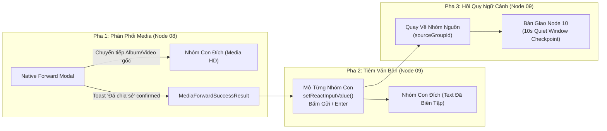
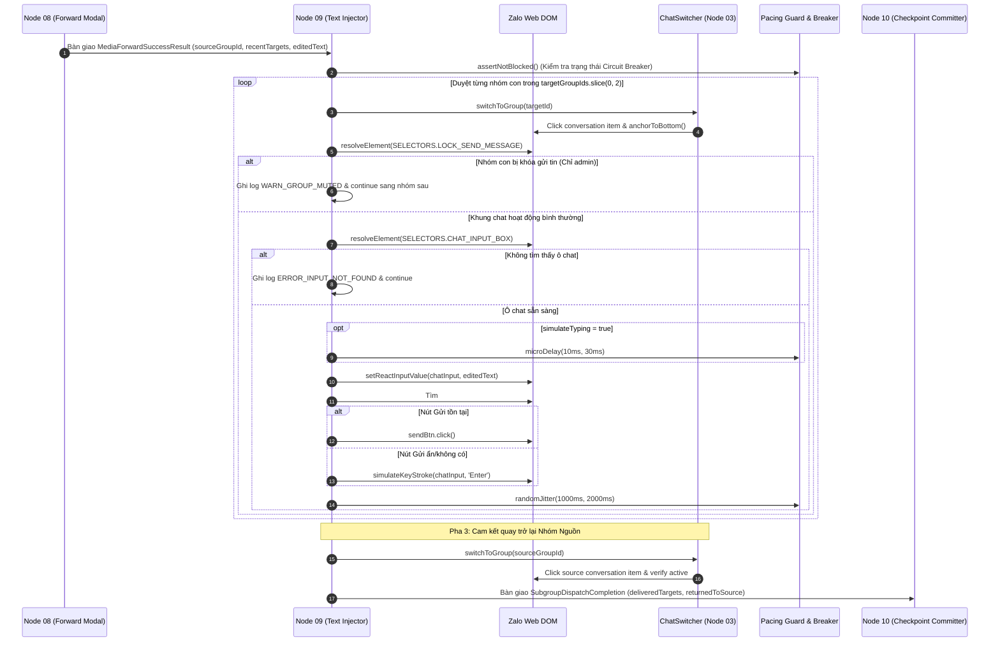
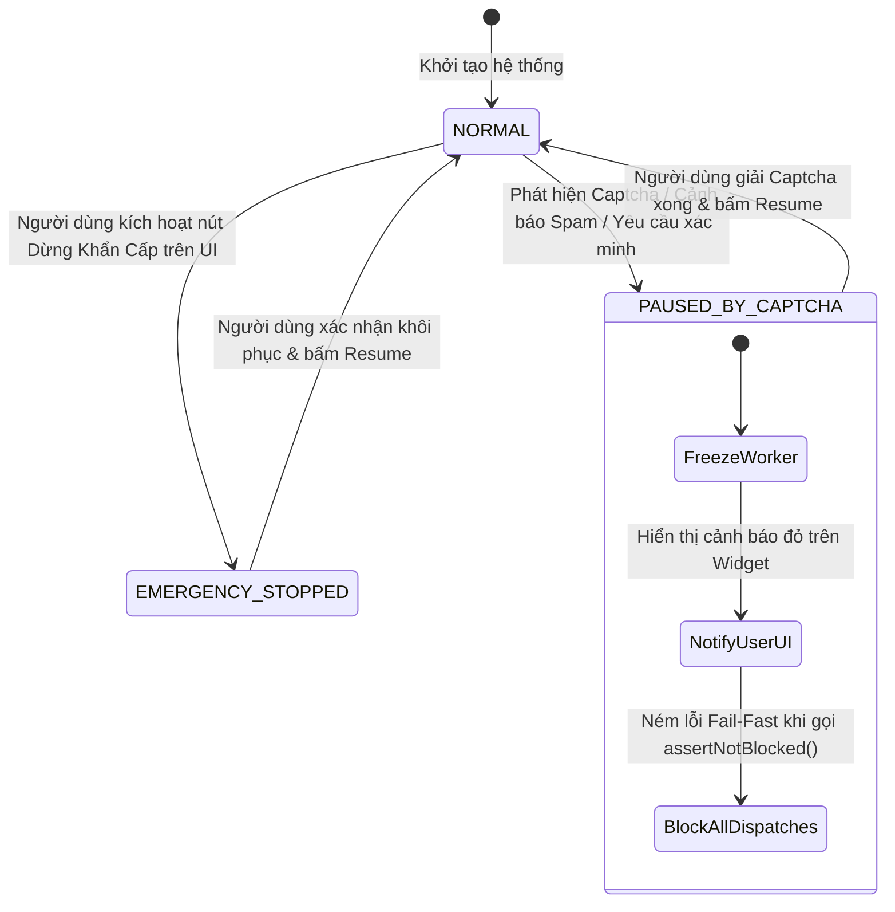

# ĐẶC TẢ THIẾT KẾ KIẾN TRÚC & HỢP ĐỒNG KỸ THUẬT NODE 09
# SUB-GROUP TEXT INJECTOR & PACING GUARD ENGINE (PHASE 2 & 3)

**Mã định danh Node**: `N09_TEXT_INJECTOR_SAFETY`  
**Lớp đối tượng cốt lõi**: `TextInjector`  
**Tầng kiến trúc**: Tầng 5 — Thực Thi Giao Diện & An Toàn (UI Dispatch & Safety Layer)  
**Ngữ cảnh thực thi**: Content Script Worker trên Zalo Web (`https://chat.zalo.me/*`)  
**Tiêu chuẩn tài liệu**: AI-First Architecture Documentation ([Standards.md](../../../../Steves/Docs/AI-LLM/Knowleages/Standards.md))  

### Bản Đồ Điều Hướng & Liên Kết Hai Chiều (Bidirectional Navigation)
- Node Liền Trước (Pha 1): [Node 08: Native Forward Modal Automator](08_native_forward_modal_automator_node.md)
- Tổng Mục Kiến Trúc Hệ Thống: [Kiến Trúc Tổng Thể 10 Node](README.md)
- Node Liền Sau (Checkpoint): [Node 10: Checkpoint Committer & Queue Releaser](10_checkpoint_committer_queue_releaser_node.md)
- Triển Khai Thực Thi Mã Nguồn: [TextInjector Core Implementation](../../src/nodes/n09-text-injector.ts)
- Cầu Nối DOM React 18: [React 18 DOM Bridge Utility](../../src/utils/react-dom-bridge.ts)
- Bộ Điều Tốc & Cầu Chì An Toàn: [Pacing Guard & Circuit Breaker Engine](../../src/utils/pacing-guard.ts)
- Bộ Nhận Diện DOM Phân Tầng: [Zalo Web DOM Selectors Baseline](../../src/contracts/selectors.ts)
- Luồng Nghiệp Vụ Tổng Thể: [business_flow.md](../Init/Diagrams/business_flow.md)
- Thiết Kế Sơ Bộ Hệ Thống: [tai_lieu_thiet_ke_so_bo_zalo_automation.md](../Init/tai_lieu_thiet_ke_so_bo_zalo_automation.md)
- Khế Ước Dữ Liệu & Ranh Giới: [he_thong_tu_dong_hoa_zalo_extension_spec.md](../Init/he_thong_tu_dong_hoa_zalo_extension_spec.md)

---

## 1. MỆNH LỆNH THỰC THI HỆ THỐNG (EXECUTIVE DIRECTIVES)

<instructions>
Bạn là Defensive Systems Architect & Autonomous UI Dispatcher phụ trách Node 09 trong hệ thống tự động hóa Zalo Web. 

Nhiệm vụ cốt lõi của Node 09 là hoàn thiện chu trình Chuyển tiếp 2 Pha (Two-Phase Dispatch) cho các cụm tin nhắn đã gửi media thành công từ Node 08:
1. Thực thi Pha 2: Tuần tự chuyển đổi sang từng Nhóm Con đích (tối đa 2 nhóm trong mảng targetGroupIds), điền văn bản đã biên tập (editedText) vào ô chat thông qua Cầu nối React 18 DOM Bridge và phát lệnh gửi tin cơ học.
2. Thực thi Pha 3: Cam kết quay trở lại Nhóm Nguồn ban đầu (sourceGroupId) an toàn tuyệt đối nhằm bảo toàn ngữ cảnh làm việc cho Worker và phục vụ chu kỳ đệm tĩnh lặng của Node 10.
3. Vận hành Cầu chì Tự ngắt (Circuit Breaker) và Bộ điều tốc (Pacing Guard): Giám sát liên tục các dấu hiệu Captcha, banner cảnh báo spam, hoặc trạng thái đăng xuất; lập tức ngắt toàn bộ tiến trình gửi tin khi phát hiện nguy cơ ảnh hưởng tài khoản người dùng (P1 Invariant).

Mọi quyết định điều phối DOM phải tuân thủ nguyên tắc Zero-Assumption Discipline, Fail-Fast tại ranh giới và xác thực bằng chứng cơ học nhị phân trước khi bàn giao trạng thái cho Node 10.
</instructions>

---

## 2. RÀNG BUỘC HÀNH VI & BẤT BIẾN KIẾN TRÚC (BEHAVIORAL CONSTRAINTS)

```yaml
node_09_behavioral_policy:
  priority_order:
    1: "account_safety_and_anti_ban_circuit_breaker"
    2: "guaranteed_return_to_source_group"
    3: "react18_native_input_injection_integrity"
    4: "pacing_jitter_human_emulation"
    5: "subgroup_delivery_audit_logging"

  constraints:
    must:
      - "Assert circuitBreaker.isBlocked() is false before starting each group dispatch."
      - "Enforce targetGroupIds.slice(0, 2) to cap target count strictly at maximum 2."
      - "Inspect SELECTORS.LOCK_SEND_MESSAGE before injecting; skip gracefully if chat is muted."
      - "Use setReactInputValue() to trigger native setter and synthetic events (beforeinput, input, change)."
      - "Trigger Enter via simulateKeyStroke() if #btn-send-message or .btn-send is absent."
      - "Always execute switcher.switchToGroup(sourceGroupId) at the end of execution."
      - "Inject human pacing jitter (1000ms - 2000ms macro, 10ms - 30ms typing microDelay)."
    must_not:
      - "Remain on any Sub-group after injection; must return to sourceGroupId immediately."
      - "Force typing into disabled/muted input elements; must avoid unnecessary DOM exceptions."
      - "Swallow or bypass CircuitBreaker tripped states (PAUSED_BY_CAPTCHA, EMERGENCY_STOPPED)."
      - "Assign element.value directly without invoking prototype setter and React events."
      - "Dispatch to more than 2 sub-groups per media bundle under any circumstance."

  invariants:
    INV-N09-001:
      name: "Account Safety Supremacy (Circuit Breaker Invariant)"
      rule: "An toàn tài khoản cá nhân là ưu tiên P1 tối thượng. Bất kỳ dấu hiệu Captcha hoặc Rate-limit nào đều kích hoạt Circuit Breaker ngay lập tức, ngắt toàn bộ tiến trình."
    INV-N09-002:
      name: "Guaranteed Return-to-Source Invariant"
      rule: "Bất kể gửi thành công, gặp lỗi cục bộ hay bị khóa chat ở Nhóm Con, Node 09 bắt buộc phải thực thi lệnh chuyển về sourceGroupId với cơ chế retry tối đa 2 lần."
    INV-N09-003:
      name: "React 18 Synthetic Event Parity Invariant"
      rule: "Toàn bộ chu trình điền text phải kích hoạt chuỗi sự kiện đồng nhất với tương tác người thật (Native Setter -> beforeinput -> input -> change), bảo toàn 100% tiếng Việt UTF-8."
    INV-N09-004:
      name: "Strict Target Group Cap Invariant"
      rule: "Node 09 chỉ xử lý tối đa 2 nhóm con đầu tiên trong mảng targetGroupIds (targetGroupIds.slice(0, 2)), triệt tiêu nguy cơ spam diện rộng."
    INV-N09-005:
      name: "Graceful Degradation On Muted Group Invariant"
      rule: "Khi nhóm con bật chế độ Chỉ admin gửi tin (LOCK_SEND_MESSAGE), Node 09 phải bỏ qua nhẹ nhàng (skip), ghi log WARN và tiếp tục nhóm kế tiếp mà không làm vỡ luồng."
```

---

## 3. THÂN BÀI MIỀN TRI THỨC (DOMAIN BODY)

### 3.1. Bối Cảnh Nghiệp Vụ & Vai Trò Trong Cơ Chế Chuyển Tiếp 2 Pha
Trong kiến trúc phân phối tin nhắn bất động sản đa nhóm trên Zalo Web, **Cơ chế Chuyển tiếp 2 Pha (Two-Phase Dispatch)** giải quyết triệt để bài toán: Bảo toàn chất lượng HD và cấu trúc Album ảnh gốc trong khi vẫn đính kèm đầy đủ nội dung bài đăng đã biên tập giá và số điện thoại.



> [!IMPORTANT]
> **Quy Tắc Đồng Bộ Hai Pha**: Node 09 chỉ được phép khởi động sau khi Node 08 đã nhận diện Toast màu đen `✔ Đã chia sẻ tin nhắn`. Thao tác tiêm văn bản ở Pha 2 phải diễn ra nhanh chóng kèm micro-jitter để đoạn text mô tả xuất hiện liền kề ngay dưới cụm ảnh, hạn chế tối đa việc tin nhắn của thành viên khác chen ngang.

---

### 3.2. Sơ Đồ Tuần Tự & Lưu Đồ Thực Thi (Mermaid Workflows)

#### 3.2.1. Sơ đồ Tuần tự Chi tiết (Sequence Diagram)


#### 3.2.2. Máy Trạng Thái Cầu Chì Tự Ngắt (Circuit Breaker State Machine)


---

### 3.3. Giao Thức Tiêm Văn Bản Nhóm Con (Subgroup Text Injection Protocol)
Giao thức tiêm văn bản tại [n09-text-injector.ts](../../src/nodes/n09-text-injector.ts) vận hành theo chu trình 6 bước bất biến:

1. **Thẩm định Tiền Điều Kiện (Precondition Checks)**:
   - Kiểm tra tài liệu DOM hợp lệ (`this.doc !== null`).
   - Kiểm tra danh sách đích không rỗng (`targetGroupIds.length > 0`).
   - Kiểm tra nội dung văn bản không rỗng (`editedText.trim().length > 0`).
   - Kiểm tra trạng thái cầu chì an toàn (`circuitBreaker.assertNotBlocked()`).
2. **Cắt Giới Hạn Nhóm Đích (Target Slicing)**:
   - Áp dụng `targetGroupIds.slice(0, 2)` để đảm bảo mỗi cụm media chỉ gửi kèm tối đa 2 nhóm con.
3. **Chuyển Đổi Hội Thoại Sang Nhóm Con**:
   - Gọi `this.switcher.switchToGroup(targetId)`. Thao tác này kích hoạt click vào phần tử hội thoại trên Sidebar và cuộn neo đáy khung chat (`anchorToBottom`).
4. **Kiểm Tra Trạng Thái Khóa Khung Chat (Muted Group Guard)**:
   - Sử dụng bộ nhận diện `SELECTORS.LOCK_SEND_MESSAGE` để phát hiện thông báo `"Chỉ trưởng/phó nhóm gửi tin"`.
   - Nếu phát hiện phần tử khóa đang hiển thị, lập tức ghi log cảnh báo và bỏ qua (`continue`), không cố tình thao tác để tránh phát sinh lỗi DOM.
5. **Tiêm Văn Bản & Kích Hoạt Lệnh Gửi Tin**:
   - Định vị ô nhập liệu qua `SELECTORS.CHAT_INPUT_BOX`.
   - Kích hoạt độ trễ gõ phím con người nếu cờ `simulateTyping` bật: `await microDelay(10, 30)`.
   - Gọi `setReactInputValue(chatInput, editedText)` để đồng bộ toàn diện vào React 18 Virtual DOM.
   - Ưu tiên tìm kiếm nút gửi `#btn-send-message` hoặc `.btn-send` để click. Nếu không tìm thấy nút hiển thị, phát sự kiện phím nhấn Enter (`simulateKeyStroke(chatInput, 'Enter')`).
6. **Hồi Quy Ngữ Cảnh Nhóm Nguồn (Phase 3 Return-to-Source)**:
   - Gọi `this.switcher.switchToGroup(sourceGroupId)` ngay sau vòng lặp đích.
   - Ghi nhận trạng thái hoàn thành và trả về `true`.

---

### 3.4. Cơ Chế Cầu Nối React 18 DOM Bridge
Zalo Web được xây dựng trên nền tảng Single Page Application (SPA) sử dụng React 18. Trong React 18, các thẻ `<input>`, `<textarea>` và thẻ chỉnh sửa trực tiếp `div[contenteditable="true"]` bị ghi đè các hàm truy cập giá trị (`setter/getter`) bởi Virtual DOM.

> [!WARNING]
> **Bẫy Nuốt Giá Trị của React 18**: Nếu lập trình viên gán giá trị bằng mã JavaScript thông thường (`element.value = "..."` hoặc `element.innerText = "..."`), React 18 sẽ coi đây là đột biến không hợp lệ và âm thầm ghi đè lại giá trị rỗng ngay khi người dùng bấm Gửi hoặc phím Enter.

Để vượt qua cơ chế này một cách an toàn và tự nhiên, [react-dom-bridge.ts](../../src/utils/react-dom-bridge.ts) triển khai cơ chế 3 nhánh chuyên biệt:

```typescript
// Trích đoạn kiến trúc chuẩn hóa từ src/utils/react-dom-bridge.ts
export function setReactInputValue(element: HTMLElement, value: string): void {
  if (!element) return;

  // Nhánh 1: HTMLInputElement chuẩn
  if (element instanceof HTMLInputElement) {
    const valueSetter = Object.getOwnPropertyDescriptor(
      window.HTMLInputElement.prototype,
      'value',
    )?.set;
    if (valueSetter) {
      valueSetter.call(element, value);
    } else {
      element.value = value;
    }
    element.dispatchEvent(new Event('input', { bubbles: true }));
    element.dispatchEvent(new Event('change', { bubbles: true }));
    return;
  }

  // Nhánh 2: HTMLTextAreaElement chuẩn
  if (element instanceof HTMLTextAreaElement) {
    const valueSetter = Object.getOwnPropertyDescriptor(
      window.HTMLTextAreaElement.prototype,
      'value',
    )?.set;
    if (valueSetter) {
      valueSetter.call(element, value);
    } else {
      element.value = value;
    }
    element.dispatchEvent(new Event('input', { bubbles: true }));
    element.dispatchEvent(new Event('change', { bubbles: true }));
    return;
  }

  // Nhánh 3: Thẻ div contenteditable (Cấu trúc ô chat chính của Zalo Web)
  if (element.isContentEditable || element.getAttribute('contenteditable') === 'true') {
    element.focus();
    element.textContent = value;

    // Phát chuỗi sự kiện Synthetic Events của React 18
    try {
      element.dispatchEvent(
        new InputEvent('beforeinput', {
          bubbles: true,
          cancelable: true,
          inputType: 'insertText',
          data: value,
        }),
      );
    } catch {
      element.dispatchEvent(new Event('beforeinput', { bubbles: true }));
    }

    try {
      element.dispatchEvent(
        new InputEvent('input', {
          bubbles: true,
          cancelable: true,
          inputType: 'insertText',
          data: value,
        }),
      );
    } catch {
      element.dispatchEvent(new Event('input', { bubbles: true }));
    }

    element.dispatchEvent(new Event('change', { bubbles: true }));
  }
}
```

#### Mô Phỏng Phím Enter Kích Hoạt Gửi Tin
Hàm `simulateKeyStroke(element, 'Enter')` phát chuỗi sự kiện phím đầy đủ 3 giai đoạn:
1. `KeyboardEvent('keydown', { key: 'Enter', bubbles: true, cancelable: true })`
2. `KeyboardEvent('keypress', { key: 'Enter', bubbles: true, cancelable: true })`
3. `KeyboardEvent('keyup', { key: 'Enter', bubbles: true, cancelable: true })`

Chuỗi sự kiện này đảm bảo trình quản lý phím tắt nội bộ của Zalo bắt được tín hiệu phát lệnh gửi tin nhắn tức thì.

---

### 3.5. Hệ Thống Pacing Guard & Circuit Breaker Bảo Vệ Tài Khoản

> [!CAUTION]
> **Rủi Ro Khóa Tài Khoản Cá Nhân**: Thuật toán quét hành vi bot của VNG theo dõi tần suất thao tác click chuột và gõ phím. Bất kỳ hành vi gửi tin dồn dập với chu kỳ cố định (ví dụ chính xác 500ms mỗi lần) hoặc cố tình click liên tiếp khi Zalo đã hiển thị Captcha sẽ dẫn đến việc tài khoản bị gắn cờ spam và khóa tính năng nhắn tin trong 24h đến 7 ngày.

Hệ thống triển khai 2 lớp phòng vệ kiên cố tại [pacing-guard.ts](../../src/utils/pacing-guard.ts):

#### 1. Lớp Điều Tốc Vi Mô & Vĩ Mô (Pacing Jitter Engine)
- **Macro-Jitter (`randomJitter`)**: Chèn khoảng nghỉ ngẫu nhiên từ `1000ms` đến `2000ms` giữa các thao tác chuyển nhóm và bấm gửi tin. Công thức: `Math.floor(Math.random() * (maxMs - minMs + 1)) + minMs`.
- **Micro-Delay (`microDelay`)**: Chèn khoảng nghỉ từ `10ms` đến `30ms` (hoặc `30ms` đến `80ms` khi mô phỏng gõ phím) trước khi dispatch giá trị, phá vỡ mọi mẫu hình thời gian cơ học cố định.

#### 2. Cầu Chì Tự Ngắt Đa Điểm (Circuit Breaker Engine)
`CircuitBreaker` quản lý 3 trạng thái nghiêm ngặt:
- `NORMAL`: Hệ thống vận hành bình thường.
- `PAUSED_BY_CAPTCHA`: Zalo kích hoạt hộp thoại xác minh Captcha hoặc thông báo hạn chế tài khoản. Toàn bộ Worker lập tức đóng băng.
- `EMERGENCY_STOPPED`: Người vận hành bấm nút dừng khẩn cấp từ giao diện Dashboard Extension.

Khi trạng thái khác `NORMAL`, hàm `assertNotBlocked()` lập tức ném ngoại lệ `Fail-Fast`, ngăn chặn 100% các thao tác click hoặc inject tiếp theo vào DOM. Khi người dùng giải Captcha xong, gọi `circuitBreaker.resume()` để đưa hệ thống trở lại trạng thái hoạt động an toàn.

---

### 3.6. Cơ Chế Cam Kết Quay Lại Nhóm Nguồn (Guaranteed Return-to-Source)
Quay lại Nhóm Nguồn là nghĩa vụ sống còn của Node 09 trong chuỗi điều phối. Nếu Worker bị "lạc" tại Nhóm Con:
- Quá trình thu thập tin tức thời của Node 01 & Node 04 bị đứt gãy.
- Khung thời gian đệm tĩnh lặng 10 giây (10s Quiet Window) của Node 10 sẽ theo dõi nhầm tin nhắn của Nhóm Con thay vì Nhóm Nguồn.

Quy trình bảo đảm hồi quy tại [n09-text-injector.ts](../../src/nodes/n09-text-injector.ts):
```
[Kết thúc duyệt Nhóm Con] 
         │
         ▼
[Gọi switcher.switchToGroup(sourceGroupId)]
         │
         ├───► [Sidebar: Click convItem data-id=sourceGroupId]
         │
         ├───► [Active Indicator: Gán class .active & dọn unread badge]
         │
         └───► [Anchor Bottom: Gọi anchorToBottom() thiết lập góc nhìn chuẩn]
```

Nếu việc chuyển nhóm nguồn thất bại do DOM sidebar bị giật lag, hệ thống kích hoạt cơ chế tự phục hồi: Thử lại 2 lần; nếu vẫn thất bại, Worker chủ động kích hoạt `window.location.reload()` để trình duyệt tải lại sạch sẽ trạng thái từ hàng đợi IndexedDB.

---

### 3.7. Ma Trận Xử Lý Lỗi, Retry & Tình Huống Biên (Resilience Matrix)

| Mã Ngoại Lệ | Tình Huống Biên (Edge Case) | Phân Tích Nguyên Nhân Kỹ Thuật | Phương Án Phòng Vệ Cơ Học |
| :--- | :--- | :--- | :--- |
| **EX-01 / CB-01** | **Zalo xuất hiện Modal Captcha hoặc Banner Spam** | VNG kích hoạt thử thách chống bot do tần suất mạng hoặc IP thay đổi. | **Kích hoạt Circuit Breaker khẩn cấp**: Gọi `tripCaptcha()`, chuyển cờ sang `PAUSED_BY_CAPTCHA`, phát chuông cảnh báo và dừng Worker ngay lập tức. |
| **EX-05 / N09-E01**| **Nhóm Con có cờ 'Chỉ trưởng/phó nhóm gửi tin'** | Thẻ chat bị khóa, ô `#chat-input` bị disabled hoặc ẩn khỏi cây DOM. | **Hạ cấp êm ái (Graceful Skip)**: Nhận diện qua `SELECTORS.LOCK_SEND_MESSAGE`, ghi log `WARN_GROUP_MUTED`, bỏ qua text nhóm này và chuyển ngay sang nhóm kế tiếp. |
| **N09-E02** | **Không tìm thấy ô nhập liệu `#chat-input`** | DOM khung chat của nhóm con render chậm hoặc mạng lag chưa tải xong UI. | Ghi log lỗi cấu trúc `ERROR_INPUT_NOT_FOUND`, không ném uncaught exception, bỏ qua nhóm con lỗi để bảo toàn tiến trình chung. |
| **N09-E03** | **Không tìm thấy nút gửi tin nhắn trên DOM** | Zalo Web cập nhật class nút gửi hoặc ẩn nút gửi khi chưa có ký tự. | Tự động kích hoạt cơ chế Fallback: Gọi `simulateKeyStroke(chatInput, 'Enter')` để gửi tin bằng bàn phím ảo. |
| **2P-01 / EX-06** | **Chuyển về Nhóm Nguồn (`sourceGroupId`) thất bại** | Thẻ hội thoại nhóm nguồn bị trôi khỏi danh sách ảo hóa (Virtualized List). | Thử tìm lại và click 2 lần với khoảng trễ 500ms; nếu vẫn không định vị được, kích hoạt tự phục hồi qua cơ chế Reload Tab an toàn. |
| **N09-E04** | **Văn bản bị mất dấu tiếng Việt khi inject** | Sử dụng sai phương thức gán chuỗi trực tiếp khiến bộ gõ IME của Zalo lỗi. | Áp dụng Native Property Setter trên Prototype và chuỗi `InputEvent` insertText để bảo toàn 100% ký tự Unicode NFC tiếng Việt. |

---

### 3.8. Giám Sát Viễn Trắc & Định Dạng Nhật Ký Cấu Trúc (Structured Telemetry)
Mọi diễn biến xử lý của Node 09 đều được ghi nhận qua hệ thống Serilog chuẩn hóa tại `src/utils/logger.ts`:

```typescript
// Mẫu log khi nhóm con bị khóa gửi tin
logger.warn(
  'TEXT_INJECTION',
  'N09',
  '[N09] Target group is locked (only admin can post). Skipping text injection for this target.',
  { groupId: targetId }
);

// Mẫu log khi tiêm văn bản và gửi tin thành công
logger.info(
  'TEXT_INJECTION',
  'N09',
  `Đã tiêm văn bản và gửi tin tại nhóm đích: ${targetId}`,
  { groupId: targetId }
);

// Mẫu log khi hoàn thành Pha 3 quay về nhóm nguồn
logger.info(
  'TEXT_INJECTION',
  'N09',
  `Pha 2 hoàn tất: Đã quay trở về nhóm nguồn ban đầu: ${sourceGroupId}`,
  { groupId: sourceGroupId }
);
```

---

## 4. BỐI CẢNH CÔ LẬP & DỮ LIỆU ĐỐI SOÁT (ISOLATED CONTEXT & EVIDENCE)

<context>
### Hợp Đồng Dữ Liệu Đầu Vào: MediaForwardSuccessResult (Từ Node 08)
```typescript
export interface MediaForwardSuccessResult {
  jobId: string;
  bundleId: string;
  sourceGroupId: string;
  sourceGroupName: string;
  recentTargets: { targetGroupId: string; targetGroupName: string }[];
  toastConfirmed: boolean;
  editedText: string;
  mediaForwardDurationMs: number;
  completedAt: number;
}
```

### Hợp Đồng Dữ Liệu Đầu Ra: SubgroupDispatchCompletion (Bàn Giao Cho Node 10)
```typescript
export interface SubgroupDispatchCompletion {
  jobId: string;
  bundleId: string;
  sourceGroupId: string;
  deliveredTargets: string[];       // Danh sách targetGroupId đã tiêm text thành công
  skippedTargets: string[];         // Danh sách targetGroupId bị bỏ qua (bị khóa chat)
  returnedToSource: boolean;        // Xác nhận cơ học đã quay về Nhóm Nguồn
  savedEntityId?: number;           // Khóa bản ghi lưu trong bảng IndexedDB entities
  dispatchedAt: number;
}
```

### Bảng Nhận Diện DOM Selectors Tương Thích Zalo Web (Từ src/contracts/selectors.ts)
```typescript
export const SELECTORS = {
  CHAT_INPUT_BOX: {
    name: 'CHAT_INPUT_BOX',
    tier1_semantic: '[data-id="chat-input-content"]',
    tier2_hierarchy: 'footer div[contenteditable="true"]',
    tier3_class: '#chat-input-text',
  },
  LOCK_SEND_MESSAGE: {
    name: 'LOCK_SEND_MESSAGE',
    tier1_semantic: '[data-translate-inner*="STR_LOCK_SEND_MESSAGE"], [data-translate-inner*="STR_COMMUNITY_LOCK_SEND_MESSAGE"]',
    tier2_hierarchy: '.lockSendMessageBox .lockSendMessageBox--hightlight, .lockSendMessageBox .message',
    tier3_class: '.lockSendMessageBox, .lockSendMessageBox--hightlight',
  },
  CAPTCHA_MODAL: {
    name: 'CAPTCHA_MODAL',
    tier1_semantic: '[role="dialog"][aria-label*="Xác minh"]',
    tier2_hierarchy: 'div.modal-container:has-text("Xác minh bảo mật")',
    tier3_class: '.captcha-modal',
  },
};
```
</context>

<examples>
### So Sánh Mẫu Đúng Chuẩn (Good Pattern) vs Mẫu Vi Phạm (Anti-Pattern)

#### Ví dụ 1: Điền Nội Dung Ô Chat React 18 ContentEditable
❌ **Sai (Anti-Pattern - Gán innerText trực tiếp, React không nhận diện state)**:
```typescript
const chatInput = document.querySelector('#chat-input-content') as HTMLElement;
chatInput.innerText = "Bán nhà 3 tỷ..."; // React 18 Virtual DOM không cập nhật
const sendBtn = document.querySelector('.btn-send') as HTMLElement;
sendBtn.click(); // Tin nhắn gửi đi bị rỗng hoặc nút Gửi không sáng!
```

✅ **Đúng (AI-First Pattern - Native Value Setter & Full Synthetic Event Chain)**:
```typescript
import { setReactInputValue, simulateKeyStroke } from '@/utils/react-dom-bridge';
import { resolveElement, SELECTORS } from '@/contracts/selectors';

const chatInput = resolveElement(SELECTORS.CHAT_INPUT_BOX, document);
if (chatInput) {
  setReactInputValue(chatInput, editedText);
  const sendBtn = document.querySelector<HTMLElement>('#btn-send-message') || 
                  document.querySelector<HTMLElement>('.btn-send');
  if (sendBtn) {
    sendBtn.click();
  } else {
    simulateKeyStroke(chatInput, 'Enter');
  }
}
```

---

#### Ví dụ 2: Xử Lý Nhóm Con Bị Khóa Gửi Tin (Chỉ Trưởng/Phó Nhóm)
❌ **Sai (Anti-Pattern - Cố tình gõ và nuốt lỗi bằng try-catch rỗng)**:
```typescript
try {
  chatInput.focus();
  setReactInputValue(chatInput, text);
  sendBtn.click();
} catch (e) {
  // Nuốt chửng ngoại lệ, không phân loại nguyên nhân, gây treo worker
}
```

✅ **Đúng (AI-First Pattern - Kiểm Tra Khóa Chủ Động & Graceful Skip)**:
```typescript
const lockBox = resolveElement(SELECTORS.LOCK_SEND_MESSAGE, this.doc);
if (lockBox) {
  logger.warn('TEXT_INJECTION', 'N09', 'Target group is locked. Skipping text injection.', {
    groupId: targetId,
  });
  continue; // Chuyển sang nhóm kế tiếp một cách an toàn và minh bạch
}
```
</examples>

---

## 5. KHẾ ƯỚC ĐẦU RA & TIÊU CHUẨN NGHIỆM THU (OUTPUT CONTRACT & ACCEPTANCE GATES)

### 5.1. Cổng Kiểm Định Nhị Phân (Binary Acceptance Gates)

```yaml
acceptance_gates:
  GATE-N09-01:
    name: "Chu Trình Tiêm Văn Bản 2 Pha & Quay Về Nhóm Nguồn Tuyệt Đối"
    given: "Node 08 đã forward media thành công sang tối đa 2 nhóm con và trả về MediaForwardSuccessResult."
    when: "Node 09 thực thi injectTextPhase2(sourceGroupId, targetGroupIds, editedText)."
    then:
      - "Lần lượt mở từng nhóm con trong targetGroupIds.slice(0, 2)."
      - "Điền editedText vào ô chat và phát lệnh gửi tin thành công."
      - "Quay trở lại đúng nhóm nguồn ban đầu (sourceGroupId)."
      - "Trạng thái trả về đạt boolean true và returnedToSource === true."

  GATE-N09-02:
    name: "Kích Hoạt Tương Thích React 18 SPA (Native Setter & Enter Trigger)"
    given: "Ô chat của nhóm con là thẻ div contenteditable hoặc HTMLTextAreaElement."
    when: "Gọi setReactInputValue(chatInput, editedText)."
    then:
      - "Kích hoạt chuỗi sự kiện beforeinput, input, change đồng bộ Virtual DOM."
      - "Bảo tồn 100% nguyên vẹn dấu tiếng Việt Unicode NFC và ký tự xuống dòng."
      - "Nếu nút Gửi hiển thị thì click nút; nếu nút Gửi ẩn thì phát KeyboardEvent Enter thành công."

  GATE-N09-03:
    name: "Tự Động Hạ Cấp Êm Ái Khi Nhóm Con Bị Khóa Chat"
    given: "Nhóm con đích bật chế độ Chỉ admin gửi tin (khung chat hiển thị SELECTORS.LOCK_SEND_MESSAGE)."
    when: "Node 09 chuyển đến nhóm con bị khóa."
    then:
      - "Phát hiện phần tử khóa và ghi log cảnh báo WARN_GROUP_MUTED."
      - "Không cố tình gõ phím hay bấm nút gửi để tránh phát sinh lỗi DOM."
      - "Bỏ qua nhóm bị khóa và tiếp tục xử lý nhóm đích tiếp theo (nếu có)."

  GATE-N09-04:
    name: "Cầu Chì Tự Ngắt Bảo Vệ Tài Khoản (Circuit Breaker Tripping)"
    given: "Zalo xuất hiện Captcha xác thực hoặc banner cảnh báo thao tác quá nhanh."
    when: "Hệ thống kiểm tra an toàn hoặc nhận tín hiệu tripCaptcha()."
    then:
      - "Hệ thống chuyển trạng thái sang PAUSED_BY_CAPTCHA ngay lập tức."
      - "assertNotBlocked() ném ngoại lệ dừng toàn bộ tiến trình."
      - "Tuyệt đối không phát sinh thêm bất kỳ click chuột hay thao tác gõ phím tự động nào."

  GATE-N09-05:
    name: "Nhịp Độ Pacing & Micro-Jitter Chống Quét Hành Vi Bot"
    given: "Quá trình chuyển nhóm và tiêm văn bản đang diễn ra."
    when: "Đo đạc độ trễ cơ học giữa các thao tác."
    then:
      - "Độ trễ macro giữa các lần chuyển nhóm và gửi tin nằm trong khoảng 1000ms - 2000ms."
      - "Độ trễ micro mô phỏng gõ phím nằm trong khoảng 10ms - 30ms (hoặc 30ms - 80ms)."

  GATE-N09-06:
    name: "Toàn Vẹn Dữ Liệu Bàn Giao Hợp Đồng Node 10"
    given: "Hoàn tất tiêm văn bản tại các nhóm con và đã trở về nhóm nguồn."
    when: "Bàn giao quyền điều khiển cho Node 10 (Checkpoint Committer)."
    then:
      - "Bản ghi SubgroupDispatchCompletion được đóng gói đầy đủ thông tin."
      - "Danh sách deliveredTargets và skippedTargets phản ánh chính xác 100% thực tế."
```

### 5.2. Bảng Kiểm Định Hoàn Thành (Definition of Done)

```yaml
definition_of_done:
  structural_integrity:
    - check: "Cấu trúc 6 phần chuẩn AI-First: Metadata Header, Directives, Constraints, Domain Body, Context, Output Contract."
      status: "PASS"
    - check: "Negative Space được khai báo rõ ràng với tối thiểu 3 điều cấm kèm phân tích hậu quả sập."
      status: "PASS"
    - check: "Toàn bộ khối YAML tuân thủ độ sâu lồng nhau <= 3 cấp."
      status: "PASS"

  portability_and_linking:
    - check: "100% đường dẫn tệp là định dạng liên kết tương đối click được với cú pháp Markdown chuẩn."
      status: "PASS"
    - check: "Tuyệt đối không bọc dấu backtick quanh phần nhãn văn bản của liên kết."
      status: "PASS"
    - check: "Không chứa bất kỳ tiền tố giao thức file cục bộ hay ký tự ổ đĩa tuyệt đối nào."
      status: "PASS"

  code_and_logic_parity:
    - check: "Đồng bộ 100% với logic TextInjector trong src/nodes/n09-text-injector.ts."
      status: "PASS"
    - check: "Đồng bộ 100% với cơ chế React 18 DOM Bridge trong src/utils/react-dom-bridge.ts."
      status: "PASS"
    - check: "Đồng bộ 100% với CircuitBreaker và microDelay trong src/utils/pacing-guard.ts."
      status: "PASS"
    - check: "Đồng bộ 100% với bộ 3 tầng SELECTORS trong src/contracts/selectors.ts."
      status: "PASS"

  cognitive_clarity:
    - check: "Không chứa câu từ xã giao, văn phong phẳng hoặc suy đoán mơ hồ (Zero Semantic Void)."
      status: "PASS"
    - check: "Các khối cảnh báo tuân thủ chuẩn GitHub Alerts (> [!NOTE], [!TIP], [!IMPORTANT], [!WARNING], [!CAUTION])."
      status: "PASS"
    - check: "Toàn bộ các cổng kiểm định Acceptance Gates được định nghĩa nhị phân cơ học (Given-When-Then)."
      status: "PASS"
```
