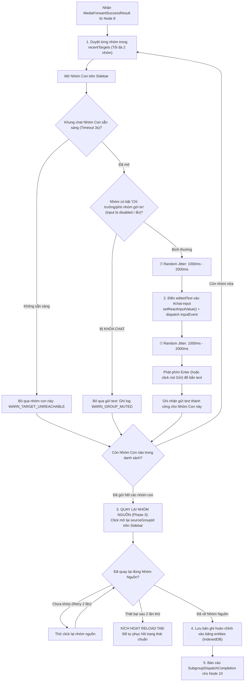

# ĐẶC TẢ CHI TIẾT NODE 09: SUB-GROUP TEXT INJECTOR & PACING GUARD (PHASE 2 & 3)

**Mã định danh Node**: `N09_TEXT_INJECTOR_SAFETY`  
**Tầng kiến trúc**: Tầng 5 — Thực Thi Giao Diện & An Toàn (UI Dispatch & Safety Layer)  
**Ngữ cảnh thực thi**: Content Script (`content-script.ts`) trên Zalo Web (`https://chat.zalo.me/*`)  
**Tài liệu tham chiếu**:
- [business_flow.md](file:///c:/Users/ADMIN/Documents/workspace/Sales/EXTENSIONS/Docs/Init/Diagrams/business_flow.md)
- [tai_lieu_thiet_ke_so_bo_zalo_automation.md](file:///c:/Users/ADMIN/Documents/workspace/Sales/EXTENSIONS/Docs/Init/tai_lieu_thiet_ke_so_bo_zalo_automation.md)
- [he_thong_tu_dong_hoa_zalo_extension_spec.md](file:///c:/Users/ADMIN/Documents/workspace/Sales/EXTENSIONS/Docs/Init/he_thong_tu_dong_hoa_zalo_extension_spec.md)

---

## 1. MỤC TIÊU & PHẠM VI (NODE OBJECTIVE & SCOPE)

### 1.1. Mục tiêu Cốt lõi
- Tiếp nhận kết quả gửi media thành công (`MediaForwardSuccessResult`) từ Node 8.
- Thực thi **Pha 2 của Cơ chế Chuyển tiếp 2 Pha**: Lần lượt chuyển sang từng Nhóm Con đích (trong mảng `recentTargets`, tối đa 2 nhóm), điền đoạn văn bản đã biên tập (`editedText`) vào ô nhập liệu chính (`#chat-input`) và phát lệnh gửi tin.
- Thực thi **Pha 3 của Cơ chế Chuyển tiếp 2 Pha**: Tự động chuyển quay trở lại **Nhóm Nguồn ban đầu** (`sourceGroupId`) để bảo toàn ngữ cảnh làm việc và tiếp tục xử lý các cụm tin nhắn tiếp theo trong mảng Delta.
- **Tích hợp Cầu chì Tự ngắt Bảo vệ Tài khoản (Circuit Breaker)**: Giám sát liên tục các dấu hiệu Captcha, thông báo hạn chế tính năng gửi tin hoặc đăng xuất bất thường từ Zalo. Nếu phát hiện, lập tức ngắt toàn bộ Worker, chuyển hệ thống sang trạng thái `PAUSED_BY_CIRCUIT_BREAKER`.
- Áp dụng **Micro-Jitter `1000ms – 2000ms`** và lưu trữ bản ghi thực thể hoàn chỉnh vào bảng `entities` trong cơ sở dữ liệu IndexedDB (Dexie.js).
- Báo cáo hoàn tất phân phối cụm cho Node 10 (Checkpoint Committer & Inactivity Drain).

### 1.2. Ranh giới & Không gian Phủ định (In-Scope vs Negative Scope)
- **Trong phạm vi (In-Scope)**:
  - Mở từng nhóm con từ Sidebar và kiểm tra trạng thái khung chat.
  - Kiểm tra xem nhóm con có bị khóa chat ("Chỉ trưởng/phó nhóm gửi tin") không để hạ cấp an toàn.
  - Kích hoạt ô nhập liệu `#chat-input` thông qua Native Value Setter và phát sự kiện `InputEvent`, `KeyboardEvent('Enter')`.
  - Tự động quay lại nhóm nguồn theo biến neo cố định `sourceGroupId`.
  - Kích hoạt Circuit Breaker khi phát hiện nguy cơ khóa tài khoản.
  - Ghi bản ghi đối tượng chính thức vào bảng `entities` (Rolling 30 days).
- **Ranh giới cấm (Negative Scope - CẤM TUYỆT ĐỐI)**:
  - **CẤM** ở lại Nhóm Con sau khi gửi text (bắt buộc phải quay lại Nhóm Nguồn ngay lập tức để tiếp tục luồng giám sát).
  - **CẤM** cố tình gửi text nếu ô chat của Nhóm Con bị `disabled` (tránh spam lỗi DOM).
  - **CẤM** bỏ qua tín hiệu Circuit Breaker (an toàn tài khoản cá nhân của người dùng là ưu tiên P1 tối thượng).

---

## 2. HỢP ĐỒNG KỸ THUẬT & DỮ LIỆU (INPUT/OUTPUT CONTRACTS)

### 2.1. Đầu Vào: Kết Quả Chuyển Tiếp Media (`MediaForwardSuccessResult`)
Tiếp nhận từ Node 8:

```typescript
export interface MediaForwardSuccessResult {
  jobId: string;
  bundleId: string;
  sourceGroupId: string;
  sourceGroupName: string;
  recentTargets: { targetGroupId: string; targetGroupName: string }[];
  toastConfirmed: boolean;
  editedText: string;
  mediaForwardDurationMs: number;
  completedAt: number;
}
```

### 2.2. Đầu Ra: Kết Quả Hoàn Tất Phân Phối Cụm (`SubgroupDispatchCompletion`)
Bàn giao cho Node 10 (Checkpoint Committer & Inactivity Drain):

```typescript
export interface SubgroupDispatchCompletion {
  jobId: string;
  bundleId: string;
  sourceGroupId: string;
  deliveredTargets: string[];       // Danh sách tên nhóm con đã gửi text thành công
  skippedTargets: string[];         // Danh sách nhóm con bị bỏ qua (ví dụ bị khóa chat)
  returnedToSource: boolean;        // Xác nhận đã quay trở lại Nhóm Nguồn an toàn
  savedEntityId?: number;           // ID bản ghi vừa lưu trong bảng entities
  dispatchedAt: number;
}
```

---

## 3. LUỒNG XỬ LÝ CHI TIẾT & STATE MACHINE (EXECUTION ALGORITHM)

### 3.1. Sơ đồ Tuần Tự Luồng 2 Pha (Phase 2 & 3 Flowchart)



### 3.2. Thuật toán Điền Văn Bản Kích Hoạt React 18 SPA
```typescript
export function setReactInputValue(
  element: HTMLInputElement | HTMLTextAreaElement,
  value: string
): void {
  // Lấy native value setter từ prototype chuẩn của HTML element
  const prototype = Object.getPrototypeOf(element);
  const nativeValueSetter = Object.getOwnPropertyDescriptor(prototype, 'value')?.set;
  
  if (nativeValueSetter) {
    nativeValueSetter.call(element, value);
  } else {
    element.value = value;
  }

  // Phát chuỗi sự kiện mô phỏng hành vi gõ bàn phím của người thật
  element.dispatchEvent(new Event('input', { bubbles: true }));
  element.dispatchEvent(new Event('change', { bubbles: true }));
}

export async function sendTextToChatInput(
  chatInput: HTMLTextAreaElement | HTMLInputElement,
  text: string
): Promise<void> {
  // 1. Focus ô nhập
  chatInput.focus();
  await randomJitter(500, 800);

  // 2. Điền nội dung
  setReactInputValue(chatInput, text);
  await randomJitter(800, 1200);

  // 3. Phát phím Enter để gửi
  const enterDown = new KeyboardEvent('keydown', {
    key: 'Enter',
    code: 'Enter',
    keyCode: 13,
    which: 13,
    bubbles: true,
    cancelable: true
  });
  chatInput.dispatchEvent(enterDown);
}
```

### 3.3. Thuật toán Giám Sát Cầu Chì Tự Ngắt (Circuit Breaker Engine)
```typescript
export function checkCircuitBreakerThreats(): boolean {
  // 1. Quét tìm Captcha của Zalo
  const captchaModal = document.querySelector(
    '.captcha-modal, .z-captcha, [data-id="captcha-view"], iframe[src*="captcha"]'
  );
  
  // 2. Quét tìm thông báo hạn chế tài khoản / spam warning
  const rateLimitBanner = document.querySelector(
    '.banner-warning, .toast-error, [data-translate-inner="STR_ACCOUNT_TEMPORARILY_BLOCKED"]'
  );
  const hasSpamWarning = rateLimitBanner?.textContent?.includes('tạm thời bị hạn chế') ||
                         rateLimitBanner?.textContent?.includes('thao tác quá nhanh');

  // 3. Quét kiểm tra trạng thái bị đăng xuất ra màn hình Login
  const loginForm = document.querySelector('.login-container, .qrcode-wrapper');

  if (captchaModal || hasSpamWarning || loginForm) {
    return true; // Kích hoạt ngắt khẩn cấp!
  }
  return false;
}
```

---

## 4. XỬ LÝ LỖI, RETRY & EDGE CASES (RESILIENCE MATRIX)

| Mã Ngoại Lệ | Tình Huống Biên (Edge Case) | Phân Tích Kỹ Thuật | Phương Án Xử Lý & Phòng Vệ |
| :--- | :--- | :--- | :--- |
| **EX-01** | **Zalo hiển thị Captcha hoặc thông báo hạn chế gửi tin** | Nếu tiếp tục click tự động sẽ kích hoạt thuật toán chống bot của VNG và dẫn đến khóa tài khoản vĩnh viễn. | **KÍCH HOẠT CIRCUIT BREAKER**: Ngay lập tức tạm dừng toàn bộ luồng Worker, chuyển cờ hệ thống sang `PAUSED_BY_CIRCUIT_BREAKER`, phát âm thanh cảnh báo và giữ nguyên hàng chờ cho người dùng can thiệp thủ công. |
| **2P-01 / EX-06** | **Chuyển sang Nhóm Con nhưng không quay lại được Nhóm Nguồn** | Mất ngữ cảnh làm việc do danh sách chat bị trôi hoặc thẻ sidebar nhóm nguồn bị unmount. | Lưu biến `sourceGroupId` cố định. Thực hiện retry click lại 2 lần; nếu sau 2 lần vẫn không thể quay về nhóm nguồn ➔ Tự động gọi `window.location.reload()` để khởi động lại sạch sẽ và tự phục hồi từ hàng chờ. |
| **2P-02** | **Thành viên khác trong Nhóm Con nhắn tin xen ngang giữa ảnh và text** | Sau khi ảnh gửi xong, có người khác nhắn tin khiến đoạn text mô tả bị cách xa cụm ảnh. | Tối ưu hóa thời gian chuyển sang Nhóm Con (ngay sau khi nhận Toast "Đã chia sẻ tin nhắn"), chuyển tab và gửi text trong vòng `< 2 giây` với micro-jitter tối thiểu. |
| **2P-03 / EX-05** | **Nhóm Con có bật tính năng 'Chỉ trưởng/phó nhóm gửi tin'** | Ô `#chat-input` ở Nhóm Con bị `disabled` hoặc ẩn hoàn toàn khỏi DOM. | Kiểm tra thuộc tính `disabled` hoặc text "Chỉ trưởng/phó nhóm gửi tin". Nếu bị khóa ➔ Bỏ qua việc gửi text ở nhóm đó, ghi log `WARN_GROUP_MUTED` và chuyển ngay sang nhóm tiếp theo. |
| **N09-E05** | **Nội dung text bị mất dấu tiếng Việt khi inject vào React** | Một số trường hợp dispatch sự kiện không tương thích bộ gõ tiếng Việt. | Sử dụng Native Property Setter trên prototype chuẩn của `HTMLTextAreaElement` để bảo toàn nguyên vẹn 100% dấu tiếng Việt và xuống dòng. |

---

## 5. PHỤ THUỘC KỸ THUẬT (TECHNICAL DEPENDENCIES)

1. **DOM Selectors (Zalo Web Baseline)**:
   - Ô nhập liệu khung chat chính: `#chat-input, div[contenteditable="true"], textarea.chat-input`.
   - Nút gửi tin nhắn: `.btn-send, [data-translate-inner="STR_SEND"], .chat-action-send`.
   - Thẻ thông báo khóa chat: `.chat-disabled-banner, [data-translate-inner="STR_ONLY_ADMIN_CAN_CHAT"]`.
   - Thẻ Captcha & Cảnh báo: `.captcha-modal, .z-captcha, .toast-error`.
2. **Cơ sở dữ liệu cục bộ (IndexedDB — Dexie.js)**:
   - Bảng `entities`: Ghi nhận bản ghi chính thức sau khi gửi thành công.
   - Bảng `system_logs`: Ghi nhận các sự kiện cảnh báo và kích hoạt Circuit Breaker.
3. **Module tương tác**:
   - Nhận đầu vào: `MediaForwardSuccessResult` từ Node 8.
   - Báo cáo hoàn tất: Gọi `checkpointCommitter.notifyBundleDispatched()` của Node 10.

---

## 6. TIÊU CHÍ KIỂM THỬ & NGHIỆM THU (ACCEPTANCE CRITERIA / DoD)

### 6.1. Kịch bản Nghiệm thu Nhị phân (Binary Acceptance Gates)
- **GATE-05 (Chu Trình 2 Pha Hoàn Hảo & Quay Lại Nhóm Nguồn)**:
  - **Given**: Node 8 đã forward cụm ảnh sang Nhóm Con A và Nhóm Con B.
  - **When**: Node 9 thực hiện Pha 2 và Pha 3.
  - **Then**:
    1. Node 9 lần lượt mở Nhóm Con A và Nhóm Con B, điền đúng `editedText` vào `#chat-input` và gửi đi.
    2. Sau khi gửi xong, Node 9 tự động click quay trở lại đúng Nhóm Nguồn ban đầu (`sourceGroupId`).
    3. Trạng thái `returnedToSource === true`.
- **EX-01 (Kích Hoạt Cầu Chì Circuit Breaker Khi Thấy Captcha)**:
  - **Given**: Zalo hiển thị hộp thoại Captcha xác thực trên màn hình.
  - **When**: Node 9 quét an toàn.
  - **Then**: Hệ thống lập tức ngắt toàn bộ tiến trình gửi tin, đặt cờ `isCircuitBreakerActive = true`, hiển thị cảnh báo đỏ trên widget và không thực hiện bất kỳ click nào tiếp theo.
- **EX-05 (Xử Lý Nhóm Con Bị Khóa Chat Êm Ái)**:
  - **Given**: Nhóm Con A bật tính năng chỉ trưởng nhóm chat (`#chat-input` có thuộc tính `disabled`).
  - **When**: Node 9 chuyển tới Nhóm Con A.
  - **Then**: Hệ thống không bị treo hoặc crash; ghi nhận log `WARN_GROUP_MUTED`, bỏ qua text tại Nhóm Con A và chuyển sang Nhóm Con B bình thường.
- **AC-04 (Ghi Nhận Dữ Liệu Chống Trùng 30 Ngày)**:
  - **Given**: Cụm đối tượng được gửi thành công sang ít nhất 1 nhóm con.
  - **When**: Kết thúc Pha 2.
  - **Then**: Một bản ghi mới với `entityKey` và `contentHash` chính thức xuất hiện trong bảng `entities` của IndexedDB.

