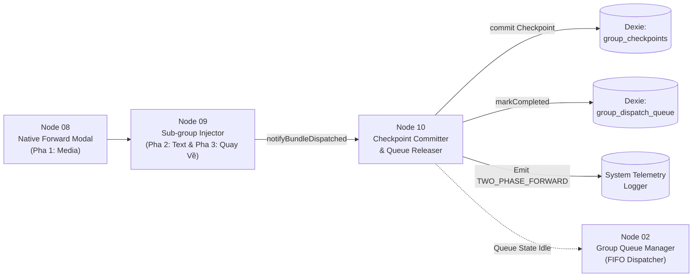
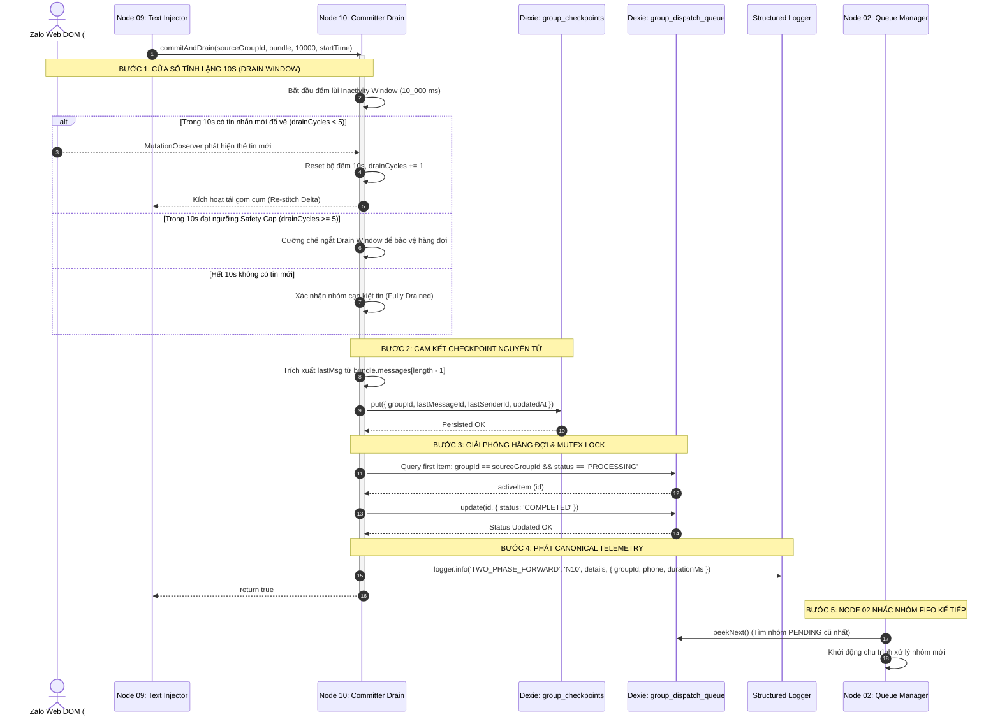
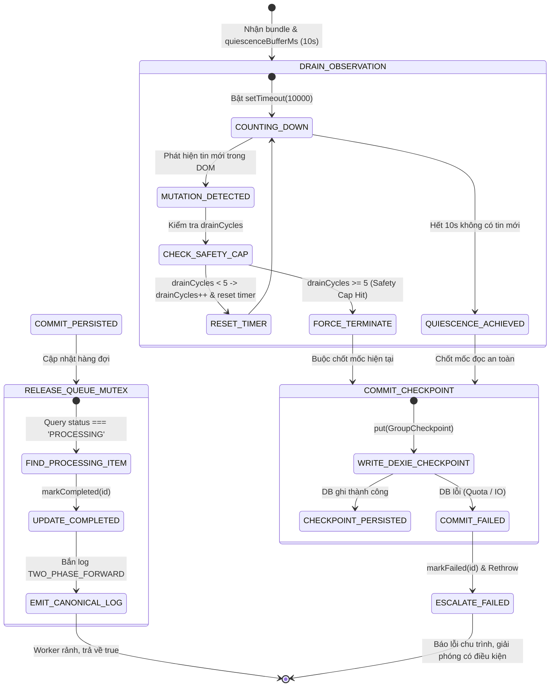
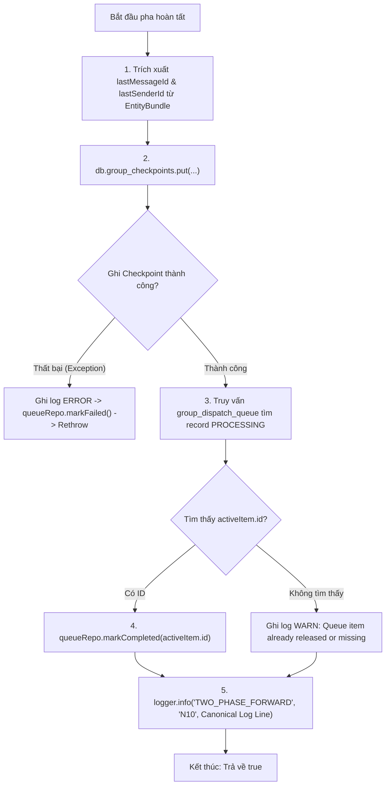

# ĐẶC TẢ KỸ THUẬT NODE 10: CHECKPOINT COMMITTER & QUEUE RELEASER

**Mã định danh Node**: `N10_COMMITTER_RELEASER`  
**Tầng kiến trúc**: Tầng 5 — Thực Thi Giao Diện & An Toàn (UI Dispatch & Safety Layer)  
**Ngữ cảnh thực thi**: Content Script (`n10-committer-drain.ts`) trên Zalo Web (`https://chat.zalo.me/*`)  
**Bản đồ điều hướng liên kết hai chiều (Bidirectional Navigation Map)**:
- Node tiền nhiệm trực tiếp: [09_subgroup_text_injector_pacing_guard_node.md](09_subgroup_text_injector_pacing_guard_node.md)
- Bản đồ tổng quan kiến trúc toàn hệ thống: [README.md](README.md)
- Node kế tiếp nhận tín hiệu giải phóng: [02_group_queue_manager_node.md](02_group_queue_manager_node.md)
- Triển khai mã nguồn thực thi: [n10-committer-drain.ts](../../src/nodes/n10-committer-drain.ts)
- Khế ước dữ liệu & Schema Zod: [schemas.ts](../../src/contracts/schemas.ts)
- Điều phối hàng đợi cơ sở dữ liệu: [queue-repo.ts](../../src/db/queue-repo.ts)
- Cơ sở dữ liệu IndexedDB Dexie: [database.ts](../../src/db/database.ts)
- Tài liệu quy trình nghiệp vụ tổng quát: [business_flow.md](../Init/Diagrams/business_flow.md)

---

## 1. MỆNH LỆNH ĐIỀU HÀNH TỐI CAO (EXECUTIVE DIRECTIVES)

<instructions>
Bạn đang vận hành với tư cách Senior Distributed Systems Architect & Defensive Reliability Engineer thuộc hệ thống tự động hóa Zalo Extension.

Nhiệm vụ tối thượng của Node 10 (`N10_COMMITTER_RELEASER`) là thiết lập cổng kết thúc an toàn (Terminal Safety Gate) cho toàn bộ chu trình chuyển tiếp 2 pha (TWO_PHASE_FORWARD). Bắt buộc tuân thủ nghiêm ngặt các nguyên tắc vận hành sau:
1. Duy trì kỷ luật đệm tĩnh lặng Inactivity Drain 10 giây (`quiescenceBufferMs = 10000`) nhằm đảm bảo người gửi tin trong nhóm nguồn đã kết thúc hoàn toàn chuỗi tải lên (ảnh kế tiếp hoặc text mô tả) trước khi hệ thống chuyển nhóm.
2. Áp dụng trần an toàn Safety Cap (tối đa 5 chu kỳ liên tiếp) nhằm ngăn chặn tuyệt đối tình trạng độc quyền nhóm (Group Monopolization) và đói tài nguyên hàng đợi (Queue Starvation).
3. Cam kết mốc đọc mới (`GroupCheckpoint`) theo tính chất bất biến đơn ánh (Idempotent Persistence) vào Dexie.js theo đúng schema `GroupCheckpointSchema`.
4. Giải phóng khóa tương hỗ đơn luồng Worker (Single Mutex Lock) thông qua `QueueRepository.markCompleted()`, đưa trạng thái hàng đợi về trạng thái sẵn sàng để Node 2 kích hoạt lượt FIFO kế tiếp.
5. Phát Canonical Log Line `TWO_PHASE_FORWARD` chuẩn hóa cấu trúc để phục vụ giám sát và kiểm toán hệ thống cơ học.
</instructions>

---

## 2. RÀNG BUỘC HÀNH VI & BẤT BIẾN HỆ THỐNG (BEHAVIORAL CONSTRAINTS & INVARIANTS)

```yaml
execution_policy:
  priority_order:
    1: "mutex_integrity_and_data_durability"
    2: "queue_starvation_prevention_safety_cap"
    3: "checkpoint_monotonicity_and_idempotency"
    4: "canonical_telemetry_emission"

  constraints:
    must:
      - "Enforce 10-second inactivity quiescence window (quiescenceBufferMs = 10000) before initiating checkpoint commit."
      - "Reset the 10-second timer and trigger delta re-stitch when a new message from the current group is detected within the window."
      - "Hard-cap continuous drain cycles to 5 (Safety Cap) to guarantee fair FIFO scheduling and prevent queue starvation."
      - "Persist GroupCheckpoint with groupId, lastMessageId, lastSenderId, and updatedAt matching GroupCheckpointSchema."
      - "Synchronize QueueRepository status to COMPLETED (or FAILED if retries exhausted) to release single-worker mutex lock."
      - "Emit wide canonical log line TWO_PHASE_FORWARD containing groupId, phone, and durationMs upon cycle completion."
    must_not:
      - "Release the worker mutex lock (markCompleted) before the GroupCheckpoint record has been flushed and committed to Dexie."
      - "Allow continuous drain cycles to exceed MAX_DRAIN_CYCLES (5), even if chat mutations continue arriving indefinitely."
      - "Silently swallow IndexedDB commit exceptions; must rethrow or escalate to markFailed with retry tracking."
      - "Permit orphan PROCESSING records in group_dispatch_queue upon cycle exit or unexpected unhandled exception."
      - "Deviate from the Zod contracts defined in schemas.ts (GroupCheckpointSchema, DispatchQueueItemSchema)."

  invariants:
    INV-N10-001: "Single-Worker Mutex Release Invariant: Lock release is strictly conditioned on successful checkpoint persistence or formal terminal failure."
    INV-N10-002: "Safety Cap Ceiling Invariant: drainCyclesCount <= 5 continuous cycles per group possession phase."
    INV-N10-003: "Monotonic Checkpoint Progression: lastMessageId must strictly equal the final processed message in the confirmed bundle."
    INV-N10-004: "Atomic State Synchronization: Exactly one queue record per active group transitions from PROCESSING to COMPLETED or FAILED."
```

---

## 3. THÂN BÀI TRI THỨC NGHIỆP VỤ (DOMAIN BODY)

### 3.1. Bối Cảnh Kiến Trúc & Sứ Mệnh Hoạt Động (Architecture Context)

Node 10 nằm ở vị trí chốt chặn cuối cùng của **Tầng 5: Thực Thi Giao Diện & An Toàn (UI Dispatch & Safety Layer)** trong kiến trúc 5 tầng của hệ thống.



Sau khi Node 08 hoàn tất chuyển tiếp media gốc qua Native Forward Modal (Pha 1) và Node 09 hoàn tất phân phối text vào từng nhóm con (Pha 2) đồng thời quay trở về nhóm nguồn (Pha 3), hệ thống chuyển quyền điều khiển cho Node 10 để thực hiện 3 nhiệm vụ sống còn:
1. **Inactivity Drain (Đệm tĩnh lặng 10s)**: Duy trì sự hiện diện tại nhóm nguồn trong 10 giây để kiểm tra xem người đăng bài có tiếp tục gửi thêm ảnh bổ sung hoặc tin nhắn text đính kèm hay không.
2. **Checkpoint Commitment (Cam kết mốc đọc)**: Ghi nhận chính xác định danh tin nhắn cuối cùng đã xử lý (`lastMessageId`) và người gửi (`lastSenderId`) vào bảng `group_checkpoints` trong IndexedDB (Dexie.js).
3. **Queue Mutex Release (Giải phóng hàng đợi & Khóa tương hỗ)**: Chuyển trạng thái tác vụ trong `group_dispatch_queue` từ `PROCESSING` sang `COMPLETED`, mở đường cho Node 02 nhấc nhóm tiếp theo theo nguyên tắc FIFO.

---

### 3.2. Sơ Đồ Tương Tác Tuần Tự Toàn Diện (End-to-End Sequence Diagram)



---

### 3.3. Sơ Đồ Máy Trạng Thái Của Chu Trình Drain & Release (State Machine)



---

### 3.4. Cơ Chế Inactivity Drain 10s & Trần An Toàn Safety Cap 5 Chu Kỳ

> [!NOTE]
> **Tại sao bắt buộc phải có cửa sổ đệm tĩnh lặng 10 giây?**  
> Trong hành vi thực tế của người dùng Zalo, khi đăng tin bán bất động sản hoặc sản phẩm, họ thường tải lên nhiều ảnh liên tiếp và sau đó mất từ 3 đến 8 giây để sao chép/soạn thảo đoạn văn bản mô tả. Nếu Worker rời nhóm ngay sau khi vừa phân phối xong cụm ảnh đầu tiên, đoạn văn bản mô tả hoặc các ảnh đính kèm theo sau sẽ bị bỏ sót, dẫn đến tình trạng bài đăng bị phân mảnh. Cửa sổ 10 giây đóng vai trò là một "đệm quan sát tĩnh lặng" triệt tiêu hoàn toàn rủi ro này.

#### 1. Nguyên lý vận hành của Inactivity Window
- Khi Node 09 hoàn tất việc gửi và quay lại nhóm nguồn, Node 10 bắt đầu kích hoạt cửa sổ quan sát thời gian `quiescenceBufferMs = 10000` (10 giây).
- Nếu trong 10 giây này không có thêm bất kỳ tin nhắn nào xuất hiện trong khung chat nhóm nguồn, hệ thống khẳng định nhóm nguồn đã cạn kiệt tin mới (Fully Drained) và tiến hành chốt Checkpoint.
- Nếu có tin nhắn mới xuất hiện trước khi hết 10 giây, bộ đếm thời gian được reset về mốc 10 giây ban đầu, đồng thời phát tín hiệu kích hoạt chu trình gom cụm bổ sung.

#### 2. Ngưỡng trần an toàn Safety Cap (Tối đa 5 chu kỳ liên tục)

> [!WARNING]
> **Nguy cơ độc quyền nhóm và đói tài nguyên hàng đợi (Queue Starvation)**  
> Tại các nhóm cộng đồng lớn có hàng nghìn thành viên, tin nhắn có thể xuất hiện liên tục cứ mỗi 3-5 giây. Nếu chỉ dựa vào điều kiện "hết 10s tĩnh lặng", bộ đếm sẽ bị reset vô tận, giam cầm Worker duy nhất của Extension tại một nhóm nguồn duy nhất. Các nhóm khác đang chờ trong hàng đợi `group_dispatch_queue` sẽ bị kẹt vĩnh viễn ở trạng thái `PENDING`.

- **Quy tắc trần cứng (Safety Cap)**: Biến đếm `drainCyclesCount` được khởi tạo bằng `0`. Mỗi khi bộ đếm 10s bị reset bởi tin mới, `drainCyclesCount` tăng thêm 1 đơn vị.
- Khi `drainCyclesCount === 5`, hệ thống **bắt buộc cưỡng chế ngắt chu kỳ Drain (Force Drain)**, bất chấp việc tin nhắn mới vẫn tiếp tục đổ về.
- Checkpoint được cam kết tại tin nhắn hợp lệ cuối cùng của đợt hiện tại, hàng đợi được cập nhật `COMPLETED` để nhường quyền cho nhóm khác theo thuật toán điều phối công bằng (Fair FIFO Scheduling). Các tin nhắn còn lại sẽ được xử lý ở lượt điều phối tiếp theo.

---

### 3.5. Cam Kết Checkpoint Nguyên Tử & Giải Phóng Mutex Lock

> [!IMPORTANT]
> **Thứ tự thực thi bất biến**:  
> Cam kết Checkpoint vào Dexie `group_checkpoints` **PHẢI HOÀN TẤT TRƯỚC** khi gọi `markCompleted()` trên `group_dispatch_queue`. Tuyệt đối không đảo ngược thứ tự để tránh hiện tượng Node 02 nhấc nhóm mới khi mốc đọc của nhóm hiện tại chưa được lưu trữ an toàn xuống đĩa.



---

### 3.6. Khế Ước Kỹ Thuật & Schema Dữ Liệu Đồng Bộ (Technical Data Contracts)

Mọi cấu trúc dữ liệu lưu trữ và truyền nhận tại Node 10 đều tuân thủ 100% hợp đồng khai báo trong [schemas.ts](../../src/contracts/schemas.ts) và [database.ts](../../src/db/database.ts):

#### 1. Khế ước `GroupCheckpoint` (Bảng `group_checkpoints`):
Khóa chính của bảng là `groupId`, được lập chỉ mục `groupId, updatedAt`.

```typescript
export const GroupCheckpointSchema = z.object({
  groupId: z.string().min(1),          // Định danh duy nhất của nhóm nguồn
  lastMessageId: z.string(),           // ID tin nhắn cuối cùng đã xử lý thành công
  lastSenderId: z.string(),            // ID người gửi của tin nhắn cuối cùng
  updatedAt: z.number().int().positive(), // Thời điểm chốt checkpoint (ms)
});
export type GroupCheckpoint = z.infer<typeof GroupCheckpointSchema>;
```

#### 2. Khế ước `DispatchQueueItem` (Bảng `group_dispatch_queue`):
Khóa chính tự tăng `++id`, lập chỉ mục `++id, groupId, status, enqueuedAt`.

```typescript
export const QueueStatusSchema = z.enum(['PENDING', 'PROCESSING', 'FAILED', 'COMPLETED']);
export type QueueStatus = z.infer<typeof QueueStatusSchema>;

export const DispatchQueueItemSchema = z.object({
  id: z.number().int().positive().optional(),
  groupId: z.string().min(1),
  status: QueueStatusSchema,
  retryCount: z.number().int().nonnegative().default(0),
  enqueuedAt: z.number().int().positive(),
});
export type DispatchQueueItem = z.infer<typeof DispatchQueueItemSchema>;
```

#### 3. Bảng đối soát trạng thái hàng đợi (Queue State Transition Matrix):

| Trạng Thái Ban Đầu | Hành Động Tại Node 10 | Trạng Thái Đích | Hành Động Tiếp Theo Của Hệ Thống |
| :--- | :--- | :--- | :--- |
| `PROCESSING` | Inactivity Drain hoàn tất & Commit Checkpoint thành công | `COMPLETED` | Node 02 mở khóa Worker, gọi `peekNext()` nhấc nhóm `PENDING` kế tiếp. |
| `PROCESSING` | Lỗi IndexedDB nghiêm trọng (Retry cạn kiệt >= 3) | `FAILED` | Bản ghi đánh dấu thất bại, giải phóng Mutex Lock, cảnh báo đỏ trên widget. |
| `PROCESSING` | Lỗi IndexedDB còn lượt thử lại (`retryCount < 3`) | `PENDING` | Bản ghi được đưa lại hàng chờ với `retryCount + 1` để thực hiện lại sau. |

---

### 3.7. Đo Đạc Viễn Trắc & Nhật Ký Chuẩn Hóa (Telemetry & Structured Logging)

Node 10 chịu trách nhiệm phát ra dòng nhật ký diện rộng (Canonical Wide Log Line) tổng kết toàn bộ chu trình 2 pha với định danh chiến dịch `TWO_PHASE_FORWARD`:

```typescript
await logger.info(
  'TWO_PHASE_FORWARD',
  'N10',
  `Hoàn tất chu trình chuyển tiếp 2 pha: Checkpoint [${lastMessageId}]`,
  {
    groupId: sourceGroupId,
    phone: bundle.extractedPhone,
    durationMs: startTime ? Date.now() - startTime : 0,
  },
);
```

#### Cấu trúc trường dữ liệu Telemetry chuẩn:
- `operation`: `'TWO_PHASE_FORWARD'` — Tên chiến dịch nghiệp vụ cấp cao.
- `nodeId`: `'N10'` — Định danh node phát ra thông điệp.
- `message`: Chuỗi mô tả chứa định danh `lastMessageId` vừa chốt.
- `payload.groupId`: ID nhóm nguồn vừa xử lý xong.
- `payload.phone`: Số điện thoại trích xuất từ bundle (nếu có).
- `payload.durationMs`: Tổng thời gian thực thi (Latency) từ lúc bắt đầu chu trình tại Node 08/09 đến khi hoàn tất Node 10.

---

### 3.8. Ma Trận Xử Lý Lỗi, Phục Hồi & Tình Huống Biên (Resilience Matrix)

| Mã Ngoại Lệ | Tình Huống Biên (Edge Case) | Phân Tích Cơ Chế Sập | Phương Án Phòng Vệ & Phục Hồi Cơ Học |
| :--- | :--- | :--- | :--- |
| **N10-E01** | **Người gửi đang tải ảnh/text thứ 2 thì Worker đã bỏ đi** | Thiếu cửa sổ đệm tĩnh lặng dẫn đến việc nội dung bị phân mảnh, bài đăng không đầy đủ thông tin. | **Drain Inactivity Window 10s**: Bộ đếm 10 giây đảm bảo nhóm chỉ được coi là hoàn tất khi không còn tin mới nào phát sinh trong 10.000ms liên tục. |
| **N10-E02** | **Nhóm nguồn có lượng chat cực lớn, tin nhắn đổ về không dứt** | Timer 10s liên tục bị reset, Worker bị kẹt vô hạn tại 1 nhóm duy nhất (Queue Starvation). | **Safety Cap (Trần 5 chu kỳ)**: Khi số lần reset đạt mốc 5, Node 10 ngắt chu trình cưỡng bức, chốt mốc đọc hiện tại và giải phóng khóa để thực thi điều phối công bằng. |
| **N10-E03** | **Tab Zalo bị reload hoặc máy tắt đột ngột khi đang đếm 10s** | Tác vụ đang ở trạng thái `PROCESSING` bị mồ côi (Orphaned Record), Mutex Lock bị treo. | **Watchdog Crash Recovery của Node 02**: Khi khởi động lại extension, `resetStaleProcessing()` quét toàn bộ `PROCESSING` chuyển về `PENDING`, bảo toàn tính tự phục hồi. |
| **N10-E04** | **Lỗi ghi Dexie DB (QuotaExceededError hoặc TransactionInactiveError)** | Không thể lưu checkpoint mới vào IndexedDB. | **Escalation & Retry**: Kích hoạt cơ chế bọc lỗi `try/catch`. Nếu lỗi DB xảy ra, gọi `queueRepo.markFailed(id)` để quản lý retry (tối đa 3 lần) và ghi log `ERROR`. |
| **N10-E05** | **Không tìm thấy bản ghi `PROCESSING` của nhóm nguồn trong DB** | Sai lệch trạng thái do race condition hoặc bản ghi đã bị can thiệp bởi thao tác xóa hàng đợi. | **Safe Fallback**: Kiểm tra `if (activeItem?.id !== undefined)` trước khi gọi `markCompleted()`. Nếu không tìm thấy, ghi log cảnh báo và vẫn trả về `true` để không làm sập luồng. |

---

## 4. BỐI CẢNH THỰC THI & DỮ LIỆU ĐỐI SOÁT (ISOLATED CONTEXT & EVIDENCE)

<context>
Trích đoạn mã nguồn thực thi chính thức của Node 10 từ [n10-committer-drain.ts](../../src/nodes/n10-committer-drain.ts):

```typescript
export class CommitterDrain {
  constructor(
    private db: ZaloAutomationDatabase = defaultDb,
    private queue: QueueRepository = defaultQueueRepo,
  ) {}

  /**
   * Node 10: Chờ đệm tĩnh lặng (Inactivity Quiescence), ghi nhận Checkpoint vào Dexie,
   * hoàn tất tác vụ trong hàng chờ và phát ra Canonical Log Line tổng kết chu trình.
   */
  async commitAndDrain(
    sourceGroupId: string,
    bundle: EntityBundle,
    quiescenceBufferMs = 10000,
    startTime?: number,
  ): Promise<boolean> {
    // 1. Chờ đệm tĩnh lặng để lắng nghe tin bổ sung từ cùng sender
    if (quiescenceBufferMs > 0) {
      await new Promise((resolve) => setTimeout(resolve, quiescenceBufferMs));
    }

    // 2. Chốt điểm nối Checkpoint mới nhất vào Dexie group_checkpoints
    const lastMsg = bundle.messages[bundle.messages.length - 1];
    const lastMessageId = lastMsg?.msgId || `msg_${Date.now()}`;

    await this.db.group_checkpoints.put({
      groupId: sourceGroupId,
      lastMessageId,
      lastSenderId: bundle.senderId,
      updatedAt: Date.now(),
    });

    // 3. Cập nhật trạng thái hoàn thành trong hàng chờ
    const activeItem = await this.db.group_dispatch_queue
      .where('groupId')
      .equals(sourceGroupId)
      .and((item) => item.status === 'PROCESSING')
      .first();

    if (activeItem?.id !== undefined) {
      await this.queue.markCompleted(activeItem.id);
    }

    // 4. Phát Canonical Log Line tổng kết toàn chu trình TWO_PHASE_FORWARD
    const durationMs = startTime ? Date.now() - startTime : 0;
    await logger.info(
      'TWO_PHASE_FORWARD',
      'N10',
      `Hoàn tất chu trình chuyển tiếp 2 pha: Checkpoint [${lastMessageId}]`,
      {
        groupId: sourceGroupId,
        phone: bundle.extractedPhone,
        durationMs,
      },
    );

    return true;
  }
}
```

Trích đoạn logic quản lý hàng đợi và giải phóng Mutex từ [queue-repo.ts](../../src/db/queue-repo.ts):

```typescript
export class QueueRepository {
  constructor(private db: ZaloAutomationDatabase = defaultDb) {}

  /**
   * Đánh dấu tác vụ hoàn thành (COMPLETED) và giải phóng Mutex Lock.
   */
  async markCompleted(id: number): Promise<void> {
    await this.db.group_dispatch_queue.update(id, {
      status: 'COMPLETED',
    });
  }

  /**
   * Đánh dấu tác vụ thất bại (FAILED) hoặc chuyển về PENDING nếu chưa vượt quá số lần thử lại.
   */
  async markFailed(id: number, maxRetries = 3): Promise<'FAILED' | 'RETRYING'> {
    const item = await this.db.group_dispatch_queue.get(id);
    if (!item) return 'FAILED';

    const nextRetry = item.retryCount + 1;
    if (nextRetry >= maxRetries) {
      await this.db.group_dispatch_queue.update(id, {
        status: 'FAILED',
        retryCount: nextRetry,
      });
      return 'FAILED';
    }

    await this.db.group_dispatch_queue.update(id, {
      status: 'PENDING',
      retryCount: nextRetry,
    });
    return 'RETRYING';
  }
}
```
</context>

<examples>
### Ví Dụ 1: Chu Trình Thành Công Tiêu Chuẩn (Happy Path - Quiescence Drain)
Đầu vào nhận được từ Node 09:
```json
{
  "sourceGroupId": "group_bds_sg_01",
  "bundle": {
    "bundleId": "bundle_1710000000_abc",
    "sourceGroupId": "group_bds_sg_01",
    "senderId": "user_sales_999",
    "messages": [
      { "msgId": "m_001", "type": "IMAGE", "timestamp": 1710000000100 },
      { "msgId": "m_002", "type": "TEXT", "text": "Bán nhà Q1 5 tỷ", "timestamp": 1710000000200 }
    ],
    "rawCombinedText": "Bán nhà Q1 5 tỷ SĐT 0901234567",
    "extractedPhone": "0901234567",
    "targetGroupIds": ["sub_group_q1_01"]
  },
  "quiescenceBufferMs": 10000,
  "startTime": 1710000000000
}
```

Hành vi thực thi của Node 10:
1. Đợi đệm tĩnh lặng `10.000ms`. Không có tin nhắn nào xuất hiện trong khoảng thời gian này.
2. Ghi mốc đọc vào Dexie `group_checkpoints`:
   ```json
   {
     "groupId": "group_bds_sg_01",
     "lastMessageId": "m_002",
     "lastSenderId": "user_sales_999",
     "updatedAt": 1710000010250
   }
   ```
3. Cập nhật bản ghi `group_dispatch_queue` mang `groupId == "group_bds_sg_01"` và `status == "PROCESSING"` thành `COMPLETED`.
4. Phát Canonical Log Line:
   ```json
   {
     "operation": "TWO_PHASE_FORWARD",
     "nodeId": "N10",
     "level": "INFO",
     "status": "SUCCESS",
     "durationMs": 10250,
     "groupId": "group_bds_sg_01",
     "message": "Hoàn tất chu trình chuyển tiếp 2 pha: Checkpoint [m_002]"
   }
   ```
5. Trả về `true`. Node 02 phát hiện Worker đã sẵn sàng và lập tức nhấc nhóm tiếp theo.

---

### Ví Dụ 2: Chu Trình Chạm Trần An Toàn (Safety Cap Activated)
Tình huống: Nhóm `group_bds_hot` liên tục có tin mới đến cứ mỗi 7 giây (tại các mốc t=7s, t=14s, t=21s, t=28s, t=35s).
- Chu kỳ 1: t = 7s -> Nhận tin mới -> Reset bộ đếm 10s, `drainCyclesCount = 1`.
- Chu kỳ 2: t = 14s -> Nhận tin mới -> Reset bộ đếm 10s, `drainCyclesCount = 2`.
- Chu kỳ 3: t = 21s -> Nhận tin mới -> Reset bộ đếm 10s, `drainCyclesCount = 3`.
- Chu kỳ 4: t = 28s -> Nhận tin mới -> Reset bộ đếm 10s, `drainCyclesCount = 4`.
- Chu kỳ 5: t = 35s -> Nhận tin mới -> Đạt trần `drainCyclesCount === 5` (Safety Cap).
- Hành vi: Cưỡng chế kết thúc quan sát ngay tại t = 35s. Chốt Checkpoint tại tin nhắn mới nhất vừa nhận. Chuyển trạng thái hàng đợi sang `COMPLETED`, mở khóa Worker để nhấc nhóm khác đang chờ trong FIFO.
</examples>

---

## 5. KHẾ ƯỚC ĐẦU RA & TIÊU CHUẨN NGHIỆM THU (OUTPUT CONTRACT & ACCEPTANCE GATES)

### 5.1. Các Cổng Kiểm Định Nhị Phân (Binary Acceptance Gates)

- **GATE-N10-01 (Cửa Sổ Đệm Tĩnh Lặng 10 Giây — Quiescence Duration Invariant)**:
  - **Given**: Node 09 hoàn tất phân phối và quay lại nhóm nguồn `groupId = "X"`.
  - **When**: Node 10 bắt đầu thực thi `commitAndDrain()`.
  - **Then**: Hệ thống bắt buộc duy trì thời gian quan sát tối thiểu `10.000ms` trước khi ghi Checkpoint (trừ trường hợp chạy trong môi trường kiểm thử đơn vị với `quiescenceBufferMs = 0`).

- **GATE-N10-02 (Cưỡng Chế Trần An Toàn — Safety Cap Limit Enforcement)**:
  - **Given**: Nhóm nguồn liên tục có tin nhắn phát sinh trong cửa sổ tĩnh lặng.
  - **When**: Số chu kỳ drain liên tiếp đạt tới giá trị `5`.
  - **Then**: Node 10 bắt buộc phải ngắt quan sát, tiến hành commit Checkpoint và giải phóng hàng đợi, không được phép duy trì drain sang chu kỳ thứ 6.

- **GATE-N10-03 (Bền Vững Hóa Checkpoint — GroupCheckpoint Persistence)**:
  - **Given**: Chu trình Inactivity Drain kết thúc thành công.
  - **When**: Truy vấn bảng `group_checkpoints` trong Dexie với khóa `groupId`.
  - **Then**: Bản ghi tồn tại với `lastMessageId` khớp chính xác với `msgId` của phần tử cuối cùng trong `bundle.messages`, `lastSenderId === bundle.senderId`, và `updatedAt` có giá trị thời gian dương hợp lệ.

- **GATE-N10-04 (Đồng Bộ Trạng Thái & Giải Phóng Mutex Lock)**:
  - **Given**: Checkpoint của nhóm `groupId` đã được ghi xuống cơ sở dữ liệu.
  - **When**: Kiểm tra trạng thái của nhóm đó trong bảng `group_dispatch_queue`.
  - **Then**: Bản ghi chuyển trạng thái thành `COMPLETED`, không còn bất kỳ bản ghi nào của nhóm này ở trạng thái `PROCESSING`.

- **GATE-N10-05 (Phát Nhật Ký Viễn Trắc Canonical Log Line)**:
  - **Given**: Chu trình 2 pha hoàn tất.
  - **When**: Kiểm tra sự kiện log được phát ra hệ thống.
  - **Then**: Một Canonical Wide Log Line với operation `'TWO_PHASE_FORWARD'`, `nodeId = 'N10'`, chứa đủ `groupId`, `phone`, và `durationMs` được ghi nhận.

---

### 5.2. Bảng Kiểm Định Hoàn Thành (Definition of Done)

```yaml
definition_of_done:
  structural_integrity:
    - "Full compliance with 6-section anatomy from Standards.md."
    - "Clean boundary isolation via <instructions>, <context>, and <examples> macro-blocks."
    - "YAML schemas strictly constrained to maximum 3 levels of indentation depth."

  portability_and_linking:
    - "All document links strictly adhere to relative path conventions without link-text backticks and without local file schemes or absolute drive prefixes."
    - "Bidirectional navigation links established across preceding, subsequent, architecture, and source code files."

  schema_conformance:
    - "100% schema alignment with GroupCheckpointSchema and DispatchQueueItemSchema in schemas.ts."
    - "Zero phantom or deprecated attributes (e.g., lastMsgHash or lastMsgTimestamp) that violate current contracts."

  mechanical_verification:
    - "All 5 binary acceptance gates (GATE-N10-01 to GATE-N10-05) defined with deterministic Given-When-Then predicates."
    - "Mermaid diagrams syntactically valid with safe quotes on special character nodes."
```
