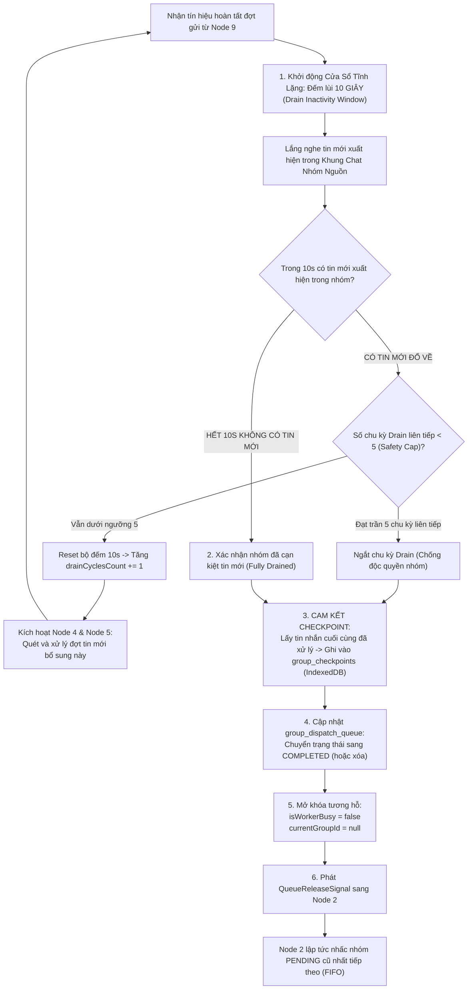

# ĐẶC TẢ CHI TIẾT NODE 10: CHECKPOINT COMMITTER & QUEUE RELEASER

**Mã định danh Node**: `N10_COMMITTER_RELEASER`  
**Tầng kiến trúc**: Tầng 5 — Thực Thi Giao Diện & An Toàn (UI Dispatch & Safety Layer)  
**Ngữ cảnh thực thi**: Content Script (`content-script.ts`) trên Zalo Web (`https://chat.zalo.me/*`)  
**Tài liệu tham chiếu**:
- [business_flow.md](file:///c:/Users/ADMIN/Documents/workspace/Sales/EXTENSIONS/Docs/Init/Diagrams/business_flow.md)
- [tai_lieu_thiet_ke_so_bo_zalo_automation.md](file:///c:/Users/ADMIN/Documents/workspace/Sales/EXTENSIONS/Docs/Init/tai_lieu_thiet_ke_so_bo_zalo_automation.md)
- [he_thong_tu_dong_hoa_zalo_extension_spec.md](file:///c:/Users/ADMIN/Documents/workspace/Sales/EXTENSIONS/Docs/Init/he_thong_tu_dong_hoa_zalo_extension_spec.md)

---

## 1. MỤC TIÊU & PHẠM VI (NODE OBJECTIVE & SCOPE)

### 1.1. Mục tiêu Cốt lõi
- Tiếp nhận tín hiệu từ Node 9 sau khi đã phân phối thành công toàn bộ các cụm đối tượng (`EntityBundle`) trong đợt quét hiện tại của Nhóm Nguồn.
- Thực thi **Cơ chế Xử lý Cạn kiệt với Đệm Tĩnh lặng (Drain-with-10s-Quiet-Window)**:
  - Khi đã xử lý xong các tin hiện có, Worker không vội vàng rời nhóm ngay mà duy trì một cửa sổ quan sát đếm lùi **10 giây (Inactivity Timeout)** tại Nhóm Nguồn.
  - Nếu trong 10 giây có tin mới phát sinh trong nhóm ➔ Tự động reset bộ đếm và kích hoạt vòng quét mới (Node 4 & Node 5) để xử lý dứt điểm đợt tin bổ sung đó trước khi chuyển nhóm.
  - Nếu hết 10 giây không có thêm tin mới ➔ Xác nhận nhóm đã được xử lý triệt để (Drained).
- **Cam kết Mốc Đọc Mới (Checkpoint Committer)**: Ghi nhận chính thức tin nhắn cuối cùng đã xử lý (`lastMsgId`, `lastMsgHash`, `lastMsgTimestamp`) vào bảng `group_checkpoints` trong IndexedDB (Dexie.js).
- **Giải phóng Khóa Tương hỗ & Luân chuyển Hàng đợi (Queue Releaser)**:
  - Cập nhật trạng thái bản ghi trong bảng `group_dispatch_queue` thành `COMPLETED` (hoặc xóa khỏi hàng đợi).
  - Mở khóa tương hỗ: Đặt lại cờ `isWorkerBusy = false`.
  - Phát tín hiệu giải phóng (`QueueReleaseSignal`) để Node 2 (Queue Manager) nhấc nhóm `PENDING` cũ nhất tiếp theo trong hàng đợi FIFO.

### 1.2. Ranh giới & Không gian Phủ định (In-Scope vs Negative Scope)
- **Trong phạm vi (In-Scope)**:
  - Quản lý bộ đếm lùi Inactivity Window 10 giây bằng `setTimeout` có khả năng reset khi có mutation tin mới.
  - Thiết lập trần an toàn chống độc quyền nhóm (**Safety Cap: Tối đa 5 chu kỳ drain liên tiếp**) để chống đói tài nguyên hàng đợi (Queue Starvation).
  - Cập nhật atomic các bảng `group_checkpoints` và `group_dispatch_queue` trong Dexie.js.
  - Báo cáo hoàn tất chu trình cho Node 2.
- **Ranh giới cấm (Negative Scope - CẤM TUYỆT ĐỐI)**:
  - **CẤM** rời nhóm ngay lập tức khi vừa gửi xong bài cuối (bắt buộc phải qua cửa sổ đệm tĩnh lặng 10s để tránh việc người đăng đang gửi tiếp ảnh thứ 2/3 thì Worker đã bỏ đi).
  - **CẤM** ghi đè Checkpoint bằng một mốc tin nhắn chưa được xác nhận chuyển tiếp thành công (bảo đảm tính Bất biến & Idempotency).
  - **CẤM** giải phóng khóa `isWorkerBusy` khi quá trình ghi dữ liệu IndexedDB chưa hoàn tất (tránh race condition).

---

## 2. HỢP ĐỒNG KỸ THUẬT & DỮ LIỆU (INPUT/OUTPUT CONTRACTS)

### 2.1. Bản Ghi Checkpoint Lưu Trữ (`GroupCheckpoint`)
Lưu tại bảng `group_checkpoints` (Dexie.js):

```typescript
export interface GroupCheckpoint {
  groupId: string;             // Khóa chính: ID nhóm nguồn
  groupName: string;           // Tên nhóm nguồn
  lastMsgId: string;           // ID của tin nhắn mới nhất trong nhóm đã xử lý
  lastMsgHash: string;         // SHA-256 chuỗi văn bản của tin nhắn mới nhất
  lastMsgTimestamp: number;    // Thời gian của tin nhắn mới nhất (ms)
  updatedAt: number;           // Thời điểm cập nhật checkpoint (ms)
}
```

### 2.2. Tín Hiệu Giải Phóng Hàng Đợi Đầu Ra (`QueueReleaseSignal`)
Phát sang Node 2 (Queue Manager):

```typescript
export interface QueueReleaseSignal {
  releasedGroupId: string;
  releasedGroupName: string;
  totalBundlesProcessed: number;
  drainCyclesCount: number;
  finalCheckpoint: GroupCheckpoint;
  status: 'COMPLETED';
  completedAt: number;
  nextAction: 'POP_NEXT_FIFO';
}
```

---

## 3. LUỒNG XỬ LÝ CHI TIẾT & STATE MACHINE (EXECUTION ALGORITHM)

### 3.1. Sơ đồ Luồng Đệm Tĩnh Lặng 10s & Cam Kết Checkpoint (Drain Flowchart)



### 3.2. Thuật toán Quản lý Cửa Sổ Drain 10s Chi tiết
```typescript
export class DrainInactivityManager {
  private timer: NodeJS.Timeout | null = null;
  private readonly DRAIN_DURATION_MS = 10_000; // 10 giây
  private drainCycles = 0;
  private readonly MAX_DRAIN_CYCLES = 5;

  public async startDrainWindow(
    groupId: string,
    groupName: string,
    lastProcessedMsg: RawChatMessage,
    onNewMessagesDetected: () => Promise<void>,
    onDrainComplete: (checkpoint: GroupCheckpoint) => Promise<void>
  ): Promise<void> {
    return new Promise((resolve) => {
      this.drainCycles = 0;

      const scheduleDrain = () => {
        if (this.timer) clearTimeout(this.timer);

        this.timer = setTimeout(async () => {
          // Hết 10s không có tin mới -> Hoàn tất
          const checkpoint: GroupCheckpoint = {
            groupId,
            groupName,
            lastMsgId: lastProcessedMsg.msgId,
            lastMsgHash: lastProcessedMsg.textHash,
            lastMsgTimestamp: lastProcessedMsg.timestamp,
            updatedAt: Date.now()
          };
          await onDrainComplete(checkpoint);
          resolve();
        }, this.DRAIN_DURATION_MS);
      };

      // Đăng ký bộ lắng nghe DOM trong khung chat nhóm hiện tại
      const chatBox = document.querySelector('#chatView .chat-message-list');
      const observer = new MutationObserver(async (mutations) => {
        const hasNewNodes = mutations.some(m => m.addedNodes.length > 0);
        if (hasNewNodes) {
          if (this.drainCycles < this.MAX_DRAIN_CYCLES) {
            this.drainCycles += 1;
            if (this.timer) clearTimeout(this.timer);
            observer.disconnect(); // Tạm dừng observer khi đang xử lý tin mới
            await onNewMessagesDetected(); // Xử lý đợt tin mới
            // Sau khi xử lý xong đợt tin mới, bật lại drain window
            observer.observe(chatBox!, { childList: true });
            scheduleDrain();
          } else {
            // Vượt quá trần 5 chu kỳ -> Bắt buộc kết thúc
            if (this.timer) clearTimeout(this.timer);
            observer.disconnect();
            const checkpoint: GroupCheckpoint = {
              groupId,
              groupName,
              lastMsgId: lastProcessedMsg.msgId,
              lastMsgHash: lastProcessedMsg.textHash,
              lastMsgTimestamp: lastProcessedMsg.timestamp,
              updatedAt: Date.now()
            };
            await onDrainComplete(checkpoint);
            resolve();
          }
        }
      });

      if (chatBox) {
        observer.observe(chatBox, { childList: true });
      }

      // Kích hoạt bộ đếm lần đầu
      scheduleDrain();
    });
  }
}
```

### 3.3. Thuật toán Cam kết Checkpoint & Giải phóng Khóa
```typescript
export async function commitAndReleaseGroup(
  checkpoint: GroupCheckpoint,
  db: ZaloAutomationDatabase,
  queueManager: QueueManager
): Promise<void> {
  // 1. Ghi Checkpoint mới vào IndexedDB
  await db.group_checkpoints.put(checkpoint);

  // 2. Cập nhật hàng đợi
  await db.group_dispatch_queue.update(checkpoint.groupId, {
    status: 'COMPLETED',
    lastActiveAt: Date.now()
  });

  // 3. Ghi log thành công
  await db.system_logs.add({
    level: 'INFO',
    eventType: 'GROUP_PROCESSING_COMPLETED',
    details: `Đã hoàn tất xử lý Nhóm [${checkpoint.groupName}]. Checkpoint cập nhật tại tin: ${checkpoint.lastMsgId}`,
    timestamp: Date.now()
  });

  // 4. Phát tín hiệu giải phóng mở khóa Worker
  queueManager.releaseGroup(checkpoint.groupId, 'COMPLETED');
}
```

---

## 4. XỬ LÝ LỖI, RETRY & EDGE CASES (RESILIENCE MATRIX)

| Mã Ngoại Lệ | Tình Huống Biên (Edge Case) | Phân Tích Kỹ Thuật | Phương Án Xử Lý & Phòng Vệ |
| :--- | :--- | :--- | :--- |
| **GATE-06** | **Rời nhóm quá sớm khi người đăng đang tải tiếp tin** | Người đăng gửi 3 ảnh lúc 09:00:00 và đang gõ text mô tả lúc 09:00:05. Nếu rời nhóm ngay sẽ bỏ sót đoạn mô tả. | **Drain Inactivity Window 10s**: Nhờ giữ đệm 10 giây, khi đoạn mô tả xuất hiện ở giây thứ 5, MutationObserver bắt được ngay và kích hoạt chu trình gom cụm tiếp theo, triệt tiêu hoàn toàn rủi ro sót tin. |
| **N10-E02** | **Nhóm nguồn có lượng chat cực lớn, tin nhắn đổ về vô tận** | Cứ sau 8 giây lại có 1 tin nhắn mới, làm bộ đếm 10s bị reset liên tục không bao giờ kết thúc (Queue Starvation). | **Safety Cap (Trần 5 chu kỳ liên tiếp)**: Nếu đã lặp lại quá 5 chu kỳ drain mà vẫn chưa hết tin, Node 10 cưỡng chế cam kết Checkpoint tại tin nhắn hiện tại, giải phóng nhóm và đẩy nhóm xuống cuối hàng đợi để nhấc nhóm khác lên (Fair Scheduling). |
| **N10-E03** | **Tab trình duyệt bị đóng đột ngột trong lúc đang đếm 10 giây** | Máy tính mất nguồn hoặc người dùng vô tình đóng tab Zalo. | Từng bài đăng hợp lệ trước đó đã được lưu an toàn trong bảng `entities`. Khi tab mở lại, Node 2 sẽ phục hồi nhóm về `PENDING`, và Node 4 sẽ dùng Checkpoint cũ để quét lại các tin còn dở dang. |
| **N10-E04** | **Lỗi ghi cơ sở dữ liệu IndexedDB khi cam kết Checkpoint** | Không thể cập nhật bảng `group_checkpoints` do quota đầy hoặc IO error. | Áp dụng cơ chế Retry ghi 3 lần. Nếu vẫn không thể ghi DB, lưu checkpoint vào `chrome.storage.local` làm kênh dự phòng và phát tín hiệu cảnh báo trên UI. |

---

## 5. PHỤ THUỘC KỸ THUẬT (TECHNICAL DEPENDENCIES)

1. **Cơ sở dữ liệu cục bộ (IndexedDB — Dexie.js)**:
   - Ghi bảng `group_checkpoints`: `&groupId, groupName, lastMsgId, lastMsgHash, lastMsgTimestamp, updatedAt`.
   - Cập nhật bảng `group_dispatch_queue`: `status = 'COMPLETED'`.
   - Ghi nhật ký vận hành vào bảng `system_logs`.
2. **Web APIs**:
   - `MutationObserver`: Giám sát sự xuất hiện của các thẻ DOM tin nhắn mới trong khung chat trong thời gian đếm 10 giây.
   - `setTimeout` / `clearTimeout`: Quản trị đồng hồ đếm lùi Inactivity Window.
3. **Module tương tác**:
   - Nhận tín hiệu kích hoạt: Từ Node 9 (`Subgroup Text Injector & Pacing Guard`).
   - Tái kích hoạt vòng lặp quét mới (nếu có tin mới): Gọi ngược lại Node 4 & Node 5.
   - Bàn giao kết thúc: Gọi `queueManager.releaseGroup()` của Node 2 (`Group Queue Manager`).

---

## 6. TIÊU CHÍ KIỂM THỬ & NGHIỆM THU (ACCEPTANCE CRITERIA / DoD)

### 6.1. Kịch bản Nghiệm thu Nhị phân (Binary Acceptance Gates)
- **GATE-06 (Cửa Sổ Tĩnh Lặng 10s Drain Inactivity Window)**:
  - **Given**: Worker đã gửi xong cụm tin cuối cùng trong Nhóm Nguồn.
  - **When**: Bắt đầu cửa sổ quan sát.
  - **Then**:
    1. Hệ thống phải giữ trạng thái quan sát trong đúng **10 giây**.
    2. Nếu trong 10 giây không có thêm tin nhắn nào xuất hiện ➔ Checkpoint được ghi và Worker mới được phép mở khóa chuyển sang nhóm tiếp theo.
- **AC-02 (Reset Bộ Đếm 10s Khi Có Tin Mới Bổ Sung)**:
  - **Given**: Đang ở giây thứ 6 của cửa sổ tĩnh lặng 10s.
  - **When**: Một tin nhắn mới xuất hiện trong khung chat của Nhóm Nguồn.
  - **Then**: Bộ đếm 10s bị reset ngay lập tức, Node 4 & Node 5 được kích hoạt để bóc tách đợt tin mới này.
- **AC-03 (Chống Độc Quyền Nhóm - Safety Cap Invariant)**:
  - **Given**: Nhóm Nguồn liên tục có tin mới đến ở giây thứ 8 sau mỗi đợt gửi.
  - **When**: Số chu kỳ drain đạt tới mốc `5`.
  - **Then**: Node 10 cưỡng chế ngắt chu trình, cập nhật Checkpoint và giải phóng khóa để nhấc nhóm khác trong FIFO, bảo đảm các nhóm khác không bị đói hàng đợi.
- **AC-04 (Tính Bền Vững Của Checkpoint)**:
  - **Given**: Chu trình xử lý Nhóm X hoàn tất.
  - **When**: Kiểm tra bảng `group_checkpoints` trong IndexedDB.
  - **Then**: Bản ghi của Nhóm X phải có `lastMsgId` khớp chính xác với ID của tin nhắn cuối cùng được xử lý trong nhóm đó.

